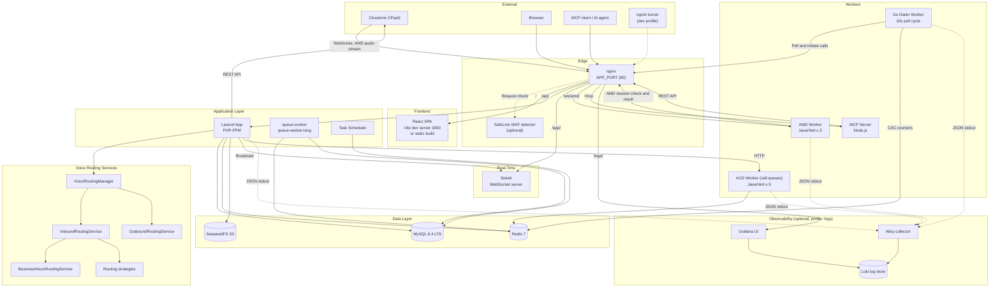
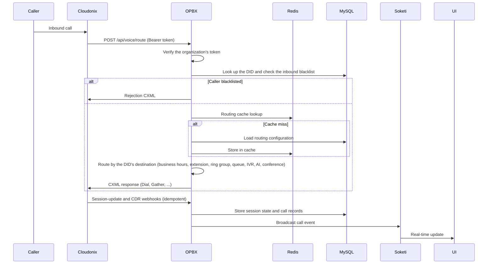
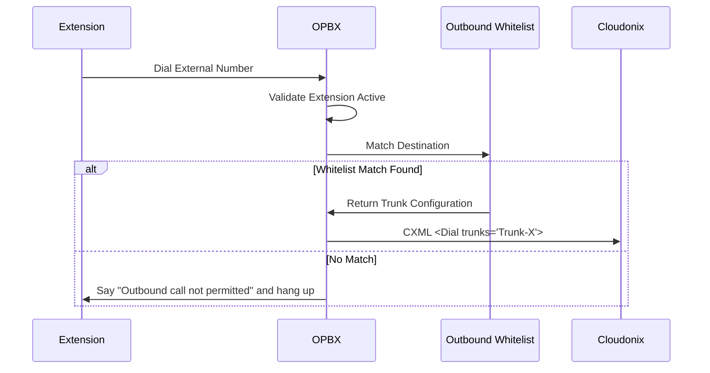

# OPBX - Open Source Business PBX

[](LICENSE.md)
[](https://laravel.com)
[](https://reactjs.org)
[](https://docs.docker.com/compose/)

A modern, containerized business PBX application built on top of the [Cloudonix CPaaS](https://cloudonix.com) platform. OPBX provides enterprise-grade call routing, ring groups, call queues, IVR menus, business hours management, AI assistant integration, a browser Web Phone, automated outbound dialing, and real-time call monitoring — all without the complexity of managing SIP infrastructure.

> **Documentation**: [User Guide](https://developers.cloudonix.com/opbx) | [REST API Reference](https://developers.cloudonix.com/opbxRestOpenAPI)

---

## Table of Contents

- [Features](#features)
- [Architecture](#architecture)
- [Built With](#built-with)
- [Installation](#installation)
- [Configuration](#configuration)
- [Security & Monitoring](#security--monitoring)
- [API Reference](#api-reference)
- [Testing](#testing)
- [Contributing](#contributing)
- [Credits](#credits)
- [License](#license)

---

## Features

### Call Routing & Management
- **Direct Extension Calling**: Extension-to-extension dialing with SIP URI generation
- **Outbound Calling**: E.164 international dialing with whitelist-based trunk routing
- **Ring Groups**: Distribute calls with simultaneous, round-robin, or sequential strategies
- **IVR Menus**: Interactive voice menus with DTMF input, TTS, and configurable destinations
- **Business Hours**: Time-based routing with weekly schedules, holiday exceptions, and public holiday import
- **AI Assistant Integration**: Route calls to 47 AI voice providers (42 over SIP, 5 over WebSocket)
- **AI Load Balancers**: Distribute calls across multiple AI assistants with round-robin, priority, or percentage strategies and automatic failover
- **Conference Rooms**: Multi-party conference calls with PIN protection, recording, and host waiting
- **Call Queues (ACD)**: FIFO queues run by a dedicated Java worker, with agent states, ring-all, round-robin, least-talk-time and fewest-calls strategies, a live view, queue reports and a public wallboard
- **Call Transfer**: Blind transfer from the Web Phone and the embedded dialer to an extension or number

### Auto Dialer (Outbound Campaigns)
- **Campaign Management**: Create, schedule, and monitor outbound calling campaigns
- **Distribution Lists**: CSV-based phone number lists with validation and versioning
- **Rate Limiting**: Concurrent Active Calls (CAC, 1-50) + Calls Per Second (CPS, 1-30) for precise call pacing
- **Answering Machine Detection**: Java/Vert.x 5 AMD worker with an ONNX model and energy-based tone detection for voicemail beeps
- **Campaign Destinations**: Answered calls go to an AI assistant, an AI load balancer, a ring group (dialing waits for an available agent) or a call queue
- **Caller ID Pooling**: Multi-DID caller ID rotation with round-robin, random, and LRU strategies
- **Real-Time Monitor**: Command-center dashboard with bird's-eye campaign cards and drill-down views
- **Go Dialer Worker**: Dedicated microservice for rate-limited call execution with Redis-based CAC counters
- **Campaign Scheduling**: Weekly calendar with per-day time ranges, timezone support, and date ranges

### Phone Number Management
- **DID Management**: Full support for Direct Inward Dialing numbers in E.164 format
- **Flexible Routing**: Route DIDs to extensions, ring groups, call queues, IVR menus, AI assistants, conference rooms, AI load balancers, or business hours schedules
- **Outbound Whitelist**: Control outbound calling with country/prefix-based rules and trunk selection
- **Inbound Blacklist**: Block unwanted callers with exact, prefix, or wildcard matching and configurable rejection strategies
- **Trunks**: Create and manage the organization's Cloudonix SIP trunks from OPBX

### Web Phone & Embedded Dialer
- **Web Phone**: In-browser softphone (WebRTC) for the signed-in user's extension: inbound ring and pop-up, in-call keypad (DTMF), recent calls, registration status, blind transfer
- **Web Phone Settings**: A Settings tab with auto-answer, keep-alive and refresh-on-hangup, stored in the user's Cloudonix subscriber profile
- **Embedded Dialer**: The same phone as a widget for third-party websites, authenticated by a per-user token, with a per-snippet "Allow call transfer" switch

### Real-Time Monitoring
- **Live Call Dashboard**: Real-time call presence via WebSockets with automatic stale record cleanup
- **Auto Dialer Monitor**: Real-time campaign monitoring with active calls, disposition pie charts, and KPI cards
- **AI Real Time Monitor**: Live call figures for every AI assistant and AI load balancer as a card wall with a slide-show refresh (AI Configuration > Real Time Monitor, Owner and PBX Admin)
- **Call Detail Records (CDR)**: Complete call history with search, filtering, and streaming CSV export; older records move to a warm archive (6 to 12 months) and then to compressed cold files kept 7 years by default
- **Call Statistics**: Volume, duration, and disposition metrics
- **Call Notifications**: Webhook-based notifications for call events with SSRF protection and retry logic
- **Platform Status**: Component health with a 24-hour history for platform managers, plus a public status page
- **Centralized Logging**: Optional Loki + Grafana stack aggregating structured logs from all services, with per-call audit trails searchable by Cloudonix session token ([docs](docs/LOG-AGGREGATION.md))

### Performance & Reliability
- **Redis Caching Layer**: 50-90% faster routing lookups with automatic cache invalidation
- **Idempotent Webhooks**: Redis-based deduplication prevents duplicate processing
- **Distributed Locking**: Prevents race conditions on concurrent calls
- **Queue Workers**: Async job processing for non-blocking operations
- **Service Architecture**: Modular voice routing with dedicated services for outbound, business hours, and IVR handling
- **CAC Counter Reconciliation**: Laravel reconciles the auto dialer's Redis CAC counters every minute, healing drift from missed or duplicate call records
- **Circuit Breaker**: Fault tolerance for Cloudonix API calls with automatic fallback
- **Resilient Cache**: Graceful degradation from Redis to database when Redis is unavailable

### Multi-Tenant Architecture
- **Organization Isolation**: Complete data separation between tenants via global query scopes
- **Role-Based Access Control (RBAC)**:
  - **Owner**: Full organization control
  - **PBX Admin**: Manage users, extensions, ring groups, business hours, campaigns
  - **PBX User**: Access own extension and basic features
  - **Reporter**: Read-only access to reports and call logs
  - **Supervisor**: Read-only monitoring of the users and ring groups assigned to them
- **Platform Management**: Cross-tenant administration for service providers hosting multiple organizations
- **Scoped API Keys and MCP Server**: Revocable `opbxk_` API keys with per-resource read/write grants, and an MCP server for AI agents

### Deployment & Security
- **Guided Installer**: `./install.sh` asks plain-language questions, generates every secret, writes `.env`, builds and starts the stack, creates the owner and runs checks
- **Stack Script**: `./opbx.sh` starts, stops, upgrades and reports on the stack in the right order
- **SafeLine WAF**: Optional web application firewall; nginx checks every request with the SafeLine detector, in monitor or block mode
- **SeaweedFS Storage**: S3-compatible storage for recordings and the CDR archive (replaced MinIO)

---

## Architecture

OPBX separates concerns into distinct planes for scalability and maintainability.

### High-Level Architecture



With the WAF on, nginx asks the SafeLine detector about each request before it proxies it (monitor mode only logs,
block mode rejects; Cloudonix webhook, voice and callback routes are only logged, never blocked). In development, ngrok can forward Cloudonix webhooks to nginx.

### Inbound Call Flow



### Outbound Call Flow



### Control Plane vs Execution Plane

| Aspect | Control Plane | Execution Plane |
|--------|---------------|-----------------|
| **Purpose** | Configuration management | Real-time call processing |
| **Components** | REST API, React SPA | Webhooks, Queue Workers |
| **Data Store** | MySQL (source of truth) | Redis (cache, locks, state) |
| **Latency** | Standard web latency | Sub-100ms response required |

---

## Built With

### Backend
| Technology | Version | Purpose |
|------------|---------|---------|
| [Laravel](https://laravel.com) | 13 | PHP application framework |
| [PHP](https://php.net) | 8.4+ (the image ships 8.5) | Server-side language |
| [Go](https://go.dev) | 1.27 | Dialer worker microservice |
| [Java](https://openjdk.org) | 21 | AMD & ACD (call queue) workers (Vert.x 5) |
| [MySQL](https://mysql.com) | 8.4 LTS | Relational database |
| [Redis](https://redis.io) | 7 | Cache, queues, CAC counters |
| [Node.js](https://nodejs.org) | 26 | MCP server and installer |
| [Laravel Sanctum](https://laravel.com/docs/sanctum) | - | API authentication |

### Frontend
| Technology | Version | Purpose |
|------------|---------|---------|
| [React](https://reactjs.org) | 19 | UI framework |
| [TypeScript](https://typescriptlang.org) | 5 | Type-safe JavaScript |
| [Vite](https://vitejs.dev) | 8 | Build tool |
| [Tailwind CSS](https://tailwindcss.com) | 4 | Utility-first CSS |
| [Radix UI](https://radix-ui.com) / shadcn/ui | - | Accessible components |
| [TanStack Query](https://tanstack.com/query) | 5 | Server state management |
| [JsSIP](https://jssip.net) | 3 | Web Phone (WebRTC SIP) |

### Infrastructure
| Technology | Purpose |
|------------|---------|
| [Docker](https://docker.com) | Containerization |
| [nginx](https://nginx.org) | Web server / reverse proxy |
| [Soketi](https://soketi.app) | WebSocket server (Laravel Echo compatible) |
| [SeaweedFS](https://github.com/seaweedfs/seaweedfs) | S3-compatible object storage for recordings and the CDR archive |
| [ngrok](https://ngrok.com) | Webhook tunneling for local development |
| [SafeLine CE](https://waf.chaitin.com) | Optional web application firewall (WAF) |
| [Grafana Loki](https://grafana.com/oss/loki/) | Log aggregation store (optional, `logs` profile) |
| [Grafana](https://grafana.com) | Log viewer at `/logs/` (optional, `logs` profile) |
| [Grafana Alloy](https://grafana.com/docs/alloy/) | Container log collector (optional, `logs` profile) |

---

## Installation

### Prerequisites

- **Docker** (20.10+) with the **Compose plugin 2.24.4+** (the compose files use `!reset` and `!override`), or
  **Podman** with its Docker-compatible socket and CLI
- **Cloudonix CPaaS Account**: [Sign up at cloudonix.com](https://cloudonix.com)
- **ngrok Account** (optional, development only, to receive Cloudonix webhooks): [Get authtoken](https://dashboard.ngrok.com/get-started/your-authtoken)

### Quick Start

The host needs only Docker with the Compose plugin (or Podman with a Docker-compatible socket). Node.js, PHP and
Composer are not needed on the host: the installer runs in a container.

```bash
git clone https://github.com/greenfieldtech-nirs/opbx.git
cd opbx
./install.sh
```

The installer asks, in plain language:

- production server or development machine, and the port OPBX listens on
- production: the public `https://` address and your reverse proxy's IP (optional)
- development: other host names allowed to open it (VPN or Tailscale names, the machine's IP, an ngrok domain)
- the company, the owner's name and email, and whether the server hosts one company or many organizations
- what the site root shows: the sign-in page (default) or the OPBX homepage
- the outgoing email service (Mailgun, Mailjet, MailerLite, Brevo (Sendinblue) or none)
- optional Auth0 sign-in, reCAPTCHA and UserCheck
- whether to collect logs in Grafana
- whether to put the SafeLine WAF in front (off, monitor or block), its data folder, its console port and who may
  open the console
- development: an optional ngrok token
- optionally, advanced limits, retention periods and log levels

You review the answers before anything is written. It then generates all secrets, writes `.env` and the compose
files, builds the images, installs the PHP packages inside the app image, starts the stack, creates the platform
owner and runs checks (services, web app, API, WebSocket, storage, WAF). The final summary lists the URLs, the owner
login, the Grafana and WAF admin logins when those are on, a reverse proxy snippet for production, and next steps.

- **Production needs an `https://` address.** OPBX does not terminate TLS. Your own reverse proxy or HTTPS accelerator
  must terminate TLS and forward one domain to the OPBX nginx port (`APP_PORT`, default 80). The installer prints a
  ready-to-paste proxy snippet. If you give it the proxy IP or CIDR (`TRUSTED_PROXY_CIDR`), nginx uses the real client
  IP from `X-Forwarded-For`. Without it, rate limits, logs and WAF events see the proxy's address.
- **WAF (SafeLine CE)** can be off, monitor (log only) or block. The installer shows the host steps it needs and waits
  for you to confirm each one. The WAF console is served by the OPBX nginx on a port you choose (default 9443,
  `WAF_CONSOLE_PORT`), so your proxy must forward that port too (a second block in the snippet). If the proxy runs on
  the same server, pick a console port the proxy does not listen on. The console is limited to the proxy IP when you
  gave one; otherwise only SafeLine's own login protects it. On a development install the console is on `localhost` only,
  unless you choose to let other computers (for example over a VPN) open it, optionally limited to an IP list such as
  Tailscale's `100.64.0.0/10`. `./install.sh reconfigure` can change this later.
- **Owner account.** The installer creates the organization owner (who is also a platform manager) with a generated
  password. The password is shown once and saved to `opbx-install-summary.txt` (mode 600, git-ignored). Store the
  password, then delete that file. The seeded `admin@example.com` account does not exist on installer-made systems.
- **Development from another machine.** The Vite dev server only answers to host names it knows (`localhost` always works).
  A development install asks for the other names you use to open it (a Tailscale or other VPN name, the machine's IP, an
  ngrok domain; `.ts.net` allows every name under it) and writes them to `VITE_ALLOWED_HOSTS`. Live updates connect to
  the same name on port 6001 (unless `VITE_WS_HOST` is set to something other than `localhost`), so let 6001 through too.
- **Everyday use.** Start and stop the stack with `./opbx.sh` (below). The installer also writes `COMPOSE_FILE`,
  `COMPOSE_PROFILES` and `COMPOSE_PARALLEL_LIMIT=2` to `.env`, so plain `docker compose` commands use the same files.

Starting and stopping:

```bash
./opbx.sh start             # SafeLine first when the WAF is on, then the database, Redis, storage and the app,
                            # then the rest; waits until every service is up and prints the URLs
./opbx.sh start --no-waf    # this run without the WAF (.env unchanged; the next start brings it back)
./opbx.sh start --nofork    # stay in the foreground with every service's log; Ctrl-C stops the stack
./opbx.sh start --with-ngrok  # this run also starts the ngrok tunnel (needs NGROK_AUTHTOKEN in .env)
./opbx.sh stop              # stops OPBX, then SafeLine; containers, network and data are kept
./opbx.sh restart           # stop + start
./opbx.sh status            # every service's state and health, the WAF, the URLs
./opbx.sh logs [service]    # follow the logs
./opbx.sh upgrade           # after git pull: rebuild with fresh base images and start in order
```

`stop` never runs `docker compose down`. That deletes the Docker network, and recreating it has been seen to leave a
stale host firewall rule that silently drops traffic to a container. Use `./install.sh reset` to remove everything.

Other modes:

```bash
./install.sh                # install; on an existing install offers Change settings / Start over / Exit.
                            # An interrupted install is resumed.
./install.sh reconfigure    # change the public address, the front page, the allowed host names (development),
                            # who can open the WAF console, or turn the WAF on/off or switch its mode
./install.sh reset          # delete all data and generated config (see below)
```

`reset` lists what it will destroy, offers a database backup into `./backups/`, and asks you to type the domain
(production) or `RESET` (development). It then deletes `volumes/mysql`, `volumes/redis`, `volumes/seaweedfs`,
`volumes/amd-dumps`, the Loki and Grafana volumes, the SafeLine `resources/` and `logs/` directories under its state
directory (a host step, shown for you to run) and the generated config files. Afterwards it offers to reuse your
previous answers.

To set a new owner password later:

```bash
docker compose exec app php artisan user:reset-password <email>
```

The old `./opbx_bootstrap.sh` now just runs `./install.sh`. See [installer/README.md](installer/README.md) for how the
installer works.

### Advanced: manual setup

Use this only if you do not want the installer. It starts the stack with the default (development) compose file.

1. **Clone the repository**
   ```bash
   git clone https://github.com/greenfieldtech-nirs/opbx.git
   cd opbx
   ```

2. **Prepare the configuration (before the first start)**
   ```bash
   cp docker-compose.yml.example docker-compose.yml   # git-ignored
   cp .env.example .env
   docker/scripts/generate-secrets.sh .env            # worker tokens, Pusher/Soketi secret, Grafana, S3 keys
   ```
   Both this script and the `APP_KEY` value need `openssl` on the host. Set `APP_KEY` in `.env` to `base64:` followed
   by the output of `openssl rand -base64 32`. The containers refuse to start with a missing `APP_KEY` or placeholder secrets.

   Then edit `.env` and set the values the script cannot choose for you. Use strong random passwords; `secret`,
   `rootsecret`, `password`, `minioadmin` and `admin` are rejected at startup:
   ```env
   NGROK_AUTHTOKEN=your_ngrok_authtoken_here   # local development only
   DB_DATABASE=opbx
   DB_USERNAME=opbx
   DB_PASSWORD=...        # openssl rand -base64 32
   DB_ROOT_PASSWORD=...   # openssl rand -base64 32
   REDIS_PASSWORD=...     # openssl rand -base64 32
   ```

3. **Install the PHP dependencies** (the repository is bind-mounted into the containers, and the `app` container
   exits without `vendor/autoload.php`)
   ```bash
   docker compose run --rm --no-deps --user "$(id -u):$(id -g)" -e COMPOSER_HOME=/tmp/composer \
     --entrypoint composer app install --no-interaction --prefer-dist --optimize-autoloader
   ```
   `--user` keeps `vendor/` owned by you instead of root, and `COMPOSER_HOME` points Composer at a writable
   directory for that user. The installer adds `--no-scripts` (and `--no-dev` for production), then runs
   `php artisan package:discover` as root, because after the first start `bootstrap/cache` belongs to `www-data`.

4. **Start all services**
   ```bash
   ./opbx.sh start
   ```
   On every start the `app` container runs the database migrations, seeds a fresh database and creates the storage
   buckets before it reports healthy, so there is no separate database step. The first start takes a few minutes.
   A fresh database gets the default `admin@example.com` / `password` account (see Default Credentials). Change it
   before exposing the system.

5. **Access the application**
   - **Web app**: http://localhost (nginx; in development it serves the Vite dev server, also on http://localhost:3000)
   - **API**: http://localhost/api/v1
   - **ngrok Dashboard**: http://localhost:4040 (after `./opbx.sh start --with-ngrok`)
   - **SeaweedFS master UI**: http://localhost:9333 (requires `-f docker-compose.ports.yml`)

### Upgrading an existing installation

```bash
./scripts/backup-database.sh        # optional, recommended
git pull
./scripts/update-compose.sh         # bring the git-ignored docker-compose.yml up to date (asks per changed service)
./opbx.sh upgrade                   # rebuild, install PHP packages, start in order
```

`./opbx.sh upgrade` needs only Docker on the host. It copies MinIO data to SeaweedFS once (older installs), rebuilds
every image with fresh base images, runs `composer install` inside the app image (`--no-dev` in production), starts
SafeLine first when the WAF is on, then the database, Redis, SeaweedFS and the app (showing the app's log while the
migrations run), then the rest, and waits until every service is up. It uses the compose files listed in `.env`
(`COMPOSE_FILE`); `--prod` is only for a hand-made `.env` without it. `./scripts/upgrade.sh` runs the same thing.
The first start after an upgrade can take several minutes (`UPGRADE_TIMEOUT`, default 1800 seconds).

When you upgrade to the version with the guided installer:

- Run `./scripts/update-compose.sh` to bring your `docker-compose.yml` up to date. The nginx service now starts
  through `docker/nginx/render.sh` and reads `TRUSTED_PROXY_CIDR`, `WAF_CONSOLE_ENABLED` and `WAF_CONSOLE_ALLOW`; an old
  generated `docker-compose.yml` combined with the new `docker-compose.waf.yml` loses the WAF hook.
- Production (`docker-compose.prod.yml`) no longer publishes Soketi's ports 6001 and 9601. Browsers reach WebSockets
  through the nginx `/app/` proxy: set `VITE_WS_PORT=443` and `VITE_WS_SCHEME=https`, then rebuild the frontend.
- `./opbx_bootstrap.sh` is now interactive (it runs `./install.sh`). Automation that called it must use the manual
  setup steps above instead.
- `/up` now returns Laravel's health page instead of the SPA.
- SafeLine's own `127.0.0.1:9443` console mapping is gone; the OPBX nginx serves the console on `WAF_CONSOLE_PORT`
  (with `WAF_CONSOLE_ENABLED=true`).
- `./install.sh reconfigure` only works on installations the installer set up (`OPBX_INSTALLER_MANAGED=true`). For a
  manual installation, edit `.env` and run `./opbx.sh restart`.
- `./scripts/upgrade.sh` now runs `./opbx.sh upgrade`. With an installer-made `.env` it uses `COMPOSE_FILE` (so the
  WAF and development port settings are kept) and ignores `--prod`. It now also installs the PHP packages, so
  `composer install` on the host is no longer needed.
- `vite.config.ts` no longer allows `opbx.ngrok.io` by default. If you open the development UI through ngrok or a VPN
  name, add it to `VITE_ALLOWED_HOSTS` (comma-separated).
- Unset `OPBX_FRONT_PAGE` keeps the public homepage at `/`; set `OPBX_FRONT_PAGE=login` to open the sign-in page
  instead (no rebuild needed).

### ⚠️ Database Persistence

MySQL data is stored in the host bind mount `./volumes/mysql` that **survives container restarts and recreation**. However, it **will be deleted** if you run:

```bash
# NEVER run this unless you want to erase all data!
docker compose down -v
```

**Always backup before major changes:**
```bash
# Create a backup
./scripts/backup-database.sh

# Restore from backup (if needed)
./scripts/restore-database.sh backups/opbx-daily.sql.gz
```

### Database Backups

`./scripts/backup-database.sh` dumps the MySQL database (via `mysqldump` inside the container) to `./backups/` on the **host** filesystem. Every backup is verified to contain a valid dump.

```bash
./scripts/backup-database.sh           # Timestamped backup (keeps last 10)
./scripts/backup-database.sh daily     # Rotating daily backup (overwrites)
./scripts/backup-database.sh weekly    # Rotating weekly backup (overwrites)
./scripts/backup-database.sh pre-test  # Safety backup (runs automatically before ./run-tests.sh)
```

**Scheduling (production):** trigger backups from the **host**, not a container — a broken stack must not stop your backups. Example cron entry:

```cron
0 3 * * * cd /path/to/opbx && ./scripts/backup-database.sh daily >> /var/log/opbx-backup.log 2>&1
```

Backups in `./backups/` live on the same disk as the database — copy them off-box (rsync/rclone/S3) for real disaster protection.

See [docs/DATABASE-PERSISTENCE.md](docs/DATABASE-PERSISTENCE.md) for full details.

### Docker Services

| Service | Description | Port |
|---------|-------------|------|
| `frontend` | React SPA (Vite dev server; static build in production) | 3000 (dev only) |
| `nginx` | Web server / API gateway | `APP_PORT` (default 80) |
| `app` | Laravel PHP-FPM application | - |
| `queue-worker` | Laravel queue processor (`auto-dialer`, `default`) | - |
| `queue-worker-long` | Long jobs (`auto-dialer-long`: list uploads, hold music) | - |
| `scheduler` | Laravel cron scheduler | - |
| `dialer-worker` | Go auto-dialer worker | 8181 (loopback, opt-in) |
| `amd-worker` | Java/Vert.x AMD worker (reached through nginx at `/ws/amd/`) | - |
| `acd-worker` | Java/Vert.x call queue worker (internal 8084) | - |
| `mcp-server` | MCP server for AI agents, reached through nginx at `/mcp` ([docs](mcp-server/README.md)) | 8080 (loopback, opt-in) |
| `mysql` | MySQL 8.4 LTS database | 3306 (loopback, opt-in) |
| `redis` | Redis 7 cache/queue/CAC | 6379 (loopback, opt-in) |
| `seaweedfs` | S3-compatible storage (SeaweedFS) | 8333, 9333 (loopback, opt-in) |
| `soketi` | WebSocket server (reached through nginx at `/app/`) | 6001, 9601 (dev only) |
| `nginx` WAF console | SafeLine console, only with the WAF overlay and `WAF_CONSOLE_ENABLED=true` (`WAF_CONSOLE_PORT`) | 9443 |
| `ngrok` | Webhook tunnel — *profile `dev`* | 4040 |
| `loki` | Log store — *profile `logs`* | - |
| `alloy` | Log collector — *profile `logs`* | - |
| `grafana` | Log viewer via nginx at `/logs/` — *profile `logs`* | - |
| `docker-socket-proxy` | Read-only Docker API for Alloy — *profile `logs`* | - |

"Loopback, opt-in" ports are published on `127.0.0.1` only with `-f docker-compose.ports.yml` (never in production).

### Default Credentials

On a system made by `./install.sh` there are no default credentials. The installer creates the owner you specified and
shows the generated password once (it is also saved to `opbx-install-summary.txt`; delete that file after storing the
password). A lost owner password is reset with `docker compose exec app php artisan user:reset-password <email>`.

Only the manual setup seeds an account (the `app` container runs `php artisan db:seed-if-fresh` on a fresh database):

- **Email**: `admin@example.com`
- **Password**: `password`

> ⚠️ **Change these credentials immediately in production!**

---

## Configuration

### Environment Variables

See `.env.example` for all available configuration options. Key variables:

| Variable | Description |
|----------|-------------|
| `APP_URL` | Public address of the web app |
| `APP_PORT` | Host port of the OPBX nginx (default 80) |
| `OPBX_FRONT_PAGE` | `login` opens the sign-in page at `/`; anything else (or unset) shows the OPBX homepage |
| `REDIS_PASSWORD` | Redis authentication password |
| `DB_PASSWORD` | MySQL database password |
| `DIALER_WORKER_API_TOKEN`, `AMD_WORKER_API_TOKEN`, `ACD_WORKER_API_TOKEN` | Worker tokens (filled in by `docker/scripts/generate-secrets.sh`) |
| `MINIO_ENDPOINT`, `MINIO_ACCESS_KEY`, `MINIO_SECRET_KEY` | S3 endpoint and keys (SeaweedFS by default; the names are kept from MinIO) |
| `CLOUDONIX_WEBHOOK_REQUIRE_AUTH` | `true` rejects Cloudonix webhooks from organizations without a webhook key |
| `VITE_ALLOWED_HOSTS` | Extra host names the development Vite server answers to (comma-separated) |
| `NGROK_AUTHTOKEN` | ngrok authentication token |
| `LOG_STACK_ENABLED` | Enable centralized logging (use with `--profile logs`) |
| `GRAFANA_ADMIN_PASSWORD` | Grafana admin password for the log viewer |
| `GRAFANA_ROOT_URL` | Public URL of the log viewer (`<APP_URL>/logs/`); must match or Grafana 403s queries |
| `LOKI_RETENTION_HOURS` | Log retention (default 168 = 7 days) |

The installer also writes `COMPOSE_FILE`, `COMPOSE_PROFILES`, `TRUSTED_PROXY_CIDR` and the WAF settings (`WAF_MODE`,
`WAF_CONSOLE_ENABLED`, `WAF_CONSOLE_PORT`, `WAF_CONSOLE_BIND`, `WAF_CONSOLE_ALLOW`); they are not in `.env.example`.

### Cloudonix Webhook Configuration

Webhooks are configured per-organization in **Settings → Cloudonix** in the admin UI. Configure these webhook URLs in your Cloudonix portal (replace `{YOUR_WEBHOOK_URL}` with your organization's webhook base URL):

| Event | URL |
|-------|-----|
| Voice Application | `{YOUR_WEBHOOK_URL}/api/voice/route` |
| IVR Input | `{YOUR_WEBHOOK_URL}/api/voice/ivr-input` |
| CDR | `{YOUR_WEBHOOK_URL}/api/webhooks/cloudonix/cdr` |
| Session Update | `{YOUR_WEBHOOK_URL}/api/webhooks/cloudonix/session-update` |
| Call Status | `{YOUR_WEBHOOK_URL}/api/webhooks/cloudonix/call-status` |

---

## Security & Monitoring

### Security Features

- **Multi-Tenant Isolation**: Global query scopes enforce organization boundaries
- **RBAC Authorization**: Policy-based access control at all layers
- **API Authentication**: Laravel Sanctum with token rotation
- **Webhook Security**:
  - Per-organization Bearer token (the Cloudonix domain requests API key) on CDR, status and session-update webhooks; keyless organizations are rejected once `CLOUDONIX_WEBHOOK_REQUIRE_AUTH=true`
  - The same Bearer token, always required, on voice routing and voice callbacks
  - Idempotency protection against duplicate processing
- **Rate Limiting**: Configurable per-endpoint limits
- **Security Headers**: CSP, HSTS, X-Frame-Options, and more
- **Web Application Firewall**: Optional SafeLine CE in monitor or block mode (`./install.sh` or `./install.sh reconfigure`)
- **API Key Masking**: Cloudonix API keys are encrypted and masked in API responses

### Monitoring

**Health Check Endpoint:**
```bash
curl http://localhost/api/health
```

**Platform Status:** platform managers see every component's health, with a 24-hour history, at `/ui/platform/status`. The public status page at `/status` shows coarse group health without login. See the [user guide](docs/opbx-userguide/administration/platform-management.mdx).

**Application Logs:**
```bash
docker compose logs -f app
```

**Centralized Logs (optional):**
```bash
# .env: LOG_STACK_ENABLED=true, GRAFANA_ADMIN_PASSWORD=<password>, GRAFANA_ROOT_URL=<APP_URL>/logs/
docker compose --profile logs up -d
# Open http://localhost/logs/ — provisioned dashboards "OPBX Call Flow Logs"
# (session-token audit trail) and "OPBX Platform Logs", both with text
# search and click-to-inspect detail view.
```
See [docs/LOG-AGGREGATION.md](docs/LOG-AGGREGATION.md) for details, or
[SUBMITTING_LOGS.md](SUBMITTING_LOGS.md) for the end-user guide (setup,
dashboards, session-token filtering, exporting logs for bug reports).

**Queue Monitoring:**
```bash
docker compose exec app php artisan queue:monitor redis:default,redis:auto-dialer,auto-dialer:auto-dialer-long
```

**Cache Statistics:**
```bash
docker compose exec redis redis-cli INFO stats   # the container's REDISCLI_AUTH supplies the password
```

**Cleanup Stale Session Updates:**
```bash
# Dry run to see what would be cleaned
docker compose exec app php artisan session-updates:cleanup --hours=2 --dry-run

# Actually clean stale records (asks for confirmation; --force skips it)
docker compose exec app php artisan session-updates:cleanup --hours=2
```

For detailed security implementation, see the [security architecture](docs/opbx-userguide/architecture/security.mdx) page of the user guide and [docs/WEBHOOK-AUTHENTICATION.md](docs/WEBHOOK-AUTHENTICATION.md).

---

## API Reference

### Authentication

```bash
# Login
curl -X POST http://localhost/api/v1/auth/login \
  -H "Content-Type: application/json" \
  -d '{"email": "<your-email>", "password": "<your-password>"}'

# Response: {"access_token": "YOUR_TOKEN", "token_type": "Bearer", "expires_in": 86400, "user": {...}}

# Use token in subsequent requests
curl http://localhost/api/v1/extensions \
  -H "Authorization: Bearer YOUR_TOKEN"
```

#### Scoped API Keys

Organization Owners can issue long-lived, revocable **scoped API keys** (prefixed `opbxk_`) for
integrations and automation. Each key carries its own per-resource `read`/`write` permission set,
which is the sole authorization gate for requests made with it — independent of the user role model.
The plaintext value is shown only once at creation.

#### MCP Server (AI Agents)

OPBX includes an optional [MCP server](mcp-server/README.md) (`mcp-server` compose service) that
exposes a curated, safety-gated [Model Context Protocol](https://modelcontextprotocol.io) interface
over the REST API — letting AI agents manage extensions, routing, campaigns, and configuration
audits with role-based access and confirmation-gated destructive operations.

```bash
# Create a key (Owner session token). The plaintext key is returned ONCE.
curl -X POST http://localhost/api/v1/api-keys \
  -H "Authorization: Bearer YOUR_TOKEN" \
  -H "Content-Type: application/json" \
  -d '{
    "name": "CI deploy key",
    "permissions": [
      {"resource": "business-hours", "level": "read"},
      {"resource": "extensions", "level": "write"}
    ]
  }'

# Response: {"data": {...}, "key": "opbxk_XXXXXXXX..."}

# Use the key like any other bearer token
curl http://localhost/api/v1/business-hours \
  -H "Authorization: Bearer opbxk_XXXXXXXX..."
```

See the [API Keys module guide](docs/opbx-userguide/modules/api-keys.mdx) for details.

### Extensions

```bash
# List extensions
curl http://localhost/api/v1/extensions \
  -H "Authorization: Bearer YOUR_TOKEN"

# Create extension
curl -X POST http://localhost/api/v1/extensions \
  -H "Authorization: Bearer YOUR_TOKEN" \
  -H "Content-Type: application/json" \
  -d '{
    "extension_number": "1001",
    "type": "user",
    "status": "active",
    "user_id": 1
  }'

# Turn extension 12 (by ID) into a forward to an external number
curl -X PUT http://localhost/api/v1/extensions/12 \
  -H "Authorization: Bearer YOUR_TOKEN" \
  -H "Content-Type: application/json" \
  -d '{
    "type": "forward",
    "configuration": {
      "forward_to": "+1234567890"
    }
  }'
```

### Phone Numbers (DIDs)

```bash
# List phone numbers
curl http://localhost/api/v1/phone-numbers \
  -H "Authorization: Bearer YOUR_TOKEN"

# Create with extension routing
curl -X POST http://localhost/api/v1/phone-numbers \
  -H "Authorization: Bearer YOUR_TOKEN" \
  -H "Content-Type: application/json" \
  -d '{
    "phone_number": "+12125551234",
    "friendly_name": "Main Line",
    "status": "active",
    "routing_type": "extension",
    "routing_config": {"extension_id": 1}
  }'

# Route to AI Assistant
curl -X PUT http://localhost/api/v1/phone-numbers/1 \
  -H "Authorization: Bearer YOUR_TOKEN" \
  -H "Content-Type: application/json" \
  -d '{
    "routing_type": "ai_assistant",
    "routing_config": {"ai_assistant_id": 5}
  }'

# Route to IVR Menu
curl -X PUT http://localhost/api/v1/phone-numbers/1 \
  -H "Authorization: Bearer YOUR_TOKEN" \
  -H "Content-Type: application/json" \
  -d '{
    "routing_type": "ivr_menu",
    "routing_config": {"ivr_menu_id": 3}
  }'
```

### Outbound Whitelist

```bash
# Create whitelist entry for US calls via Trunk-1
curl -X POST http://localhost/api/v1/outbound-whitelist \
  -H "Authorization: Bearer YOUR_TOKEN" \
  -H "Content-Type: application/json" \
  -d '{
    "name": "US Calls",
    "destination_country": "US",
    "destination_prefix": "1212",
    "outbound_trunk_name": "Trunk-1"
  }'
```

### AI Assistant Load Balancers

```bash
# Create ALB with fallback
curl -X POST http://localhost/api/v1/ai-assistant-load-balancers \
  -H "Authorization: Bearer YOUR_TOKEN" \
  -H "Content-Type: application/json" \
  -d '{
    "name": "Customer Service LB",
    "strategy": "round_robin",
    "status": "active",
    "fallback_action": "extension",
    "fallback_extension_id": 1,
    "members": [
      {"ai_assistant_id": 1, "weight": 50},
      {"ai_assistant_id": 2, "weight": 50}
    ]
  }'
```

### Live Calls

```bash
# Get active calls
curl http://localhost/api/v1/session-updates/active \
  -H "Authorization: Bearer YOUR_TOKEN"

# Get active call statistics
curl http://localhost/api/v1/session-updates/active/stats \
  -H "Authorization: Bearer YOUR_TOKEN"

# Disconnect a session
curl -X DELETE http://localhost/api/v1/session-updates/12345/disconnect \
  -H "Authorization: Bearer YOUR_TOKEN"
```

### Key Endpoints

| Method | Endpoint | Description |
|--------|----------|-------------|
| `GET` | `/api/v1/extensions` | List extensions |
| `POST` | `/api/v1/extensions` | Create extension |
| `GET` | `/api/v1/ring-groups` | List ring groups |
| `POST` | `/api/v1/ring-groups` | Create ring group |
| `GET` | `/api/v1/call-queues` | List call queues |
| `GET` | `/api/v1/business-hours` | List schedules |
| `POST` | `/api/v1/business-hours` | Create schedule |
| `GET` | `/api/v1/ivr-menus` | List IVR menus |
| `POST` | `/api/v1/ivr-menus` | Create IVR menu |
| `GET` | `/api/v1/phone-numbers` | List DIDs |
| `POST` | `/api/v1/phone-numbers` | Create DID |
| `GET` | `/api/v1/ai-assistants` | List AI assistants |
| `GET` | `/api/v1/ai-assistant-load-balancers` | List AI load balancers |
| `GET` | `/api/v1/ai-monitor` | AI Real Time Monitor figures |
| `GET` | `/api/v1/auto-dialer-campaigns` | List auto-dialer campaigns |
| `POST` | `/api/v1/auto-dialer-campaigns` | Create campaign |
| `PATCH` | `/api/v1/auto-dialer-campaigns/{id}/start` | Start campaign |
| `PATCH` | `/api/v1/auto-dialer-campaigns/{id}/pause` | Pause campaign |
| `GET` | `/api/v1/auto-dialer-campaigns/monitor/summary` | Real-time monitor |
| `GET` | `/api/v1/auto-dialer-campaigns/lists` | List distribution lists |
| `GET` | `/api/v1/call-detail-records` | List CDR records |
| `GET` | `/api/v1/session-updates/active` | Active calls |
| `GET` | `/api/v1/settings/cloudonix` | Get Cloudonix settings |

For the complete REST API reference, see the [OpenAPI specification](docs/opbx-openapi/openapi.yaml) or the [online reference](https://developers.cloudonix.com/opbxRestOpenAPI).

---

## Testing

### Run All Tests

```bash
./run-tests.sh                             # All tests (runs inside Docker)
./run-tests.sh --filter=TestClassName      # Single test class
```

### Frontend

```bash
cd frontend && npm test                    # Vitest unit tests
cd frontend && npm run build               # Production build
cd frontend && npm run lint                # ESLint
cd frontend && npm run type-check          # TypeScript check
```

### Code Quality

```bash
vendor/bin/pint                            # PHP lint (PSR-12)
vendor/bin/pint --dirty                    # Lint changed files only
```

### Workers, MCP Server and Installer

```bash
# Go dialer worker (in Docker: a local Go older than 1.27 rewrites go.mod/go.sum)
docker run --rm -v "$PWD/dialer-worker":/src -w /src golang:1.27-alpine sh -c 'go build ./... && go vet ./... && go test ./...'

# Java AMD and ACD workers (JDK 21)
docker run --rm -v "$PWD/amd-worker":/build -w /build maven:3.9-eclipse-temurin-21 mvn -B test
docker run --rm -v "$PWD/acd-worker":/build -w /build maven:3.9-eclipse-temurin-21 mvn -B test

# MCP server (Node 26)
cd mcp-server && npm ci && npm test

# Installer unit tests
docker run --rm --user "$(id -u):$(id -g)" -e HOME=/tmp -v "$PWD":/repo -w /repo/installer node:26-alpine sh -c 'npm ci && npm test'
```

---

## Contributing

We welcome contributions from the community! Here's how to get started:

### Development Setup

1. Fork the repository
2. Clone your fork locally
3. Follow the [Installation](#installation) instructions
4. Create a feature branch: `git checkout -b feature/your-feature-name`

### Guidelines

- **Code Style**: Follow PSR-12 (Laravel Pint) for PHP and ESLint for TypeScript
- **Testing**: Add tests for new features and bug fixes
- **Documentation**: Update relevant docs for any changes
- **Commits**: Use conventional commit messages (`feat:`, `fix:`, `docs:`, etc.)

### Pull Request Process

1. Ensure all tests pass: `./run-tests.sh` (never run `php artisan test` directly in the container — it must go through `run-tests.sh`, which targets the `opbx_test` database and takes a pre-test backup)
2. Run code quality checks: `vendor/bin/pint` and frontend linting
3. Update `CHANGELOG.md` with your changes
4. Open a PR with a clear description of changes
5. Address any review feedback

### Reporting Issues

- Use GitHub Issues for bug reports and feature requests
- Include steps to reproduce for bugs
- Check existing issues before creating new ones

---

## Credits

### Created By

- **Nir Simionovich** ([@greenfieldtech-nirs](https://github.com/greenfieldtech-nirs)) - Lead Architect

### Created Using

- **Claude Code** ([@claudecode](https://claude.com/product/claude-code)) - Backend Developer
- **Grok Code Fast 1** ([@grokcode](https://x.ai/news/grok-code-fast-1)) - Frontend Developer
- **Google Gemini** ([@gemini](https://gemini.google.com/app)) - Code Reviewer and Expert Debugger
- **Google Antigravity** ([@antigravity](https://antigravity.google.com/app))
- **OpenCode** ([@opencode](https://opencode.ai/))

### Built With Support From

- [Cloudonix](https://cloudonix.com) - CPaaS platform powering all telephony
- [Laravel](https://laravel.com) - PHP application framework
- The open source community

### Special Thanks

- All contributors who have helped improve this project
- The Laravel, React, and Docker communities for their excellent documentation

---

## License

This project is licensed under the **MIT License**.

```
MIT License

Copyright (c) 2025-2026 Nir Simionovich / Greenfield Technologies Ltd.

Permission is hereby granted, free of charge, to any person obtaining a copy
of this software and associated documentation files (the "Software"), to deal
in the Software without restriction, including without limitation the rights
to use, copy, modify, merge, publish, distribute, sublicense, and/or sell
copies of the Software, and to permit persons to whom the Software is
furnished to do so, subject to the following conditions:

The above copyright notice and this permission notice shall be included in all
copies or substantial portions of the Software.

THE SOFTWARE IS PROVIDED "AS IS", WITHOUT WARRANTY OF ANY KIND, EXPRESS OR
IMPLIED, INCLUDING BUT NOT LIMITED TO THE WARRANTIES OF MERCHANTABILITY,
FITNESS FOR A PARTICULAR PURPOSE AND NONINFRINGEMENT. IN NO EVENT SHALL THE
AUTHORS OR COPYRIGHT HOLDERS BE LIABLE FOR ANY CLAIM, DAMAGES OR OTHER
LIABILITY, WHETHER IN AN ACTION OF CONTRACT, TORT OR OTHERWISE, ARISING FROM,
OUT OF OR IN CONNECTION WITH THE SOFTWARE OR THE USE OR OTHER DEALINGS IN THE
SOFTWARE.
```

---

## Documentation

### User & Admin Guides
- [User Guide](https://developers.cloudonix.com/opbx) ([source](docs/opbx-userguide/)) — installation, modules, call routing, AI assistants, auto dialer, workers, administration

### API Reference
- [OpenAPI 3.1 Specification](docs/opbx-openapi/openapi.yaml) — multi-file spec ([README](docs/opbx-openapi/README.md))
- [REST API (online)](https://developers.cloudonix.com/opbxRestOpenAPI) — interactive API explorer

### Operations
- [Database Persistence and Backups](docs/DATABASE-PERSISTENCE.md)
- [Log Aggregation](docs/LOG-AGGREGATION.md) and [Submitting Logs](SUBMITTING_LOGS.md)
- [Webhook Authentication](docs/WEBHOOK-AUTHENTICATION.md)
- [Auth0 SaaS Setup](docs/AUTH0-SAAS-SETUP.md)
- [Email Troubleshooting](docs/EMAIL-TROUBLESHOOTING.md)

### Architecture
- [Architecture Overview](docs/opbx-userguide/architecture/index.mdx)
- [Call Flow](docs/opbx-userguide/architecture/call-flow.mdx)
- [Security](docs/opbx-userguide/architecture/security.mdx)
- [Data Models](docs/opbx-userguide/data-models/index.mdx)

### Module Documentation
- [Backend (Laravel)](app/) — API controllers, models, services, middleware
- [Frontend (React)](frontend/README.md) — React SPA with TypeScript, TanStack Query, shadcn/ui
- [Dialer Worker (Go)](dialer-worker/README.md) — auto-dialer campaign execution
- [AMD Worker (Java)](amd-worker/README.md) — stream-based voicemail detection
- [ACD Worker (Java)](acd-worker/) — call queue engine ([user guide page](docs/opbx-userguide/workers/acd-worker.mdx))
- [MCP Server (Node.js)](mcp-server/README.md) — MCP interface for AI agents
- [Installer](installer/README.md) — guided install, reconfigure and reset
- [Docker Infrastructure](docker/README.md) — Docker Compose stack, nginx, PHP-FPM configs
- [SafeLine WAF](docker/safeline/README.md) — the optional web application firewall

---

## Recent Updates

See [CHANGELOG.md](CHANGELOG.md) for the full list. Recent highlights:

- **Guided installer and stack script**: `./install.sh` (install, reconfigure, reset) and `./opbx.sh` (start, stop,
  restart, status, logs, upgrade; `--no-waf`, `--nofork`, `--with-ngrok`)
- **SafeLine WAF**: optional firewall in monitor or block mode, with its console on its own port
- **SeaweedFS**: replaces MinIO; `./opbx.sh upgrade` copies existing MinIO data once
- **Front page choice**: `OPBX_FRONT_PAGE` shows the sign-in page or the OPBX homepage at `/`
- **Web Phone**: inbound ring and pop-up, redesigned in-call screen, keypad DTMF, registration status, blind transfer,
  and a Settings tab (auto-answer, keep-alive, refresh on hangup)
- **Embedded dialer**: per-snippet "Allow call transfer" switch
- **AI Real Time Monitor**: live figures per AI assistant and AI load balancer
- **Auto dialer**: campaign calls routed to ring groups and call queues; ring group campaigns wait for available agents
- **Business hours**: schedule dialog in three tabs; "Unprovisioned" shown as the schedule's status badge

<p align="center">
  Made with ❤️ by <a href="https://github.com/greenfieldtech-nirs">Greenfield Technologies</a>&nbsp;&nbsp;Empowered by <a href="https://developers.cloudonix.com">Cloudonix</a>
</p>
