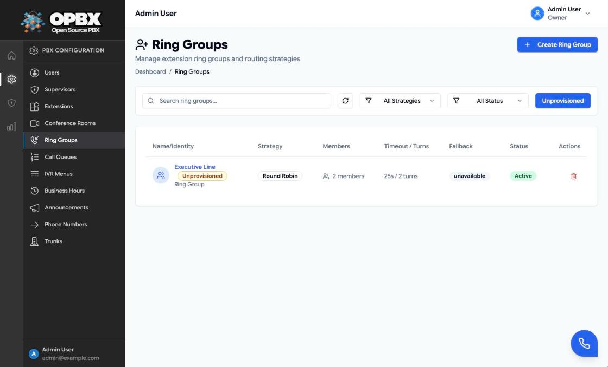

# Navigating the Admin Interface

This page explains how the OPBX web interface is organised, which menu items you see for your role, and the patterns that repeat across every module: delete confirmations, the "still in use" dialog, the Unprovisioned badge, and the banner shown while a platform manager operates as an organization.

Read this page first. The module guides assume you know where things are.

## Sidebar Areas

The sidebar is grouped into sections. Items you cannot use for your role are hidden.

| Section | What is in it |
|---------|---------------|
| **Dashboards** | Your home dashboard |
| **PBX Configuration** | Users, Supervisors, Extensions, Conference Rooms, Ring Groups, Call Queues, IVR Menus, Business Hours, Announcements, Phone Numbers, Trunks |
| **Apps and Security** | Campaign Manager, Distribution Lists, Real Time Monitor (auto dialer), AI Assistants, AI Load Balancers, Call Tracking (Dashboard, Campaigns, Sessions, DNI Snippet, Integrations), Inbound Blacklist, Outbound Whitelist |
| **Analytics** | Live Calls, Queues Dashboard, Queue Reports, Call Logs, Call Notifications, API Keys |
| **Supervisor** | Shown to Supervisors instead of the sections above (see below) |
| **Platform Management** | Platform Dashboard, Organizations, Users, Audit Log, Platform Status. Shown only to platform managers |

Which roles see each item comes from the sidebar configuration. Examples:

| Item | Owner | PBX Admin | PBX User | Reporter | Supervisor |
|------|:-----:|:---------:|:--------:|:--------:|:----------:|
| Users | Yes | Yes | No | No | Yes (own scope) |
| Extensions | Yes | Yes | Yes | Yes | No |
| Ring Groups, Call Queues | Yes | Yes | No | Yes | Yes (own scope) |
| IVR Menus, Business Hours, Trunks | Yes | Yes | No | No | No |
| Phone Numbers | Yes | Yes | No | Yes | No |
| Outbound Whitelist, Call Tracking Integrations, API Keys | Yes | No | No | No | No |
| Live Calls, Call Logs | Yes | Yes | Call Logs only | Yes | Yes |

:::info Supervisors
A user with the Supervisor role sees the **Supervisor** section, not the configuration sections. Their Users, Ring Groups and Call Queues views are limited to the users and groups assigned to them. See [Supervisors](/modules/supervisors).
:::

## Roles at a Glance

| Role | Typical use |
|------|-------------|
| **Owner** | Runs the organization. The only role that can change another user's role, manage Cloudonix settings and manage API keys |
| **PBX Admin** | Day-to-day administration: routing, users (within the limits below), phone numbers, queues |
| **PBX User** | Has an extension. Uses the Web Phone and their own queue login state |
| **Reporter** | Read-only access to reports, call logs and most configuration |
| **Supervisor** | Monitors and coaches the users and groups assigned to them |

Full permissions per module are on each module page. The role rules that affect user management are in [User Management](/modules/user-management).

## Repeated Patterns

### Delete Confirmations

Every delete in the interface asks for confirmation first. Some deletes show more than a yes/no question:

- **User delete** shows an impact preview: which extensions are kept, which groups or queues lose the user, and which routes will change. The delete goes ahead only when you confirm. See [User Management](/modules/user-management).
- **Routing resources** (extensions used as a target, ring groups, IVR menus, DIDs and similar) are refused while other configuration still points at them. The refusal opens a **"Cannot delete: still in use"** dialog that lists every place the resource is used. Remove or change those references first, then delete again. History records (call logs, CDRs, session logs) never block a delete.

:::note
The server enforces the in-use check. The dialog is the display of that result, so the list you see is always the one the server returned.
:::

### Unprovisioned Resources

An **Unprovisioned** badge marks a resource that has at least one route set to **Destination unavailable**. This is the "set up for future use" state. Callers who reach that route hear "Destination doesn't exist" and the call ends.

- The badge appears on the list row and in the edit dialog title.
- Seven resource types can be unprovisioned: IVR menus, phone numbers (DIDs), ring groups, call queues, AI load balancers, call-tracking campaigns and business hours schedules. Each list page has an **Unprovisioned** filter.
- A new resource must be fully connected when it is created. "Destination unavailable" is only offered on **edit** screens, under **Disconnect**.

### Live Data

Pages with live data (Live Calls, Queues Dashboard, Platform Status) refresh themselves while the browser tab is visible and stop when the tab is hidden. Use the page's refresh control or reload if a value looks stale.

### Error States

When the main data for a list or detail page cannot be loaded, the page shows an error state with the message from the server instead of an empty table. An empty table means there is genuinely no data.

## Operating as an Organization (Platform Managers)

A platform manager can act as the Owner of an active organization. While that session is active:

- A yellow banner at the top of every page names the organization and offers **Exit organization**.
- Every request carries the organization being operated on. Changes you make are real changes to that organization.
- The session ends when you exit, log out, or your token expires.

Start and stop are both recorded in the platform audit log. Read [Platform Management](/administration/platform-management) before using it.

## Where to Go Next

- [Organization Settings](/administration) — profile, Cloudonix integration and organization users
- [Module guides](/modules) — one page per feature, in the order listed in the modules index
- [Platform Management](/administration/platform-management) — for platform owners and operators only
