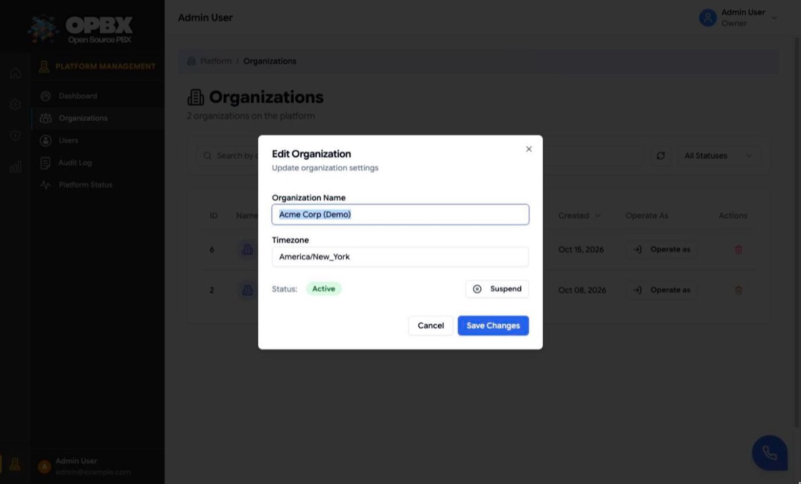
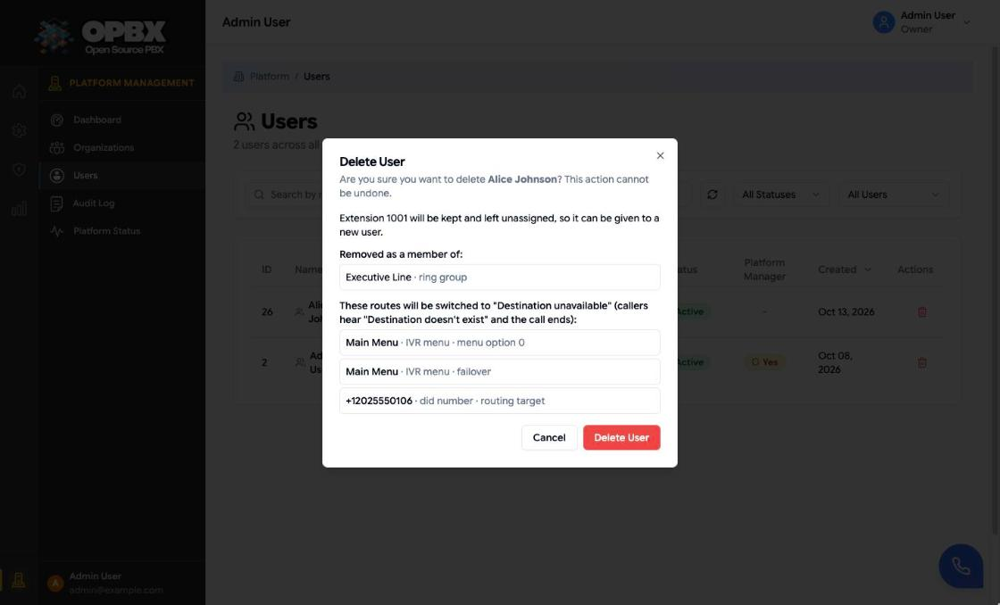
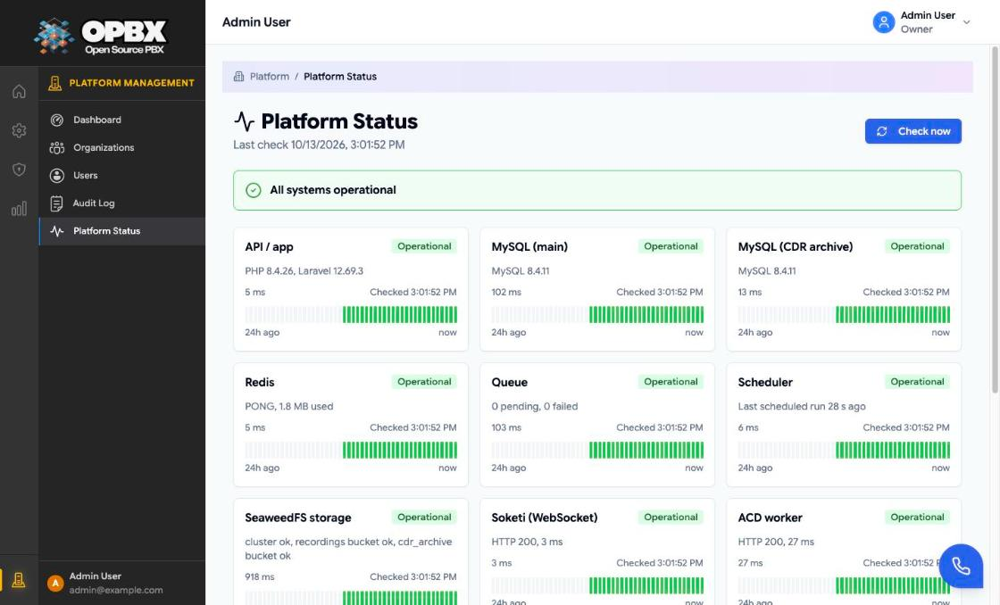

# Platform Management

:::danger Platform Owners/Operators Only
This section applies only to people who operate the OPBX deployment. Organization users (Owner, PBX Admin, PBX User, Reporter, Supervisor) cannot open Platform Management. If you administer one organization, see [Organization Settings](/opbx/administration) instead.
:::

Platform Management is a cross-tenant console for the team that hosts OPBX for one or more customer organizations. It appears in the sidebar as **Platform Management** (amber icon) for platform managers only. Anyone else who opens a `/ui/platform/...` address sees an **Access Denied** page: "You do not have platform manager privileges. Contact your system administrator if you believe this is an error."

## Pages

| Sidebar item | Path | What it is for |
|--------------|------|----------------|
| Dashboard | `/ui/platform/dashboard` | Totals across all organizations, the newest organizations and the latest platform actions |
| Organizations | `/ui/platform/organizations` | List, edit, suspend, reactivate and delete organizations; **Operate as** |
| Users | `/ui/platform/users` | Owner accounts of every organization; platform-manager flag, password, delete |
| Audit Log | `/ui/platform/audit-log` | Record of platform actions |
| Platform Status | `/ui/platform/status` | Health of every OPBX component, with a 24-hour history |

An organization detail page (`/ui/platform/organizations/{id}`) opens from the dashboard's **Recent Organizations** list.

The public status page at `/status` is separate. It needs no login and shows only coarse group health. See [Public status page](#public-status-page).

When the server refuses an action on these pages, the toast at the top of the screen names what failed (for example "Failed to delete user") and the line below it gives the server's reason (for example "Cannot delete the last owner of an organization.").

## Access Requirements

The `is_platform_manager` flag on a user account grants access. It is separate from the organization role. Set it from the server:

```bash
docker compose exec app php artisan opbx:create-platform-manager           # interactive: promote an existing user, or create a new user (and organization)
docker compose exec app php artisan opbx:set-platform-manager user@example.com
docker compose exec app php artisan opbx:revoke-platform-manager user@example.com
```

An existing platform manager can also grant or revoke the flag for Owner accounts on the [Users](#users) page. Revoking the flag (command or page) also signs the user out of every session.

:::caution
The last platform manager cannot be revoked ("Cannot revoke the last platform manager."). Create and confirm a second one first.
:::

## Dashboard

Who can do this: platform managers.

Open **Platform Management → Dashboard**. The page shows:

- **Organizations**: the total, with the number of active ones. Click the card to open the Organizations page.
- **Users**: the total across all organizations, with the number of platform managers. Click the card to open the Users page.
- **Extensions** and **DIDs**: totals across all organizations.
- **Recent Organizations**: the newest organizations. Click one to open its detail page; **View All** opens the Organizations page.
- **Recent Activity**: the latest audit entries; **View All** opens the Audit Log.

{/* SCREENSHOT: platform-dashboard — Platform Dashboard with the Organizations, Users, Extensions and DIDs cards, Recent Organizations (Acme Corp (Demo) listed) and Recent Activity */}

## Organizations

The Organizations page lists every organization with **ID**, **Name/Identity** (name and slug), **Users**, **Extensions**, **DIDs**, **Status**, **Created** and an **Operate as** button. Search by name or slug, filter by status (**All Statuses**, **Active**, **Suspended**, **Deleted**) and sort by any column. Pages hold 25, 50 or 100 rows.

The platform console has **no** action to create an organization. New organizations come from [registration](/opbx/installation/first-login#register-a-new-organization), [Auth0 sign-up](/opbx/modules/auth0-syndicated-auth), or `opbx:create-platform-manager`.

### Status: Active, Suspended, Deleted

| Status | Effect |
|--------|--------|
| **Active** | Normal operation |
| **Suspended** | Every request from that organization's users (API and web) is refused with HTTP 403 "Your organization has been suspended." Data is kept. Platform managers are not blocked, so they can still open and reactivate the organization |
| **Deleted** | The organization is removed with its data (see [Delete an organization](#delete-an-organization)). It no longer appears in the list, so the **Deleted** filter normally shows nothing |

Allowed changes: Active to Suspended or Deleted, Suspended to Active or Deleted. A deleted organization cannot change again.

### Edit an organization

Who can do this: platform managers.

1. Open **Platform Management → Organizations**.
2. Click the organization's row. The **Edit Organization** dialog opens.
3. Change **Organization Name** (up to 255 characters) or **Timezone** (type a valid IANA time zone, for example `America/New_York`).
4. Click **Save Changes**.

The toast "Organization updated" appears. An invalid time zone is refused: the toast "Failed to update organization" shows the server's validation message. The change is written to the audit log as `organization.settings.updated`. Cloudonix keys and secrets in the settings are masked (asterisks plus the last 4 characters) in the audit entry, as they are on the organization page.

You can also edit the name and time zone on the organization detail page, **Settings** tab, with **Save Changes** ("Organization settings updated").

### Suspend an organization

Who can do this: platform managers.

1. Open **Platform Management → Organizations**.
2. Click the organization's row to open **Edit Organization**.
3. Next to **Status: Active**, click **Suspend**.

The toast "Organization suspended" appears and the status badge changes to **Suspended**. The organization's users are refused from their next request. The change is written to the audit log as `organization.status.updated`.



### Reactivate a suspended organization

Who can do this: platform managers.

1. Open **Platform Management → Organizations** and set the status filter to **Suspended** if needed.
2. Click the organization's row.
3. Next to **Status: Suspended**, click **Activate**.

The toast "Organization activated" appears and the status badge changes to **Active**. On the organization detail page the same action is the **Reactivate** button.

### Delete an organization

Who can do this: platform managers.

1. Open **Platform Management → Organizations**.
2. Click the delete (trash) icon on the organization's row.
3. In the **Delete Organization** dialog ("Are you sure you want to delete … ? This action cannot be undone."), click **Delete**.

The toast "Organization deleted" appears, the dialog closes and the row disappears. OPBX revokes the users' API tokens and removes the organization's extensions, ring groups, business-hours schedules, phone numbers, call logs and users, then the organization itself. The deletion is written to the audit log as `organization.deleted`, with the Cloudonix keys and secrets masked.

The delete is refused when **any user in the organization is a platform manager** ("Cannot delete organization: one or more users in this organization are Platform Managers. …"). Revoke their platform-manager flag first. The page shows the toast "Failed to update status" with that message below it.

#### Delete from the organization detail page

1. Open the organization's detail page (for example from **Recent Organizations** on the dashboard).
2. Click **Delete** in the page header.
3. The same **Delete Organization** dialog opens. Click **Delete** to confirm, or **Cancel** to keep the organization.

After the delete you return to the Organizations page. Nothing is deleted until you confirm.

{/* SCREENSHOT: platform-org-delete-blocked — Organization delete refused because one user is a platform manager */}

:::danger
Deleting an organization cannot be undone. Suspend first, take a database backup, and confirm with the customer.
:::

{/* SCREENSHOT: platform-org-delete-dialog — Delete Organization confirmation dialog for a demo organization, with the Cancel and Delete buttons */}

### Operate as an organization

Who can do this: platform managers, on **active** organizations only (the button is disabled for suspended ones).

Operating as an organization lets you act as its **Owner**, to reproduce a customer's problem without their password.

1. Open **Platform Management → Organizations**.
2. Click **Operate as** on the organization's row (or **Operate as this organization** on its detail page).
3. The toast "Now operating as …" appears and the organization's Dashboard opens. A yellow banner at the top of every page reads "Operating as … — you are acting as an organization admin."
4. Work as that organization's Owner. While the session is active the **Platform Management** section is hidden from the sidebar.
5. Click **Exit organization** in the banner.

The toast "Exited organization" appears and you return to the Organizations page with your own platform identity.

How it works:

- The web app attaches an `X-Operate-As-Organization` header to every API call during the session. There is no server-side session to time out; the session ends when you exit, log out, or your token expires.
- Only a real platform manager can start a session ("Only platform managers may operate as an organization."). API keys and ordinary users are refused.
- Only **active** organizations can be targeted ("The target organization is not active.").
- Starting and stopping are both written to the platform audit log as `operate_as.started` and `operate_as.stopped`. The API (`POST /v1/platform/operate-as/{organization}`) accepts an optional `reason` that is stored on the audit entry; the web page does not ask for one.

:::warning Full Owner access
While operating as an organization you can change anything its Owner can, including users, routing and Cloudonix settings. Exit as soon as you are done.
:::

{/* SCREENSHOT: platform-operate-as-banner — Dashboard of Acme Corp (Demo) with the yellow "Operating as Acme Corp (Demo)" banner and the Exit organization button */}

## Users

The Users page lists the **Owner** accounts of every organization (other roles are not listed) with **ID**, **Name**, **Email**, **Organization**, **Status**, **Platform Manager** and **Created**. Search by name or email, filter by status (**All Statuses**, **Active**, **Inactive**, **Suspended**) and by **All Users**, **Platform Managers** or **Regular Users**.

The platform console has no action to create a user. Users of an organization are managed by its Owner and PBX Admins on the [Users](/opbx/modules/user-management) page (or by you, after [operating as the organization](#operate-as-an-organization)).

Click a row to open the **Edit User** dialog. It shows the name, email, an **Owner** badge, the **Platform Manager** switch, a **Status** list and a **Change Password** button.

### Edit a user

Who can do this: platform managers.

1. Open **Platform Management → Users**.
2. Click the user's row. The **Edit User** dialog opens.
3. Change **Name**, **Email** or **Status** (**Active**, **Inactive** or **Pending**). The role stays as shown (**Owner**).
4. Click **Save Changes**. The button reads **Saving...** while the change is sent.

The toast "User updated" appears, the dialog closes and the list shows the new values. When the server refuses the change (for example an invalid email address), the toast "Failed to update user" shows the server's reason and the dialog stays open. The change is written to the audit log as `user.updated` with the before and after values.

The **Platform Manager** switch and **Change Password** take effect on their own; **Save Changes** is not needed for them.

### Grant or revoke platform-manager rights

Who can do this: platform managers.

1. Open **Platform Management → Users**.
2. Click the user's row.
3. Turn the **Platform Manager** switch on or off ("Grant cross-tenant administrative access").

The change applies immediately: the toast "Platform manager rights granted" or "Platform manager rights revoked" appears. Revoking also signs the user out of every session. Revoking the last platform manager is refused: the toast "Failed to update platform manager status" shows "Cannot revoke the last platform manager." The change is written to the audit log.

### Set a user's password

Who can do this: platform managers.

1. Open **Platform Management → Users**.
2. Click the user's row, then **Change Password**.
3. Enter **New Password** (at least 8 characters) and **Confirm Password**.
4. Click **Update Password**.

The toast "Password updated successfully" appears. The user's existing sessions stay signed in. The change is written to the audit log as `user.password.updated`.

### Delete a user

Who can do this: platform managers.

1. Open **Platform Management → Users**.
2. Click the delete (trash) icon on the user's row.
3. Read the **Delete User** dialog. It lists what the delete changes: the user's extensions are kept but left unassigned, group and queue memberships are removed, and routes that pointed at those extensions are switched to "Destination unavailable". It is the same impact preview organization admins see (see [User Management](/opbx/modules/user-management#delete-a-user)).
4. Click **Delete User**.

The toast "User deleted" appears. The deletion is written to the audit log as `user.deleted`.

Platform-level guards (the page shows the toast "Failed to delete user" with the message below as its reason):

| Guard | API message |
|-------|-------------|
| Deleting your own account | "You cannot delete your own account." |
| Deleting the last owner of an organization | "Cannot delete the last owner of an organization." |



## Platform Status

The Platform Status page shows every OPBX component, its current status, and what happened over the last 24 hours. The header shows the time of the last check ("Last check …", or "No checks recorded yet").



### Components

| Component | What is checked |
|-----------|-----------------|
| API / app | Application is answering; PHP and Laravel versions |
| MySQL (main) and MySQL (CDR archive) | Query and server version. The archive is the warm CDR tier |
| Redis | Ping and memory use |
| SeaweedFS | Both buckets reachable (recordings and CDR archive) |
| Queue | Pending and failed jobs across the queues |
| Scheduler | Age of the heartbeat written by the scheduled health check |
| ACD worker, AMD worker, Dialer worker | Their health endpoints |
| Soketi (real-time updates) | Readiness endpoint |
| MCP server | Health endpoint |
| Loki, Grafana | Only when the `logs` profile is running |
| Cloudonix API | A lightweight request to the Cloudonix API |

Each card shows **Operational** (green), **Degraded** (amber), **Down** (red) or **Unknown**, with the latency and a short detail. An optional service that is not running (Loki or Grafana without the `logs` profile) shows "Not running (optional)".

### How status is decided

Thresholds come from `config/platform_status.php`:

| Check | Degraded (amber) | Down (red) |
|-------|------------------|------------|
| HTTP probes (workers, Soketi, MCP, SeaweedFS, Loki, Grafana) | Response slower than 1500 ms | Unreachable (no answer within 2.5 s, or refused) or an error HTTP status |
| Queue | More than 500 pending jobs, or 50 or more failed jobs | Never; the queue check reports degraded at most |
| Scheduler heartbeat | Last run 1 to 3 minutes ago | Last run more than 3 minutes ago (also when it has never run) |
| Cloudonix API | Three consecutive checks with no fast answer (slow or no answer), not all of them lost | Three consecutive checks with no answer at all |

A Cloudonix answer counts as slow when it takes longer than 3000 ms. A check fails when no answer arrives within 5 s.

Cloudonix is an external Internet service, so a single slow or lost request never changes its status. Only the third consecutive bad check does.

The scheduler check is the only one that depends on the schedule itself. It stays "Unknown" until the first scheduled run after installation. A manual **Check now** does not refresh the scheduler heartbeat.

### Run the checks now

Who can do this: platform managers.

1. Open **Platform Management → Platform Status**.
2. Click **Check now**. The button reads **Checking...** while the checks run.

The cards and the "Last check" time update. The action is limited to 6 requests per minute; above that the page shows "Check failed: …" with the server's message, followed by "You may have hit the rate limit (6 per minute); try again shortly."

### History

- The checks run every minute from the scheduler and are stored.
- The page shows a 24-hour strip per component. Hover a segment to see its time and status.
- The page refreshes every 30 seconds while the tab is visible.
- History is kept for `PLATFORM_HEALTH_RETENTION_HOURS` (default 24) and pruned by the daily `model:prune` run.

No email or other notification is sent. Someone must watch the page.

## Public status page

`/status` is a public page that needs no login. It is linked from the public home page navigation and the footer.

It shows six groups, each the worst status of its components:

| Group | Components |
|-------|------------|
| Web portal & API | API, MySQL (main), Redis |
| Call routing | API, Cloudonix |
| Call queues | ACD worker, queue |
| Auto dialer & voicemail detection | Dialer worker, AMD worker |
| Recordings & storage | SeaweedFS, MySQL (CDR archive) |
| Real-time updates | Soketi |

The banner reads **All systems operational**, **Partial outage** or **Major outage**. The page shows a six-hour strip per group.

Internal components (scheduler, Loki, Grafana, MCP server) and all details (versions, latency, hostnames, error messages) are never shown on the public page. The data comes from `GET /api/v1/public/status`, cached for 30 seconds.

## Audit Log

Every platform action is recorded with:

| Field | Description |
|-------|-------------|
| Timestamp | When it happened |
| Actor | The platform manager who did it ("by …", or "System") |
| Action | What was done, shown by its label (see the table below) |
| Target | The organization or user affected |
| Reason | When one was given through the API |
| Before / After | The changed values |

Actions written today, with the label the Audit Log shows and offers in its action filter:

| Label | Action name (API `action` filter) | Written when |
|-------|-----------------------------------|--------------|
| User Created | `user.created` | A user is created through the API |
| User Updated | `user.updated` | **Save Changes** in **Edit User** |
| User Deleted | `user.deleted` | A user is deleted |
| User Password Changed | `user.password.updated` | **Update Password** |
| Platform Manager Granted | `user.platform_manager.granted` | The **Platform Manager** switch is turned on |
| Platform Manager Revoked | `user.platform_manager.revoked` | The switch is turned off |
| Organization Settings Updated | `organization.settings.updated` | An organization's name or time zone is saved |
| Organization Status Changed | `organization.status.updated` | An organization is suspended or reactivated |
| Organization Deleted | `organization.deleted` | An organization is deleted |
| Operate As Started | `operate_as.started` | **Operate as** starts a session |
| Operate As Stopped | `operate_as.stopped` | **Exit organization** ends it |

### Review the audit log

Who can do this: platform managers.

1. Open **Platform Management → Audit Log**.
2. Optionally type a platform manager's user ID in **Search by platform manager user ID...**.
3. Optionally pick an action in the action filter (**All Actions** or one of the labels above). Only entries of that action are listed.
4. Click an entry to expand it. The expanded entry shows the reason (when given) and the before and after values; "No changes recorded" when there are none.

Entries are listed newest first, 25, 50 or 100 per page.

{/* SCREENSHOT: platform-audit-log — Audit Log page with one Organization Status Changed entry expanded, showing the before and after status */}

Audit entries are kept for `RETENTION_PLATFORM_AUDIT_LOGS_DAYS` (default 365) and then pruned. See [Data retention](/opbx/data-models/configuration/index#data-retention).

## Cross-tenant call data

The Platform API has a read-only **CDR archive** endpoint, `GET /v1/platform/cdr-archive`, that lists warm-tier call records (by default 6 to 12 months old) for all organizations, newest first. Filters: `organization_id`, `disposition`, `from` and `to` (number prefix, with or without `+`), `from_date` and `to_date`. The web console does not show it. See [Call Logs](/opbx/modules/call-logs#retention-and-archive).

## Related API endpoints

| Method | Endpoint | Purpose |
|--------|----------|---------|
| GET | `/v1/platform/dashboard` | Dashboard totals and recent items |
| GET | `/v1/platform/organizations` | List organizations (search, status, sort, paging) |
| GET / PUT | `/v1/platform/organizations/{id}` | Show or edit an organization (name, time zone) |
| PATCH | `/v1/platform/organizations/{id}/status` | Suspend, reactivate or delete (`status`, optional `reason`) |
| GET / POST | `/v1/platform/organizations/{id}/users` | List or create users of one organization (API only) |
| GET | `/v1/platform/users` | List users across organizations |
| GET / PUT / DELETE | `/v1/platform/users/{id}` | Show, edit or delete a user |
| GET | `/v1/platform/users/{id}/delete-impact` | Preview what a delete changes |
| PATCH | `/v1/platform/users/{id}/platform-manager` | Grant or revoke the flag |
| PATCH | `/v1/platform/users/{id}/password` | Set a password (at least 8 characters) |
| GET | `/v1/platform/audit-logs` | Audit log (filters: `platform_manager_user_id`, `target_organization_id`, `action`, `date_from`, `date_to`) |
| GET | `/v1/platform/cdr-archive` | Warm-tier CDRs of all organizations |
| GET | `/v1/platform/status` | Platform Status data |
| POST | `/v1/platform/status/check` | Run the checks now (6 per minute) |
| POST / DELETE | `/v1/platform/operate-as/{id}`, `/v1/platform/operate-as` | Start or stop operating as an organization |

See the [OPBX REST API reference](https://developers.cloudonix.com/opbxRestOpenAPI) for full schemas.

## Related

- [Navigating the Admin Interface](/opbx/administration/navigating-the-interface)
- [Centralized Logs](/opbx/administration/centralized-logs)
- [Configuration Reference](/opbx/data-models/configuration/index)
