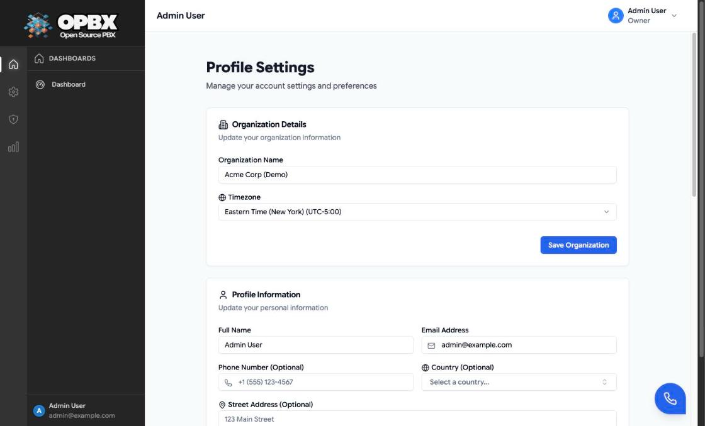

# Profile

The Profile page (**Profile Settings**) is where every signed-in user manages their own account: name, email and contact details, password, and linked social accounts. The Owner also edits the organization's name and time zone here. Users who have a PBX extension also see their **Extension Number** on the Profile Information card.

## Permissions

| Section | Owner | PBX Admin | PBX User | Reporter | Supervisor |
|---------|:-----:|:---------:|:--------:|:--------:|:----------:|
| Organization Details: view | Yes | Yes | Yes | Yes | Yes |
| Organization Details: edit | Yes | No | No | No | No |
| Profile Information: edit your own | Yes | Yes | Yes | Yes | Yes |
| Change Password | Yes | Yes | Yes | Yes | Yes |
| Linked Accounts (when Auth0 is configured) | Yes | Yes | Yes | Yes | Yes |

For everyone except the Owner, the Organization Details fields are disabled, the **Save Organization** button is hidden, and the card says "Only organization owners can edit these settings". A platform manager [operating as an organization](/opbx/administration/platform-management#operate-as-an-organization) acts as its Owner.

## Open your profile

Who can do this: every signed-in user.

1. Click your name at the top right.
2. Choose **Profile**.

The **Profile Settings** page opens with the **Organization Details**, **Profile Information** and **Change Password** cards, and **Linked Accounts** when Auth0 sign-in is configured.

## Rename the organization or change its time zone

Who can do this: Owner.

1. [Open your profile](#open-your-profile).
2. In **Organization Details**, change **Organization Name** or pick a **Timezone**.
3. Click **Save Organization**.

The toast "Organization updated successfully" appears. If nothing changed, the toast says "Organization is already up to date".

| Field | Limits | Notes |
|-------|--------|-------|
| Organization Name | 2 to 255 characters | The name shown for the organization |
| Timezone | A valid time zone; the list has 56 entries grouped by Americas, Europe, Asia, Africa, Australia, Pacific and UTC | The organization's default time zone |

Business-hours schedules and auto-dialer campaigns have their own time zone setting; changing the organization's time zone does not change them.

## Edit your profile

Who can do this: every signed-in user, for their own account.

1. [Open your profile](#open-your-profile).
2. In **Profile Information**, change the fields you need (see the table).
3. Click **Save Profile**.

The toast "Profile updated successfully" appears and the form shows the values the server stored. Only changed fields are sent; if nothing changed, the toast says "Profile is already up to date". An email address already used by another account is refused with "This email address is already in use."

| Field | Required | Limits | Notes |
|-------|----------|--------|-------|
| Full Name | Yes | 2 to 255 characters | |
| Email Address | Yes | Valid email, up to 255 characters, not used by any other account | Used to sign in. If you link social accounts, they must use the same email |
| Phone Number (Optional) | No | Up to 20 characters | |
| Country (Optional) | No | Picked from a searchable list | |
| Street Address (Optional) | No | Up to 500 characters | |
| City (Optional) | No | Up to 100 characters | |
| State/Province (Optional) | No | Up to 100 characters | |
| Postal Code (Optional) | No | Up to 20 characters | |
| Role | — | — | Shown as a badge. Nobody can change their own role here: the Owner sees "You cannot change your own role.", other roles see "Contact your organization owner to change your role" |
| Extension Number | — | — | Shown only when an extension is assigned to you; read-only |

To change another user's role, use the [Users](/opbx/modules/user-management#change-a-users-role) page.

## Change your password

Who can do this: every signed-in user, for their own account.

1. [Open your profile](#open-your-profile).
2. In **Change Password**, enter your **Current Password**.
3. Enter the **New Password** and repeat it in **Confirm New Password**. Under the confirmation field, "Passwords match" or "Passwords don't match" updates as you type. The eye buttons show or hide each field.
4. Optionally, under **Password Generator**, click **Generate Strong Password**. It fills both fields with a random 16-character password and shows it with a copy button ("Password copied to clipboard") and the reminder "Make sure to save this password securely before submitting the form".
5. Click **Change Password**.

The toast "Password changed successfully" appears and the form is cleared. Every API token of your account is revoked, **including the session you are using**: the next page you open or action you take sends you back to the login page, where you sign in with the new password. Scripts and other sessions that use a token of your account must sign in again too.

The new password must have at least 8 characters, upper- and lower-case letters, a number and a symbol. The form only checks the length; the other rules are checked when you submit.

| Message | Meaning |
|---------|---------|
| The current password is incorrect. | Wrong current password |
| Password confirmation does not match. | The two new-password fields differ |
| The new password must contain… | A missing upper/lower case letter, number or symbol |

The endpoint is rate limited more strictly than the rest of the API.

{/* SCREENSHOT: profile-change-password — Change Password card with a generated password shown with its copy button and "Passwords match" under the confirmation field */}

Accounts created through a social sign-in, a join request or an invitation have a random password nobody knows. Use **Linked Accounts** to sign in, or ask an administrator to [set a password](/opbx/modules/user-management#set-a-users-password) on the Users page.

## Link a social account

Who can do this: every signed-in user, when Auth0 sign-in is configured for the deployment (`OPBX_SAAS_ENABLED=true`). Otherwise the **Linked Accounts** card is not shown.

1. [Open your profile](#open-your-profile).
2. In **Linked Accounts**, click **Connect** next to the provider.
3. Sign in at the provider with the **same email** as your OPBX account.

You come back to the profile with the provider linked; its button now reads **Disconnect**. The card lists the providers configured for the deployment, except Microsoft, Facebook and X, which it never shows.

See [Auth0 Syndicated Authentication](/opbx/modules/auth0-syndicated-auth) for the rules and error messages.

{/* SCREENSHOT: profile-linked-accounts — Linked Accounts card with one provider connected (Disconnect) and one not (Connect) */}

## Unlink a social account

Who can do this: every signed-in user, for their own linked accounts.

1. [Open your profile](#open-your-profile).
2. In **Linked Accounts**, click **Disconnect** next to the provider.

The toast "Account unlinked." appears and the button changes back to **Connect**. Your account and password are not affected.

## Related API endpoints

| Method | Endpoint | Purpose |
|--------|----------|---------|
| GET | `/v1/profile` | Your profile, linked accounts and organization |
| PUT | `/v1/profile` | Update your name, email and contact details |
| PUT | `/v1/profile/password` | Change your password (stricter rate limit; revokes all your tokens) |
| PUT | `/v1/profile/organization` | Update the organization name and time zone (Owner; stricter rate limit) |
| POST | `/v1/auth/auth0/link`, `/v1/auth/auth0/unlink` | Link or unlink a social account |

See the [OPBX REST API reference](https://developers.cloudonix.com/opbxRestOpenAPI) for full schemas.

## Related pages

- [User Management](/opbx/modules/user-management) — roles and other users' accounts
- [Auth0 Syndicated Authentication](/opbx/modules/auth0-syndicated-auth) — social sign-in and linking
- [Navigating the Interface](/opbx/administration/navigating-the-interface) — the user menu
