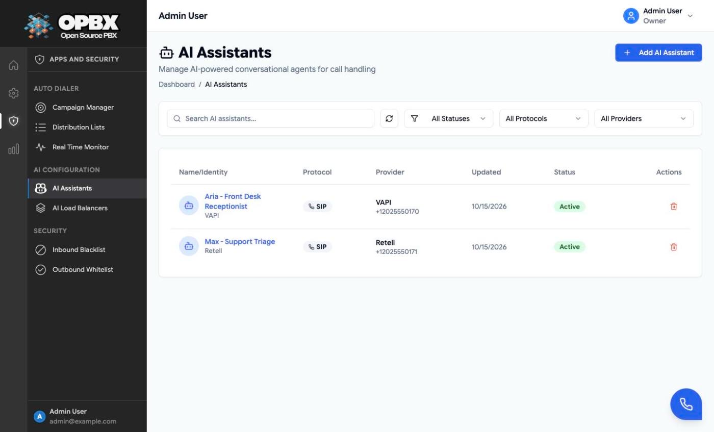

# AI Assistants

An AI assistant connects callers to an AI voice agent run by a provider. OPBX does not run the agent itself: it routes the call, then hands the audio to the provider. Once an assistant exists, any routing in OPBX can send callers to it.

This page explains how the connection works and the common designs. For the screens, fields, limits and error messages, see the module walk-through: [AI Assistants](/opbx/modules/ai-assistants).

## How the call reaches the agent

The provider you choose decides the protocol. OPBX sets it automatically.

| Protocol | Providers | What OPBX does |
|----------|-----------|----------------|
| **SIP** | 42 providers, for example Retell, VAPI, ElevenLabs, Ultravox, Synthflow, Telnyx and OpenAI. Several have UDP, TCP or TLS variants | Dials the provider's service with the agent's phone number |
| **WebSocket** | DeepDub, Dograh Cloud, Dograh OSS, AssemblyAI and Cloudonix | Streams the call audio to the provider's WebSocket address |
| **Dummy** | Dummy Test | Plays a short test message and hangs up. Nothing leaves OPBX |

### SIP

The only setting is the agent's phone number at the provider, in E.164 form. The call is sent to Cloudonix as a dial to that provider's service, for example:

```xml
<Dial>
  <Service provider="vapi">+12025550170</Service>
</Dial>
```

### WebSocket

The call audio is streamed to an address built from the provider's settings:

| Provider | Address |
|----------|---------|
| DeepDub | `wss://bot.deepdub.dev/ws/{bot_id}/{auth_token}?session={session}&from={from}&to={to}`, filled with your Bot ID and Authentication Token and the call's session, caller and called number |
| Dograh Cloud, AssemblyAI, Cloudonix | The provider's fixed endpoint followed by `/{agent UUID}` |
| Dograh OSS | Your own endpoint followed by `/{agent UUID}` |

## Where to use an assistant

| Place | Typical design |
|-------|----------------|
| [Phone number](/opbx/modules/phone-numbers) | A dedicated AI line, for example a 24-hour receptionist |
| [IVR option](/opbx/modules/ivr-menus) | "Press 2 to talk to our assistant" |
| [Business hours](/opbx/modules/business-hours) | The assistant answers when the office is closed |
| [Call queue](/opbx/modules/call-queues) fallback | Callers who wait too long are offered the assistant |
| [AI load balancer](/opbx/applications/ai-load-balancers) | Several assistants behind one destination, with failover |
| [Extension](/opbx/modules/extensions) of type AI Assistant | Staff can dial or transfer to the assistant |
| [Ring group](/opbx/modules/ring-groups) fallback | Through an AI Assistant extension |
| [Auto dialer campaign](/opbx/applications/auto-dialer) | Answered outbound calls go to the assistant |

## Example: Acme Corp

The demo organization has two SIP assistants: **Aria - Front Desk Receptionist** (VAPI) and **Max - Support Triage** (Retell). Aria answers the number +1 202 555 0104, is option 2 of the After Hours Menu, is reachable on extension 1013, is a member of the **Front Desk AI Pool** load balancer, and takes the answered calls of the **Fall Webinar Follow-up** campaign.



## Status

| Status | Behaviour |
|--------|-----------|
| Active | Used for calls |
| Inactive | Not used. Load balancers skip it, and it cannot be added to a load balancer |

Changing the status does not affect calls already connected.

## Delete protection

An assistant that any routing still points at cannot be deleted. The delete is refused, and the **Cannot delete: still in use** dialog lists each reference: extensions, phone numbers, IVR options and failovers, business-hours actions, queue fallbacks, load balancers (members and fallbacks) and auto-dialer campaigns. Change those, then delete again.

## Testing a new route

1. Create an assistant with the **Dummy Test** provider.
2. Point the route (for example a phone number) at it.
3. Call the number. You should hear the test message.
4. Edit the assistant and change the provider to the real one. The route keeps working, now with the real agent.

## Related pages

- [AI Assistants (module walk-through)](/opbx/modules/ai-assistants)
- [AI Load Balancers](/opbx/applications/ai-load-balancers)
- [Extensions](/opbx/modules/extensions)
