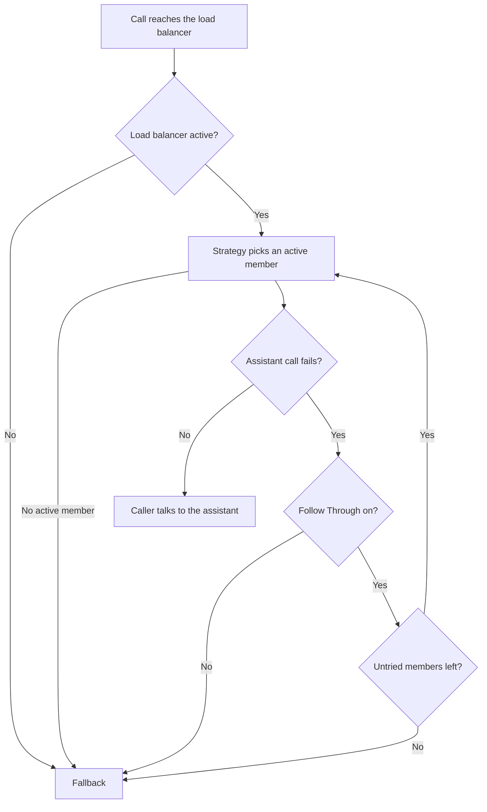

# AI Load Balancers

An AI load balancer puts several AI assistants behind one destination. It chooses one assistant per call, can move on to the next assistant when one fails, and runs a fallback when none can take the call.

This page explains the designs. The step-by-step screens, every field and the error messages are in the module walk-through: [AI Load Balancers](/opbx/modules/ai-load-balancers).

## How a call moves through a load balancer

A failure is a provider leg that ends busy, no answer, failed, canceled or with an unknown status. Members already tried for the call are skipped (the list is kept for one hour).

## Strategies

| Strategy | Choice per call | Typical use |
|----------|-----------------|-------------|
| Round Robin | Members take turns in list order | Even load across equal assistants |
| Priority Based | Always the first active member in list order | A primary assistant with backups |
| Percentage Based | Weighted random choice; the dialog requires the weights to total 100 % | A/B tests and gradual roll-outs |

## Designs

### Primary and backup

- Strategy **Priority Based**, with the primary assistant at the top of the list.
- **Follow Through** on, so a busy or failed primary moves the call to the next member.
- Members from different providers, so one provider's outage does not stop every member.
- A **Ring Group**, **Call Queue** or **PBX User Extension** fallback, so the last resort is a person.

### Gradual roll-out of a new assistant

- Strategy **Percentage Based**.
- Start with 10 % on the new assistant and 90 % on the current one. The dialog offers weights in steps of 5 %.
- Raise the share as you gain confidence. Saving the load balancer applies the new weights to the next call.

### Even load

- Strategy **Round Robin** across assistants that do the same job.
- Follow Through on, so a failing member does not lose the caller.

## Fallback

| Fallback | Result |
|----------|--------|
| PBX User Extension | Rings an extension |
| Ring Group | Sends the call to a ring group |
| IVR Menu | Plays a menu |
| AI Assistant | One more assistant, tried without Follow Through. It must not be a member of the same load balancer |
| Call Queue | Puts the caller in a call queue, so people answer |
| AI Load Balancer | Hands the call to another load balancer. It cannot be this one, and a chain of fallbacks that leads back to this one is refused ("Fallback loop detected") |
| Hang Up | Ends the call (the default) |

The fallback runs only for an **active** load balancer. An inactive load balancer takes no calls: every call sent to it (phone number, extension, IVR, business hours or another destination's fallback) is disconnected with a spoken message, and its fallback is not used.

On the edit dialog, **Disconnect** sets the fallback to "Destination unavailable". The load balancer is then marked **Unprovisioned** until you choose a real fallback. A new load balancer always needs a real fallback.

## Example: Acme Corp front desk

The demo organization has a load balancer **Front Desk AI Pool**: Round Robin over the assistants **Aria - Front Desk Receptionist** (VAPI) and **Max - Support Triage** (Retell), with Hang Up as the fallback. Routing a phone number to it alternates callers between the two assistants.

## Where to use a load balancer

A load balancer is a destination for phone numbers, IVR options and failovers, business-hours actions, ring-group, call-queue and other load balancers' fallbacks, extensions of type AI Load Balancer and auto-dialer campaigns. While any of those point at it, it cannot be deleted; the delete dialog lists them.

## Monitoring

- [Call Logs](/opbx/modules/call-logs) show each call to the number that routes to the load balancer.
- With the [centralized logging stack](/opbx/administration/centralized-logs), the routing log names the member chosen for each call and every failover step.

## Related pages

- [AI Load Balancers (module walk-through)](/opbx/modules/ai-load-balancers)
- [AI Assistants](/opbx/applications/ai-assistants)
- [Auto Dialer](/opbx/applications/auto-dialer) — campaigns can connect answered calls to a load balancer
