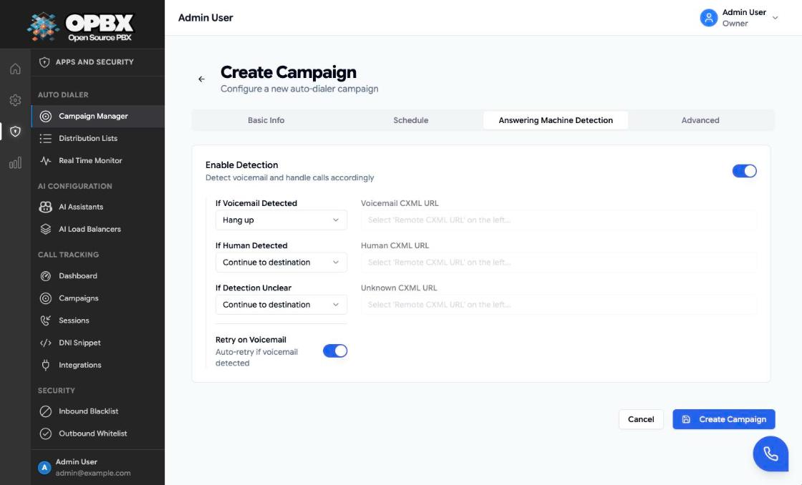

# Answering Machine Detection

Answering machine detection (AMD) tells a campaign whether a call reached a voicemail box. OPBX streams the first seconds of each answered call to its **AMD worker**, which listens for the **voicemail beep**. The campaign then hangs up or carries on, according to the actions you set.

## Purpose

Use AMD to avoid spending an AI conversation on voicemail boxes, to count how many calls reached voicemail, and (optionally) to try those numbers again later.

## Prerequisites

- The AMD worker is running and reachable by Cloudonix through your public address (path `/ws/amd/`). See [AMD Worker](/opbx/workers/amd-worker).
- The stream address is built from the organization's Cloudonix webhook base URL (or `APP_URL` when it is empty), with `https` turned into `wss`. That address must reach your Nginx from the internet.
- A campaign in **Draft** or **Paused** status. See [Managing Campaigns](/opbx/applications/auto-dialer/campaigns).

## Turn detection on

Who can do this: Owner and PBX Admin.

1. Open **Auto Dialer → Campaign Manager**. Pause the campaign if it is Running.
2. Click **Edit** on the campaign (or **Create Campaign** for a new one) and select the **Answering Machine Detection** tab.
3. Switch on **Enable Detection**. The actions are filled with the defaults below.
4. Set **If Voicemail Detected**, **If Human Detected** and **If Detection Unclear** to **Hang up** or **Continue to destination**.
5. Optionally switch on **Retry on Voicemail** ("Auto-retry if voicemail detected"). Retries also need **Max Dial Attempts** above 1 on the **Advanced** tab.
6. Keep **Connect When** on **Call Connected** (Advanced tab).
7. Click **Update Campaign** (or **Create Campaign**).

Result: the toast "Campaign updated successfully" (or "Campaign created successfully") appears. The detail page lists the **Voicemail Action**, **Human Action**, **Unknown Action** and **Retry on Voicemail** values. Calls placed from now on stream their audio to the AMD worker.

## Fields

| Field | Choices | Default when you switch detection on | Applied when |
|-------|---------|--------------------------------------|--------------|
| If Voicemail Detected | Hang up, Continue to destination | Hang up | A beep is heard |
| If Human Detected | Hang up, Continue to destination | Continue to destination | Not reported by the current detector (see below) |
| If Detection Unclear | Hang up, Continue to destination | **Continue to destination** | No beep within the detection window |
| Retry on Voicemail | On or off | Off | A beep is heard and the number has attempts left |

An action left empty (possible through the API) is treated as **Hang up**, as the form shows it. Only an explicit **Continue to destination** keeps the call going.

## What happens on a call

1. The callee answers. Cloudonix connects the call to the campaign's [routing destination](/opbx/applications/auto-dialer/routing-destinations) **and at the same time** starts streaming the callee's audio to the AMD worker. Detection does not delay the conversation.
2. The AMD worker accepts the stream only if it belongs to a known, active auto-dialer call. Any other stream is closed.
3. The worker listens for a beep. Two detectors run side by side: a trained model (`beep_ml`) and an energy-based tone detector that looks for a steady tone between 300 and 1000 Hz. The tone detector ignores a tone that starts in the first **2 seconds** of the stream, because voicemail beeps come after a greeting and a tone at answer time is usually ringback or line noise.
4. The first verdict wins, and there is exactly one per call:
   - **Voicemail**: a beep was heard.
   - **Unknown**: no beep within the detection window (**30 seconds** by default).
5. OPBX looks up the action on the campaign (never from the worker's message), records the result on the call, and:
   - **Hang up**: ends the call through Cloudonix.
   - **Continue**: does nothing; the conversation goes on.

Timings are set on the AMD worker: `AMD_DEFAULT_TIMEOUT_SECONDS` (default 30) and `AMD_MIN_BEEP_START_MS` (default 2000). The standard compose file passes `AMD_MIN_BEEP_START_MS` from `.env` but not `AMD_DEFAULT_TIMEOUT_SECONDS`. See [AMD Worker](/opbx/workers/amd-worker).

:::warning The detector does not recognise a human voice
The current detector only listens for a beep. It never reports **Human**, so **If Human Detected** has no effect. A call answered by a person ends with **Unknown** when the detection window closes. The form defaults **If Detection Unclear** to **Continue to destination**, so live conversations carry on. If you set it to **Hang up**, every call that does not reach a voicemail is **hung up after about 30 seconds**, including live conversations. Campaigns saved earlier keep the value they were saved with.
:::

## Retry on Voicemail

When a beep is heard, **Retry on Voicemail** is on and the number still has attempts left (see Max Dial Attempts on the Advanced tab), the number goes back to **pending** and is retried after 5 minutes, then 10, 20 and 40 minutes (the wait doubles with each attempt). The attempt still counts. When the attempts are used up, the number is closed according to the call's outcome, normally **Completed** because the voicemail box answered.

## Where the result appears

| Place | What you see |
|-------|--------------|
| Campaign detail page | The **Voicemail** card counts calls where a beep was heard |
| Real-Time Monitor | **Voicemail** on each campaign card and **Voicemail Detected** in the drill-down |
| [Call Logs](/opbx/modules/call-logs) | The **AMD Status** column on each call |
| List detail page | The number's last result |

## Turn detection off

Who can do this: Owner and PBX Admin.

1. Pause the campaign if it is Running, then click **Edit** and select the **Answering Machine Detection** tab.
2. Switch off **Enable Detection**. The action fields disappear.
3. Click **Update Campaign**.

Result: the toast "Campaign updated successfully" appears. The saved actions and **Retry on Voicemail** are cleared, the detail page shows **AMD** "Not configured", and new calls are placed without the audio stream. Through the API, set `action_voicemail`, `action_human` and `action_unknown` to `null`.

## Troubleshooting

| Symptom | Likely cause | What to do |
|---------|--------------|-----------|
| Live calls end after about 30 seconds | **If Detection Unclear** is Hang up or empty (older campaigns, set by hand, or `action_unknown` left out in the API) | Set it to Continue to destination |
| Voicemail is never detected | The AMD worker is down, or the webhook base URL (or `APP_URL`) does not reach Nginx from the internet | Check the worker's health and the Cloudonix settings |
| A real beep is missed | The beep came within the first 2 seconds, or the greeting was longer than the window | Raise `AMD_DEFAULT_TIMEOUT_SECONDS` (add it to the `amd-worker` environment in the compose file); lower `AMD_MIN_BEEP_START_MS` with care |
| Calls are hung up on a ringback or tone at answer | A steady tone after the 2-second gate | Raise `AMD_MIN_BEEP_START_MS` |

## Related pages

- [Managing Campaigns](/opbx/applications/auto-dialer/campaigns)
- [Rate Limiting](/opbx/applications/auto-dialer/rate-limiting) — attempts and retries
- [AMD Worker](/opbx/workers/amd-worker) — configuration and operation
- [Call Logs](/opbx/modules/call-logs) — the AMD Status column
