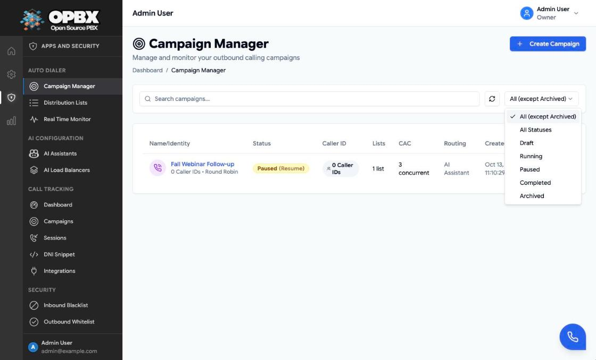
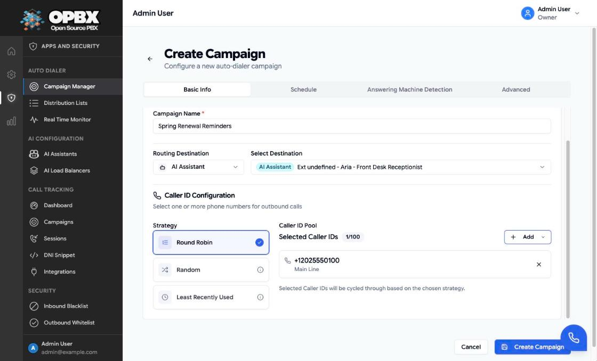
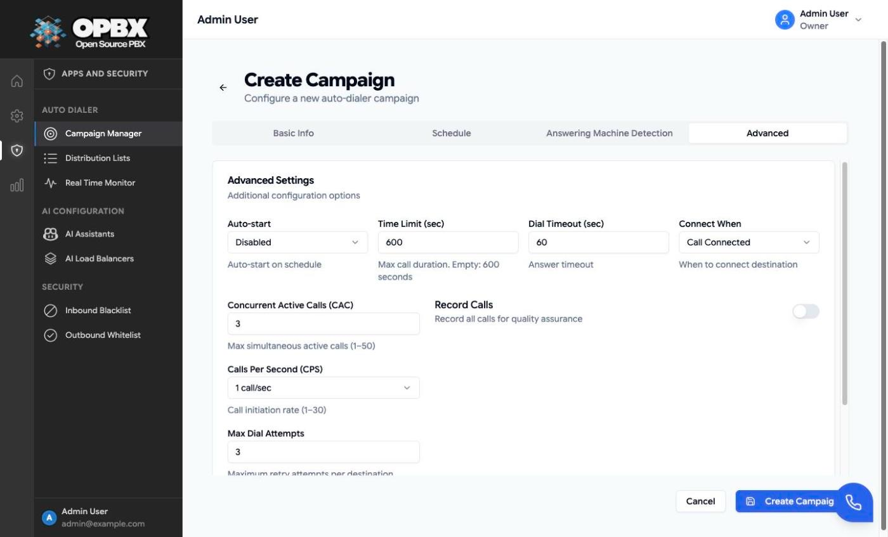
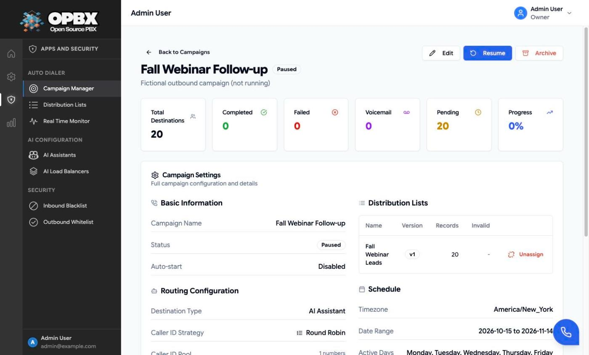

# Managing Campaigns

A campaign holds everything about one outbound calling run: where answered calls go, which caller IDs to show, when to dial, how fast, how often to retry and what to do when a voicemail answers. The numbers themselves live in [distribution lists](/opbx/applications/auto-dialer/distribution-lists) that you assign to the campaign; a campaign can hold several lists.

## Purpose

Use **Campaign Manager** to:

- create a campaign and edit it while it is Draft or Paused;
- start, pause and resume it;
- archive it and delete a Draft campaign (Owner only);
- see its progress, settings and assigned lists.

## Prerequisites

- You are the **Owner** or a **PBX Admin**. A **Reporter** can look at the campaigns but cannot change them (see [Permissions](#permissions)).
- An [AI assistant](/opbx/modules/ai-assistants) or [AI load balancer](/opbx/modules/ai-load-balancers) to receive answered calls, unless you only want to test with **Hang Up**.
- At least one **active** [phone number](/opbx/modules/phone-numbers) of your organization to use as the caller ID.

## The Campaign Manager page

Open **Auto Dialer → Campaign Manager**. Each row shows the campaign name (with the caller ID, or the number of caller IDs in the pool and the strategy, underneath), the status badge, the **Caller ID**, the number of assigned **Lists**, the **CAC** limit, the **Routing** destination and the **Created** date.

- **Search campaigns...** filters by name. The refresh button reloads the list.
- **Status filter**: **All (except Archived)** is the default. You can also pick **All Statuses**, **Draft**, **Running**, **Paused**, **Completed** or **Archived**. **Clear Filters** resets both.
- **The status badge is a button** for the Owner and PBX Admins: on **Draft** it reads "Draft (Start)" and starts the campaign, on **Running** "Running (Pause)" pauses it, on **Paused** "Paused (Resume)" resumes it. Completed and Archived badges do nothing.
- Clicking a row or the name opens the [campaign detail page](#the-campaign-detail-page).
- **Row actions** depend on the status:

| Status | Actions on the row |
|--------|--------------------|
| Draft | Edit (pencil) and, for the Owner, Delete (bin) |
| Running | **Edit**, disabled, with the hint "Pause the campaign to edit it" |
| Paused | **Edit** |
| Completed | **Archive** (Owner only; other roles see "-") |
| Archived | None |

A Reporter sees the page with a **Read-Only** badge, no **Create Campaign** button and no actions. Clicking a row does nothing for a Reporter.

## Create a campaign

Who can do this: Owner and PBX Admin. Other roles do not see **Create Campaign**.

1. Open **Auto Dialer → Campaign Manager** and click **Create Campaign**. The **Create Campaign** form opens on the **Basic Info** tab.
2. Enter the **Campaign Name**.
3. Under **Routing Destination**, choose **AI Assistant**, **AI Load Balancer** or **Hang Up**, then pick the assistant or load balancer under **Select Destination** (not needed for Hang Up).
4. Under **Caller ID Configuration**, choose a **Strategy**, then click **Add Caller IDs** (or **Add** once the pool has numbers) and pick one or more numbers from the search list. Remove a number with its **X**.
5. Open the **Schedule** tab and set the **Timezone**, **Start Date**, **End Date** and the **Active Hours** (see [Campaign Scheduling](/opbx/applications/auto-dialer/scheduling#set-the-schedule)).
6. Optionally open the **Answering Machine Detection** tab and switch on **Enable Detection** (see [Answering Machine Detection](/opbx/applications/auto-dialer/answering-machine-detection#turn-detection-on)).
7. Open the **Advanced** tab and check the rate limits, attempts, retries, timeouts and recording.
8. Click **Create Campaign** at the bottom.

Result: the toast "Campaign created successfully" appears and the campaign's detail page opens. The campaign is stored as **Draft**; nothing is dialed yet. To dial, [assign a Ready distribution list](/opbx/applications/auto-dialer/distribution-lists#assign-a-list-to-a-campaign) (the campaign stays **Draft**), then [start it](#start-a-campaign), or turn on **Auto-start**.

When a field is wrong, the form shows "Please fix the errors above before submitting." next to the buttons, or an error toast with the server's message (see [Common errors](#common-errors)). **Cancel** goes back without saving.

### Basic Info tab

| Field | Limits and default | Meaning |
|-------|--------------------|---------|
| Campaign Name | Required, up to 255 characters | Shown in lists and the monitor |
| Routing Destination | **AI Assistant** (default), **AI Load Balancer** or **Hang Up** | Where answered calls go. See [Campaign Routing](/opbx/applications/auto-dialer/routing-destinations) |
| Select Destination | Required unless the type is Hang Up | The assistant or load balancer |
| Strategy | Round Robin (default), Random, Least Recently Used | How the next caller ID is chosen from the pool |
| Caller ID Pool | 1 to 100 numbers (the counter shows *n*/100). Only **active** numbers of your organization are offered | The numbers callees see. The first number is also stored as the campaign's main caller ID |

The pool can only be changed while the campaign is **Draft** or **Paused**. On an active campaign the pool section shows **Pool Locked** and the strategy and pool are disabled.

### Caller ID strategies

| Strategy | How the next caller ID is chosen |
|----------|----------------------------------|
| Round Robin | Each number in turn |
| Random | A random number from the pool |
| Least Recently Used | The number that was used longest ago |

Round Robin and Random take each number's **weight** into account: a number with weight 2 is used twice as often as one with weight 1. Weights can be set through the API only (1 to 100); the form gives every number weight 1.

When a number is **retried**, the dialer prefers a caller ID that has not yet been tried for that number in the last hour.

:::note Caller-ID numbers are protected
A phone number in a campaign's caller-ID pool cannot be deleted. The delete is refused and the dialog lists the campaign as a "caller ID pool" use. Remove the number from the pool first. See [Phone Numbers](/opbx/modules/phone-numbers#delete).
:::

### Schedule tab

| Field | Limits and default | Meaning |
|-------|--------------------|---------|
| Timezone | Required. Default: UTC | The clock the schedule and dates are read in |
| Start Date | Required. Default: today. Today or later when you create | First day the campaign may dial |
| End Date | Required. Default: 30 days from today. On or after the start date | Last day the campaign may dial |
| Active Hours | A weekly grid. New campaigns start with Monday to Friday, 09:00 to 17:00 | The hours each weekday when dialing is allowed. Click time slots to toggle them |

See [Campaign Scheduling](/opbx/applications/auto-dialer/scheduling) for how the window is evaluated.

### Answering Machine Detection tab

| Field | Limits and default | Meaning |
|-------|--------------------|---------|
| Enable Detection | Off by default | Streams the call audio to the AMD worker, which listens for a voicemail beep |
| If Voicemail Detected | Hang up (default when enabled) or Continue to destination | Applied when a beep is heard |
| If Human Detected | Continue to destination (default when enabled) or Hang up | The detector does not report "human" today, so this has no effect |
| If Detection Unclear | Continue to destination (default when enabled) or Hang up | Applied when no beep is heard within the detection window |
| Retry on Voicemail | Off by default | Schedules another attempt when a voicemail was detected |

:::warning Read the AMD page before you set "If Detection Unclear" to Hang up
A call answered by a person ends as "unclear" when the detection window closes (about 30 seconds). With **If Detection Unclear** set to **Hang up**, those live conversations are hung up. Read [Answering Machine Detection](/opbx/applications/auto-dialer/answering-machine-detection) first.
:::

Switching **Enable Detection** off clears the actions and **Retry on Voicemail**; on save, detection is turned off for the campaign.

### Advanced tab

| Field | Limits and default | Meaning |
|-------|--------------------|---------|
| Auto-start | Disabled by default | Lets the scheduler start a Draft campaign on schedule (see [Auto-start](/opbx/applications/auto-dialer/scheduling#auto-start)) |
| Time Limit (sec) | 30 to 14400. Default: 600 (also when the field is left empty) | Maximum length of one call |
| Dial Timeout (sec) | 1 to 300. Default: 60 | How long the callee's phone rings before the attempt is given up |
| Connect When | Call Connected (default) or Immediately | Sent to Cloudonix as `execute`. **Call Connected** starts the call flow (routing, AMD) when the callee answers; **Immediately** starts it while the callee's phone is still ringing |
| Concurrent Active Calls (CAC) | 1 to 50. Default: 1 | Most calls in progress at once |
| Calls Per Second (CPS) | 1, 2, 3, 4, 5, 6, 10, 12, 15, 20, 25 or 30 calls/sec. Default: 1 | How fast new calls are started |
| Max Dial Attempts | 1 to 5. Default: 1 | Most attempts per number, including retries |
| Retry on busy / no-answer | Off by default | Redials a number whose call ended busy or unanswered, within Max Dial Attempts. Cancelled, failed and congested calls are never retried |
| First retry delay (minutes) | 1 to 1440. Default: 15. Shown when the retry switch is on | Wait before the first redial; each further retry waits twice as long, up to 24 hours |
| Record Calls | Off by default | Asks Cloudonix to record each call |

See [Rate Limiting](/opbx/applications/auto-dialer/rate-limiting) for CAC, CPS and attempts.

:::note Connect When and detection
Cloudonix turns its own machine detection off when a call is not started with **Call Connected**. If you use [Answering Machine Detection](/opbx/applications/auto-dialer/answering-machine-detection), keep **Call Connected**.
:::

## What happens when a call is placed

For each number, OPBX:

1. claims the number so it is dialed once, even if two requests race, and counts one attempt;
2. uses the caller ID the dialer worker picked from the pool;
3. chooses the outbound trunk from the first matching [outbound whitelist](/opbx/modules/outbound-whitelist) rule. When no rule matches, Cloudonix chooses the trunk;
4. asks Cloudonix to dial, with the dial timeout, time limit, recording flag and a 5-minute start deadline;
5. counts the call against the CAC limit until Cloudonix reports it ended.

If Cloudonix refuses the call, the number goes back to pending and is tried again after 1 minute, then 2 minutes; after **3 consecutive** refusals it is marked **Failed**. Each refusal uses one of the number's attempts, so with **Max Dial Attempts** 1 the number is marked **Failed** after the first refusal (within a minute).

## Start, pause, resume

| Action | Where | Allowed from | What happens |
|--------|-------|--------------|--------------|
| **Start** | Draft badge on the row, or **Start** on the detail page | Draft (the server also accepts Paused) | Needs an assigned list that is Ready or In Use. Status becomes Active (Running). The concurrent-call counter is reset |
| **Pause** | Running badge, **Pause** on the detail page, or the monitor | Active | No new calls. Calls still recorded as in progress are closed as cancelled and the concurrent-call counter is reset. OPBX does not hang up calls that are already connected |
| **Resume** | Paused badge, **Resume** on the detail page, or the monitor | Paused | Status becomes Active. The counter is reset |

An Active campaign only dials inside its schedule. Outside the window it stays **Running** but places no calls.

A campaign becomes **Completed** by itself, within a minute, once nothing is left to dial: every number is completed, failed or invalid, or pending with no attempts left, and no call is in progress. This applies however the campaign was started. A completed campaign can be archived.

### Start a campaign

Who can do this: Owner and PBX Admin.

1. Make sure a Ready list is assigned (see [Assign a list to a campaign](/opbx/applications/auto-dialer/distribution-lists#assign-a-list-to-a-campaign)).
2. Either click the **Draft (Start)** badge on the campaign's row, or open the campaign and click **Start**, then **Confirm** in the **Start Campaign** dialog ("Are you sure you want to start this campaign?").

Result: from the row, the toast "Campaign status updated" appears and the badge reads **Running**; from the detail page, the toast reads "Campaign started successfully" and the badge reads **Active**. Without a usable list the toast shows "Cannot start campaign without a destination list" and the campaign stays Draft.

{/* SCREENSHOT: auto-dialer-campaign-start-dialog — campaign detail page of a Draft campaign in Acme Corp (Demo) with the Start Campaign confirmation dialog open */}

### Pause a campaign

Who can do this: Owner and PBX Admin.

1. Click the **Running (Pause)** badge on the row, or open the campaign and click **Pause**, then **Confirm** in the **Pause Campaign** dialog. You can also click **Pause** on the [Real-Time Monitor](/opbx/applications/auto-dialer/real-time-monitor#pause-and-resume-from-the-monitor).

Result: the toast "Campaign status updated" (row) or "Campaign paused successfully" (detail page) appears and the badge reads **Paused**.

### Resume a campaign

Who can do this: Owner and PBX Admin.

1. Click the **Paused (Resume)** badge on the row, or open the campaign and click **Resume**, then **Confirm** in the **Resume Campaign** dialog. You can also click **Resume** on the Real-Time Monitor.

Result: the toast "Campaign status updated" (row) or "Campaign resumed successfully" (detail page) appears and the badge reads **Running** (**Active** on the detail page).

## Edit a campaign

Who can do this: Owner and PBX Admin, on a Draft or Paused campaign. A Running (Active) campaign cannot be edited: pause it first.

1. If the campaign is Running, pause it: click its **Running (Pause)** badge, or **Pause** on the detail page or the monitor. **Edit** stays disabled while it runs, with the hint "Pause the campaign to edit it". Opening the edit form of a Running campaign shows "Campaign is running" and disables **Update Campaign**.
2. Click **Edit** on the row or on the detail page. The **Edit Campaign** form opens with the campaign's values.
3. Change the fields on any tab.
4. Click **Update Campaign**.

Result: the toast "Campaign updated successfully" appears and you return to the page you came from. Resume the campaign to dial again.

The start date may be in the past when you edit. An edit sent for an Active campaign (for example through the API) changes nothing: the server answers 409 "Pause the campaign before editing it."

## Archive a campaign

Who can do this: the Owner only. Other roles do not see **Archive**.

1. Click **Archive** on a **Completed** row, or **Archive** on any campaign's detail page.
2. Confirm:
   - from the row, the **Archive Campaign** dialog asks "Are you sure you want to archive "*name*"? This action cannot be undone." Click **Archive**;
   - from the detail page, the **Archive Campaign** dialog asks "Are you sure you want to archive this campaign?" Click **Confirm**.

Result: the toast "Campaign archived successfully" appears. From the detail page you return to Campaign Manager, where the campaign is hidden by the default filter (choose **Archived** or **All Statuses** to see it).

Archiving an Active campaign pauses it first. Archived campaigns cannot be restored from the app.

{/* SCREENSHOT: auto-dialer-campaign-archive-dialog — Campaign Manager in Acme Corp (Demo) with the Archive Campaign confirmation dialog open for a Completed campaign */}

## Delete a campaign

Who can do this: the Owner only, and only for **Draft** campaigns. Other roles do not see the delete button.

1. Click the delete (bin) button on a **Draft** row.
2. In the **Delete Campaign** dialog ("Are you sure you want to delete "*name*"? This action cannot be undone. Associated lists will remain in the system."), click **Delete**.

Result: the toast "Campaign deleted successfully" appears and the row disappears. Use **Archive** for campaigns that have dialed.

{/* SCREENSHOT: auto-dialer-campaign-delete-dialog — Delete Campaign confirmation dialog for a Draft campaign */}

## The campaign detail page

Click a campaign's row or name (Owner and PBX Admin). The header has **Back to Campaigns**, the name, the status badge (Draft, Active, Paused, Completed or Archived), an **Auto-start** badge when enabled, and, for the Owner and PBX Admins, **Edit**, **Start**, **Pause** or **Resume** (whichever fits the status) and, for the Owner, **Archive**. The page refreshes every 10 seconds.

| Card | Meaning |
|------|---------|
| Total Destinations | Numbers on the assigned lists |
| Completed | Calls completed |
| Failed | Numbers that failed after their attempts |
| Voicemail | Calls where voicemail was detected |
| Pending | Numbers not yet dialed or waiting for a retry |
| Progress | Completed and failed as a share of the total |

Below the cards: the full configuration (routing, caller ID strategy and pool, dial timeout, connect mode, attempts, retry on busy / no-answer, CAC), the assigned distribution lists (name, version, records, invalid; five per page), the schedule (timezone, date range, active days), time limit, recording and the voicemail detection actions, or "Not configured".

For an Owner or PBX Admin each assigned list has **Unassign**, which takes the list back from the campaign (the list and its numbers are kept and it returns to **Ready**). Once the campaign has started processing a list's entries, the list shows **Locked** instead and can no longer be unassigned. See [Take a list back from a campaign](/opbx/applications/auto-dialer/distribution-lists#take-a-list-back-from-a-campaign).

## Permissions

| Action | Owner | PBX Admin | Reporter | PBX User | Supervisor |
|--------|:-----:|:---------:|:--------:|:--------:|:----------:|
| See the Auto Dialer pages and campaigns | Yes | Yes | Yes (read-only) | No | No |
| Open the campaign detail page from the list | Yes | Yes | No | No | No |
| Create, edit, start, pause, resume | Yes | Yes | No | No | No |
| Archive | Yes | No | No | No | No |
| Delete (Draft only) | Yes | No | No | No | No |

## Common errors

| Message (summary) | What it means | What to do |
|-------------------|---------------|-----------|
| The caller ID field is required | No number is in the caller-ID pool | Add at least one number to the pool |
| Caller ID must be in E.164 format | The main caller ID sent through the API is not E.164 | Use `+` and the country code |
| Invalid Caller ID pool: some DIDs do not exist, do not belong to your organization, or are not active | A pool number is inactive or not yours | Activate the number or remove it |
| A destination ID is required when routing to AI Assistant or AI Load Balancer | No destination picked | Pick the assistant or load balancer |
| The start date must be a date after or equal to today | Start date in the past on create | Pick today or later |
| Pause the campaign before editing it. | Edit sent while Running; nothing was changed | Pause, then edit |
| Cannot start campaign without a destination list | No list assigned, or the assigned list is not Ready or In Use | Assign a Ready list |
| This action is unauthorized | The action is not allowed for your role or for the campaign's status (for example deleting a campaign that is not Draft through the API) | Ask the Owner, or archive instead of delete |

## Related pages

- [Distribution Lists](/opbx/applications/auto-dialer/distribution-lists) — the numbers to dial
- [Campaign Scheduling](/opbx/applications/auto-dialer/scheduling)
- [Rate Limiting](/opbx/applications/auto-dialer/rate-limiting)
- [Answering Machine Detection](/opbx/applications/auto-dialer/answering-machine-detection)
- [Campaign Routing](/opbx/applications/auto-dialer/routing-destinations)
- [Real-Time Monitor](/opbx/applications/auto-dialer/real-time-monitor)
- [Auto Dialer Campaigns module](/opbx/modules/auto-dialer-campaigns) — fields, data and API reference
