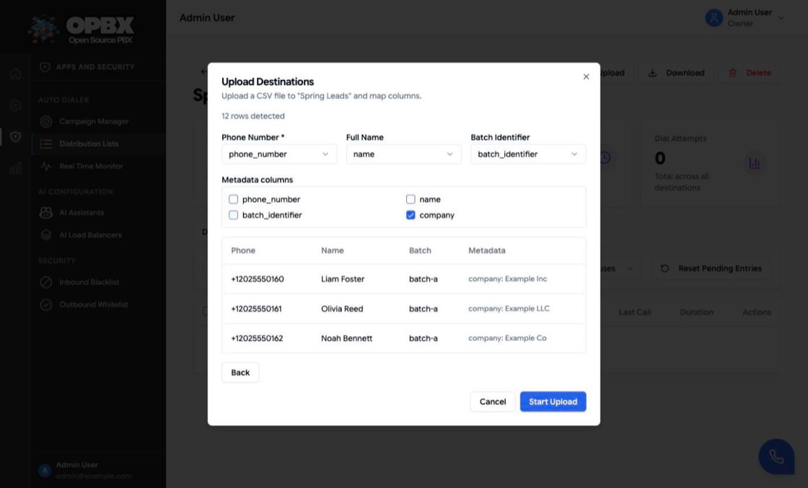
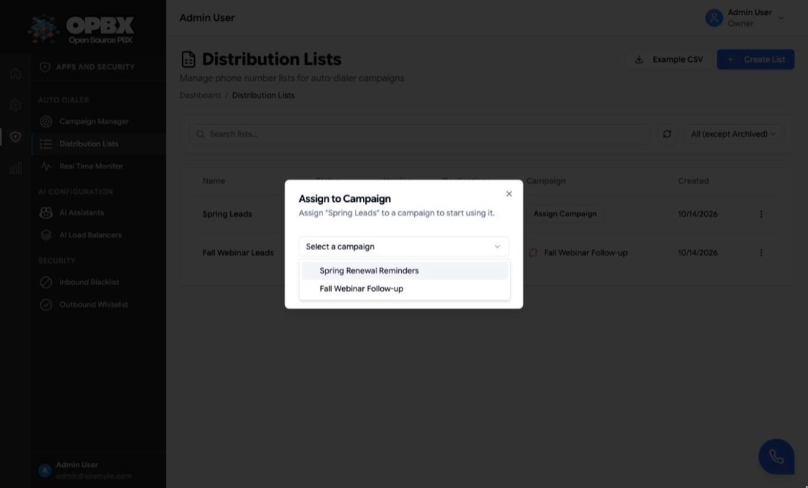
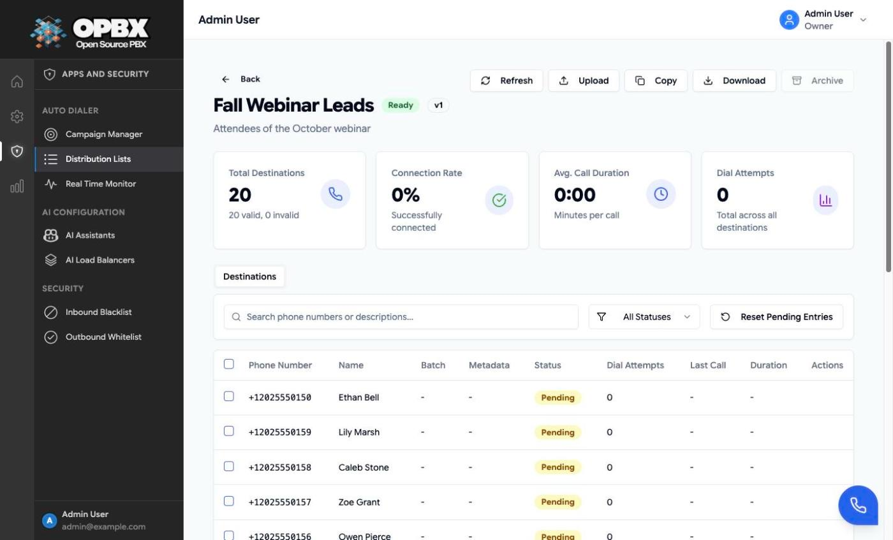
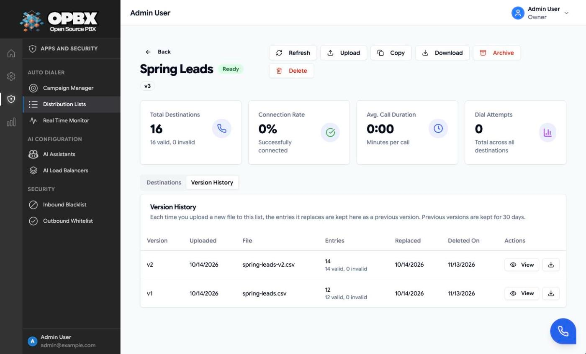
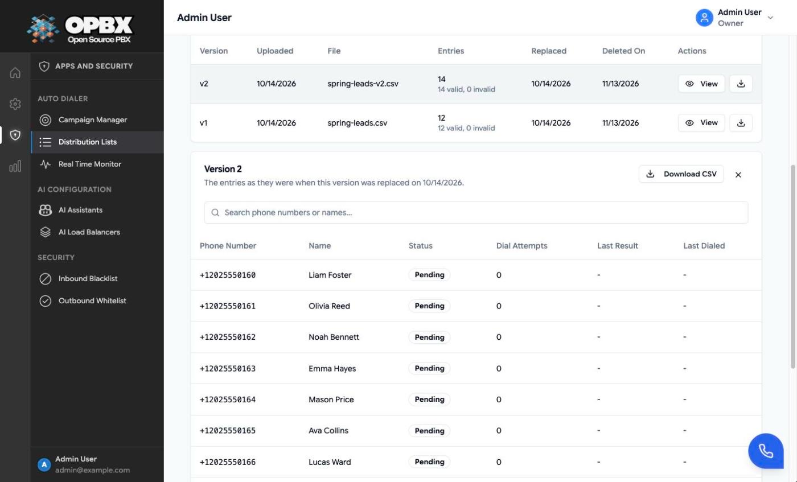
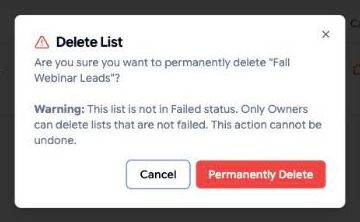

# Distribution Lists

A distribution list is the set of phone numbers a campaign dials. Each entry has a phone number and, optionally, a name, a batch identifier and extra metadata columns that are passed to the AI assistant on the call.

## Purpose

Use **Distribution Lists** to:

- create a list and upload numbers from a CSV file;
- see each number's status, attempts and last call;
- assign a list to a campaign, or take it back;
- reset numbers so they are dialed again;
- copy, download, archive or delete a list.

## Prerequisites

- You are the **Owner** or a **PBX Admin**. A **Reporter** can look at lists but cannot change them (see [Permissions](#permissions)).
- A CSV file with one column of phone numbers (with or without a header row).

## The Distribution Lists page

Open **Auto Dialer → Distribution Lists**. Each row shows the **Name**, **Status**, **Version**, number of **Destinations** (with the invalid count in red), the **Campaign** (or an **Assign Campaign** button) and the **Created** date. Only the latest version of each list is shown.

- **Search lists...** filters by name. The refresh button reloads the list.
- The **status filter** defaults to **All (except Archived)**; **All Statuses** also lists archived lists, and **Draft**, **Ready**, **Processing**, **Failed**, **In Use**, **Used** and **Archived** show only that status.
- **Example CSV** downloads a sample file (`distribution_list_example.csv`).
- **Create List** opens the create dialog.
- Clicking a row opens the [list detail page](#the-list-detail-page).
- The row menu (⋮) offers **View Details**, **Copy List**, **View Errors**, **Delete** and **Archive**, each only when the list's status and your role allow it (see [List statuses](#list-statuses)). For a list assigned to a campaign it shows a disabled **Archive (unassign first)**. Numbers are uploaded only from the [list detail page](#the-list-detail-page), with its **Upload** button, not from the row menu.

A Reporter sees the page and **Example CSV**, but not **Create List**, **Assign Campaign** or the change actions in the row menu.


## Create a list and upload numbers

Who can do this: Owner and PBX Admin.

1. Open **Auto Dialer → Distribution Lists** and click **Create List**.
2. In the **Create Distribution List** dialog, enter a **Name** (required, up to 255 characters, for example "Sales Leads Q1") and an optional **Description** (up to 1000 characters). Click **Create List**. The toast "List created successfully" appears, the list is added as **Draft** and its detail page opens.
3. On the list's detail page, click **Upload**. The **Upload Destinations** dialog opens. (To upload into a list later, click its row to open the detail page, then **Upload**.)
4. Click **Click to select a CSV file** and choose the file (`.csv`, up to 50 MB). Leave **File has a header row** ticked if the first row holds column names.
5. Click **Continue to Mapping**. The dialog shows how many rows were detected and guesses the columns whose names contain "phone", "name" and "batch".
6. Check the mapping:

| Mapping | Required | Meaning |
|---------|----------|---------|
| Phone Number * | Yes | The number to dial |
| Full Name | No | Shown in the list and passed to the assistant |
| Batch Identifier | No | A label to group numbers, for example `batch-a` |
| Metadata columns | No, any number | Every ticked column is stored per number and passed to the assistant |

7. Check the preview of the first three mapped rows (**Back** returns to the file choice) and click **Start Upload**.

Result: the toast "Upload started. Processing..." appears and the dialog shows a progress bar. When processing ends it shows "Upload completed successfully!" and closes by itself after two seconds; if it fails it shows "Upload failed. Check validation errors." (or "CSV validation failed. Check the file format and mapping."). The list is **Ready** if at least one number was valid, or **Failed** if none was. Invalid rows are counted and, on a Failed list, listed under **View Errors**.



### CSV format

```csv
phone_number,name,batch_identifier,company
+12025550140,Liam Foster,batch-a,Example Inc
+12025550141,Olivia Reed,batch-a,Example LLC
2025550142,Noah Bennett,batch-b,Example Co
```

- With **File has a header row** on, the first row holds the column names you map. With it off, every row is data and the columns are named `column_1`, `column_2`, and so on.
- Numbers are checked with the international phone-number rules and stored in E.164 format. A number without a leading `+` is read as a **US** number, so `2025550142` becomes `+12025550142`.
- The same number twice in one file is kept once.
- Blank rows and rows with an empty phone cell are skipped.

### Large files

A list holds at most **100,000** numbers. A file with more rows is split automatically: the first part goes into your list and each further part into a new list named "*name* (Part 2)", "(Part 3)" and so on. The parts belong to your list: they are listed on its **Parts** tab (see [See a list's parts](#see-a-lists-parts)), and deleting the list deletes them too.

## List statuses

| Status | Meaning | Upload | Assign | Copy | Archive |
|--------|---------|:------:|:------:|:----:|:-------:|
| Draft | Created, no numbers yet | Yes (adds) | No | No | No |
| Pending | Waiting to be re-processed | Yes (adds) | No | No | No |
| Processing | Upload being processed | No | No | No | No |
| Ready | Has valid numbers, not assigned | Replaces (see below) | Yes | Yes | Yes |
| Failed | No valid number, or processing failed | Yes (adds) | No | No | Not offered in the app (the API allows it); delete instead |
| In Use | Assigned to a campaign | No | No | Yes | No |
| Used | The campaign finished with it | Replaces | No | Yes | Only when it is not assigned to a campaign |
| Archived | Kept for history | No | No | Yes | No |

## Replacing the numbers of a Ready or Used list

Who can do this: Owner and PBX Admin.

1. Open the list's detail page and click **Upload**. The dialog warns "The current entries (v*n*) will be replaced by version *n+1*. You can still open and download them from the list's Version History tab."
2. Choose the file, map the columns as for a [new upload](#create-a-list-and-upload-numbers).
3. Click **Create Version & Upload**.

Result: the toast "Version *n+1* created. The previous entries are in Version History. Processing..." appears; when processing ends the dialog shows "Version *n+1* created and uploaded successfully!" and the page shows the toast "Upload completed successfully". The new file is processed into the same list with its version number increased by one. The numbers it replaces are kept, exactly as they were at that moment (status, dial attempts, last result), as a [previous version](#previous-versions) you can browse and download for 30 days.

On a Draft, Pending or Failed list, **Upload** on the detail page adds numbers as described in [Create a list and upload numbers](#create-a-list-and-upload-numbers). On a Processing, In Use or Archived list the **Upload** button is not shown.

## Assign a list to a campaign

Who can do this: Owner and PBX Admin.

1. On a **Ready** list's row, click **Assign Campaign**.
2. In the **Assign to Campaign** dialog, choose the campaign under **Select a campaign**. Only campaigns that are **Draft**, **Paused**, or **Active with a start date after today in the campaign's timezone** are offered; with none, the dialog says "No available campaigns found." The server applies the same rule, also to a list uploaded straight into a campaign through the API.
3. Click **Assign**.

Result: the toast "List assigned to campaign successfully" appears, the list becomes **In Use** and the row shows the campaign's name. The campaign's status does not change: a **Draft** campaign stays Draft until you [start it](/opbx/applications/auto-dialer/campaigns#start-a-campaign) (or auto-start does). An **Active** campaign whose start date has been reached is refused with "Assignment failed" and "Cannot assign list to "*name*" because it has already started. Pause the campaign first, then assign the list.", even outside its calling hours.

A campaign can hold several lists: assigning another list adds it next to the ones already assigned. The dialer takes pending numbers from all of the campaign's lists together, the numbers added earliest first; it does not finish one list before starting the next.



## Take a list back from a campaign

Who can do this: Owner and PBX Admin.

1. On the list's row, click the unassign icon (title "Unassign from campaign") next to the campaign name. You can also click **Unassign** next to the list on the [campaign's detail page](/opbx/applications/auto-dialer/campaigns#the-campaign-detail-page).

Result: the toast "List unassigned from campaign successfully" (on the campaign page, "List unassigned from campaign") appears and the list returns to **Ready**. The campaign's other lists and its status are not changed.

The same rules apply here and on the campaign's detail page:

- **The campaign must not be Active.** While it is, the row shows **Locked** instead of the icon (hover text "Cannot unassign list: its campaign is active. Pause the campaign first.") and the server refuses with that message. Pause the campaign, unassign the list, then resume.
- **Every number must still be pending with zero attempts.** Once the campaign has started processing the list's entries (a number was dialed, or is no longer pending), the list stays with the campaign for good: the row shows **Locked** (hover text "Cannot unassign list: its entries have started processing for this campaign (some destinations have been dialed or are no longer pending).") and the server refuses with that message. Use [Copy a list](#copy-a-list) to dial the same numbers with another campaign.

## The list detail page

Click a list's row or name, or choose **View Details** in the row menu. The header shows the name, status and version. For a part of a split list it also shows "Part of *list name*"; click the name to open the list it was split from. The buttons are:

| Button | Shown when | Does |
|--------|-----------|------|
| **Back** | Always | Returns to the list page |
| **Refresh** | Always | Reloads the list and its numbers |
| **Upload** | Owner and PBX Admin, list Draft, Pending, Failed, Ready or Used | Adds numbers, or [replaces them](#replacing-the-numbers-of-a-ready-or-used-list) on a Ready or Used list |
| **Copy** | Owner and PBX Admin, status allows | [Copies the list](#copy-a-list) |
| **Download** | Owner and PBX Admin | [Downloads the list](#download-a-list) |
| **Archive** | Owner and PBX Admin, Ready or Used and not assigned | [Archives the list](#archive-a-list). For an assigned list a disabled **Archive** explains "Unassign it first to archive or delete it." |
| **Delete** | Not assigned, and the Owner (any status) or a PBX Admin (Failed only) | [Deletes the list](#delete-a-list) |

Cards show the **Total Destinations** (valid and invalid), the **Connection Rate**, the **Avg. Call Duration** and the total **Dial Attempts**. When the list is assigned, the **Campaign Assignment** card shows the campaign, the **Assigned On** date and the campaign's status.

Tabs:

| Tab | Shown when | Content |
|-----|-----------|---------|
| Destinations | Always | Check boxes for selecting numbers (Owner and PBX Admin), phone number, name, batch, metadata (click **_n_ fields** to see them), status, dial attempts, last call (date and last result), duration and, for the Owner and PBX Admin, the reset icon. **Search phone numbers or descriptions...** searches the phone number; the filter offers All Statuses, Pending, Completed, Failed and Invalid |
| Version History | A file was uploaded over the list's numbers at least once | The [previous versions](#previous-versions) of the list, with the date each is deleted |
| Parts (*n*) | A large file was split into parts | The [parts](#see-a-lists-parts) the file was split into |
| Upload Info | A file was uploaded | The original file name, when it was processed, and the total, valid and invalid rows |



To read the rejected rows of a Failed list, use [View Errors](#view-the-errors-of-a-failed-list) in the list page's row menu. Numbers cannot be removed from a list in the app; upload a new version or copy the list instead.

### Reset dial attempts

Who can do this: Owner and PBX Admin. A Reporter does not see the reset buttons or the check boxes.

Resetting sets a number back to **pending** with zero attempts and clears its last result, retry time and last call, so the dialer picks it up again (it is dialed only while its campaign is Active and inside its schedule).

- **One number:** on the **Destinations** tab, click the reset icon (tooltip "Reset Dial Attempts") on the number's row. The icon is shown only for numbers that were dialed.
- **Several numbers:** tick their check boxes (or the header box for the whole page) and click **Reset Dial Attempts (*n*)**.
- **Every pending number:** click **Reset Pending Entries**. This sets every number that is still pending back to zero attempts and clears its retry time; completed and failed numbers are not touched.

Result: a toast with the server's message, for example "Dial attempts reset for 3 destinations" or "Reset 20 pending destinations".

## View the errors of a failed list

Who can do this: Owner, PBX Admin and Reporter.

1. On a **Failed** list's row, open the row menu (⋮) and choose **View Errors**.

Result: the **Validation Errors** dialog lists each rejected row with its row number, phone number and error, and the total. **Download CSV** saves them as *name*`_validation_errors.csv`; **Close** closes the dialog. Fix the file and upload it again with **Upload** on the list's detail page, or delete the list.

## Previous versions

Each time you [upload a new file over a list's numbers](#replacing-the-numbers-of-a-ready-or-used-list), the numbers it replaces are kept as a previous version of the list, exactly as they were at that moment. The **Version History** tab lists them, newest first, under the note "Previous versions are kept for 30 days." Each row shows:

| Column | Content |
|--------|---------|
| Version | The version number (v1, v2, ...) |
| Uploaded | When that version's file was uploaded, and by whom when known |
| File | The name of the file that version came from, when known |
| Entries | How many numbers it held, and the valid and invalid rows of its file when known |
| Replaced | When a new upload replaced it |
| Deleted On | The day the version is deleted |

A previous version is deleted automatically 30 days after it was replaced (the period is the `RETENTION_AUTO_DIALER_LIST_VERSIONS_DAYS` setting, see [Configuration](/opbx/data-models/configuration#data-retention)). Download it before then if you need to keep it. Deleting the list deletes its previous versions at once.



### Browse a previous version

Who can do this: Owner, PBX Admin and Reporter.

1. Open the list's detail page and click the **Version History** tab.
2. On the version's row, click **View**.
3. To find a number, type part of the phone number or the name in **Search phone numbers or names...**.
4. Use **Previous** and **Next** to page through the entries, 25 per page.
5. Click the close icon to put the version away.

Result: a card titled **Version *n*** opens under the list of versions. It shows each number with its name, status, dial attempts, last result and when it was last dialed, as they were when the version was replaced. A previous version is read-only: it cannot be assigned, dialed or edited. To call its numbers again, download it and upload the file to a list.



### Download a previous version

Who can do this: Owner and PBX Admin.

1. Open the list's detail page and click the **Version History** tab.
2. Click the download icon on the version's row, or **View** and then **Download CSV**.

Result: the browser saves "*list name* (version *n*).csv" with the columns `phone_number`, `name`, `batch_identifier`, `metadata` (JSON), `status`, `dial_attempts`, `last_disposition` and `last_dialed_at`. If the download fails, the toast "Failed to download version" appears.

## See a list's parts

Who can do this: Owner, PBX Admin and Reporter.

1. Open the detail page of the list you uploaded the large file to.
2. Click the **Parts (*n*)** tab.
3. To work with a part, click **Open** on its row.

Result: the tab lists every "*name* (Part *n*)" list the file was split into, with its status, number of valid entries and the campaign it is assigned to. **Open** opens the part's own detail page, where you assign, download or copy it like any list; its header says "Part of *list name*" with a link back.

{/* SCREENSHOT: auto-dialer-lists-parts — Parts tab of a list split from a large file: two parts, one assigned to a campaign */}

## Copy a list

Who can do this: Owner and PBX Admin.

1. Choose **Copy List** in the row menu, or **Copy** on the detail page.
2. In the **Copy List** dialog, enter the **New List Name**. It must be unique among your lists that are not archived.
3. Click **Copy List**. The dialog shows "Copying List" while the numbers are duplicated.

Result: the toast "List copied successfully" names the source, the copy and the number of destinations, and the dialog closes. The copy is a new, unassigned **Ready** list (version 1) with the same numbers, names, batches and metadata, all reset to pending with zero attempts. Use it to call the same audience again with another campaign. A name already in use gives "Copy failed" with "A list with this name already exists".

## Download a list

Who can do this: Owner and PBX Admin.

1. On the list's detail page, click **Download**.

Result: the browser saves *name*`.csv` with the columns `phone_number`, `name`, `batch_identifier`, `metadata` (JSON), `status` and `dial_attempts`, and the toast "List downloaded successfully" appears.

## Archive a list

Who can do this: Owner and PBX Admin.

1. Choose **Archive** in the row menu or on the detail page.
2. In the **Archive List** dialog ("Are you sure you want to archive "*name*"? This action cannot be undone. Archived lists cannot be used in campaigns."), click **Archive List**.

Result: the toast "List archived successfully" (row menu) or "List archived" (detail page) appears. The list is hidden by the default filter (choose **Archived** or **All Statuses** to see it) and can still be copied.

Archiving is offered for **Ready** and **Used** lists that are **not assigned to a campaign**. Archiving an assigned list is refused with a message naming the campaign; unassign the list first.

## Delete a list

Who can do this: the Owner for any list that is not assigned to a campaign; a PBX Admin for **Failed** lists only. **Delete** is shown only to those roles.

1. Choose **Delete** in the row menu or on the detail page.
2. In the **Delete List** dialog, click **Permanently Delete**. For a list that is not Failed the dialog warns that only Owners can delete such lists. For a list split from a large file the dialog also says how many parts are deleted with it.

Result: the toast "List deleted successfully" (row menu) or "List deleted" (detail page, which then returns to the list page) appears. The list is deleted completely: the list, all its numbers, their dialing records and its [previous versions](#previous-versions). It cannot be restored. The lists created by splitting a large file into it ("*name* (Part 2)" and so on) are deleted the same way, all together.

If the server is asked to delete a list that a campaign still uses, or a list one of whose parts a campaign still uses, it refuses, deletes nothing, and the **Cannot delete: still in use** dialog names the campaign (and the part, for a part). Unassign the list or part first, then delete the list.



## Permissions

| Action | Owner | PBX Admin | Reporter | PBX User | Supervisor |
|--------|:-----:|:---------:|:--------:|:--------:|:----------:|
| See lists, numbers, previous versions and parts | Yes | Yes | Yes (read-only) | No | No |
| Create, upload, assign, unassign, copy, archive | Yes | Yes | No | No | No |
| Reset dial attempts, download (lists and previous versions) | Yes | Yes | No | No | No |
| Delete | Any unassigned list | Failed lists only | No | No | No |

## Common errors

| Message (summary) | What it means | What to do |
|-------------------|---------------|-----------|
| Name is required | The name field is empty | Enter a name |
| Please upload a CSV file | The file does not end in `.csv` | Choose a CSV file |
| CSV must contain a column mapped to phone_number | The phone column was not mapped | Map the phone column (use the header-row switch to match your file) |
| List is not ready for assignment | The list is not Ready | Wait for processing, or fix a Failed upload |
| Cannot assign list … because it has already started. Pause the campaign first | The campaign is Active and its start date has been reached | Pause the campaign, assign, then resume |
| Cannot unassign list: its campaign is active. Pause the campaign first. | The list's campaign is Active | Pause the campaign, unassign, then resume |
| Cannot unassign list: its entries have started processing for this campaign … | Calls were made from the list, or a number is no longer pending | Leave it, or copy the list |
| A list with this name already exists | Copy name in use | Choose another name |
| Batch would exceed maximum list size of 100000 | Adding numbers through the API would pass the limit | Use another list |

## Related pages

- [Managing Campaigns](/opbx/applications/auto-dialer/campaigns)
- [Campaign Routing](/opbx/applications/auto-dialer/routing-destinations) — how metadata reaches the AI assistant
- [Distribution Lists module](/opbx/modules/distribution-lists) — data and API reference
