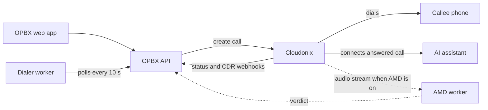
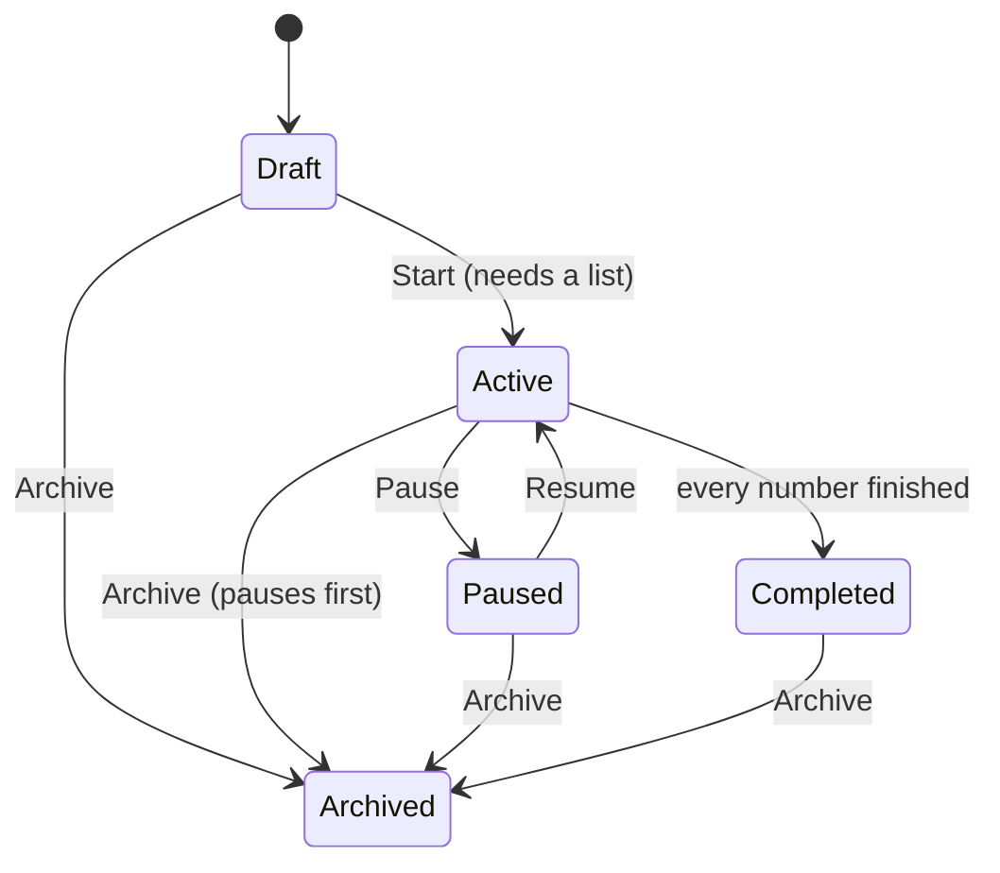

# Auto Dialer Overview

The Auto Dialer places outbound calls for you. A **campaign** dials every number on a **distribution list**, inside a weekly schedule, at a rate you control, and connects each answered call to an **AI assistant** or an **AI load balancer** (or hangs up, for testing). Optional answering machine detection hangs up on, or keeps, calls that reach a voicemail.

## Purpose

Use the Auto Dialer for outbound work such as webinar follow-ups, appointment reminders, surveys and lead qualification, where an AI assistant holds the conversation.

## Prerequisites

1. **Role.** You are the **Owner** or a **PBX Admin**. The three Auto Dialer pages are hidden from every other role.
2. **A routing destination.** An [AI assistant](/modules/ai-assistants) or an [AI load balancer](/modules/ai-load-balancers). See [Campaign Routing](/applications/auto-dialer/routing-destinations).
3. **At least one caller ID.** An **active** phone number of your organization, used as the caller ID. See [Phone Numbers](/modules/phone-numbers).
4. **The dialer worker is running.** The Go dialer worker places the calls. It runs as a single replica. See [Dialer Worker](/workers/dialer-worker).
5. **For voicemail detection:** the AMD worker is running. See [AMD Worker](/workers/amd-worker).

## The three pages

The sidebar section **Auto Dialer** has three entries:

| Page | What you do there | Guide |
|------|-------------------|-------|
| **Campaign Manager** | Create, edit, start, pause, resume, archive and delete campaigns | [Managing Campaigns](/applications/auto-dialer/campaigns) |
| **Distribution Lists** | Create lists, upload CSV files, assign a list to a campaign | [Distribution Lists](/applications/auto-dialer/distribution-lists) |
| **Real Time Monitor** | Watch active and paused campaigns, live calls and dispositions | [Real-Time Monitor](/applications/auto-dialer/real-time-monitor) |

## How a call is placed

1. Every poll (10 seconds by default), the dialer worker asks OPBX for campaigns that are **Active and inside their schedule**.
2. For each one it fetches a batch of pending numbers and asks OPBX to place each call, paced by the campaign's rate limits.
3. OPBX picks the caller ID, builds the call instructions for the routing destination and asks Cloudonix to dial.
4. When the callee answers, Cloudonix connects the call to the AI assistant.
5. Cloudonix reports the outcome to OPBX, which updates the number's status and the campaign counters.

The dialer worker has no schedule logic of its own: OPBX decides which campaigns may dial right now.

## Campaign lifecycle

| Status | The list shows | Meaning | Editable |
|--------|----------------|---------|----------|
| Draft | Draft | New campaign. Can be deleted | Yes |
| Active | Running | Dials whenever the schedule allows | No. Pause first |
| Paused | Paused | No new calls | Yes |
| Completed | Completed | Every number reached a final state (set automatically within a minute of the last number finishing; see [Managing Campaigns](/applications/auto-dialer/campaigns#start-pause-resume)) | No |
| Archived | Archived | Kept for history, hidden by the default filter | No |

:::note Assigning a list does not start the campaign
Assigning a distribution list leaves a **Draft** campaign in Draft. Start it when the settings are final.
:::

## Quick start

1. **Create the campaign.** **Campaign Manager**, then **Create Campaign**. Choose the routing destination and at least one caller ID, set the schedule, rate limits and (optionally) voicemail detection. The campaign is saved as **Draft**.
2. **Create the list.** **Distribution Lists**, then **Create List**, then **Upload Destinations** with a CSV file. Wait until the list shows **Ready**.
3. **Assign the list and start.** On the list row, click **Assign Campaign** and choose your campaign, then press **Start** on the campaign. It becomes **Active**.
4. **Watch it.** Open **Real Time Monitor**.

## Related pages

- [Managing Campaigns](/applications/auto-dialer/campaigns) — full campaign walk-through
- [Distribution Lists](/applications/auto-dialer/distribution-lists) — CSV format, statuses and assignment
- [Campaign Scheduling](/applications/auto-dialer/scheduling) — timezone, dates and weekly hours
- [Rate Limiting](/applications/auto-dialer/rate-limiting) — CAC, CPS, attempts and retries
- [Answering Machine Detection](/applications/auto-dialer/answering-machine-detection) — voicemail handling
- [Campaign Routing](/applications/auto-dialer/routing-destinations) — where answered calls go
- [Real-Time Monitor](/applications/auto-dialer/real-time-monitor) — live view
- [Auto Dialer Campaigns module](/modules/auto-dialer-campaigns) and [Distribution Lists module](/modules/distribution-lists) — field and API reference
