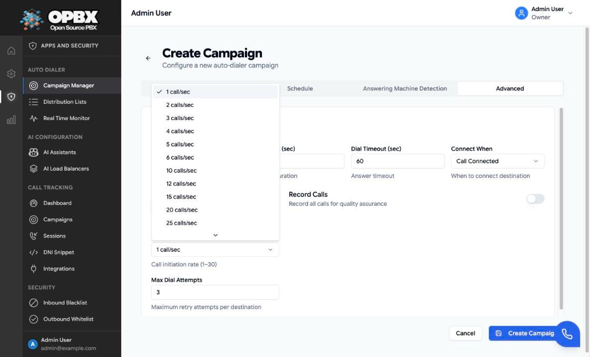

# Rate Limiting (CAC and CPS)

Two limits control how hard a campaign dials. **CAC** (concurrent active calls) caps how many of its calls may be in progress at once. **CPS** (calls per second) caps how fast new calls are started. **Max Dial Attempts** caps how often one number is tried.

## Purpose

Use these limits to match the campaign to what its destination can take: an AI assistant that handles five simultaneous conversations should not receive twenty, and a carrier may limit how fast you start calls.

## Prerequisites

- A campaign in **Draft** or **Paused** status. The limits are on the **Advanced** tab of the campaign form. See [Managing Campaigns](/opbx/applications/auto-dialer/campaigns).

## Set the rate limits

Who can do this: Owner and PBX Admin.

1. Open **Auto Dialer → Campaign Manager**. Pause the campaign if it is Running.
2. Click **Edit** on the campaign (or **Create Campaign** for a new one) and select the **Advanced** tab.
3. Enter **Concurrent Active Calls (CAC)**, pick **Calls Per Second (CPS)** and enter **Max Dial Attempts**.
4. Optionally switch on **Retry on busy / no-answer** and set **First retry delay (minutes)**.
5. Click **Update Campaign** (or **Create Campaign**).

Result: the toast "Campaign updated successfully" (or "Campaign created successfully") appears. The dialer worker uses the new limits from its next poll.

## Fields

| Field | Limits and default | Meaning |
|-------|--------------------|---------|
| Concurrent Active Calls (CAC) | 1 to 50. Default: 1 | Most calls of this campaign in progress at the same time |
| Calls Per Second (CPS) | 1, 2, 3, 4, 5, 6, 10, 12, 15, 20, 25 or 30 (the API accepts 1 to 30). Default: 1 | Fastest rate at which new calls start. 2 CPS means at least 500 ms between call starts |
| Max Dial Attempts | 1 to 5. Default: 1 | Most attempts per number, retries included |
| Retry on busy / no-answer | Off by default | Redial busy and unanswered numbers while attempts remain |
| First retry delay (minutes) | 1 to 1440. Default: 15 | Wait before the first redial; each further one waits twice as long, up to 24 hours |

## How the limits work together

Every poll (every 10 seconds by default), the dialer worker handles each runnable campaign like this:

1. **Batch size** = CPS × poll interval in seconds, but never more than CAC. With the default 10-second poll: CPS 1 and CAC 3 gives a batch of 3; CPS 5 and CAC 50 gives 50.
2. It fetches up to that many **pending** numbers whose attempts are below Max Dial Attempts and whose retry time (if any) has passed, oldest first.
3. Before each call it reserves a CAC slot. If the campaign already has CAC calls in progress, the number waits for a later poll.
4. Between call starts it waits at least 1000 ÷ CPS milliseconds.
5. A slot is released when Cloudonix reports that the call ended, or straight away if the call could not be placed.

So **CAC limits load and CPS limits speed**. With long calls, CAC is reached quickly and the campaign dials only as fast as calls finish. With short calls or many unanswered numbers, CPS and the 10-second poll set the pace.

| CAC | CPS | Behaviour |
|-----|-----|-----------|
| 1 | 1 | One call at a time. Good for a first test |
| 10 | 1 | Up to 10 calls, started at most one per second |
| 5 | 10 | Five calls start within about half a second, then nothing until calls end |
| 50 | 5 | Up to 50 per poll, five per second: about 10 seconds to fill |

## Keeping the count right

OPBX keeps the count of calls in progress for each campaign:

- It is reset to zero when the campaign is started, paused or resumed.
- It goes down when Cloudonix reports that a call ended.
- Every minute a reconciliation job corrects it against the calls OPBX knows to be in progress, so a missed or duplicate report cannot block a campaign for long.

The dialer worker runs as a **single replica**; the CPS pacing is kept inside that one process. Do not scale it out. See [Dialer Worker](/opbx/workers/dialer-worker).

One worker processes at most 10 campaigns at the same time. OPBX accepts at most `DIALER_WORKER_RATE_LIMIT` worker requests per minute (default 1000). If OPBX answers HTTP 429, the worker waits the `Retry-After` time (5 minutes when none is given) and skips the rest of that campaign's batch.

## Attempts and retries

Each call to a number counts as one attempt. A number is dialed again only while its attempts are below **Max Dial Attempts**.

| Situation | What happens |
|-----------|--------------|
| Cloudonix refuses to place the call | The number goes back to pending and is retried after 1 minute, then 2 minutes. After **3 consecutive** refusals it is marked **Failed**. Each refusal also uses an attempt, so the number fails earlier when Max Dial Attempts is reached |
| Voicemail detected and **Retry on Voicemail** is on | The number goes back to pending with a delay of 5, 10, 20, then 40 minutes (doubling with each attempt), while attempts remain. See [Answering Machine Detection](/opbx/applications/auto-dialer/answering-machine-detection) |
| The call was answered | The number is **Completed** |
| Busy or no answer | With **Retry on busy / no-answer** on and attempts left, the number goes back to pending after the campaign's **First retry delay** (default 15 minutes), and each further retry waits twice as long as the one before (15, 30, 60, 120 ... minutes), up to 24 hours. Otherwise it is **Failed** |
| Failed, cancelled, congestion or a result OPBX does not recognise | The number is **Failed**. These are never retried |

To call failed numbers again, select them on the list's detail page and use **Reset Dial Attempts** (see [Reset dial attempts](/opbx/applications/auto-dialer/distribution-lists#reset-dial-attempts)), or copy the list.

On a retry, the dialer prefers a caller ID from the pool that has not been tried for that number yet.

## Choosing values

1. **Start small.** CAC 1, CPS 1, one test list of a few of your own numbers.
2. **Match the destination.** Set CAC no higher than the number of simultaneous calls your AI assistant or load balancer can handle.
3. **Respect the carrier.** Keep CPS within what your trunk allows.
4. **Watch the monitor.** CAC utilization near 100 % with callers waiting means the destination is the bottleneck; low utilization with pending numbers means CPS or the schedule is.

## Troubleshooting

| Symptom | Likely cause | What to do |
|---------|--------------|-----------|
| Campaign is Running but nothing is dialed | Outside the schedule; no pending numbers; CAC full | Check the schedule and the list; see the monitor's Active Calls and CAC Utilization |
| Active calls stays at the CAC limit with no calls in progress | Ended calls were not reported yet | Wait for the per-minute reconciliation, or pause and resume (resets the count) |
| Numbers stay pending | Their retry time has not passed, or attempts reached the maximum | Check the number's attempts and last result on the list's detail page |

## Related pages

- [Managing Campaigns](/opbx/applications/auto-dialer/campaigns)
- [Campaign Scheduling](/opbx/applications/auto-dialer/scheduling)
- [Real-Time Monitor](/opbx/applications/auto-dialer/real-time-monitor)
- [Dialer Worker](/opbx/workers/dialer-worker)
