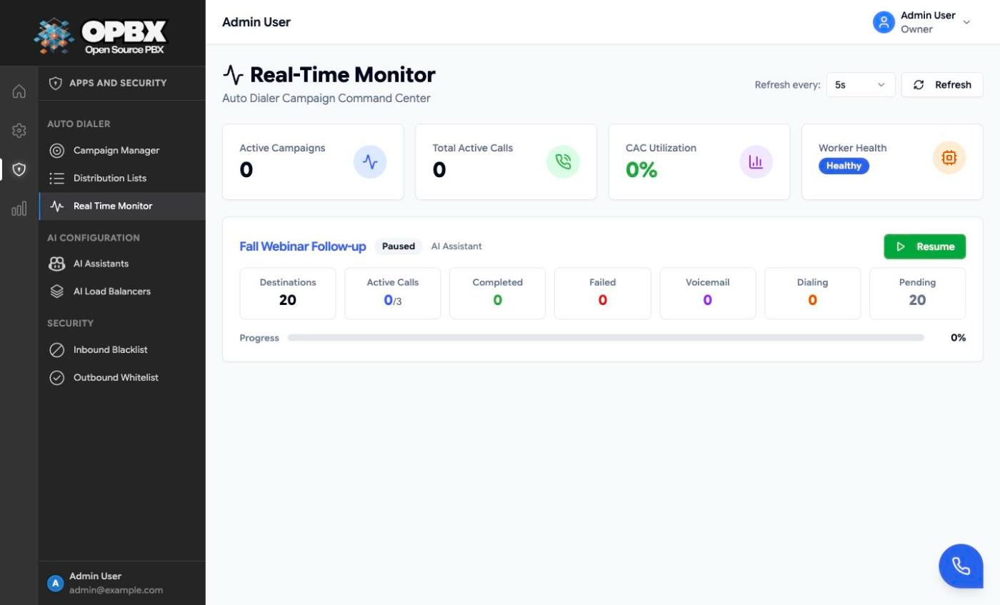
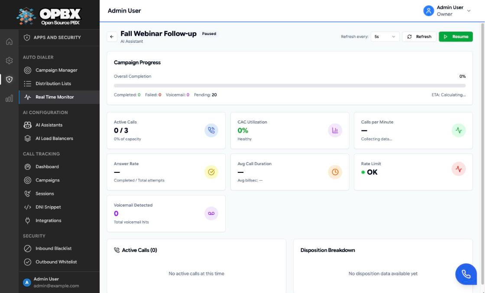

# Real-Time Monitor

The **Real Time Monitor** is the Auto Dialer's command center. It shows every **Active** and **Paused** campaign with live counters, and lets you drill into one campaign to see its calls in progress and how calls ended.

## Purpose

Use the monitor while a campaign runs to check that it dials, that it stays within its limits, and that the dialer worker is healthy. Pause or resume a campaign from here.

## Prerequisites

- You are the **Owner** or a **PBX Admin**.
- For the **Worker Health** card: the dialer worker's health address is configured in OPBX (`services.dialer_worker.health_url`). Without it the card shows **unknown**.

## Open the monitor

Open **Auto Dialer → Real Time Monitor**. Draft, Completed and Archived campaigns are not shown. With no Active or Paused campaign, the page says "No active campaigns".

## Refresh

The refresh picker in the header offers **Manual**, 1s, 5s, **10s** (default), 20s, 30s, 40s, 50s and 60s. Your choice is remembered in this browser. Polling stops while the browser tab is hidden and resumes when you come back. With **Manual**, use the refresh button.

The server caches the overview for 5 seconds and a campaign's statistics for 10 seconds, so faster settings mostly show the same numbers.

## Overview

### Summary cards

| Card | Meaning |
|------|---------|
| Active Campaigns | Campaigns in Active status (paused ones are shown as cards but not counted here) |
| Total Active Calls | Calls in progress across them |
| CAC Utilization | Calls in progress as a share of the campaigns' combined CAC limits |
| Worker Health | The dialer worker's own health report: healthy, unknown (no health address configured) or offline (no answer within 5 seconds) |

### Campaign cards

One card per campaign:

- **Header**: name, status, routing destination, and a **Pause** or **Resume** button.
- **Counters**: Destinations, Active Calls (shown as *active*/*CAC limit*), Completed, Failed, Voicemail, Dialing, Pending.
- **Footer**: a progress bar and a **Rate** indicator. "OK" is normal; "Limited" means the dialer asked OPBX to hold the campaign, with the time it resumes.

A **Paused** campaign always shows 0 active calls.

:::note The monitor tidies up stuck numbers
Loading the monitor (overview or drill-down) also corrects stuck numbers of the campaigns it shows: a number left in **Dialing** for more than 5 minutes (or any Dialing number of a paused campaign) goes back to **Pending**, or to **Failed** when it has no attempts left; a pending number with no attempts left becomes **Failed**.
:::

## Drill-down

Click a campaign card. The back arrow returns to the overview.

| Section | Content |
|---------|---------|
| Campaign Progress | Overall completion with the completed, failed, voicemail and pending counts, and an estimated finish time once a calls-per-minute rate is known |
| Active Calls | Calls in progress against the CAC limit |
| CAC Utilization | Active calls as a share of CAC |
| Calls per Minute | Calls started per minute, measured between refreshes in your browser (empty until two refreshes have passed) |
| Answer Rate | Completed calls divided by all attempts |
| Avg Call Duration | Average length of connected calls |
| Rate Limit | OK, or Throttled with the time the campaign resumes |
| Voicemail Detected | Calls where voicemail detection heard a beep |
| Active calls table | Phone number, status and duration of each call in progress |
| Disposition Breakdown | A chart of how calls ended |

## Pause and resume from the monitor

Click **Pause** or **Resume** on a card or in the drill-down. The effect is the same as on the Campaign Manager: see [Start, pause, resume](/applications/auto-dialer/campaigns#start-pause-resume).

## Reading the monitor

| What you see | What it usually means | What to do |
|--------------|-----------------------|-----------|
| Active Calls stays at the CAC limit | The destination is the bottleneck, or calls are long | Raise CAC only if the assistant can take more calls |
| Running, 0 active calls, pending numbers left | Outside the schedule window, or numbers are waiting for their retry time | Check the [schedule](/applications/auto-dialer/scheduling) |
| Running, 0 pending, 0 active calls | The list is finished | Pause or archive the campaign (see [Managing Campaigns](/applications/auto-dialer/campaigns#start-pause-resume)) |
| Many Failed quickly | Calls are being refused (caller ID, trunk) or the destination is missing | Check [Call Logs](/modules/call-logs) and the [routing](/applications/auto-dialer/routing-destinations) |
| Worker Health offline | The dialer worker is down | Check the worker. See [Dialer Worker](/workers/dialer-worker) |

## Related pages

- [Managing Campaigns](/applications/auto-dialer/campaigns)
- [Rate Limiting](/applications/auto-dialer/rate-limiting)
- [Campaign Scheduling](/applications/auto-dialer/scheduling)
- [Dialer Worker](/workers/dialer-worker)
