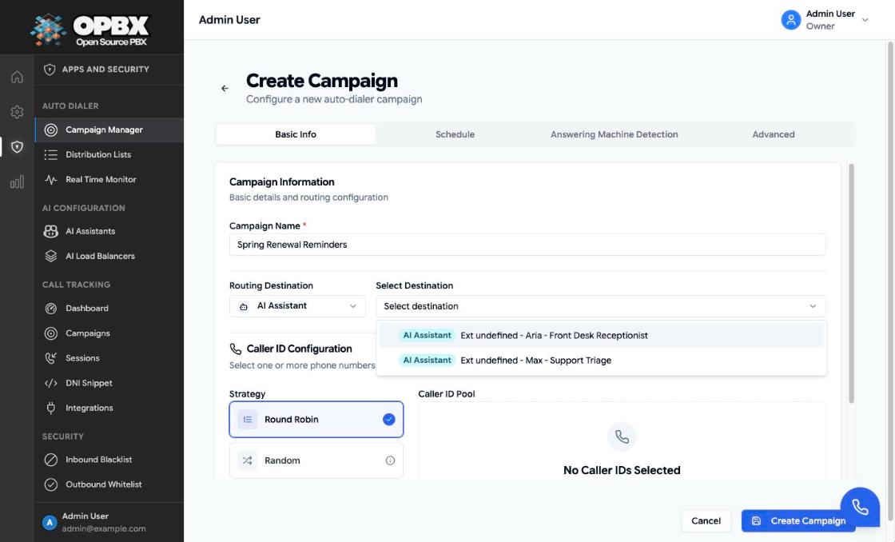
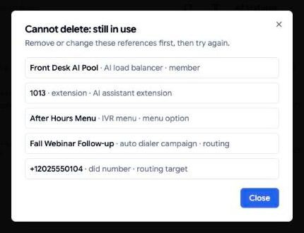

# Campaign Routing

Every campaign has one **routing destination**. When a callee answers, Cloudonix connects the call there. A campaign can route to an **AI assistant**, an **AI load balancer**, a **ring group**, a **call queue**, or **Hang Up**.

## Purpose

Choose the routing destination to decide who talks to the people your campaign calls.

## Prerequisites

- The destination exists in your organization: an [AI assistant](/opbx/modules/ai-assistants), an [AI load balancer](/opbx/modules/ai-load-balancers) with active members, a [ring group](/opbx/modules/ring-groups) or a [call queue](/opbx/modules/call-queues).
- A campaign in **Draft** or **Paused** status. See [Managing Campaigns](/opbx/applications/auto-dialer/campaigns).

## Set the destination

Who can do this: Owner and PBX Admin.

1. Open **Auto Dialer → Campaign Manager**. Pause the campaign if it is Running.
2. Click **Edit** on the campaign (or **Create Campaign** for a new one). The form opens on the **Basic Info** tab.
3. Under **Routing Destination**, choose **AI Assistant**, **AI Load Balancer**, **Ring Group**, **Call Queue** or **Hang Up**. Changing the type clears the previous selection.
4. Under **Select Destination**, choose the assistant, load balancer, ring group or queue. **Hang Up** needs no selection.
5. Click **Update Campaign** (or **Create Campaign**).

Result: the toast "Campaign updated successfully" (or "Campaign created successfully") appears and the **Routing** column of Campaign Manager shows the type you chose. Without a destination (any type except **Hang Up**) the save is refused with "A destination is required unless the campaign hangs up." on create.

The campaign form has no **Disconnect** or "Destination unavailable" choice: a campaign is always routed to one of the types below.

## Destination types

| Type | What the callee reaches | Typical use |
|------|-------------------------|-------------|
| AI Assistant | One AI assistant, over SIP or WebSocket depending on how the assistant is set up | A single assistant handles the campaign |
| AI Load Balancer | One of the load balancer's active assistants, picked by its strategy, with failover to the next one | Higher volume, redundancy |
| Ring Group | The ring group's members, rung with the ring group's own strategy, timeout and fallback | Hand answered contacts to a team of people |
| Call Queue | The call queue: the contact waits on hold until an agent takes the call, as an inbound caller would | Callback and outreach campaigns staffed by agents |
| Hang Up | The call is ended as soon as it is answered | Testing the dialer, schedule and rates without using an assistant |

### AI assistant over SIP

The call is dialed to the assistant's service. If the assistant has an AI-assistant extension with a service URL, that URL (with its token and parameters) is used; otherwise the provider and the assistant's phone number are used. If neither is configured, the call is hung up.

### AI assistant over WebSocket

The call audio is streamed to the provider's WebSocket address, built from the provider's URL template with the call's details filled in.

### AI load balancer

OPBX asks the load balancer for an assistant according to its strategy, considering only **active** members whose assistant is **active**. It also gives Cloudonix a follow-through address: if that assistant fails (busy, no answer and so on), the next assistant is tried. If no member is available, the call is hung up.

### Ring group and call queue

When the contact answers, OPBX routes the live call to the ring group or queue exactly as it routes an inbound call to it. Agents and members see the **contact's number** as the caller (on a simultaneous ring group and on a queue that rings agents in separate calls), and the call appears in Live Calls and the queue's statistics like any other. Distribution-list metadata is not passed to people. If voicemail detection is on, it runs first, as for any other destination.

#### Wait for available agents

For a ring group, turn on **Wait for available agents** (Basic Info tab, under **Strategy** in Caller ID Configuration; the switch is greyed out for other destinations). While every active member of the ring group is on a call or ringing, the dialer stops placing new calls; the numbers stay pending. When an agent finishes a call, dialing resumes on the dialer's next cycle, so there can be a short gap before the next call.

- The check is "at least one agent is free", not "one call per free agent": with one agent free the dialer can still place up to the campaign's concurrent-call limit (CAC). Lower the CAC to match the size of the team.
- An agent counts as busy only for calls to their extension (including ringing). Calls the agent places and members that forward to an outside number count as free.

## Passing list data to the assistant

The **Full Name**, **Batch Identifier** and **metadata columns** you mapped when uploading the [distribution list](/opbx/applications/auto-dialer/distribution-lists) are stored with each number. The metadata is handed to the assistant with each call:

| Assistant type | How metadata is sent |
|----------------|---------------------|
| SIP | As SIP headers named `X-<column>`, for example `X-company: Example Inc` |
| WebSocket | As stream parameters named after the column |
| Test (dummy) assistant | As comments in the call instructions |

The metadata is kept when a load balancer fails over to another assistant. Numbers without metadata send none.

## What happens if the destination is missing

The destination is checked when the call is placed, not when you save the campaign. If the assistant, load balancer, ring group or queue no longer exists, belongs to another organization, or (for a load balancer) has no available member, the callee answers and the call is **hung up at once**. An inactive ring group or queue plays its unavailable message instead. Check the campaign's routing before you start it.

## Deleting a destination that a campaign uses

An AI assistant, AI load balancer, ring group or call queue that a campaign routes to cannot be deleted. The delete is refused and the **Cannot delete: still in use** dialog lists the campaign. Change the campaign's routing (pause it first if it is running), then delete again. Archived and completed campaigns count too.

## Call recording

With **Record Calls** on (Advanced tab), Cloudonix records each call of the campaign and reports the recording to OPBX when it is complete. See [Recordings](/opbx/modules/recordings) for who can play recordings.

## Troubleshooting

| Symptom | Likely cause | What to do |
|---------|--------------|-----------|
| Callees answer and the line drops at once | Routing is Hang Up, or the destination is missing or has no available member | Check the campaign's routing and the assistant's or load balancer's status |
| Callees answer and the line drops after about 30 seconds | Voicemail detection with "If Detection Unclear = Hang up" | See [Answering Machine Detection](/opbx/applications/auto-dialer/answering-machine-detection) |
| The assistant does not receive the lead's details | The columns were not mapped as metadata, or the assistant ignores them | Re-upload with the columns ticked as metadata; check the assistant's header or parameter handling |

## Related pages

- [AI Assistants](/opbx/modules/ai-assistants) and [AI Load Balancers](/opbx/modules/ai-load-balancers)
- [Distribution Lists](/opbx/applications/auto-dialer/distribution-lists)
- [Managing Campaigns](/opbx/applications/auto-dialer/campaigns)
