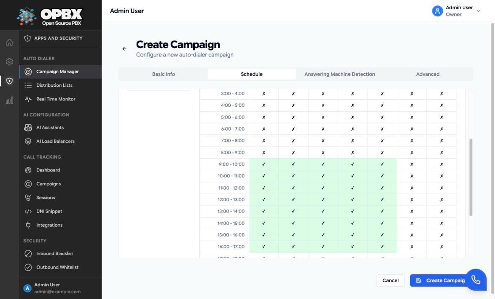

# Campaign Scheduling

An **Active** campaign dials only inside its schedule: between its start and end dates, on the enabled weekdays, during the enabled hours, all read in the campaign's own timezone. Outside the window the campaign keeps its **Running** status but places no calls.

## Purpose

Use the **Schedule** tab of the campaign form to keep calls inside legal and polite calling hours for the people you call.

## Prerequisites

- A campaign in **Draft** or **Paused** status (Running campaigns cannot be edited). See [Managing Campaigns](/applications/auto-dialer/campaigns).

## Set the schedule

1. Open the campaign's **Edit** form (or **Create Campaign**) and select the **Schedule** tab.
2. Choose the **Timezone**.
3. Set the **Start Date** and **End Date**.
4. In **Active Hours**, click hour slots to turn them on (green) or off.
5. Save.

## Fields

| Field | Limits and default | Meaning |
|-------|--------------------|---------|
| Timezone | Required. The form lists common zones grouped by region (Americas, Europe, Asia, Africa, Australia, Pacific, UTC); the API accepts any IANA name such as `America/New_York`. Default: UTC | All dates and hours are read in this zone |
| Start Date | Required. Today or later when you create; any date when you edit | First calendar day dialing is allowed |
| End Date | Required. On or after the start date | Last calendar day dialing is allowed (inclusive) |
| Active Hours | One-hour slots, per weekday. New campaigns start with Monday to Friday, 09:00 to 17:00 | When dialing is allowed each day |

Set the timezone of the people you are calling, not your own. A campaign in `America/New_York` with 09:00 to 17:00 dials 09:00 to 17:00 New York time wherever OPBX runs.

## How the window is checked

Every time the dialer worker polls (every 10 seconds by default), OPBX returns only campaigns that pass all of these checks, evaluated at the current time **in the campaign's timezone**:

1. The status is **Active**.
2. Today's date is on or after the start date and on or before the end date.
3. Today's weekday is enabled.
4. The current time falls inside one of today's hour ranges. The end of a range is included up to that minute (a range ending at 17:00 still allows calls at 17:00).

The dialer worker has no schedule logic of its own. When the window closes, no new calls start; calls already in progress continue until they end.

### Example

Campaign: `America/New_York`, 1 to 31 October 2026, Monday to Friday 09:00 to 17:00.

| Local time (New York) | Dials? | Why |
|-----------------------|:------:|-----|
| Monday 12 October, 08:30 | No | Before 09:00 |
| Monday 12 October, 10:15 | Yes | Inside the window |
| Saturday 17 October, 11:00 | No | Saturday not enabled |
| Monday 2 November, 10:00 | No | After the end date |

## Auto-start

The **Auto-start** option (Advanced tab) lets OPBX start a **Draft** campaign by itself. Every minute the scheduler looks for Draft campaigns with auto-start on and a **Ready** list linked to them, and starts each one whose window is open.

:::caution Auto-start is rarely reached, and uses the older schedule fields
- Assigning a list through **Distribution Lists** already turns a Draft campaign **Active** and the list **In Use**, so a campaign set up that way never waits for auto-start.
- The auto-start check reads the older single daily window (the first enabled range's start and end hour, and the enabled weekdays), not every range in the grid, and it does not start a campaign on its end date.
- A campaign started by auto-start is also processed by a second, older dialing path in the OPBX queue workers. That path is the only one that marks campaigns **Completed**.

Treat auto-start as a convenience for simple Monday-to-Friday style windows, and verify on the [Real-Time Monitor](/applications/auto-dialer/real-time-monitor) that the campaign behaves as expected.
:::

## Dial timeout and time limit

These are on the **Advanced** tab but affect timing:

| Field | Limits and default | Meaning |
|-------|--------------------|---------|
| Dial Timeout (sec) | 1 to 300. Default: 60 | How long the callee's phone rings before the attempt counts as not answered |
| Time Limit (sec) | 30 to 14400. Default: 3600 | Longest a connected call may last |

Each call is also sent with a **5-minute start deadline**: if Cloudonix cannot start it within 5 minutes, it is dropped rather than placed late.

## Common errors

| Message (summary) | What it means | What to do |
|-------------------|---------------|-----------|
| The start date must be a date after or equal to today | Creating with a past start date | Pick today or later |
| The end date must be a date after or equal to start date | Dates reversed | Fix the range |
| The timezone must be a valid timezone | Unknown zone name (API) | Use an IANA name |
| Campaign is Running but nothing is dialed | Outside the window, or no pending numbers | Check the timezone, dates and hours; see the monitor |

## Related pages

- [Managing Campaigns](/applications/auto-dialer/campaigns)
- [Rate Limiting](/applications/auto-dialer/rate-limiting)
- [Real-Time Monitor](/applications/auto-dialer/real-time-monitor)
