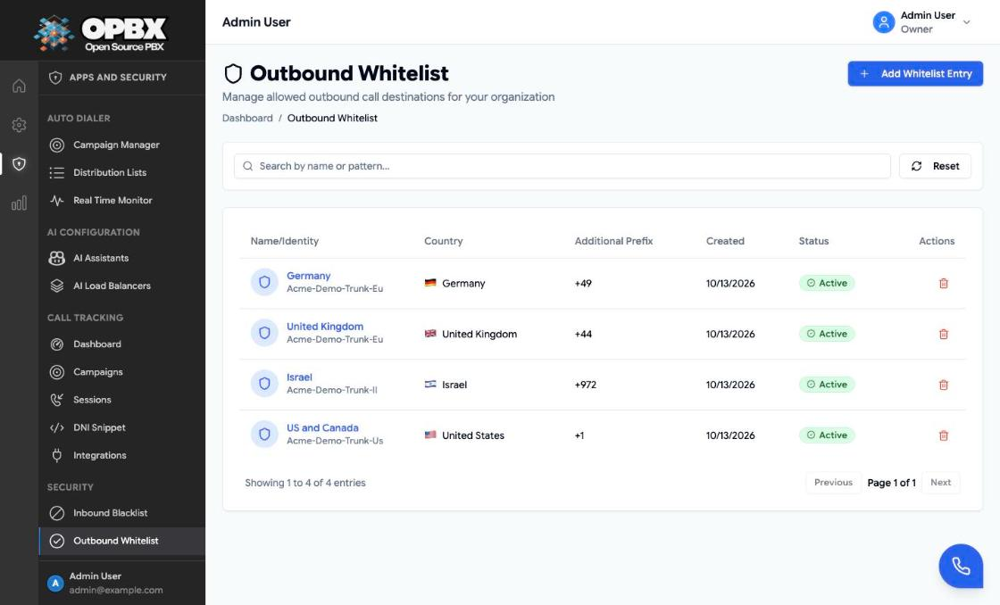

# PBX Applications

The applications build on the core PBX: they add AI voice agents and automated outbound dialing. They are found in the sidebar under **Apps and Security**, which Owners, PBX Admins and Reporters can see. Creating and changing them needs the Owner or PBX Admin role.

| Application | What it does | Sidebar |
|-------------|--------------|---------|
| [AI Assistants](/opbx/applications/ai-assistants) | Connects callers to an AI voice agent at one of 47 providers (42 over SIP, 5 over WebSocket), plus a Dummy Test provider for checking routes | **AI Configuration → AI Assistants** |
| [AI Load Balancers](/opbx/applications/ai-load-balancers) | Spreads calls across several assistants (round robin, priority or percentage), fails over between them and falls back to a person or menu | **AI Configuration → AI Load Balancers** |
| [Auto Dialer](/opbx/applications/auto-dialer) | Runs outbound calling campaigns from distribution lists, with scheduling, pacing, answering-machine detection and a live monitor | **Auto Dialer** (Owner and PBX Admin only) |

## AI voice agents

An [AI assistant](/opbx/applications/ai-assistants) is a destination like an extension or a ring group: phone numbers, IVR options, business hours, queue fallbacks and campaigns can send callers to it. The provider decides how the call is handed over:

- **SIP**: OPBX dials the provider's service with the agent's phone number.
- **WebSocket**: OPBX streams the call audio to the provider's endpoint.

An [AI load balancer](/opbx/applications/ai-load-balancers) puts several assistants behind one destination, so one failing provider does not stop the line.

Step-by-step screens: [AI Assistants](/opbx/modules/ai-assistants) and [AI Load Balancers](/opbx/modules/ai-load-balancers).

## Auto Dialer

The [Auto Dialer](/opbx/applications/auto-dialer) places outbound calls for a campaign:

- campaigns with schedules and time windows;
- distribution lists uploaded as CSV;
- pacing by concurrent calls and calls per second;
- answering-machine detection;
- a real-time monitor with live statistics.

Answered calls are connected to an AI assistant or an AI load balancer.

## Related modules

- [Call Tracking Campaigns](/opbx/modules/call-tracking-campaigns) — also under **Apps and Security**, attributes inbound calls to marketing campaigns
- [Phone Numbers](/opbx/modules/phone-numbers) — route numbers to assistants and load balancers
