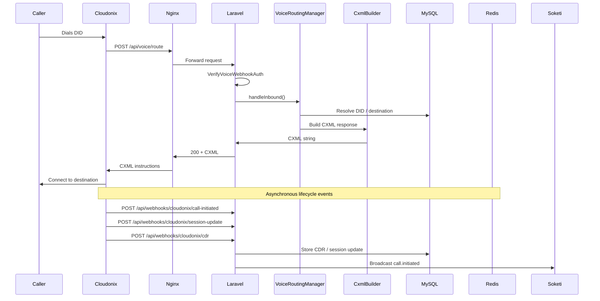

# Call Flow

This page traces the lifecycle of an inbound call from the moment Cloudonix receives it, through OPBX routing decisions, to CDR and session-update handling.

---

## Overview

---

## Step 1: Cloudonix Receives the Call

When a caller dials a DID number, Cloudonix routes the call to the voice application configured for the domain. The voice application URL points to OPBX (`/api/voice/route`).

Cloudonix sends a JSON payload that includes:

- `Domain` — the Cloudonix domain
- `To` / `to` — the called number
- `From` / `from` — the caller number
- `Direction` — call direction
- Additional Cloudonix session fields

---

## Step 2: Voice Webhook Authentication

`VerifyVoiceWebhookAuth` runs first:

1. Extracts the Bearer token from the `Authorization` header.
2. Extracts `Domain` and the `to`/`from` numbers.
3. Looks up `CloudonixSettings` by `domain_name`, then `domain_uuid`.
4. Compares the Bearer token to `domain_requests_api_key` with `hash_equals()`.
5. Injects `_organization_id` into the request.
6. Returns a CXML response on failure: 401 for a token or domain problem, 400 when `Domain` or the `to` number is missing.

If authentication succeeds, the request reaches `VoiceRoutingController@handleInbound`.

---

## Step 3: VoiceRoutingManager

`VoiceRoutingController` delegates to `App\Services\VoiceRouting\VoiceRoutingManager`.

### Coach Calls

Before anything else, `CoachRoutingService::tryHandle()` checks whether the call is a supervisor coaching call (`spy_{token}`, `whisper_{party}_{token}` or `barge_{token}`, dialed from the supervisor's Web Phone) and, if so, answers it with a Cloudonix `<Coach>` verb.

### Direction Dispatch

The manager dispatches by the `Direction` field:

| Direction | Handler | Typical Use |
|-----------|---------|-------------|
| `subscriber` | `handleSubscriberDirection()` | Internal PBX user call. |
| `inbound` | `handleInboundDirection()` | External or internal-from-DID. |
| `outbound` | `handleOutgoingDirection()` | Outbound calls only. |
| `application` | `handleApplicationDirection()` | API-initiated calls. |
| default | `handleUnknownDirection()` | Falls back to inbound. |

A `subscriber` call tries, in order: a direct extension dial, the DID routing of the dialed number, then outbound routing (outbound whitelist). The calls are marked `internal` for `call_recording_mode`; inbound calls are marked `inbound`.

For an `inbound` call, the manager first checks the [inbound blacklist](/opbx/modules/inbound-blacklist) against the dialed DID and, on a match, returns the rejection CXML. If the caller (`From`) is itself one of the organization's numbers, the call is handled as an internal call from a DID.

### DID Resolution

For inbound calls, the manager resolves the called DID (`To` number):

1. Look up an active `did_numbers` row with that phone number in the organization (`InboundRoutingService::handleDidRouting()`).
2. Read the DID's `routing_type`, and the target ID from `routing_config` (for example `routing_config.ring_group_id`).
3. Load the destination model based on the routing type, then pick the strategy for it.

### Destination Types

The DID's `routing_type` selects the destination. The routing config holds the target ID.

| Routing Type | Model | Handled by |
|--------------|-------|------------|
| `extension` | `Extension` | Strategy for the extension's type (`UserRoutingStrategy`, `ForwardRoutingStrategy`, `AiAgentRoutingStrategy`, and so on) |
| `ring_group` | `RingGroup` | `RingGroupRoutingStrategy` |
| `call_queue` | `CallQueue` | `QueueRoutingStrategy` |
| `ivr_menu` | `IvrMenu` | `IvrRoutingStrategy` |
| `conference_room` | `ConferenceRoom` | `ConferenceRoutingStrategy` |
| `business_hours` | `BusinessHoursSchedule` | `InboundRoutingService` resolves the schedule's current open or closed target, then that target's strategy runs |
| `ai_assistant` | `AiAssistant` | `AiAgentRoutingStrategy` |
| `ai_load_balancer` | `AiAssistantLoadBalancer` | `AiLoadBalancerRoutingStrategy` |
| `call_tracking` | `CallTrackingCampaign` | `CallTrackingRoutingStrategy` (called directly, before the other types) |
| `unavailable` | none | Plays the "destination unavailable" prompt and hangs up |

A DID with no valid destination gets a spoken error prompt (`Destination not configured` or `Unsupported routing configuration`) and a hangup.

---

## Step 4: Strategy Execution

`InboundRoutingService` maps the resolved destination to an `ExtensionType` (the extension's own type, or `RING_GROUP`, `CONFERENCE`, `QUEUE`, `IVR`, `AI_ASSISTANT`, `AI_LOAD_BALANCER`). `VoiceRoutingStrategyExecutor` iterates the registered strategies and runs the first one whose `canHandle()` accepts that type. The selected strategy returns a CXML response via `CxmlBuilder`.

### CxmlBuilder

`App\Services\CxmlBuilder\CxmlBuilder` generates CXML using `DOMDocument`. All user-controlled input is XML-encoded to prevent injection. Common CXML outputs include:

| Method | CXML Output |
|--------|-------------|
| `dialExtension($sipUri)` | `<Dial><Sip>...</Sip></Dial>` |
| `dialRingGroup($sipUris[])` | `<Dial>` with multiple `<Sip>` or `<Number>` nouns |
| `simpleDial($dest, ...)` | `<Dial>` for outbound numbers |
| `joinConference(...)` | `<Dial><Conference>...</Conference></Dial>` |
| `gather(...)` | `<Gather>` for IVR digit collection |
| `streamToWebSocket($url)` | `<Connect><Stream url="wss://..."/></Connect>` |
| `dialQueueConference($room)` | `<Dial><Conference>` for a queue offer through a conference |
| `busy($msg)` / `unavailable($msg)` / `destinationUnavailable()` | Error prompt + hangup |

The CXML response is returned to Cloudonix with `Content-Type: application/xml`.

---

## Step 5: IVR Input Callback

If the route returns an IVR `Gather`, Cloudonix POSTs the caller's digits to `/api/voice/ivr-input`. The flow:

1. Authenticate with `VerifyVoiceWebhookAuth`.
2. Validate the IVR menu exists and is active.
3. Check/update call state in Redis (turn count, input history).
4. No input → replay or increment turns toward failover.
5. Valid option → route to the configured destination.
6. Invalid option → error message, replay, or failover after `max_turns`.

---

## Step 6: Ring Group Callback

For ring groups with sequential strategies, Cloudonix POSTs to `/api/callbacks/voice/ring-group-callback` after each dial attempt. `VoiceRoutingManager::routeRingGroupCallback` determines the next action (try next member, failover, or hangup).

---

## Step 7: AI Load Balancer Follow-Through

For AI load balancers, `/api/callbacks/voice/albs-follow-through` handles failover when the primary AI provider is busy or unavailable. It tries the next assistant in the balancer distribution.

---

## Step 8: Call Queues

A call routed to a call queue is enqueued in the [ACD worker](/opbx/workers/acd-worker) and hears hold music. After each hold segment Cloudonix POSTs to `/api/callbacks/voice/queue-poll`. Laravel asks the ACD worker for a decision: **wait**, **dial** (the selected agents' extensions) or **overflow** (to the queue's fallback). The dial result comes back on `/api/callbacks/voice/queue-dial-callback`. Agents who are already on a call are skipped, using the extension presence kept in Redis from session updates.

---

## Step 9: Asynchronous Notifications

While the call is in progress, Cloudonix sends asynchronous JSON webhooks to OPBX.

### call-initiated

`POST /api/webhooks/cloudonix/call-initiated`

- Normalizes `from` and `to` to E.164.
- Identifies the organization from the middleware-injected `_organization_id` or by DID lookup.
- Dispatches `ProcessInboundCallJob` to create a `CallLog` and broadcast `CallInitiated` (`call.initiated` on the `presence-org.{organization_id}` channel).

### session-update

`POST /api/webhooks/cloudonix/session-update`

- High-velocity stream of call progress events.
- Filters statuses to the allowed notification list.
- Creates a `SessionUpdate` record.
- Triggers call notification webhooks if configured.
- Does not broadcast. The `CallAnswered` and `CallEnded` event classes exist, but no code dispatches them; the Live Calls page polls the API instead (see [Real-Time](/opbx/architecture/real-time)).

### CDR

`POST /api/webhooks/cloudonix/cdr`

- Creates a `CallDetailRecord` via `CallDetailRecord::createFromWebhook()`. The call `direction` (`incoming`, `outgoing`, `internal` or `application`) is copied from the latest session update.
- Updates the legacy `CallLog` record if one exists.
- Creates a [call-tracking session](/opbx/data-models/models/call-tracking-session) when the number is a tracking number.
- Creates a final `SessionUpdate` with `action = 'cdr_final_status'`.
- Triggers call notification webhooks for the final status.
- For auto-dialer calls:
  - Updates `AutoDialerCallSession` and `AutoDialerDestination`.
  - Updates campaign counters.
  - Decrements the Redis CAC counter using the `dialer` connection (raw key `dialer:cac:{campaign_id}:active`). Laravel owns this count, and `dialer:reconcile-cac` heals drift every minute.

---

## Call State in Redis

- `cdr:create:{organization_id}:{call_id}` — lock that keeps a CDR from being created twice
- IVR state — turn count and digit history (`ivr:call:{call_sid}`), with `ivr:idempotency:{event_id}`
- Dialer CAC counters — `dialer:cac:{campaign_id}:active`
- Call queue state — `acd:*` keys owned by the ACD worker, and extension presence `acd:presence:{organization_id}:{extension}`

---

## Related Documentation

- [Architecture Overview](/opbx/architecture)
- [Webhooks](/opbx/architecture/webhooks)
- [Multi-Tenancy](/opbx/architecture/multi-tenancy)
- [Security](/opbx/architecture/security)
- [Real-Time](/opbx/architecture/real-time)
- [Call Queues](/opbx/modules/call-queues)
