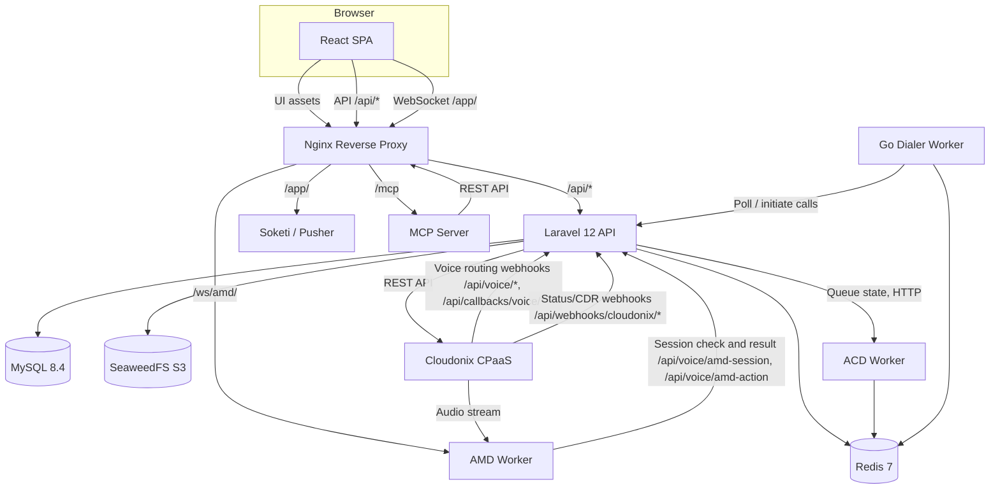

# Architecture Overview

OPBX is a multi-tenant business PBX. The platform splits responsibilities between a **control plane** for configuration and management, and an **execution plane** for real-time call processing and external integrations.

---

## Control Plane vs Execution Plane

| Plane | Purpose | Components |
|-------|---------|------------|
| **Control Plane** | Configure the PBX, manage users, review call logs, and administer the platform. | React SPA, Laravel API, MySQL |
| **Execution Plane** | Process live calls, webhooks, queues, real-time events, and worker coordination. | Voice routing controllers, webhook controllers, Redis queues, queue workers and scheduler, Soketi, Go dialer worker, Java/Vert.x AMD and ACD workers |

The control plane changes state slowly. The execution plane responds in milliseconds to voice routing requests from Cloudonix and handles high-velocity status updates.

---

## Service Architecture

### Component Responsibilities

| Component | Technology | Role |
|-----------|------------|------|
| React SPA | React 18 + TypeScript | User interface for PBX configuration, live calls, reporting, and administration. |
| Nginx | nginx:1.27-alpine | Reverse proxy, static asset delivery, WebSocket upgrade routing, and worker proxying. |
| Laravel | Laravel 12 (PHP 8.4) | REST API, voice routing decisions, webhook processing, multi-tenancy, queues, and broadcasting. |
| Queue workers and scheduler | Laravel (same image) | `queue-worker` and `queue-worker-long` run background jobs; `scheduler` runs `schedule:run` every minute (retention, CDR tiering, platform health checks). |
| MySQL | MySQL 8.4 LTS | Persistent relational storage for organizations, users, calls, routing configuration, and CDRs. |
| Redis | Redis 7 (Alpine) | Caching, sessions, queues, idempotency keys, distributed locks, rate-limit counters, and real-time state. |
| SeaweedFS | SeaweedFS 4.47 (S3-compatible) | Object storage for call recordings, IVR audio, announcement files, and the CDR archive. |
| Soketi | Soketi / Pusher protocol | WebSocket server for live call updates and presence channels. |
| Cloudonix CPaaS | Cloudonix REST API | External VoIP platform that handles call media, SIP registration, and telephony primitives. |
| Dialer Worker | Go | Outbound auto-dialer campaign execution and CAC/CPS limiting. Runs as a single replica. |
| AMD Worker | Java / Vert.x 5 | Stream-based answering-machine detection for outbound campaigns. |
| ACD Worker | Java / Vert.x 5 | Call queue state: FIFO order, agent states and agent selection. |
| MCP Server | Node.js | MCP facade over the OPBX REST API for AI assistants, served at `/mcp`. |

---

## Data-Store Responsibilities

OPBX uses three data stores. Each has a clearly defined responsibility and different durability expectations.

### MySQL (Source of Truth)

MySQL stores all durable application data. Examples include:

- Organizations, users, roles, and permissions
- Extensions, DIDs, ring groups, IVR menus, business hours
- Call detail records (CDRs), call logs, and session updates
- Auto-dialer campaigns, destinations, and call sessions
- Platform audit logs and call notification settings

MySQL data is preserved in a host bind mount (`./volumes/mysql`). Server settings come from `docker/mysql/my.cnf`, and the container is limited to 1 GB of memory. Back it up regularly with `./scripts/backup-database.sh`.

Old call detail records move out of the main tables in tiers: a warm archive table (`archived_call_detail_records`, in the main schema unless `DB_CDR_ARCHIVE_DATABASE` names another one) and then a cold compressed CSV archive in object storage. See [Configuration Reference](/opbx/data-models/configuration/index#call-detail-records-tiered).

### Redis (Ephemeral Runtime State)

Redis supports fast, transient state. It is configured with AOF persistence in the example Docker Compose file, so it survives normal restarts. The password is written to a config file inside the container instead of the command line, but treat it as operational cache/queue storage rather than a primary source of truth. Redis is used for:

- Sessions (`SESSION_DRIVER=redis`)
- Job queues (`QUEUE_CONNECTION=redis`)
- Application cache (`CACHE_STORE=redis`)
- Rate-limit counters (`rate_limit:org:{id}:{type}`)
- Webhook idempotency keys (`idem:webhook:{key}`)
- Distributed locks (for example `cdr:create:{org}:{call_id}` and `lock:ring_group:{id}`)
- IVR call state and dialer CAC counters (`dialer:cac:{campaign_id}:active`)
- Call queue state owned by the ACD worker (`acd:*` keys) and extension presence (`acd:presence:{org}:{extension}`)

Redis data is preserved in host bind mounts (`./volumes/redis`).

### SeaweedFS (Object Storage)

SeaweedFS provides S3-compatible object storage for binary files:

- Call recordings
- IVR prompts and announcements
- Auto-dialer audio assets
- Cold CDR archive (private `cdr-archive` bucket)

Data is stored in host bind mounts (`./volumes/seaweedfs`). External access to recordings is gated through HMAC-signed URLs generated by the Laravel backend.

---

## Routing Planes

| Traffic Type | Entry Point | Handler | Output |
|--------------|-------------|---------|--------|
| Web UI | Nginx :80 | React SPA | HTML/JS |
| REST API | Nginx :80 `/api/*` | Laravel controllers | JSON |
| Voice routing | Nginx :80 `/api/voice/*`, `/api/callbacks/voice/*` | `VoiceRoutingController` and the queue/ALB callback controllers | CXML |
| Status/CDR webhooks | Nginx :80 `/api/webhooks/cloudonix/*` | `CloudonixWebhookController` | JSON |
| Auto-dialer webhooks | Nginx :80 `/api/webhooks/auto-dialer/*` | `AutoDialerWebhookController` | JSON |
| Real-time | Nginx :80 `/app/` | Soketi | WebSocket |
| AMD audio stream | Nginx :80 `/ws/amd/` | AMD Worker | WebSocket |
| MCP clients | Nginx :80 `/mcp` | MCP Server | MCP (Streamable HTTP) |
| Log viewer (profile `logs`) | Nginx :80 `/logs/` | Grafana | HTML |

---

## Worker Services

The execution plane includes three worker services. All three start with the standard stack:

- **[Dialer Worker](/opbx/workers/dialer-worker)** (Go) — Polls Laravel for active auto-dialer campaigns and asks Laravel to initiate outbound calls. It has no webhook endpoints; Laravel receives the call results from Cloudonix. Run exactly one replica.
- **[AMD Worker](/opbx/workers/amd-worker)** (Java) — Receives live audio streams from Cloudonix, checks each stream's session with `/api/voice/amd-session`, detects voicemail beeps, and posts results to `/api/voice/amd-action`.
- **[ACD Worker](/opbx/workers/acd-worker)** (Java) — Holds call queue state in Redis. Laravel calls it over the internal network on every queue decision.

The workers authenticate with shared tokens (`DIALER_WORKER_API_TOKEN`, `AMD_WORKER_API_TOKEN`, `ACD_WORKER_API_TOKEN`). The worker images run as a non-root user (uid 10001), and each has a Docker healthcheck.

---

## Next Steps

- Learn how tenant isolation works: [Multi-Tenancy](/opbx/architecture/multi-tenancy)
- Understand webhook security: [Webhooks](/opbx/architecture/webhooks)
- Follow an inbound call through the system: [Call Flow](/opbx/architecture/call-flow)
- Review security controls: [Security](/opbx/architecture/security)
- See real-time infrastructure: [Real-Time](/opbx/architecture/real-time)
