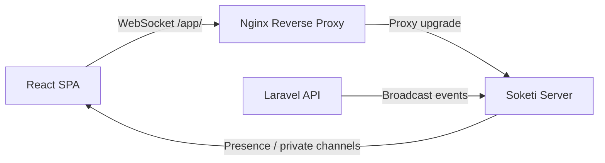

# Real-Time

OPBX delivers live call updates to the React SPA through WebSockets. The stack uses Soketi (a Pusher-compatible WebSocket server), Laravel Echo on the frontend, and Laravel broadcasting on the backend.

---

## Overview



When the `call-initiated` webhook arrives, `ProcessInboundCallJob` broadcasts `call.initiated` on the organization's presence channel, and Soketi forwards it to every subscribed client. Later `session-update` and CDR webhooks for the same call broadcast `call.answered` and `call.ended`. The Live Calls page merges these events into its list, but its main source is polling: it reloads the active calls from the session-updates API every 5 seconds by default (the refresh menu offers No Refresh, 1, 5, 15, 30 and 60 seconds).

---

## Soketi

Soketi runs as a Docker service (`opbx_websocket`) and listens on port 6001 internally. Nginx proxies the `/app/` path to Soketi, so browsers connect on the same port and domain as the API.

### Docker Configuration

From `docker-compose.yml` (`docker-compose.yml.example` is the same file):

```yaml
soketi:
  image: 'quay.io/soketi/soketi:1.6-16-alpine'
  ports:
    - "${SOKETI_PORT:-6001}:6001"
    - "${SOKETI_METRICS_PORT:-9601}:9601"
  environment:
    SOKETI_DEFAULT_APP_ID: '${PUSHER_APP_ID:-app-id}'
    SOKETI_DEFAULT_APP_KEY: '${PUSHER_APP_KEY:-pbxappkey}'
    SOKETI_DEFAULT_APP_SECRET: '${PUSHER_APP_SECRET:?set PUSHER_APP_SECRET}'
    SOKETI_METRICS_SERVER_PORT: '9601'
    SOKETI_DEFAULT_APP_ENABLE_CLIENT_MESSAGES: 'false'
    SOKETI_DEFAULT_APP_ENABLE_STATISTICS: 'true'
    SOKETI_DEFAULT_APP_MAX_CONNECTIONS: '10000'
    SOKETI_DEFAULT_APP_MAX_BACKEND_EVENTS_PER_SECOND: '100'
    SOKETI_DEFAULT_APP_MAX_CLIENT_EVENTS_PER_SECOND: '100'
    SOKETI_DEFAULT_APP_MAX_READ_REQUEST_PER_SECOND: '100'
  healthcheck:
    test: ['CMD', 'wget', '-q', '-O', '-', 'http://127.0.0.1:9601/ready']
```

`PUSHER_APP_SECRET` has no default: Compose refuses to start until it is set (generate one with `openssl rand -hex 32`).

### Frontend Connection

The frontend uses the environment variables:

| Variable | Purpose |
|----------|---------|
| `VITE_PUSHER_APP_KEY` | Soketi app key. Compose sets it from `PUSHER_APP_KEY` (default `pbxappkey`) |
| `VITE_WS_HOST` | WebSocket host |
| `VITE_WS_PORT` | WebSocket port (the compose file defaults to `80`, proxied through Nginx; the code falls back to `6001`) |
| `VITE_PUSHER_APP_CLUSTER` | Pusher cluster name (default `mt1`) |
| `VITE_WS_SCHEME` | `http` or `https` |

When Nginx proxies WebSockets, the browser connects to `ws://your-domain/app/` on port 80/443, not directly to port 6001.

---

## Broadcast Channels

Channel authorization is defined in `routes/channels.php`.

| Channel | Type | Authorization |
|---------|------|---------------|
| `org.{organizationId}` (`presence-org.{organizationId}` on the wire) | Presence | User belongs to the organization and is an Owner or PBX Admin. Supervisors are denied even though their role can view live calls (their live view is filtered by assignment instead). Returns `{id, name, email, role}`. |
| `user.{userId}` | Private | User ID matches the channel ID. |
| `extension.{extensionId}` | Private | User's organization matches the extension's organization. |

### Presence Channel

The organization presence channel is the primary channel for live call updates. All Owners and PBX Admins in the same organization receive the same call events and can see each other's online presence.

---

## Broadcast Events

| Event class | Broadcast name | Channel | Data |
|-------------|----------------|---------|------|
| `CallInitiated` | `call.initiated` | `org.{organizationId}` | `call_id`, `from_number`, `to_number`, `did_id`, `status`, `initiated_at` |
| `CallAnswered` | `call.answered` | `org.{organizationId}` | `call_id`, `status`, `answered_at`, `extension_id` |
| `CallEnded` | `call.ended` | `org.{organizationId}` | `call_id`, `status`, `ended_at`, `duration` |

When each event is dispatched:

- `CallInitiated`: by `ProcessInboundCallJob` after the `call-initiated` webhook, which creates the call log (`call_logs`, keyed by the call's `CallSid`).
- `CallAnswered`: by the `session-update` webhook when the session status is `connected`, `connect`, `answer`, `answered` or `active` (any case). The call log gets status `answered` and `answered_at`.
- `CallEnded`: by the first terminal `session-update` (`busy`, `cancel`, `failed`, `congestion`, `completed`, `hangup`, `bye` and their variants, or a deleted session) or by the CDR webhook, whichever comes first. The call log gets `ended_at`, the final status (`completed`, `busy`, `no_answer` or `failed`, from the session status or the CDR disposition) and, from the CDR, the duration.

Both are matched to the call log by the session `token` or any of the session's `callIds` (for the CDR: `call_id` or `session.token`), within the webhook's organization. Each is sent at most once per call: the call log row is updated only while `answered_at` (or `ended_at`) is still empty, so retried webhooks, replayed CDRs and duplicate statuses broadcast nothing. An answer that arrives after the call ended is not broadcast. A call with no call log (no `call-initiated` webhook for it) broadcasts neither event; the Live Calls page has no entry for it to update anyway.

These are the only broadcast events in the backend; the `user.{userId}` and `extension.{extensionId}` channels have authorization rules but no events.

---

## Frontend Echo Service

`frontend/src/services/echo.service.ts` creates a singleton Laravel Echo instance backed by Pusher.

### Features

- Bearer auth for `/api/v1/broadcasting/auth`
- Auto-retry with exponential backoff (initial 1s, max 30s, max 5 attempts)
- 10-second connection timeout
- Subscribes to organization presence channels
- Tracks online members via presence callbacks (`here`, `joining`, `leaving`)

### Hooks

- `useEchoConnection` — called from `AppLayout`; establishes the global Echo connection when the user is authenticated. It intentionally does **not** disconnect on component unmount so the connection persists across route changes.
- `useCallPresence` — used by the Live Calls page; tracks `activeCalls` and `onlineMembers`, deduplicates entries, and recalculates call durations every second.

### Returned State

```ts
{
  activeCalls,
  onlineMembers,
  totalActiveCalls,
  isConnected,
  connectionState,
}
```

---

## Broadcasting Authentication

Laravel's broadcasting auth route is registered inside the `v1` group of `routes/api.php`, so its path is `/api/v1/broadcasting/auth`:

```php
Broadcast::routes(['middleware' => ['auth:sanctum', 'tenant.scope']]);
```

To subscribe to a private or presence channel, the client must first authenticate. The Echo client posts the auth request to `/api/v1/broadcasting/auth`, where Sanctum validates the Bearer token and `EnsureTenantScope` validates the organization.

---

## Configuration

Relevant `.env.example` variables:

```env
BROADCAST_DRIVER=pusher
BROADCAST_CONNECTION=pusher

PUSHER_APP_ID=app-id
PUSHER_APP_KEY=pbxappkey
PUSHER_APP_SECRET=
PUSHER_HOST=soketi
PUSHER_PORT=6001
PUSHER_SCHEME=http
PUSHER_APP_CLUSTER=mt1
```

Frontend Vite variables:

```env
VITE_WS_HOST=localhost
VITE_WS_PORT=6001
VITE_WS_SCHEME=http
```

In production behind Nginx, set `VITE_WS_PORT=80` or `443` and `VITE_WS_SCHEME=https`.

---

## Scaling and Limits

Default Soketi limits from `docker-compose.yml`:

- Max connections: 10,000 per app
- Max backend events per second: 100
- Max client events per second: 100
- Max read requests per second: 100

For larger deployments, scale Soketi horizontally or tune these limits.

---

## Troubleshooting

### WebSocket Does Not Connect

1. Confirm Soketi is healthy: `docker compose ps soketi`
2. Check the frontend is using the Nginx-proxied path (`/app/`) and the correct port.
3. Verify `PUSHER_APP_KEY` matches between the Soketi container and the frontend build.
4. Check browser dev tools for auth failures on `/api/v1/broadcasting/auth`.

### No Live Call Updates

1. Confirm the `call-initiated` webhook reaches OPBX and the queue workers are running (`ProcessInboundCallJob` broadcasts `call.initiated`). Answered and ended states come from `call.answered` and `call.ended` (sent by the `session-update` and CDR webhooks) and from polling.
2. Verify the user is subscribed to `org.{organizationId}`.
3. Check that the organization channel authorization returns user data. It returns nothing for Reporters, PBX Users and Supervisors.

---

## Related Documentation

- [Architecture Overview](/opbx/architecture)
- [Call Flow](/opbx/architecture/call-flow)
- [Webhooks](/opbx/architecture/webhooks)
- [Security](/opbx/architecture/security)
- [Installation](/opbx/installation)
