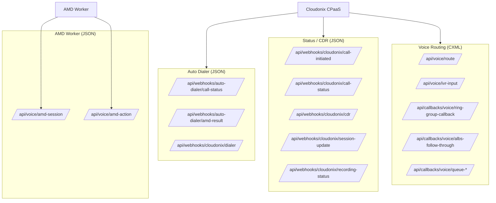

# Webhooks

OPBX receives webhooks from Cloudonix CPaaS for voice routing decisions, call status updates, session updates, and CDRs. This page describes the webhook endpoints, their authentication models, idempotency handling, and controller responsibilities.

For the complete security reference including token configuration and curl examples, see [`docs/WEBHOOK-AUTHENTICATION.md`](https://github.com/greenfieldtech-nirs/opbx/blob/main/docs/WEBHOOK-AUTHENTICATION.md).

---

## Webhook Categories

OPBX has four categories of inbound webhooks:

| Category | Middleware | Response Format | Purpose |
|----------|-----------|-----------------|---------|
| Voice routing | `voice.webhook.auth` | CXML | Real-time call routing instructions. |
| Status / CDR | `webhook.signature` (+ `webhook.idempotency`) | JSON | Asynchronous call events and records. |
| Signed queue callbacks | HMAC-signed URL (no Bearer token) | CXML | Call queue legs that OPBX starts itself (immediate connect, conference ring-all). |
| AMD worker | Inline Bearer check | JSON | AMD worker session check and detection results. |

---

## Voice Routing Webhooks

Voice routing webhooks are synchronous: Cloudonix POSTs JSON and OPBX returns CXML instructions that tell Cloudonix how to handle the call.

### Authentication

- Middleware: `App\Http\Middleware\VerifyVoiceWebhookAuth` (alias `voice.webhook.auth`)
- Method: Bearer token from the `Authorization` header
- Token location: `cloudonix_settings.domain_requests_api_key`
- Token comparison: `hash_equals()` for timing-safe comparison
- Organization lookup: the `Domain` (or `domain`) field of the JSON body, matched against `cloudonix_settings.domain_name`, then `domain_uuid`
- Error format: CXML. A missing, malformed or wrong token, an unknown domain, or an organization with no key returns 401 with `<Say>Unauthorized. Authentication failed.</Say><Hangup/>`. A body without `Domain` or without a `to`/`To` number returns 400 with `<Say>Bad request. ...</Say><Hangup/>`

The voice webhook middleware requires a Bearer token. There is no unauthenticated fallback, and `CLOUDONIX_WEBHOOK_REQUIRE_AUTH` does not apply to it. On success it adds `_organization_id` to the request.

### Voice Routing Endpoints

| Method | URI | Controller | Purpose |
|--------|-----|------------|---------|
| POST | `/api/voice/route` | `VoiceRoutingController@handleInbound` | Main inbound call routing. |
| POST | `/api/voice/ivr-input` | `VoiceRoutingController@handleIvrInput` | IVR digit input callback. |
| POST | `/api/callbacks/voice/ring-group-callback` | `VoiceRoutingController@handleRingGroupCallback` | Ring group sequential/round-robin callback. |
| POST | `/api/callbacks/voice/conference-pin` | `VoiceRoutingController@handleConferencePin` | Conference room PIN entry. |
| POST | `/api/callbacks/voice/albs-follow-through` | `AlbsFollowThroughController@handle` | AI load balancer failover routing. |
| POST | `/api/callbacks/voice/queue-poll` | `QueuePollController@handle` | Call queue hold loop: wait, dial or overflow. |
| POST | `/api/callbacks/voice/queue-dial-callback` | `QueueDialCallbackController@handle` | Result of a queue offer to an agent. |
| GET | `/api/voice/health` | `VoiceRoutingController@health` | Voice routing health check (no auth). |

### Signed Queue Callbacks

These URLs are generated by OPBX and carry an HMAC signature, so they do not use the Bearer token:

| Method | URI | Controller | Purpose |
|--------|-----|------------|---------|
| ANY | `/api/callbacks/voice/queue-dial` | `QueueImmediateDialController@handle` | Immediate connect: dial an agent who just became available. |
| ANY | `/api/callbacks/voice/queue-agent-connect` | `QueueConferenceController@agentConnect` | Ring-all through a conference: the agent leg that answers claims the call. |
| ANY | `/api/callbacks/voice/queue-conference-join` | `QueueConferenceController@callerJoin` | The waiting caller joins the winning agent's room. |

---

## Status / CDR Webhooks

Status and CDR webhooks are asynchronous notifications. OPBX acknowledges them with JSON responses.

### Authentication

- Middleware: `App\Http\Middleware\VerifyCloudonixSignature` (alias `webhook.signature`)
- Method: Bearer token from the `Authorization` header (conditional)
- Token location: `cloudonix_settings.domain_requests_api_key`
- Fallback: If `domain_requests_api_key` is empty, the request is accepted without a token and logged as `webhook.unauthenticated`. Set `CLOUDONIX_WEBHOOK_REQUIRE_AUTH=true` to reject such requests once every organization has a key (`php artisan cloudonix:provision-webhook-keys`).
- Error format: JSON (`{"error": "Unauthorized - ..."}`)

The middleware extracts the domain from:

1. `payload.domain`
2. `payload.owner.domain.name`
3. `payload.owner.domain.uuid`

It then looks up the organization via `CloudonixSettings` by `domain_name`, then by `domain_uuid` (when the value looks like a UUID), then by `owner.domain.uuid`. A payload with no domain returns 400 `Bad Request - Missing domain parameter`; an unknown domain returns 401 `Unauthorized - Unknown domain`. A key that is configured but missing or wrong in the request returns 401 `Unauthorized - Bearer token required` or `Unauthorized - Invalid Bearer token`.

### Status / CDR Endpoints

| Method | URI | Controller | Middleware | Purpose |
|--------|-----|------------|------------|---------|
| POST | `/api/webhooks/cloudonix/call-initiated` | `CloudonixWebhookController@callInitiated` | `webhook.signature`, `webhook.idempotency` | Call arrived notification (async). |
| POST | `/api/webhooks/cloudonix/call-status` | `CloudonixWebhookController@callStatus` | `webhook.signature`, `webhook.idempotency` | Call status changes. |
| POST | `/api/webhooks/cloudonix/cdr` | `CloudonixWebhookController@cdr` | `webhook.signature`, `webhook.idempotency` | Final call detail record. |
| POST | `/api/webhooks/cloudonix/session-update` | `CloudonixWebhookController@sessionUpdate` | `webhook.signature` only | High-velocity session progress events. |
| POST | `/api/webhooks/cloudonix/recording-status` | `CloudonixWebhookController@recordingStatus` | `webhook.idempotency` | A `<Dial record>` recording finished processing. |

The recording-status payload has no `domain` field, so `webhook.signature` cannot run on it. The controller finds the organization from the call record that matches the `CallSid`/`Session`, then checks that organization's webhook key before it writes anything.

### session-update Handling

`session-update` is high-velocity and therefore skips the idempotency middleware. The controller still deduplicates by `eventId` against the `session_updates` table.

It lowercases the status and keeps only these statuses, mapped to notification events. Updates with any other status are not stored (the controller only ends extension presence for terminal statuses):

- `new`, `initiated`, `created` → `new`
- `ringing`, `ring`, `progress` → `ringing`
- `connected`, `connect` → `connected`
- `answer`, `answered`, `active` → `answered`
- `busy` → `busy`
- `cancel`, `cancelled`, `canceled` → `cancel`
- `failed`, `fail`, `error` → `failed`
- `congestion`, `congested` → `congestion`

---

## Auto-Dialer Webhooks

Auto-dialer webhooks reuse the same status/CDR authentication stack.

| Method | URI | Controller | Middleware | Purpose |
|--------|-----|------------|------------|---------|
| POST | `/api/webhooks/auto-dialer/call-status` | `AutoDialerWebhookController@callStatus` | `webhook.signature`, `webhook.idempotency` | Outbound call status. |
| POST | `/api/webhooks/auto-dialer/amd-result` | `AutoDialerWebhookController@amdResult` | `webhook.signature`, `webhook.idempotency` | AMD result for outbound calls. |
| POST | `/api/webhooks/cloudonix/dialer` | `DialerWebhookProxyController@handleCloudonixWebhook` | `webhook.signature`, `webhook.idempotency` | Cloudonix-to-dialer proxy events. |

These handlers wrap all model queries in `OrganizationScope::bypass()` because they run without an authenticated user.

---

## AMD Worker Callbacks

The Java/Vert.x AMD worker calls two endpoints. Both require `Authorization: Bearer {AMD_WORKER_API_TOKEN}`, compared with `hash_equals()`. If the token is not configured, both return 503.

| Method | URI | Controller | Purpose |
|--------|-----|------------|---------|
| POST | `/api/voice/amd-session` | `AmdActionController@session` | Stream admission: is this session token an active auto-dialer call? Returns 200 `{"active":true}` or 404. |
| POST | `/api/voice/amd-action` | `AmdActionController@handle` | Detection result. |

When a stream starts, the worker asks `amd-session` about the stream's session token. An unknown session closes the stream, and a result for it is dropped.

`amd-action`:

1. Looks up the auto-dialer session by `session_token` and its campaign, using `OrganizationScope::bypass()`.
2. Updates the local `AutoDialerCallSession` with `amd_result` and `amd_confidence`.
3. Updates the Cloudonix session profile with the AMD result (best effort).
4. Runs the action configured on the **campaign** for that result (`action_voicemail`, `action_human` or `action_unknown`):
   - `HANGUP` → disconnects the session
   - `CONTINUE` (or empty) → logs only

The action is never taken from the request body, so a stream sender cannot choose what happens to the call.

---

## Idempotency

`App\Http\Middleware\EnsureWebhookIdempotency` (alias `webhook.idempotency`) prevents duplicate processing caused by retries or redeliveries.

### Key Settings

| Setting | Default | Env Var |
|---------|---------|---------|
| TTL | 24 hours (86,400 seconds) | `WEBHOOK_IDEMPOTENCY_TTL` |
| Max cached response size | 100 KB | `WEBHOOK_MAX_CACHE_SIZE` |
| Replay protection max age | 5 minutes | `WEBHOOK_REPLAY_MAX_AGE` |
| Future timestamp tolerance | 1 minute | *(hardcoded)* |

### Key Generation Priority

1. `X-Idempotency-Key` header
2. SHA-256 of the call ID (`CallSid` or `call_id`) and the event type (`CallStatus` or `event_type`, or the route name when the payload has no status)
3. SHA-256 of the full JSON payload

A request that yields no key (empty payload) is processed without idempotency, with a warning in the log.

Redis key format: `idem:webhook:{key}`.

### Replay Protection

Checked only when the payload has a `timestamp` field (Unix seconds):

- Timestamps older than `WEBHOOK_REPLAY_MAX_AGE` (5 minutes) are rejected with 400 `Webhook Expired` (except CDR webhooks, which are accepted with a warning log).
- Timestamps more than 1 minute in the future are rejected with 400 `Invalid Timestamp`.

### Concurrent Duplicates

Before running the handler, the middleware claims `idem:webhook:{key}:lock` for 60 seconds. A second delivery that arrives while the first is still running gets 409 `Webhook is being processed`. The claim is released when the handler finishes.

### Response Caching

Only successful (2xx) responses are cached, so a failed delivery can be retried.

- Small responses (≤ 100 KB): status, content and content type are cached and returned on duplicate requests.
- Large responses (> 100 KB): only metadata is cached; duplicates receive an empty body with the original status.

### Endpoints Using Idempotency

- `/api/webhooks/cloudonix/call-initiated`
- `/api/webhooks/cloudonix/call-status`
- `/api/webhooks/cloudonix/cdr`
- `/api/webhooks/cloudonix/recording-status`
- `/api/webhooks/cloudonix/dialer`
- `/api/webhooks/auto-dialer/call-status`
- `/api/webhooks/auto-dialer/amd-result`

`/api/webhooks/cloudonix/session-update` does **not** use the idempotency middleware; it deduplicates in the controller.

---

## Webhook Flow Diagram

---

## Configuration

The per-organization webhook auth key is stored in `cloudonix_settings.domain_requests_api_key`. It is encrypted at rest using Laravel's `encrypted` cast and masked in API responses.

Relevant environment variables:

| Variable | Purpose |
|----------|---------|
| `AMD_WORKER_API_TOKEN` | Shared secret for the AMD worker callbacks. |
| `CLOUDONIX_WEBHOOK_REQUIRE_AUTH` | Reject status/CDR/dialer webhooks from organizations with no webhook key. Default `false`. |
| `DIALER_WORKER_API_TOKEN` | Token for dialer worker API authentication. |
| `DIALER_WORKER_API_TOKEN_SECONDARY` | Optional secondary token for rotation. |
| `WEBHOOK_IDEMPOTENCY_TTL` | Idempotency key TTL in seconds. |
| `WEBHOOK_MAX_CACHE_SIZE` | Max cached response size in bytes. |
| `WEBHOOK_REPLAY_MAX_AGE` | Max accepted webhook age in seconds. |

---

## Related Documentation

- [`docs/WEBHOOK-AUTHENTICATION.md`](https://github.com/greenfieldtech-nirs/opbx/blob/main/docs/WEBHOOK-AUTHENTICATION.md)
- [Call Flow](/opbx/architecture/call-flow)
- [Security](/opbx/architecture/security)
- [Multi-Tenancy](/opbx/architecture/multi-tenancy)
- [Auto Dialer Worker](/opbx/workers/dialer-worker)
- [AMD Worker](/opbx/workers/amd-worker)
