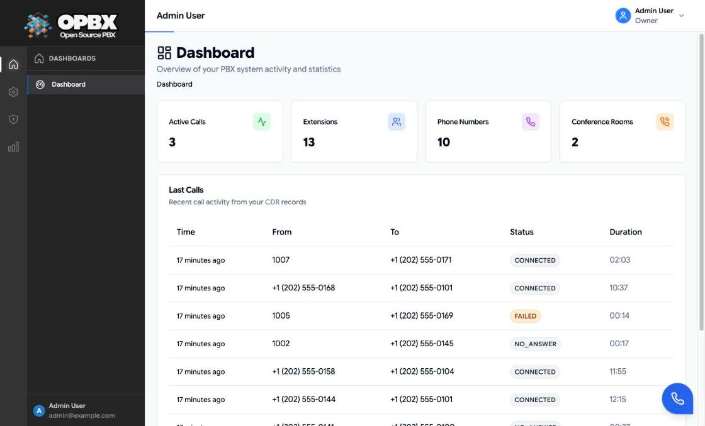

# First Login

After installing OPBX, you either log in with the seeded owner account or register a new organization. This guide walks you through both.

## The Seeded Owner Account

On a fresh database, the `app` container seeds one organization and one owner:

| Item | Value |
|------|-------|
| Organization | `Default Organization` (slug `default-org`, timezone UTC) |
| Name | `Admin User` |
| Email | `admin@example.com` |
| Password | `password` |
| Role | Owner |

Seeding runs only when the `organizations` table is empty. Sign in with this account and **change the password immediately** (see [Change your password](/opbx/administration/profile#change-your-password)), or remove the account once you have your own owner.

## Sign in

Who can do this: any active user of an active organization.

1. Open `http://localhost/ui/login` (use your own host and `APP_PORT` if you changed them).
2. Enter your **Email** and **Password**.
3. Click **Log In**.

The toast "Login successful!" appears and the Dashboard opens. The session lasts 24 hours.

{/* SCREENSHOT: login-page — Login page ("Welcome back!") with the Email and Password fields, Remember me, Forgot password? and the Log In button */}

| Message | Meaning |
|---------|---------|
| Invalid credentials. | Wrong email or password |
| Your account is not active. Please contact support. | The user is inactive or still pending |
| Your organization is not active. Please contact support. | The organization is suspended |
| Too many login attempts. Please try again later. | More than 5 attempts per minute from your IP address (`RATE_LIMIT_AUTH`) |

Other controls on the page:

- **Forgot password?** does not send an email. It shows "Contact your administrator to reset password". An Owner or PBX Admin [sets a new password](/opbx/modules/user-management#set-a-users-password) on the Users page; on the server, `docker compose exec app php artisan user:reset-password user@example.com` prompts for a new one.
- **Remember me** has no effect: every session lasts 24 hours.
- **Create an organization** opens the registration page.
- When Auth0 sign-in is configured, Google and GitHub buttons appear below the form. See [Auth0 Setup](/opbx/installation/auth0-setup).

## Platform Managers

A platform manager administers all organizations (see [Platform Management](/opbx/administration/platform-management)). Neither the seeded account nor a registered owner is one. Create one from the command line:

```bash
docker compose exec app php artisan opbx:create-platform-manager      # interactive: promote an existing user, or create a new user and organization
docker compose exec app php artisan opbx:set-platform-manager admin@example.com
docker compose exec app php artisan opbx:revoke-platform-manager admin@example.com
```

`opbx:create-platform-manager` asks for an email. An existing user is promoted after confirmation. For a new email it asks for a name, a password (at least 8 characters) and an organization name; it uses the organization with that name if one exists, or creates it, and makes the user its Owner. Revoking signs the user out of every session, and the last platform manager cannot be revoked. The user must sign in again to see the **Platform Management** section.

## Register a New Organization

Who can do this: anyone who can reach the page. Each registration creates a separate organization.

1. Open `http://localhost/ui/register` (or click **Create an organization** on the login page).
2. On **Create Organization**, enter the **Organization Name** and pick a **Timezone** (default Eastern Time, New York). Click **Continue**.
3. On **Create Admin Account**, enter **Your Name**, **Email Address**, **Password** and **Confirm Password**. The email is checked as you type ("Email looks good!" when it passes).
4. Click **Create Organization**.

The toast "Organization registered successfully!" appears, you are signed in as the organization's **Owner**, and the Dashboard opens. **Back** returns to the first step without losing what you typed.

{/* SCREENSHOT: register-admin-step — Registration page, Create Admin Account step with Your Name, Email Address (green check, "Email looks good!"), Password and Confirm Password filled, and the Back and Create Organization buttons */}

| Field | Requirements |
|-------|--------------|
| Organization Name | 2 to 100 characters, unique across the system. The form accepts letters, digits, spaces, hyphens, underscores, apostrophes and periods |
| Timezone | Required, picked from the list |
| Your Name | 2 to 100 characters |
| Email Address | Valid email with a real domain, not used by any other account. Used to sign in |
| Password and Confirm Password | At least 8 characters, with uppercase, lowercase, a number and a special character |

The page does not ask for an organization slug; it is made from the name. The API (`POST /v1/auth/register`) accepts an optional `organization.slug` (2 to 50 characters, lowercase letters, digits and hyphens, unique).

When reCAPTCHA is enabled (`RECAPTCHA_ENABLED=true`), the form is also checked with reCAPTCHA v3 ("Security verification failed. Please try again." when it fails). Registration is limited to 10 attempts per hour per IP address ("Too many registration attempts. Please try again in 1 hour.").

:::tip Password Security
Use a strong, unique password for the admin account. This account has full access to your organization.
:::

## Authentication Modes

OPBX supports dual-mode authentication via Laravel Sanctum:

| Mode | Best For | Behavior |
|------|----------|----------|
| Bearer token | API clients, SPA default | Returns `access_token` in JSON; store in localStorage |
| Cookie | Browser SPA sessions | Uses Sanctum cookie/session auth |

The frontend (`AuthContext`) stores the token in `localStorage` as `opbx_token` and attaches it to every API request via an Axios interceptor.

## Dashboard Overview

After login, you land on the Dashboard. It shows:

- **Counters**: **Active Calls**, **Extensions**, **Phone Numbers** and **Conference Rooms**. Click a counter to open that page.
- **Last Calls**: the latest call records of your organization (Time, From, To, Status, Duration), or "No recent calls" on a new organization.

Supervisors see **Assigned Users**, **Assigned Ring Groups** and **Active Calls** counters, the lists of their assigned users and ring groups, and **Recent Calls** for the resources assigned to them. The page refreshes every 15 seconds (30 seconds for Supervisors).



## First Steps After Login

Complete these tasks in order to get your PBX operational:

### 1. Configure Cloudonix Integration

Click your name at the top right and choose **Settings** (Owner only). Enter your Cloudonix credentials to enable telephony features.

See the [Cloudonix Integration](/opbx/installation/cloudonix-setup) guide for detailed instructions.

### 2. Create Extensions

Go to **Extensions** in the sidebar and create extensions for your team members. Each extension represents a phone endpoint in your system.

Extensions can be:

- **User extensions**: Assigned to people with SIP phones
- **Conference rooms**: Multi-party audio bridges
- **Ring groups**: Groups that ring together
- **IVR menus**: Automated phone menus
- **AI assistants**: Routes to AI providers
- **AI load balancers**: Distributes calls across AI providers
- **Call queues**: Callers wait on hold until an agent is free
- **Forward**: Forwards calls to external numbers
- **Custom logic**: Advanced routing via webhooks

### 3. Set Up Phone Numbers (DIDs)

Navigate to **Phone Numbers** to add your phone numbers. DIDs (Direct Inward Dialing numbers) are the phone numbers callers dial to reach your organization.

Each DID routes to a destination such as:

- A specific extension
- A ring group
- A call queue
- An IVR menu
- Business hours routing
- A conference room
- An AI assistant or AI load balancer
- A call tracking campaign (the number is attached from the campaign, not from the Phone Numbers page)
- Unavailable, set only when you edit a number (**Disconnect**): callers hear "Destination doesn't exist" and the call ends

### 4. Configure Call Routing

Set up how incoming calls flow through your system:

1. Define business hours if you want time-based routing
2. Create ring groups for departments (Sales, Support, etc.)
3. Build IVR menus for self-service options
4. Assign DIDs to their destinations

:::tip Testing
Make test calls to verify your configuration works as expected before announcing new numbers to customers.
:::

## Related API Endpoints

| Method | Endpoint | Purpose |
|--------|----------|---------|
| POST | `/v1/auth/register` | Create organization and owner account |
| GET | `/v1/auth/register/validate` | Check whether an organization name (`organization_name`), admin email (`admin_email`) or slug (`slug`) is still available |
| POST | `/v1/auth/login` | Authenticate and receive a token |
| GET | `/v1/auth/me` | Retrieve current user |
| POST | `/v1/auth/logout` | Revoke current token |
| POST | `/v1/auth/refresh` | Refresh access token |
| GET | `/v1/config/application` | Public settings the login and register pages read (reCAPTCHA, Auth0) |

See the [OPBX REST API reference](https://developers.cloudonix.com/opbxRestOpenAPI) for request/response schemas.

## Next Steps

With your initial setup complete, you are ready to:

1. [Configure Cloudonix integration](/opbx/installation/cloudonix-setup)
2. [Learn core PBX concepts](/opbx/installation/concepts)
3. [Create extensions](/opbx/modules/extensions)
4. [Configure phone numbers](/opbx/modules/phone-numbers)

:::info Need Help?
If you encounter issues during setup, check the logs with `docker compose logs -f app` and verify all services are running with `docker compose ps`.
:::
