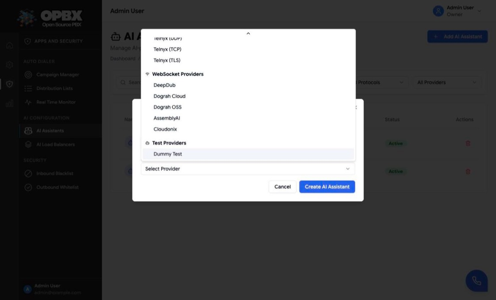
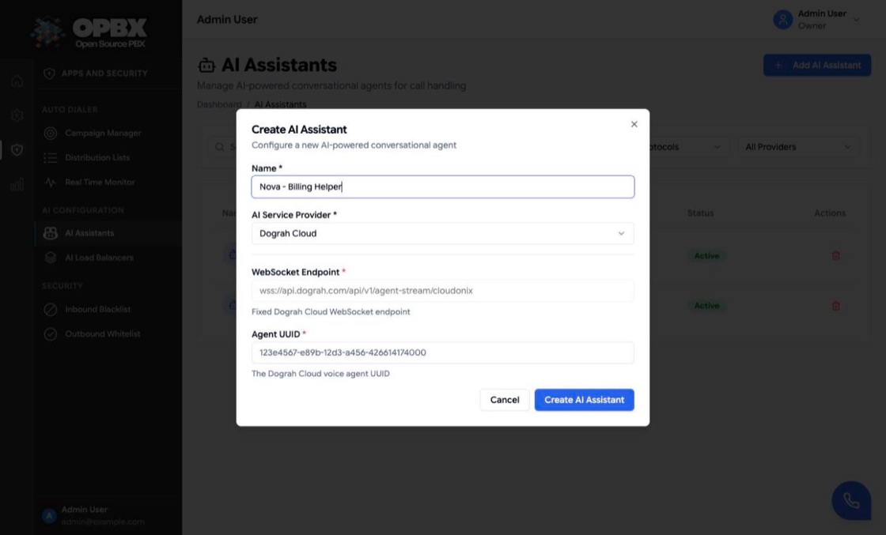

# AI Assistants

An AI assistant is a connection to an AI voice agent hosted by a provider (Retell, VAPI, ElevenLabs, Dograh and others). When a call reaches the assistant, OPBX hands the call to the provider, either by dialling the provider's SIP service or by streaming the audio over a WebSocket. Once it exists, the assistant is a destination like any other: phone numbers, IVR options, business hours, queue fallbacks and campaigns can all send callers to it.

This page is the walk-through. For the concepts and typical designs, see [AI Assistants (applications)](/opbx/applications/ai-assistants).

## Purpose

Use this module to:

- register an AI voice agent you have built with a provider;
- choose how OPBX connects to it (the provider decides SIP or WebSocket);
- turn an assistant on or off;
- remove an assistant once nothing routes to it.

## Prerequisites

- An agent set up with the provider. For a SIP provider you need the agent's phone number (E.164) at that provider. For a WebSocket provider you need the agent identifier (and, for some providers, the endpoint or token).
- You are the **Owner** or a **PBX Admin** to create, edit or delete. Reporters can open the page read-only.

## Permissions

| Action | Owner | PBX Admin | PBX User | Reporter | Supervisor |
|--------|:-----:|:---------:|:--------:|:--------:|:----------:|
| See **AI Assistants** in the sidebar | Yes | Yes | No | Yes (read-only) | No |
| List and view (API) | Yes | Yes | Yes | Yes | Yes |
| Create | Yes | Yes | No | No | No |
| Edit, activate or deactivate | Yes | Yes | No | No | No |
| Delete | Yes | Yes | No | No | No |

The page is under **Apps and Security → AI Configuration**. That sidebar section is shown to Owners, PBX Admins and Reporters only.

## Providers

The provider list comes from the server (`config/ai-providers.php`), so a deployment can add providers without a code change. The current list has 48 entries in three groups, and the dropdown in the dialog shows the same groups:

| Group | Count | Examples | Configuration fields |
|-------|------:|----------|----------------------|
| **SIP Providers** | 42 | Retell (plus UDP, TCP and TLS variants), VAPI (plus UDP and No Proxy), ElevenLabs, Ultravox, Synthflow, Telnyx, OpenAI, Millis (US and EU), X (x.ai) | **Phone Number**: the agent's number at the provider, E.164, for example `+12025550170` |
| **WebSocket Providers** | 5 | DeepDub, Dograh Cloud, Dograh OSS, AssemblyAI, Cloudonix | Depends on the provider (table below) |
| **Test Providers** | 1 | Dummy Test | None |

WebSocket providers:

| Provider | Fields |
|----------|--------|
| DeepDub | **Bot ID** (up to 255 characters) and **Authentication Token** (up to 512 characters) |
| Dograh Cloud | **WebSocket Endpoint** (fixed, read-only) and **Agent UUID** |
| AssemblyAI | **WebSocket Endpoint** (fixed, read-only) and **Agent UUID** |
| Cloudonix | **WebSocket Endpoint** (fixed, read-only) and **Agent UUID** |
| Dograh OSS | **WebSocket Endpoint** (your own server, a URL) and **Agent UUID** |

For the endpoint-and-UUID providers the stream URL is `{endpoint}/{agent UUID}`.

**Dummy Test** connects to nothing. The caller hears a short spoken (text-to-speech) message saying the routing works, and the call ends. Use it to test a routing path before the real agent is ready.

## Workflows

### Create an AI assistant

**Who can do this:** Owner, PBX Admin.

Every assistant is created the same way; only the configuration fields differ by provider. The next sections give the exact fields for each kind of provider.

1. Open **Apps and Security → AI Configuration → AI Assistants** in the sidebar.
2. Click **Add AI Assistant** (top right). The **Create AI Assistant** dialog opens.
3. Enter a **Name**, for example `Aria - Front Desk Receptionist`.
4. Open **AI Service Provider** and choose the provider. The list is grouped into **SIP Providers**, **WebSocket Providers** and **Test Providers**. The configuration fields for that provider appear below a divider.
5. Fill in the configuration fields (see the next sections).
6. Click **Create AI Assistant**.

The dialog closes, the toast **AI Assistant created successfully** appears and the assistant is listed as **Active**. OPBX sets its protocol (SIP, WebSocket or Dummy) from the provider, and the assistant is offered in every destination picker that accepts an AI assistant. If a field is wrong, the dialog stays open and a toast shows the server's message (see [Common errors](#common-errors)).

### Connect a remote AI voice assistant over SIP

**Who can do this:** Owner, PBX Admin.

Use this for any provider under **SIP Providers** (Retell, VAPI, ElevenLabs, Ultravox, Synthflow, Telnyx, OpenAI, Millis, X and the others).

1. In the provider's console, give your agent a phone number (or SIP-reachable number) and copy it in E.164 form, for example `+12025550170`.
2. In OPBX, follow [Create an AI assistant](#create-an-ai-assistant) and choose the provider under **SIP Providers**. For Retell and VAPI, pick the transport variant your provider account uses (for example **Retell (TLS)** or **VAPI (No Proxy)**).
3. Enter the agent's number in **Phone Number**.
4. Click **Create AI Assistant**.

When a call reaches the assistant, OPBX dials that number at the provider's SIP service and bridges the caller.

{/* SCREENSHOT: ai-assistants-sip-fields — Create AI Assistant dialog with Name "Aria - Front Desk Receptionist", provider VAPI selected and Phone Number +12025550170 filled in */}

### Connect a remote AI voice assistant over WebSocket

**Who can do this:** Owner, PBX Admin.

Use this for the providers under **WebSocket Providers**. OPBX streams the call audio to the provider over a WebSocket.

1. Follow [Create an AI assistant](#create-an-ai-assistant) and choose the provider under **WebSocket Providers**.
2. Fill in the fields for that provider:
   - **Dograh Cloud**, **AssemblyAI** or **Cloudonix**: the **WebSocket Endpoint** is filled in and read-only. Paste the agent's identifier from the provider console into **Agent UUID**.
   - **Dograh OSS** (self-hosted): enter your own server's address in **WebSocket Endpoint**, for example `wss://dograh.example.com/api/v1/agent-stream/cloudonix`, and the agent's identifier in **Agent UUID**.
   - **DeepDub**: enter the **Bot ID** and the **Authentication Token** from the DeepDub console. The token field hides what you type.
3. Click **Create AI Assistant**.

### Create a test assistant

**Who can do this:** Owner, PBX Admin.

1. Follow [Create an AI assistant](#create-an-ai-assistant) and choose **Dummy Test** under **Test Providers**. It has no configuration fields.
2. Click **Create AI Assistant**.
3. Route a phone number, IVR option or extension to it and call it. You hear the test message, then the call ends.

When the real agent is ready, [edit the assistant](#edit-an-assistant) and change the provider; the routing that points at it stays in place.

### Find an assistant

**Who can do this:** Owner, PBX Admin, Reporter.

- Type in **Search AI assistants...** to filter by name.
- Use the **Status** (**All Statuses**, **Active**, **Inactive**), **Protocol** (**All Protocols**, **SIP**, **WebSocket**, **Dummy**) and **Provider** filters.
- Click the refresh button next to the search box to reload the list.
- Click the **Updated** or **Status** column header to sort. The list shows 25 assistants per page, with **Previous** and **Next** below it.

Reporters see a **Read-Only** badge next to the page title, no **Add AI Assistant** button and no row actions.

### Edit an assistant

**Who can do this:** Owner, PBX Admin.

1. Click the assistant's row or its name. The **Edit AI Assistant** dialog opens.
2. Change the **Name**, the **AI Service Provider** or the configuration fields.
3. Click **Update AI Assistant**.

The toast **AI Assistant updated successfully** appears. Changing the provider also changes the protocol, and the configuration fields are replaced by the new provider's fields. Routing that points at the assistant is not changed.

{/* SCREENSHOT: ai-assistants-edit-dialog — Edit AI Assistant dialog for "Max - Support Triage" with provider Retell and its Phone Number filled in */}

### Activate or deactivate

**Who can do this:** Owner, PBX Admin.

Click the **Active** or **Inactive** badge in the **Status** column. The change is saved at once and the toast **AI Assistant updated successfully** appears.

An inactive assistant stays configured but is not used:

- routes that point straight at it (a phone number, an IVR option, a business-hours action) do not connect callers to it;
- an AI load balancer skips it as a member;
- it cannot be added as a load-balancer member or chosen as a load-balancer fallback while it is inactive.

Calls already connected are not affected.

### Delete an assistant

**Who can do this:** Owner, PBX Admin.

1. Click the delete (trash) action on the assistant's row.
2. In the **Delete AI Assistant?** dialog, check the name. When AI Assistant extensions point at it, the dialog also says **This AI Assistant is used by N extension(s).** and asks you to reassign them first.
3. Click **Delete**.

The toast **AI Assistant deleted successfully** appears and the row disappears.

{/* SCREENSHOT: ai-assistants-delete-dialog — Delete AI Assistant? confirmation for "Max - Support Triage" with the Cancel and Delete buttons */}

If anything still points at the assistant, the delete is refused and the **Cannot delete: still in use** dialog lists every place, for example:

- an extension of type AI Assistant;
- a phone number, IVR option or IVR failover;
- a business-hours action;
- a call-queue fallback;
- an AI load balancer, as a member or as its fallback;
- an auto-dialer campaign.

Change or remove those references, then delete again. Call history (call logs and CDRs) never blocks a delete.

## Where an assistant can be used

| Place | How |
|-------|-----|
| [Phone Numbers](/opbx/modules/phone-numbers) | Routing type **AI assistant** |
| [IVR Menus](/opbx/modules/ivr-menus) | An option target or the failover |
| [Business Hours](/opbx/modules/business-hours) | The open-hours or closed-hours action |
| [Call Queues](/opbx/modules/call-queues) | The overflow fallback |
| [AI Load Balancers](/opbx/modules/ai-load-balancers) | As a member, or as the fallback |
| [Extensions](/opbx/modules/extensions) | An extension of type **AI Assistant**, so it can be dialled internally |
| [Ring Groups](/opbx/modules/ring-groups) | The **AI assistant** fallback of a ring group points at an AI Assistant extension, not at the assistant itself |
| [Auto Dialer Campaigns](/opbx/modules/auto-dialer-campaigns) | The routing destination for answered calls |

## Fields

| Field | Required | Limits | Meaning |
|-------|----------|--------|---------|
| Name | Yes | Up to 255 characters; unique within the organization | Shown in lists and destination pickers |
| AI Service Provider | Yes | One of the providers above | Decides the protocol and the configuration fields |
| Configuration fields | Per provider | See [Providers](#providers) | How OPBX reaches the agent |
| Status | No | Active or Inactive. Default: Active | Inactive assistants are not used for calls |
| Description | No (API only) | Up to 1000 characters | Free text. The dialog does not show it |

The phone number of a SIP provider must be E.164. A value such as `2025550170` without the plus sign is accepted by the server, but use the full `+12025550170` form.

## Common errors

| Message (summary) | What it means | What to do |
|-------------------|---------------|-----------|
| An AI Assistant with this name already exists in your organization | The name is taken | Choose another name |
| Please select a provider | No provider was chosen | Pick a provider |
| Unknown AI provider: *key* | The provider key is not in the server's list (API) | Use a key from `GET /v1/ai-assistant/providers` |
| *Field* is required | A required configuration field is empty | Fill it in |
| Phone Number must be a valid phone number (E.164 format) | The SIP number is not a valid number | Enter it as `+` and country code, for example `+12025550170` |
| *Field* must be a valid URL | The Dograh OSS endpoint is not a URL | Enter the full `wss://…` address |
| Cannot delete: still in use | Routing configuration points at the assistant | Change the listed references, then delete |

## Key data fields

### `ai_assistants`

| Column | Notes |
|--------|-------|
| `id` | Primary key |
| `organization_id` | Tenant scope |
| `name` | Unique within the organization (deleted assistants excluded) |
| `description` | Optional, up to 1000 characters |
| `provider` | Provider key, for example `vapi` or `dograh-cloud` |
| `protocol` | `sip`, `websocket` or `dummy`. Set from the provider |
| `configuration` | JSON with the provider's fields, for example `{"phone_number": "+12025550170"}` |
| `status` | `active` or `inactive` (there is no `pending`; other values are refused with 422) |
| `deleted_at` | Deletes are soft deletes |

## Related API endpoints

| Method | Endpoint | Purpose |
|--------|----------|---------|
| GET | `/v1/ai-assistants` | List. Filters: `status`, `protocol`, `provider`, `search` |
| POST | `/v1/ai-assistants` | Create |
| GET | `/v1/ai-assistants/{id}` | One assistant |
| PUT | `/v1/ai-assistants/{id}` | Update |
| DELETE | `/v1/ai-assistants/{id}` | Delete. Returns 409 with the list of uses when in use |
| GET | `/v1/ai-assistant/providers` | All providers and their fields |
| GET | `/v1/ai-assistant/providers/{provider}` | One provider |
| GET | `/v1/ai-assistant/providers/protocol/{protocol}` | Providers for `sip` or `websocket` |

Scoped API keys use the `ai-assistants` and `ai-assistant-providers` resources (see [API Keys](/opbx/modules/api-keys)). The [MCP server](/opbx/modules/mcp-server) has `list_ai_providers`, `get_ai_provider`, `list_ai_assistants`, `get_ai_assistant`, `create_ai_assistant`, `update_ai_assistant` and `delete_ai_assistant`.

See the [OPBX REST API reference](https://developers.cloudonix.com/opbxRestOpenAPI) for full schemas.

## Related modules

- [AI Load Balancers](/opbx/modules/ai-load-balancers) — spread calls over several assistants, with failover
- [Extensions](/opbx/modules/extensions) — AI Assistant extensions for internal dialling
- [Phone Numbers](/opbx/modules/phone-numbers) — route a number straight to an assistant
- [AI Assistants (applications)](/opbx/applications/ai-assistants) — concepts and designs
