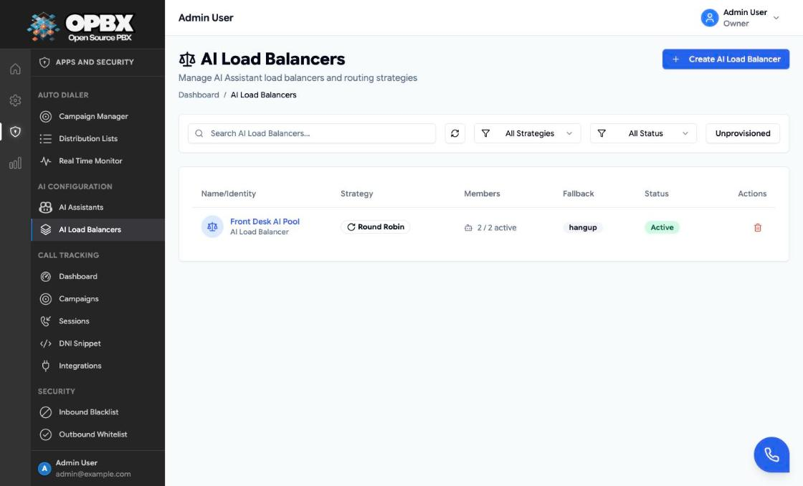
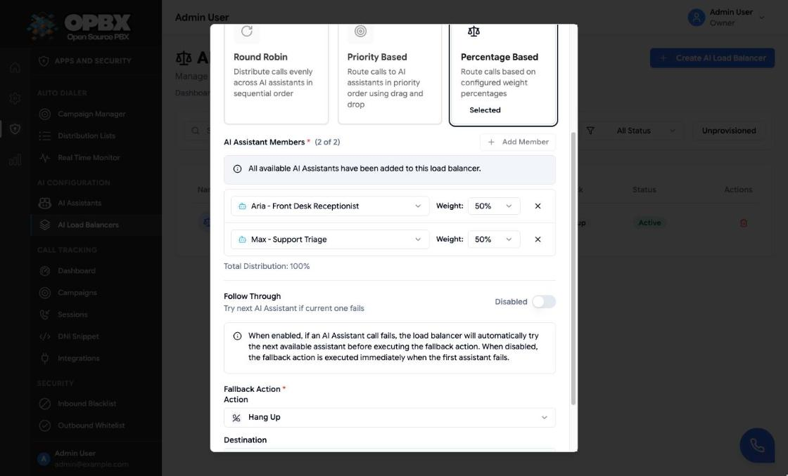
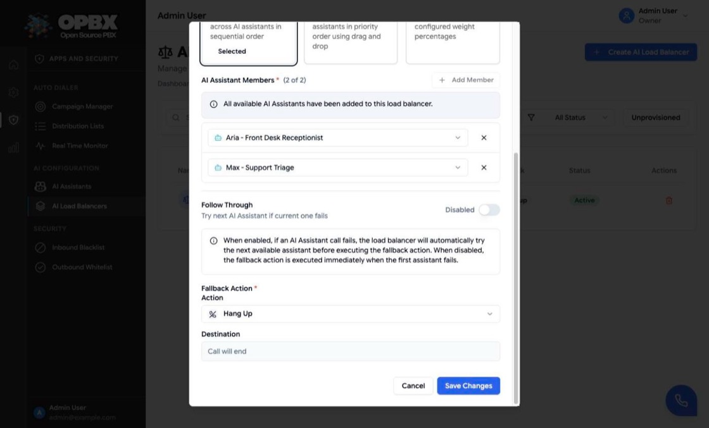
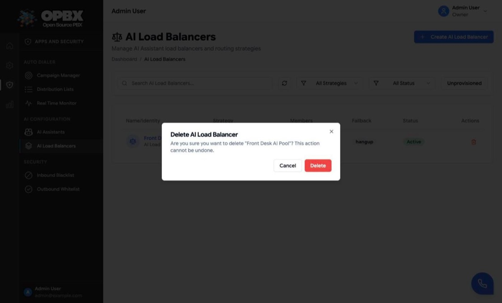

# AI Load Balancers

An AI load balancer groups several [AI assistants](/opbx/modules/ai-assistants) behind one destination. Each call goes to one member chosen by the strategy (round robin, priority or percentage). With **Follow Through** on, a member that fails is skipped and the next one is tried. When no member can take the call, the **fallback** runs: an extension, ring group, IVR menu, another AI assistant, a call queue, another AI load balancer, or hang up.

This page is the walk-through. For designs such as primary and backup, or A/B tests, see [AI Load Balancers (applications)](/opbx/applications/ai-load-balancers).

## Purpose

Use a load balancer to:

- share call volume between assistants or providers;
- keep a backup assistant ready when the primary one fails;
- test a new assistant on a share of the calls;
- send callers to people when every assistant fails.

## Prerequisites

- At least one **active** AI assistant. Inactive assistants cannot be added. See [AI Assistants](/opbx/modules/ai-assistants).
- A fallback destination, if you do not want callers to be hung up on. It must exist and be **active**.
- You are the **Owner** or a **PBX Admin** to create, edit or delete. Reporters can open the page read-only.

## Permissions

| Action | Owner | PBX Admin | PBX User | Reporter | Supervisor |
|--------|:-----:|:---------:|:--------:|:--------:|:----------:|
| See **AI Load Balancers** in the sidebar | Yes | Yes | No | Yes (read-only) | No |
| List and view (API) | Yes | Yes | Yes | Yes | Yes |
| Create, edit, activate or deactivate | Yes | Yes | No | No | No |
| Delete | Yes | Yes | No | No | No |

## Workflows

### Create a load balancer

**Who can do this:** Owner, PBX Admin.

1. Open **Apps and Security → AI Configuration → AI Load Balancers** in the sidebar.
2. Click **Create AI Load Balancer** (top right). The **Create AI Load Balancer** dialog opens.
3. Enter a **Name** of at least 2 characters, for example `Front Desk AI Pool`.
4. Under **Distribution Strategy**, click **Round Robin**, **Priority Based** or **Percentage Based**.
5. Under **AI Assistant Members**, click **Add Member** once per assistant. Each click adds the next active assistant that is not yet a member and shows the toast **Added *name* to load balancer**. To use a different assistant, pick it in the member's dropdown. Click **X** on a member to remove it.
6. For **Priority Based**, [order the members](#order-members-for-priority-based); for **Percentage Based**, [set the weights](#set-weights-for-percentage-based).
7. Turn **Follow Through** on (**Enabled**) to try the next member when one fails, or leave it **Disabled**.
8. Under **Fallback Action**, choose the **Action** and, when it needs one, the **Destination** (for example a ring group of people).
9. Click **Create AI Load Balancer**.

The dialog closes, the toast **AI Load Balancer created successfully** appears and the load balancer is listed as **Active**. It is now offered everywhere an AI load balancer can be chosen. A new load balancer must have a real fallback: the create dialog does not offer **Disconnect**.

If something is missing, the dialog stays open and shows the problem under the field, for example **Name must be at least 2 characters**, **At least one AI Assistant member is required** or **Fallback ring group is required**.

{/* SCREENSHOT: ai-load-balancers-create-dialog — Create AI Load Balancer dialog for "Front Desk AI Pool" with Round Robin selected, the members Aria - Front Desk Receptionist and Max - Support Triage, Follow Through Enabled and the Fallback Action Ring Group "Support Team" */}

**Add Member** is disabled when every active assistant is already a member; the dialog then says **All available AI Assistants have been added to this load balancer.** A load balancer has at most 50 members.

### Order members for Priority Based

**Who can do this:** Owner, PBX Admin.

1. In the create or edit dialog, select **Priority Based**. Each member gets a drag handle.
2. Drag the members by the handle. The top member is the first choice; the next one is used only when the first cannot take the call (with **Follow Through** on) or is inactive.
3. Click **Create AI Load Balancer** or **Save Changes**.

{/* SCREENSHOT: ai-load-balancers-priority-order — Edit AI Load Balancer dialog with Priority Based selected and the drag handles next to Aria (top) and Max */}

### Set weights for Percentage Based

**Who can do this:** Owner, PBX Admin.

1. In the create or edit dialog, select **Percentage Based**. Each member gets a **Weight** dropdown (0 % to 100 % in steps of 5). A new member starts at 100 %.
2. Set the weights so that **Total Distribution** shows 100 %, for example 80 % for the current assistant and 20 % for the one under test.
3. Click **Create AI Load Balancer** or **Save Changes**.

If the total is not 100 %, saving stops with **Percentage distribution must equal 100% (currently: N%). Please adjust the weights.**

### Find a load balancer

**Who can do this:** Owner, PBX Admin, Reporter.

- Type in **Search AI Load Balancers...** to filter by name.
- Use the **Strategy** filter (**All Strategies**, **Round Robin**, **Priority Based**, **Percentage Based**) and the **Status** filter (**All Status**, **Active**, **Disabled**).
- Turn on the **Unprovisioned** filter to see only load balancers whose fallback is disconnected.
- Click the refresh button to reload, and the **Strategy** or **Status** column header to sort. The list shows 25 load balancers per page.

Reporters see a **Read-Only** badge, no **Create AI Load Balancer** button and no row actions.

### Edit a load balancer

**Who can do this:** Owner, PBX Admin.

1. Click the load balancer's row or name. The **Edit AI Load Balancer** dialog opens.
2. Change the name, strategy, members, **Follow Through** or **Fallback Action**.
3. Click **Save Changes**.

The toast **AI Load Balancer updated successfully** appears. Saving replaces the member list with the one in the dialog. If another person is saving the same load balancer at that moment, the save is refused with "Load balancer is currently being modified. Please try again."

### Disconnect the fallback

**Who can do this:** Owner, PBX Admin.

1. Open the load balancer's **Edit AI Load Balancer** dialog.
2. Under **Fallback Action**, choose **Disconnect** (offered on the edit dialog only).
3. Click **Save Changes**.

This stores "Destination unavailable": callers who reach the fallback hear "Destination doesn't exist" and the call ends. The load balancer then shows the **Unprovisioned** badge in the list and in the dialog title, and the **Unprovisioned** filter on the list finds it. Pick a real fallback to clear the badge.

The same state appears after a [user is deleted](/opbx/modules/user-management#delete-a-user) whose extension was the fallback.

### Activate or deactivate

**Who can do this:** Owner, PBX Admin.

Click the **Active** or **Disabled** badge in the **Status** column. The change is saved at once and the toast **AI Load Balancer updated successfully** appears. An inactive load balancer does not use its members; every call goes straight to the fallback.

### Delete a load balancer

**Who can do this:** Owner, PBX Admin.

1. Click the delete (trash) action on the row.
2. The **Delete AI Load Balancer** dialog asks: Are you sure you want to delete "*name*"? This action cannot be undone.
3. Click **Delete**.

The toast **AI Load Balancer deleted successfully** appears and the row disappears.

If anything still points at the load balancer, the delete is refused and the **Cannot delete: still in use** dialog lists every place: phone numbers, IVR options and failovers, business-hours actions, ring-group, call-queue and AI load balancer fallbacks, extensions of type AI Load Balancer, auto-dialer campaigns and call-tracking campaigns. Change those, then delete again. Call history never blocks a delete.

## Where a load balancer can be used

- [Phone Numbers](/opbx/modules/phone-numbers): routing type **AI load balancer**.
- [IVR Menus](/opbx/modules/ivr-menus): an option target or the failover.
- [Business Hours](/opbx/modules/business-hours): the open-hours or closed-hours action.
- [Ring Groups](/opbx/modules/ring-groups) and [Call Queues](/opbx/modules/call-queues): the fallback.
- [Extensions](/opbx/modules/extensions): an extension of type **AI Load Balancer**.
- [Auto Dialer Campaigns](/opbx/modules/auto-dialer-campaigns) and [Call Tracking Campaigns](/opbx/modules/call-tracking-campaigns) (API).

## Fields

| Field | Required | Limits and default | Meaning |
|-------|----------|--------------------|---------|
| Name | Yes | 2 to 255 characters; unique within the organization | Shown in lists and destination pickers |
| Distribution Strategy | Yes | Round Robin, Priority Based or Percentage Based. Default: Round Robin | How the member for each call is chosen |
| Members | Yes | 1 to 50 active AI assistants; each assistant once | The assistants that take calls |
| Weight | Percentage Based only | 0 to 100 % in steps of 5 in the dialog. Default for a new member: 100 | Share of calls for the member |
| Follow Through | No | Off by default | Try the next member when one fails |
| Fallback Action | Yes | PBX User Extension, Ring Group, IVR Menu, AI Assistant, Call Queue, AI Load Balancer or Hang Up. Default: Hang Up | What happens when no member can take the call |
| Status | No | Active or Disabled (`inactive` in the API). Default: Active. Change it from the list | Inactive load balancers send every call straight to the fallback |
| Description | No (API only) | Up to 1000 characters | Free text. The dialog does not show it |

### Strategies

| Strategy | How the member is chosen |
|----------|--------------------------|
| **Round Robin** | Members take turns, in list order. The turn counter is kept in Redis; if Redis is unavailable, a member is picked at random |
| **Priority Based** | Always the first member in list order. Drag members to set the order |
| **Percentage Based** | Weighted random choice. In the dialog the weights must add up to 100 % ("Percentage distribution must equal 100%"). A member with weight 0 is never chosen while others have weight |

Only members whose assistant is **active** take part. An assistant you deactivate later is skipped automatically.

### Follow Through

| Follow Through | When the chosen assistant's call fails |
|----------------|----------------------------------------|
| On | The next untried member is chosen with the same strategy, and so on until every member was tried. Then the fallback runs |
| Off | The fallback runs at once |

A call counts as failed when the provider leg ends **busy**, **no answer**, **failed**, **canceled** or with an unknown status. It applies to SIP and WebSocket members; a Dummy Test member has nothing to fail. The list of members already tried for a call is kept for one hour.

### Fallback

| Fallback Action | Result |
|-----------------|--------|
| PBX User Extension | Rings the chosen extension. The dialog lists active PBX User extensions |
| Ring Group | Sends the call to the ring group |
| IVR Menu | Plays the menu |
| AI Assistant | Connects one more assistant, without Follow Through. It cannot be a member of the same load balancer ("Circular reference detected") |
| Call Queue | Puts the caller in the call queue |
| AI Load Balancer | Hands the call to another load balancer's selection. Saving is refused (422) if the chain of AI Load Balancer fallbacks would ever return to this balancer: A to A, A to B to A, A to B to C to A and so on. The message names the loop. If a loop still exists at call time, the call ends |
| Hang Up | Ends the call |

Call Queue and AI Load Balancer need a target: saving without one is refused. The fallback target must belong to your organization and be **active** when you save.

## Common errors

| Message (summary) | What it means | What to do |
|-------------------|---------------|-----------|
| A load balancer with this name already exists in your organization | The name is taken, also by a deleted load balancer | Choose another name |
| At least one AI Assistant member is required | The member list is empty | Add a member |
| Only active AI assistants can be added to load balancers | A member is inactive | Activate the assistant or remove it |
| Percentage distribution must equal 100% (currently: N%) | The weights do not add up to 100 | Adjust the weights |
| Fallback … must be active | The fallback target is inactive | Activate it or pick another |
| Circular reference detected: Fallback AI assistant cannot be a member | The fallback assistant is also a member | Pick a different fallback assistant |
| A load balancer cannot fall back to itself | The AI Load Balancer fallback is the same load balancer | Pick a different one |
| Choose a destination | You tried to create with "Destination unavailable" (API) | Pick a fallback. Disconnect is for edits only |
| Load balancer is currently being modified | Two saves at the same time | Try again |
| Cannot delete: still in use | Routing configuration points at the load balancer | Change the listed references, then delete |

## Key data fields

### `ai_assistant_load_balancers`

| Column | Notes |
|--------|-------|
| `id` | Primary key |
| `organization_id` | Tenant scope |
| `name` | Unique within the organization, deleted rows included |
| `strategy` | `round_robin`, `priority` or `percentage` |
| `follow_through` | Boolean |
| `status` | `active` or `inactive` |
| `fallback_action` | `extension`, `ring_group`, `ivr_menu`, `ai_assistant`, `call_queue`, `ai_load_balancer`, `hangup` or `unavailable` |
| `fallback_extension_id`, `fallback_ring_group_id`, `fallback_ivr_menu_id`, `fallback_ai_assistant_id`, `fallback_call_queue_id`, `fallback_ai_load_balancer_id` | Only the one that matches the action is set |
| `deleted_at` | Deletes are soft deletes |

### `ai_assistant_load_balancer_members`

| Column | Notes |
|--------|-------|
| `load_balancer_id`, `ai_assistant_id` | Each assistant once per load balancer |
| `position` | List order (round robin) |
| `priority` | Lower is tried first (priority strategy). The dialog sets it from the list order |
| `weight` | 0 to 100 (percentage strategy) |
| `status` | `active` or `inactive` |

## Related API endpoints

| Method | Endpoint | Purpose |
|--------|----------|---------|
| GET | `/v1/ai-assistant-load-balancers` | List. Filters: `strategy`, `status`, `search`, `unprovisioned=1` |
| POST | `/v1/ai-assistant-load-balancers` | Create. Rejects "Destination unavailable" |
| GET | `/v1/ai-assistant-load-balancers/{id}` | One load balancer with members |
| PUT | `/v1/ai-assistant-load-balancers/{id}` | Update. Sending `members` replaces them all |
| DELETE | `/v1/ai-assistant-load-balancers/{id}` | Delete. Returns 409 with the list of uses when in use |

Scoped API keys use the `ai-assistant-load-balancers` resource (see [API Keys](/opbx/modules/api-keys)). The [MCP server](/opbx/modules/mcp-server) has `list_ai_load_balancers` and `get_ai_load_balancer`.

See the [OPBX REST API reference](https://developers.cloudonix.com/opbxRestOpenAPI) for full schemas.

## Troubleshooting

With the [centralized logging stack](/opbx/administration/centralized-logs) enabled, search for `AiLoadBalancerRoutingStrategy` to see which member was chosen for a call, and for `ALBS Follow Through` to follow a failover.

Common causes of "callers always get the fallback":

- the load balancer is inactive;
- every member's assistant is inactive;
- the provider rejects the call (check the assistant's phone number or agent ID).

## Related modules

- [AI Assistants](/opbx/modules/ai-assistants) — the members
- [Extensions](/opbx/modules/extensions) — AI Load Balancer extensions
- [Phone Numbers](/opbx/modules/phone-numbers) — route a number to a load balancer
- [AI Load Balancers (applications)](/opbx/applications/ai-load-balancers) — designs and use cases
