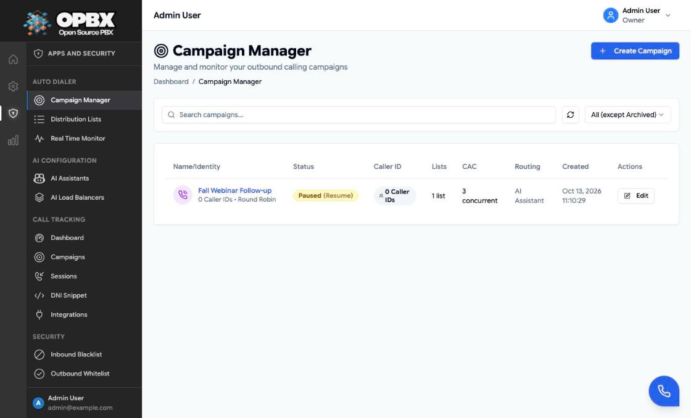

# Auto Dialer Campaigns

An auto-dialer campaign dials every number on its [distribution list](/modules/distribution-lists) inside a weekly schedule, at a controlled rate, and connects answered calls to an AI assistant or AI load balancer. This page is the reference. The step-by-step walk-through is in the **Auto Dialer** application guide, starting at [Auto Dialer Overview](/applications/auto-dialer).

## Purpose

Use this module to:

- create and edit outbound campaigns;
- choose the routing destination and the caller-ID pool;
- set the schedule, rate limits, attempts and voicemail detection;
- start, pause, resume, archive or delete campaigns;
- follow progress on the [Real-Time Monitor](/applications/auto-dialer/real-time-monitor).

## Prerequisites

- **Owner** or **PBX Admin** role.
- An [AI assistant](/modules/ai-assistants) or [AI load balancer](/modules/ai-load-balancers), unless you route to Hangup for testing.
- At least one **active** [phone number](/modules/phone-numbers) for the caller ID.
- The [dialer worker](/workers/dialer-worker) running (single replica), and the [AMD worker](/workers/amd-worker) for voicemail detection.

## Walk-through

| Task | Guide |
|------|-------|
| Create, edit, start, pause, resume, archive, delete | [Managing Campaigns](/applications/auto-dialer/campaigns) |
| Upload and assign the numbers | [Distribution Lists](/applications/auto-dialer/distribution-lists) |
| Dates, weekly hours, timezone, auto-start | [Campaign Scheduling](/applications/auto-dialer/scheduling) |
| CAC, CPS, attempts, retries | [Rate Limiting](/applications/auto-dialer/rate-limiting) |
| Voicemail detection | [Answering Machine Detection](/applications/auto-dialer/answering-machine-detection) |
| Where answered calls go | [Campaign Routing](/applications/auto-dialer/routing-destinations) |
| Live view | [Real-Time Monitor](/applications/auto-dialer/real-time-monitor) |

## Fields at a glance

| Field | Limits and default |
|-------|--------------------|
| Name | Required, up to 255 characters |
| Description | Up to 1000 characters (API only; the form does not show it) |
| Routing destination | AI Assistant, AI Load Balancer or Hangup. A destination ID is required except for Hangup |
| Caller ID | Required, E.164. The form uses the first number of the pool |
| Caller-ID pool | 1 to 100 active numbers of your organization; weight 1 to 100 per number (API only, default 1) |
| Caller-ID strategy | Round Robin (default), Random, Least Recently Used |
| Timezone | Required, IANA name |
| Start and end date | Required. Start today or later on create; end on or after start |
| Weekly schedule | Per weekday: enabled, and time ranges `HH:MM` to `HH:MM` (end may be `24:00`) |
| Dial timeout | 1 to 300 seconds. Form default: 60 |
| Connect when | Call Connected or Immediately. Stored; not used by the current dialer |
| Time limit | 30 to 14400 seconds. Default: 3600 |
| Concurrent active calls (CAC) | 1 to 50 |
| Calls per second (CPS) | 1 to 30. Default: 1 |
| Max dial attempts | 1 to 5 |
| Record calls | Off by default |
| Voicemail, human and unknown actions | `HANGUP` or `CONTINUE`, or empty (treated as Continue). Empty on all three means no detection |
| Retry on voicemail | Off by default |
| Auto-start | Off by default |

## Statuses

| Status | Shown as | Meaning |
|--------|----------|---------|
| `draft` | Draft | New. Editable and deletable |
| `active` | Running | Dials whenever the schedule allows. Not editable |
| `paused` | Paused | No new calls. Editable |
| `completed` | Completed | Every number finished. Set automatically only for auto-started campaigns |
| `archived` | Archived | Kept for history |

A Draft campaign becomes **Active** when a Ready list is assigned to it.

## Permissions

| Action | Owner | PBX Admin | PBX User | Reporter | Supervisor |
|--------|:-----:|:---------:|:--------:|:--------:|:----------:|
| See the Auto Dialer pages | Yes | Yes | No | No | No |
| List campaigns and the monitor | Yes | Yes | No | No | No |
| Create, edit, start, pause, resume | Yes | Yes | No | No | No |
| Archive | Yes | No | No | No | No |
| Delete (Draft only) | Yes | No | No | No | No |

## What a campaign blocks

- A **phone number** in a campaign's caller-ID pool cannot be deleted ("caller ID pool" in the in-use dialog).
- An **AI assistant** or **AI load balancer** that a campaign routes to cannot be deleted ("routing" in the in-use dialog), whatever the campaign's status.

Remove the reference from the campaign first. See [Phone Numbers](/modules/phone-numbers#delete) and [Campaign Routing](/applications/auto-dialer/routing-destinations#deleting-a-destination-that-a-campaign-uses).

## Key data fields

### `auto_dialer_campaigns`

| Column | Notes |
|--------|-------|
| `id`, `organization_id` | Key and tenant scope |
| `name`, `description` | |
| `status` | `draft`, `active`, `paused`, `completed`, `archived` |
| `auto_start` | Boolean |
| `routing_destination_type`, `routing_destination_id` | `ai_assistant`, `ai_load_balancer` or `hangup`, and the target id |
| `caller_id`, `caller_id_strategy`, `caller_id_pool_enabled` | Main caller ID and pool settings |
| `dial_timeout`, `time_limit`, `destination_connect`, `record_calls` | Call settings |
| `max_dial_attempts`, `concurrent_active_calls`, `calls_per_second` | Limits |
| `timezone`, `start_date`, `end_date`, `schedule` | The schedule. `schedule` is the weekly JSON that the dialer reads |
| `days_active`, `start_time`, `end_time` | Older single-window fields derived from `schedule`; used by auto-start |
| `action_voicemail`, `action_human`, `action_unknown`, `retry_on_voicemail` | Voicemail detection |
| `total_destinations`, `completed_calls`, `failed_calls`, `pending_calls`, `voicemail_calls` | Counters |
| `started_at`, `completed_at` | Timestamps |

### `auto_dialer_campaign_caller_ids`

The caller-ID pool: `campaign_id`, `did_number_id`, `weight`.

### `auto_dialer_call_sessions`

One row per call attempt: campaign, destination, session token, status, disposition, duration, AMD result and confidence, and the start, answer and end times.

## Related API endpoints

| Method | Endpoint | Purpose |
|--------|----------|---------|
| GET | `/v1/auto-dialer-campaigns` | List (filters: `status`, `exclude_status`, `search`) |
| POST | `/v1/auto-dialer-campaigns` | Create (status Draft) |
| GET | `/v1/auto-dialer-campaigns/{campaign}` | One campaign, with its caller-ID pool |
| PUT | `/v1/auto-dialer-campaigns/{campaign}` | Update (refused while Active) |
| DELETE | `/v1/auto-dialer-campaigns/{campaign}` | Delete (Owner, Draft only) |
| PATCH | `/v1/auto-dialer-campaigns/{campaign}/start` | Start |
| PATCH | `/v1/auto-dialer-campaigns/{campaign}/pause` | Pause |
| PATCH | `/v1/auto-dialer-campaigns/{campaign}/resume` | Resume |
| PATCH | `/v1/auto-dialer-campaigns/{campaign}/archive` | Archive (Owner) |
| POST | `/v1/auto-dialer-campaigns/{campaign}/reset-cac` | Reset the concurrent-call counter |
| GET | `/v1/auto-dialer-campaigns/{campaign}/destinations` | Numbers of the campaign's lists |
| GET | `/v1/auto-dialer-campaigns/{campaign}/concurrency` | Live CAC use |
| GET | `/v1/auto-dialer-campaigns/monitor/summary` | Monitor overview |
| GET | `/v1/auto-dialer-campaigns/{campaign}/monitor/detail` | Monitor drill-down |
| GET | `/v1/auto-dialer-campaigns/available-caller-ids` | Active numbers that can join a pool |
| GET | `/v1/auto-dialer-campaigns/{campaign}/caller-id-stats` | Per-number usage |
| POST | `/v1/auto-dialer-campaigns/{campaign}/reset-caller-id-cycle` | Restart round robin (Paused only) |

**Scoped API keys** use the `auto-dialer-campaigns` resource. The **MCP server** offers tools such as `list_campaigns`, `get_campaign`, `create_campaign`, `update_campaign` and `get_campaigns_monitor_summary`. See [API Keys](/modules/api-keys) and [MCP Server](/modules/mcp-server).

See the [OPBX REST API reference](https://developers.cloudonix.com/opbxRestOpenAPI) for full schemas.

## Related modules

- [Distribution Lists](/modules/distribution-lists) — the numbers a campaign dials
- [AI Assistants](/modules/ai-assistants) and [AI Load Balancers](/modules/ai-load-balancers) — routing destinations
- [Phone Numbers](/modules/phone-numbers) — caller IDs
- [Outbound Whitelist](/modules/outbound-whitelist) — trunk selection for campaign calls
- [Dialer Worker](/workers/dialer-worker) and [AMD Worker](/workers/amd-worker)
