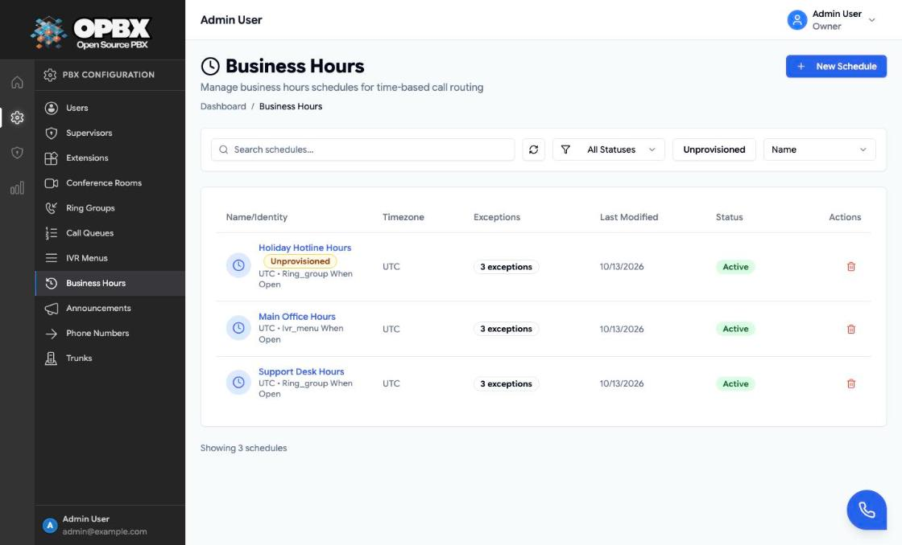
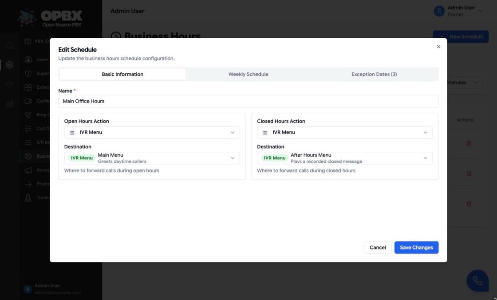
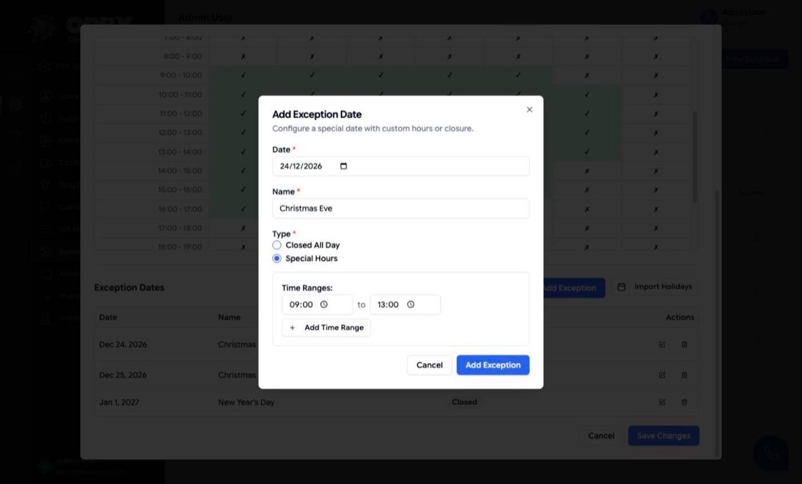
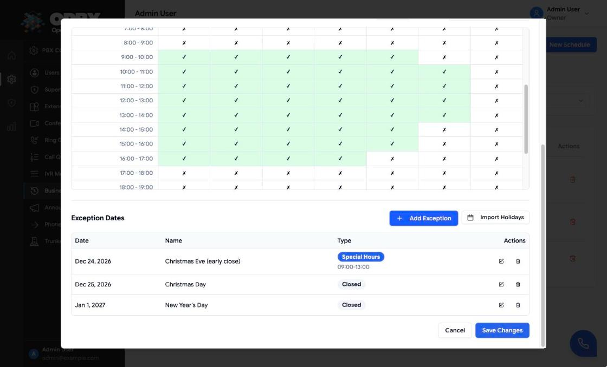
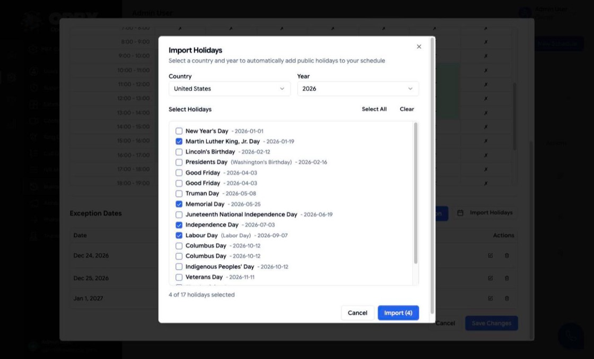
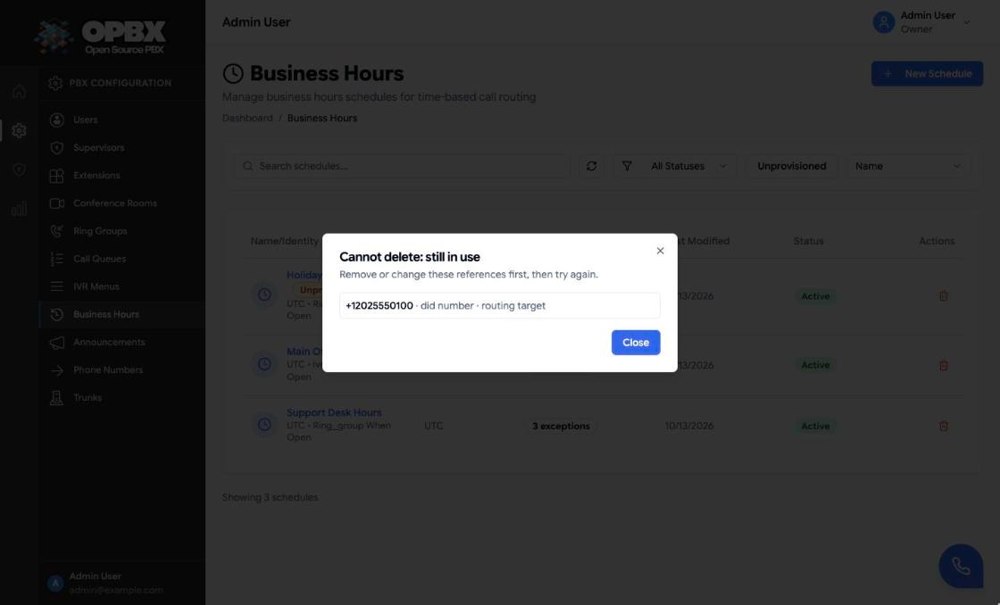

# Business Hours

A business-hours schedule decides where a call goes based on the time it arrives. It has weekly opening hours, optional exception dates (holidays and special hours), an **open-hours action** and a **closed-hours action**. Route a phone number to the schedule and it picks the right destination for every call.

## Purpose

Use this module to:

- set opening hours for each day of the week, with one or more time ranges per day;
- add holidays and days with special hours;
- send open-hours calls to, for example, an IVR menu and closed-hours calls to an after-hours menu.

## Prerequisites

- **Both destinations exist.** Create the extensions, ring groups, menus, rooms, queues or AI targets first.
- **A phone number** to route to the schedule. See [Phone Numbers](/opbx/modules/phone-numbers).

## Permissions

| Action | Owner | PBX Admin | PBX User | Reporter |
|--------|:-----:|:---------:|:--------:|:--------:|
| See Business Hours in the sidebar | Yes | Yes | No | No |
| View schedules | Yes | Yes | Yes (API) | Yes (API) |
| Create, edit, delete, duplicate, change status | Yes | Yes | No | No |

## How a call is routed

1. A call arrives on a phone number routed to the schedule.
2. If the schedule is Inactive, it is closed: go to step 4.
3. If today's date has an exception, the exception decides: closed, or open only within its ranges.
4. Otherwise the day's time ranges decide.
5. Open: the open-hours action runs. Closed: the closed-hours action runs.
6. If the target no longer exists or is inactive, the caller hears a short "not available" message and the call ends.

## Workflows

### Create a schedule

**Who can do this:** Owner, PBX Admin.

1. Open **Business Hours** in the sidebar (under **PBX Configuration**).
2. Click **New Schedule**. The **Create Schedule** dialog opens.
3. Enter the **Name**.
4. Under **Open Hours Action**, choose the type, then the **Destination**.
5. Under **Closed Hours Action**, choose the type, then the **Destination**.
6. Set the weekly hours (see [Set the weekly hours](#set-the-weekly-hours)).
7. Optionally add exception dates (see [Add an exception date](#add-an-exception-date) and [Import public holidays](#import-public-holidays)).
8. Click **Create Schedule**.

The toast "Business hours schedule has been created successfully." appears and the schedule is listed as **Active**. It becomes available as a routing type on phone numbers. If the name or an action is missing, the dialog marks the field and shows "Please fix the errors in the form."

### Set the weekly hours

**Who can do this:** Owner, PBX Admin.

The **Weekly Schedule** section of the schedule dialog is a grid with one column per weekday and one row per hour (`0:00 - 1:00` to `23:00 - 24:00`). Open hours are green with a check mark.

1. To start from a common pattern, pick one under **Template:** (see [Weekly schedule](#weekly-schedule)). It replaces the whole week.
2. Click an hour cell to open or close that hour. Adjacent open hours join into one time range. Closing the last open hour of a day closes the day.
3. Click a day name in the header row to open that whole day (00:00 to 24:00). Click it again to close the day.
4. Click **Clear All** to close every day.
5. Save the schedule (**Create Schedule** or **Save Changes**). The hours are only stored when you save.

### Add an exception date

**Who can do this:** Owner, PBX Admin.

1. In the schedule dialog, under **Exception Dates**, click **Add Exception**. The **Add Exception Date** dialog opens.
2. Pick the **Date** and enter the **Name**, for example `Christmas Day`.
3. Choose the **Type**: **Closed All Day** or **Special Hours**. For Special Hours, set the times under **Time Ranges:**; click **Add Time Range** for more.
4. Click **Add Exception**. The toast "Exception date has been added." appears and the date is listed in the **Exception Dates** table.
5. Save the schedule. Exception dates are only stored when you save.

To change a date, click its edit (pencil) icon, change it and click **Update Exception** ("Exception date has been updated."). To remove one, click its delete icon ("Exception date has been removed."). Both take effect when you save the schedule.

### Import public holidays

**Who can do this:** Owner, PBX Admin.

1. In the schedule dialog, under **Exception Dates**, click **Import Holidays**.
2. Choose the **Country** and the **Year**. The list of public holidays loads.
3. Tick the holidays to add under **Select Holidays** (**Select All** and **Clear** help).
4. Click **Import (*n*)**. The toast "Imported *n* holidays" appears. Each holiday is added as a **Closed** exception; dates already in the list are skipped.
5. Save the schedule.

The holidays come from the public `date.nager.at` service. The browser calls it directly.

### Edit a schedule

**Who can do this:** Owner, PBX Admin.

1. Click the schedule's row or name in the list. The **Edit Schedule** dialog opens.
2. Change the fields, hours or exception dates.
3. Click **Save Changes**.

The toast "Business hours schedule has been updated successfully." appears. Editing keeps the schedule's time zone.

### Activate or deactivate a schedule

**Who can do this:** Owner, PBX Admin.

1. In the **Status** column, click the **Active** or **Disabled** badge.

The toast "Business hours schedule status updated" appears and the badge switches. **Disabled** is how the list shows an Inactive schedule. An Inactive schedule always uses its closed-hours action.

An unprovisioned schedule shows **Unprovisioned** in the **Status** column instead. That badge is not a switch: open the schedule, choose a destination for the action that has none, and save; the status badge then comes back.

### Find a schedule

**Who can do this:** Owner, PBX Admin.

1. Type in the search box to filter by name.
2. Narrow the list with the status filter (**All Statuses**, **Active**, **Inactive**).
3. Click a column title (**Name**, **Last Modified** or **Status**) to sort by it; click it again to reverse the order.
4. Click the refresh button to reload the list.

A schedule with an action set to Destination unavailable shows **Unprovisioned** in the **Status** column; open it and choose a new destination.

### Delete a schedule

**Who can do this:** Owner, PBX Admin.

1. Click the delete (trash) icon on the row.
2. Confirm with **Delete** in the **Delete Schedule** dialog.

The toast "Business hours schedule has been deleted." appears and the row disappears. The delete is refused while a phone number or an IVR menu option or failover still routes to the schedule: the **Cannot delete: still in use** dialog lists each one. Change them, then delete again. Deleted schedules are soft-deleted, so the name can be reused.

## Unprovisioned schedules

An action becomes **Destination unavailable** when its destination is removed, for example when a user is deleted and the action pointed at that user's extension. Callers in that period hear "Destination doesn't exist" and the call ends. The schedule then shows **Unprovisioned** in the list's **Status** column and in the dialog title, and its status can't be switched from the list until every action has a destination again.

**Destination unavailable** is never a choice in the dialog: it only appears, greyed out, as the current type of an action that lost its destination. To fix the schedule, open it, choose a new type and destination for that action, and save. The create dialog and the API refuse it on create with "Choose a destination.

## Duplicate a schedule

The API and the MCP server (`duplicate_business_hours`) can copy a schedule with its days and exceptions (each exception keeps its type, Closed All Day or Special Hours, and its time ranges). The copy is named "*original* (Copy)", keeps the original's time zone and starts **Inactive**. The page has no Duplicate button.

## Fields

| Field | Limits | Meaning |
|-------|--------|---------|
| Name | Required. 2 to 255 characters, unique within the organization | Shown in lists and in the phone-number destination picker |
| Open Hours Action | Required. A type and one destination | Where calls go while the schedule is open |
| Closed Hours Action | Required. A type and one destination | Where calls go while it is closed |
| Weekly schedule | Each day on or off. An enabled day needs at least one time range | The regular opening hours |
| Exceptions | Up to 100 dates | Holidays and special hours |
| Status | Active or Inactive (the list shows **Disabled**). Default: Active | Changed from the list |
| Timezone | Shown in the list; see the caution below | The time zone of the hours |

### Action types

| Type (dialog label) | Destination |
|---------------------|-------------|
| PBX User Extension | One extension |
| Ring Group | A ring group. The group rings its members with its own strategy and uses its own fallback, as when a phone number routes to it |
| Conference | A conference room |
| IVR Menu | A menu |
| AI Assistant | An AI assistant |
| AI Load Balancer | An AI load balancer |
| Call Queue | A call queue |

There is no "Hang Up" action. Route the period to a destination that ends the call if callers should not be connected.

:::caution Things to check before relying on a schedule
- **Time zone.** The hours are evaluated in the schedule's own time zone (the `timezone` field, `UTC` by default), including daylight-saving changes. The dialog has no time-zone field, so a schedule created in it is saved as **UTC**: enter the hours in UTC or set `timezone` through the API.
- **Call Queue action.** The Call Queue action routes the caller into the queue, from a phone number or an IVR menu.
- **Inactive schedules.** An Inactive schedule is always treated as closed: every call sent to it (from a phone number or an IVR menu) uses the **closed-hours action**, whatever the hours say.
:::

### Weekly schedule

Each day of the week is either closed or has one or more time ranges in `HH:mm` format. The end time must be after the start time. A call at the end time is already closed. An end time of `24:00` means end of day, so `00:00` to `24:00` is open the whole day, up to midnight.

The dialog shows the week as an hour grid. Click an hour to open or close it. Helpers:

- **Template**: Monday-Friday 9:00-17:00, Monday-Friday all day, Sunday-Thursday 9:00-17:00, Sunday-Thursday all day, or 24 x 7. "All day" and 24 x 7 use 00:00 to 24:00.
- **Clear All**: closes every day.

### Exception dates

An exception replaces the weekly hours for one date.

| Exception type | Meaning |
|----------------|---------|
| Closed All Day | Closed for the whole date. No time ranges allowed |
| Special Hours | Open only during the time ranges you give. At least one range |

Each exception has a date and a name (up to 255 characters). The server does not stop two exceptions on the same date, so keep one entry per date; **Import Holidays** skips dates already in the list.

**Import Holidays** adds public holidays as Closed exceptions. See [Import public holidays](#import-public-holidays).

## Common errors

| Message | What it means | What to do |
|---------|---------------|-----------|
| A schedule with this name already exists in your organization. | Duplicate name | Choose another name |
| *Day* is enabled but has no time ranges. | An open day without hours | Add a range or close the day |
| End time must be after start time. | A range ends before it starts | Fix the times |
| End time must be in HH:mm format (24:00 for end of day). | The end time is not a valid time | Use `HH:mm`, or `24:00` for midnight at the end of the day |
| Special hours exceptions must have at least one time range. | Special Hours without hours | Add a range or use Closed All Day |
| Maximum 100 exceptions allowed per schedule. | Too many exception dates | Remove old dates |
| Choose a destination. | A create request used Destination unavailable | Pick a real destination |
| This business hours is still used by: … | The delete was refused | Change the listed references, then delete |

## Key data fields

### `business_hours_schedules`

| Column | Notes |
|--------|-------|
| `id` | Primary key |
| `organization_id` | Tenant scope. Soft-deleted rows keep `deleted_at` |
| `name` | Unique among the organization's live schedules |
| `status` | `active` or `inactive` |
| `timezone` | IANA name. Default `UTC` |
| `open_hours_action_type`, `closed_hours_action_type` | `extension`, `ring_group`, `conference_room`, `ivr_menu`, `ai_assistant`, `ai_load_balancer`, `call_queue` or `unavailable` |
| `open_hours_action`, `closed_hours_action` | JSON with a prefixed target, for example `{"target_id": "ivr-3"}` |

Target prefixes checked by the API: `ext-` (extension), `rg-` (ring group), `queue-` (call queue) and `ivr-` (IVR menu), each followed by the id. The API checks the format only, not that the target exists.

### Related tables

- `business_hours_schedule_days`: one row per weekday, with `enabled`.
- `business_hours_time_ranges`: the ranges of a day.
- `business_hours_exceptions`: date, name and type (`closed` or `special_hours`).
- `business_hours_exception_time_ranges`: the ranges of a special-hours date.

## Related API endpoints

| Method | Endpoint | Purpose |
|--------|----------|---------|
| GET | `/v1/business-hours` | List. Filters: `status`, `search`, `unprovisioned=1` (API only) |
| POST | `/v1/business-hours` | Create. Rejects `unavailable` actions |
| GET | `/v1/business-hours/{businessHour}` | One schedule with days and exceptions |
| PUT or PATCH | `/v1/business-hours/{businessHour}` | Update only the fields sent; omitted fields, days not sent and (when `exceptions` is omitted) the exceptions keep their stored values |
| DELETE | `/v1/business-hours/{businessHour}` | Delete. Returns 409 with `references` when in use |
| POST | `/v1/business-hours/{businessHour}/duplicate` | Copy with the same time zone, saved as Inactive |
| PATCH | `/v1/business-hours/{businessHour}/toggle-status` | Switch Active and Inactive |

Scoped API keys use the `business-hours` resource. The MCP server has `list_business_hours`, `get_business_hours`, `create_business_hours`, `update_business_hours`, `duplicate_business_hours`, `set_business_hours_status` and `delete_business_hours`.

See the [OPBX REST API reference](https://developers.cloudonix.com/opbxRestOpenAPI) for full schemas.

## Related modules

- [Phone Numbers](/opbx/modules/phone-numbers) — route a number to a schedule
- [IVR Menus](/opbx/modules/ivr-menus) — a common open-hours or closed-hours destination
- [Ring Groups](/opbx/modules/ring-groups) — another common destination
- [User Management](/opbx/modules/user-management) — deleting a user can disconnect an action
