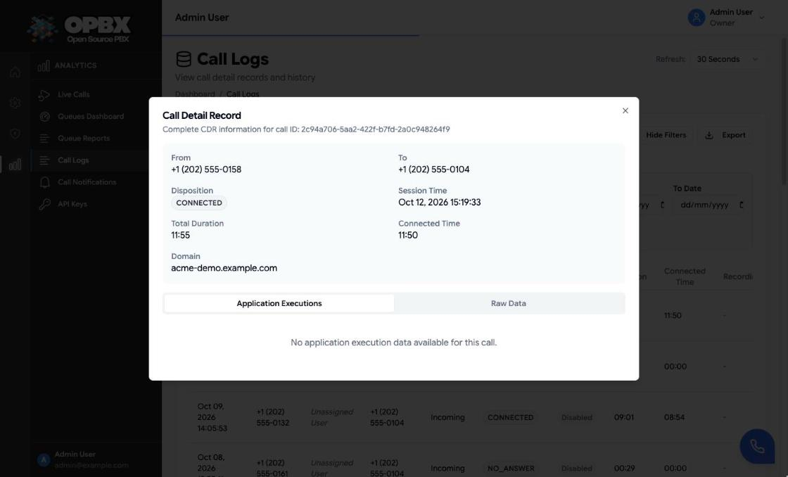

# Call Logs

Call Logs shows the call detail records (CDRs) that Cloudonix sends to OPBX when a call ends. Each row is one call with the extension it belongs to, its Caller ID and destination, disposition, durations and AMD result. You can search, open a call for details, play its recording, and export the results.

## Purpose

Use this module to:

- find a call by extension, destination, date, disposition, direction or user;
- open one call to see its full record and AMD result;
- play the call's recording, if one was made;
- export the results to CSV.

Call logs are read-only. They are created by the Cloudonix call-end webhook and cannot be edited or deleted.

## Prerequisites

- Calls are flowing through Cloudonix to your OPBX instance. If the Call Logs page is empty after a test call, check the webhook settings on [Settings](/opbx/administration) and [Cloudonix Setup](/opbx/installation/cloudonix-setup).
- Only recorded calls have a recording to play. Recordings of IVR prompts and announcements are a different thing; see [Recordings](/opbx/modules/recordings).

## Who can see what

| Action | Owner | PBX Admin | PBX User | Reporter | Supervisor |
|--------|:-----:|:---------:|:--------:|:--------:|:----------:|
| Open Call Logs (sidebar) | Yes | Yes | Yes | Yes | Yes |
| See the call records | All in the organization | All in the organization | Only calls of or to their own extension(s), enforced by the server | All in the organization | Only calls to or from their assigned users and ring groups |
| Export CSV (button) | Yes | Yes | No | No | No |
| Play a recording | Yes | Yes | No | Yes | Only calls in their scope |

:::note
A PBX User's list, single call, statistics and CSV export are always limited to their own calls, decided by role on the server: calls whose **Extension** is one of their extensions, and calls whose **Destination** is one of them. The Caller ID does not count, so an outbound call that presents a DID as its Caller ID is still theirs, and a call that only shows their number as its Caller ID is not. No filter can widen the list. Opening another user's call returns 403. A PBX User without an extension sees no calls.

A supervisor's list, single call, statistics and CSV export are always limited to their scope (their assigned users and ring groups plus their own calls), decided by role on the server: a call is in scope when its Extension, Caller ID or Destination is one of theirs. The old `supervisor=true` request flag is accepted but ignored.

The **Export** button is hidden for PBX Users, Reporters and Supervisors, but the export endpoint itself accepts every role (a PBX User's or Supervisor's export is limited to their scope).
:::

:::note Recording playback for PBX Users
PBX Users see the play button on recorded calls, but the server refuses the recording (403), so nothing plays. Recordings are played by Owners, PBX Admins, Reporters and Supervisors (in their scope).
:::

## Table columns

| Column | Meaning |
|--------|---------|
| Session Time | When the call started. The default sort, newest first |
| Extension | The OPBX extension the call belongs to (`extension_number`), or `-` when OPBX cannot tell (see [Which extension a call belongs to](#which-extension-a-call-belongs-to)) |
| Caller ID | The number the call presented (`from`). For an outbound call this can be a DID, not the extension. Display only: it is not a filter |
| User | The OPBX user who owns the extension that placed the call, or *Unassigned User* |
| Destination | The called number (`to`) |
| Direction | `incoming`, `outgoing`, `internal` or `application` |
| Disposition | How the call ended, for example ANSWERED, NO ANSWER, BUSY or FAILED |
| AMD Status | Answering machine detection result (see [AMD results](#amd-results)) |
| Duration | Total call length |
| Connected Time | Billable (connected) time |
| Recording | A play button when a recording is available, otherwise `-` |

The list shows 50 calls per page, with **Previous** and **Next** below it.

## Workflows

### Find a call

**Who can do this:** everyone who can open Call Logs.

1. Open **Call Logs** in the sidebar.
2. Click **Show Filters**.
3. Fill in any of the filters:

   | Filter | How it matches |
   |--------|----------------|
   | Extension | Number search (see below) on the call's extension |
   | Destination | Number search (see below) on the called number |
   | Match | Shown when both Extension and Destination are filled. **All (Extension and Destination)** (default) finds calls of that extension to that destination. **Any (Extension or Destination)** finds calls of the extension or to the destination; with the same number in both, that is every call of one extension, placed or received |
   | Disposition | Exact match: Answered, No Answer, Busy, Failed, Cancelled or Congestion |
   | User | Part of the name of the user who owns the extension |
   | Direction | Exact match: Incoming, Outgoing, Internal or Application |
   | From Date / To Date | From the start of the first day to the end of the last day, by session time |

4. Click **Apply Filters**. The list returns to page 1 and the card header shows the number of matching records.
5. To start over, click **Clear Filters**.

When nothing matches, the list shows **No CDRs found** with "Try adjusting your filters".

The API takes the same filters as `extension`, `to` and `extension_destination_match=all` (default) or `extension_destination_match=any`; the CSV export and the statistics honour them too. There is no Caller ID filter: `from` is not accepted as a filter.

The API also filters on `session_token` (exact match on the Cloudonix session token). The page does not offer it.

{/* SCREENSHOT: call-logs-list — Call Logs list with the Extension and Destination filters and Match selector, showing demo calls with the Extension and Caller ID columns and the AMD Status column */}

#### Searching numbers

- The Extension and Destination filters use the same search.
- A number matches from its **start**. Typing `+1415` finds numbers that begin with `+1415`, and `10` finds extensions 1001, 1002 and so on.
- The leading `+` is optional: `+1415` and `1415` both match numbers stored with or without the plus sign.
- `*` and `%` are wildcards for any characters. `*555` matches numbers that contain `555` anywhere. `+1415*` is the same as `+1415`.
- `_` is a literal character, not a wildcard.

A search with a leading wildcard works, but is slower on large data sets. Use a prefix when you can.

The same number search applies to the list and the CSV export.

### Sort the list

**Who can do this:** everyone who can open Call Logs.

1. Click the **Session Time**, **Extension**, **Caller ID**, **User**, **Direction** or **Disposition** column header. The first click sorts ascending.
2. Click the same header again to reverse the order.

### Refresh the list

**Who can do this:** everyone who can open Call Logs.

1. Click **Refresh** above the list to load new calls now.
2. To change the automatic refresh, choose a value in **Refresh:** at the top of the page: **Manual**, **5 Seconds**, **10 Seconds**, **30 Seconds** (the default) or **60 Seconds**.

### Open a call's details

**Who can do this:** everyone who can open Call Logs (a Supervisor only calls in their scope).

1. Click the call's row. The **Call Detail Record** dialog opens.
2. Read the summary: **Extension**, **Caller ID**, **Destination**, **Disposition**, **Session Time**, **Total Duration**, **Connected Time**, **Domain** and, when the call was rated, **Cost**.
3. When AMD ran on the call, the **AMD Result** box shows **Result**, **Confidence**, **Detection Time**, **Timestamp** and, when there is one, **Reason**.
4. Open the **Application Executions** tab to see each webhook request (**URL:**) and the **CXML Response:** OPBX returned, or the **Raw Data** tab for the full Cloudonix CDR, including the session token and call ID.

#### AMD results

| Result | Meaning |
|--------|---------|
| `Enabled::human` | A person answered |
| `Enabled::voicemail` | A voicemail greeting and beep were detected |
| `Enabled::unknown` | Detection timed out or was not conclusive |
| `Disabled` | AMD was not used on this call |

### Play a call recording

**Who can do this:** Owner, PBX Admin, Reporter, and a Supervisor for calls in their scope.

1. Find the call. Recorded calls show a play button in the **Recording** column.
2. Click the play button. It shows a spinner while the recording loads, then plays it in the browser.
3. Click the pause button to stop.

The recording is streamed from storage. Recordings larger than 200 MB are not fetched from Cloudonix (`RECORDINGS_MAX_DOWNLOAD_BYTES`), so such calls have no recording.

A recording is removed when its retention period ends. After that the row stays, without the play button.

{/* SCREENSHOT: call-logs-recording-play — Call Logs list with a recorded demo call whose Recording column shows the pause button while it plays */}

### Export call logs to CSV

**Who can do this:** Owner, PBX Admin.

1. Apply the filters you need with **Show Filters** and **Apply Filters**.
2. Click **Export**.
3. The browser downloads `cdr-<date and time>.csv`.

The export uses the applied filters (not the sort order; it is always newest first) and is produced in chunks of 1000 records, so large exports do not run out of memory. Its columns are Timestamp, Extension, From (the Caller ID), To (the destination), Call Start Time, Call Answer Time, Call End Time, Domain, Session Token, Duration (sec), Billable (sec) and Status.

## Which extension a call belongs to

OPBX stores the extension on the call record when Cloudonix reports the call, by the first rule that applies:

1. The extension that placed the call (the Cloudonix subscriber on the record). This covers outbound calls whatever Caller ID they present, including a DID.
2. An extension number used as the Caller ID, for calls started through the API.
3. For an inbound call to a DID that routes directly to an extension, that extension.
4. The extension that took the call, as OPBX recorded it while routing:
   - an IVR option, business hours rule or fallback that sends the call to one extension: that extension;
   - a ring group: the member who answered (Simultaneous groups ring each member in a separate call, so the member who answered first is known);
   - a call queue: the agent who answered it (their extension).

   The first extension recorded for a call is kept, so a call belongs to the agent who took it first.

Otherwise the Extension is empty: a call that nobody answered in a ring group or queue and a **Ring All** call queue that rings several agents at once without **Ring Agents in Separate Calls**. A ring group is attributed the same way however the call reaches it (phone number, IVR, business hours action, or another group's, queue's or AI load balancer's fallback). Such a call can still be found by its Destination.

A PBX User therefore sees the inbound calls they answered through a ring group, IVR or queue. Records that existed before this column was added were filled in once with rules 1 to 3 and the current DID routing; answered call queue calls were also filled in once with their agent's extension. Other older calls answered through a ring group or IVR stay empty.

## Statistics (API)

`GET /v1/call-detail-records/statistics` returns the total calls, total and billable duration, average duration, total cost and a count per disposition. It filters by `from_date` and `to_date` (default: the last 30 days), by `extension`, `to` and `extension_destination_match`, and by the caller's scope (PBX User, Supervisor). The page has no statistics view.

## Retention and archive

Call records are kept in three tiers, by the call's session time (UTC):

| Tier | Age | Where it is | Who can reach it |
|------|-----|-------------|------------------|
| Hot | Up to 6 months | The main database | Everyone in the organization, through this page and the API |
| Warm | 6 to 12 months | A separate archive table in the database | API keys sent with `archive=1` (list, detail, export, statistics), and the platform owner's CDR archive endpoint. **Not** shown in this page |
| Cold | More than 12 months | Compressed CSV files in object storage, one per organization per hour | Platform owner only, through object storage. Kept for 7 years, then deleted |

Recordings have their own retention. They are not moved between tiers. They are deleted after `RECORDING_RETENTION_MONTHS`, which can never be longer than the cold-tier period (7 years by default). A CDR whose recording has been deleted stays, with its recording status set to none.

Retention is set by environment variables. See the [Configuration Reference](/opbx/data-models/configuration/index#data-retention).

:::note
The move from hot to warm and from warm to cold runs once a day, at 04:00 UTC. Records do not disappear at the exact moment they cross a boundary.
:::

## Related API endpoints

| Method | Endpoint | Purpose |
|--------|----------|---------|
| GET | `/v1/call-detail-records` | List (add `archive=1` for API keys to read the warm tier) |
| GET | `/v1/call-detail-records/{call_detail_record}` | One record |
| GET | `/v1/call-detail-records/{call_detail_record}/recording` | Stream the recording |
| GET | `/v1/call-detail-records/export` | CSV export |
| GET | `/v1/call-detail-records/statistics` | Totals and averages |
| GET | `/v1/platform/cdr-archive` | Warm-tier records for all organizations (platform owners) |

See the [OPBX REST API reference](https://developers.cloudonix.com/opbxRestOpenAPI) for full schemas.

## Common problems

| Symptom | Likely cause |
|---------|--------------|
| A call is missing | The call-end webhook did not reach OPBX. Check [Settings](/opbx/administration) and the Cloudonix webhook configuration |
| Recording button is missing | The call was not recorded, or the recording was deleted by retention |
| A search finds nothing for a number | Number search matches the start of the number. Add a wildcard (`*`) in front of the part you want |
| A call older than 6 months is missing from this page | It moved to the warm tier. Use the API with an API key and `archive=1` |

## Related modules

- [Live Calls](/opbx/modules/live-calls) — real-time view of calls in progress
- [Recordings](/opbx/modules/recordings) — recordings for IVR prompts and announcements (different from call recordings)
- [AMD Worker](/opbx/workers/amd-worker) — voicemail detection service
- [Call Notifications](/opbx/modules/call-notifications) — webhook notifications for call events
- [API Keys](/opbx/modules/api-keys) — scoped keys, including archive access
