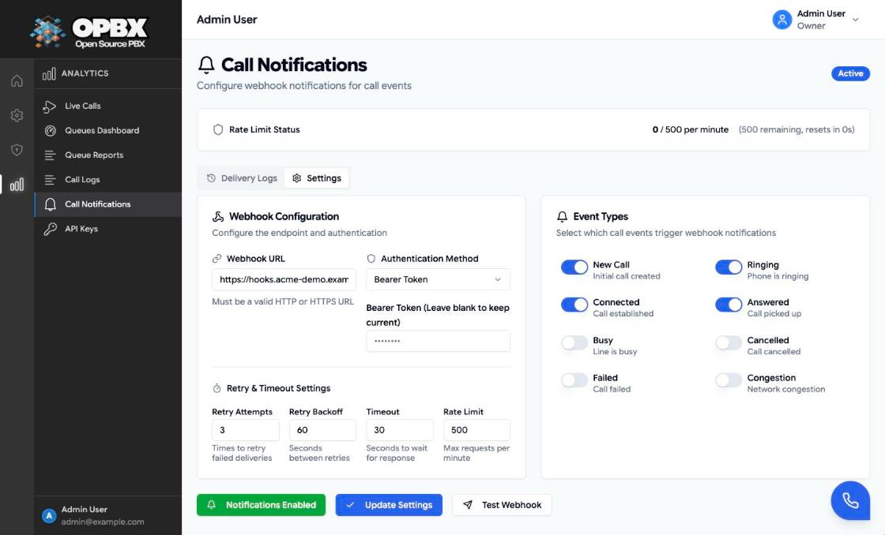
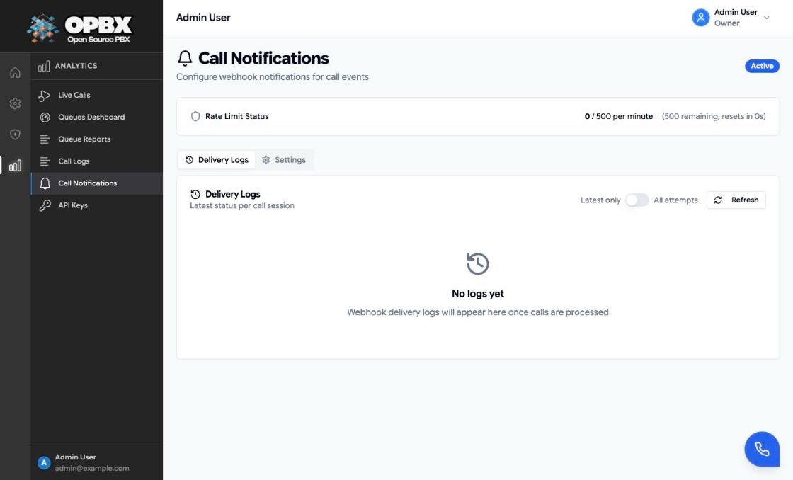

# Call Notifications

Call Notifications send an HTTP `POST` to a URL you choose each time a call in your organization changes status (new, ringing, answered and so on). Use them to update a CRM, show a screen pop or feed your own analytics. Each organization has one notification configuration.

## Purpose

Use this module to:

- send call status changes to an external system;
- choose which statuses are sent;
- protect the endpoint with a bearer token or basic authentication;
- control retries, timeout and a per-minute rate limit;
- see every delivery attempt with its request and response.

## Prerequisites

- An HTTP or HTTPS endpoint reachable from the internet. Internal network addresses are refused (see [URL rules](#url-rules)).
- You are the **Owner** or a **PBX Admin**.

## Permissions

| Action | Owner | PBX Admin | PBX User | Reporter |
|--------|:-----:|:---------:|:--------:|:--------:|
| See Call Notifications in the sidebar (Analytics section) | Yes | Yes | No | No |
| View settings, delivery logs and rate-limit status | Yes | Yes | No | No |
| Create or change settings, send a test | Yes | Yes | No | No |

Other roles get `403` from the API, so the page shows an error state if they open its address directly.

## Set up notifications

1. Open **Call Notifications** in the sidebar. The page opens on the **Delivery Logs** tab.
2. Open the **Settings** tab.
3. Under **Webhook Configuration**, enter the **Webhook URL** and choose the **Authentication Method**.
4. Set the retry, timeout and rate-limit values (or keep the defaults).
5. Under **Event Types**, switch on the statuses you want.
6. Click **Create Settings** (or **Update Settings** once a configuration exists).
7. Click **Test Webhook** to send a sample event.



### Settings

| Field | Required | Limits and default | Meaning |
|-------|----------|--------------------|---------|
| Webhook URL | Yes | Valid URL, up to 2048 characters, `http` or `https`, public host | Where events are posted |
| Authentication Method | Yes | No Authentication, Bearer Token or Basic Authentication. Default: No Authentication | Which `Authorization` header is sent |
| Username | For Basic Authentication | Up to 255 characters | Basic-auth user name |
| Bearer Token / Password | Bearer Token: yes. Basic: no | 16 to 512 characters | The secret. Once saved it is never shown again; leave the field blank to keep it |
| Retry Attempts | No | 1 to 10. Default: 3 | Retries after a failed delivery |
| Retry Backoff | No | 10 to 3600 seconds. Default: 60 | Delay before the first retry; it doubles for each further retry (capped at 1 hour) |
| Timeout | No | 5 to 120 seconds. Default: 30 | How long to wait for your endpoint |
| Rate Limit | No | 100 to 5000 per minute. Default: 500 | Maximum events sent per minute |
| Event Types | Yes | At least one | Which statuses are sent (table below) |

:::note Retry timing
Failed deliveries are retried up to the number of Retry Attempts. The first retry waits **Retry Backoff** seconds and each further retry waits twice as long as the one before (with the default 60 seconds: 60, 120, 240...), never more than one hour.
:::

### Authentication header

| Method | Header sent |
|--------|-------------|
| No Authentication | None |
| Bearer Token | `Authorization: Bearer <token>` |
| Basic Authentication | `Authorization: Basic <base64 of username:password>` |

Every request also carries `Content-Type: application/json` and `User-Agent: Cloudonix-PBX-Webhook/1.0`.

### Event types

A call's status from Cloudonix is mapped to one of eight events. Only enabled events are sent.

| Event (label) | Sent when the call status is |
|---------------|------------------------------|
| New Call (`new`) | new, initiated, created |
| Ringing (`ringing`) | ringing, ring, progress |
| Connected (`connected`) | connected, connect |
| Answered (`answered`) | answer, answered, active |
| Busy (`busy`) | busy |
| Cancelled (`cancel`) | cancel, cancelled, canceled |
| Failed (`failed`) | failed, fail, error |
| Congestion (`congestion`) | congestion, congested |

All eight are on by default.

### URL rules

The URL is checked when you save and again before every delivery. It is refused with "…must be a valid, publicly accessible URL. Internal network addresses are not allowed." when:

- the scheme is not `http` or `https`;
- the host is `localhost` or a name of an OPBX service (for example `mysql`, `redis`, `app`, `nginx`);
- the host resolves to a private, loopback or link-local address.

## Turn notifications on or off

When a configuration exists, the **Notifications Enabled** / **Notifications Disabled** button switches sending on or off and saves at once. The badge next to the page title shows **Active** or **Inactive**. While inactive, nothing is sent and nothing is logged.

There is no delete button on the page. To remove the configuration, use `DELETE /v1/call-notifications/settings`.

## Test the webhook

**Test Webhook** posts a sample event with `"test": true`, a `new` status and the fictional numbers `+12125551234` and `+12125555678`. The result appears as a toast and in the delivery logs. The test is refused with "Notification settings not configured" while notifications are disabled.

## Payload

```json
{
  "event_type": "call.status_update",
  "event_id": "…",
  "timestamp": "2026-10-13T09:15:02+00:00",
  "organization_id": 12,
  "session": {
    "call_session_token": "…",
    "from": "+12025550131",
    "to": "+12025550100",
    "direction": "inbound",
    "call_start_time": "…",
    "call_answer_time": null,
    "call_end_time": null,
    "call_duration": 0,
    "call_billable_duration": 0,
    "status": "ringing",
    "previous_status": "new"
  },
  "metadata": { "caller_name": null, "extension_id": 5, "did_id": 1 }
}
```

Your endpoint should answer with a `2xx` status. A `5xx`, a `429`, a timeout or a connection error is retried; any other `4xx` is not.

## Delivery logs

The **Delivery Logs** tab lists deliveries with time, session token, from, to, status and response code.

- **Latest only** (default) shows the latest delivery per call. Switch to **All attempts** to see every delivery.
- Click a session token or the debug icon to open the session's timeline: every notification for that call with the request (method, URL, headers, body) and the response.
- **Refresh** reloads the list.

The `Authorization` header is never stored: the logs show it as `[redacted]`. Logs are kept for 90 days.



{/* SCREENSHOT: call-notifications-debug-dialog — debug dialog for one call session showing the request headers with Authorization: [redacted], the JSON body and the response */}

## Rate limit

The **Rate Limit Status** bar at the top shows events sent in the current minute, the limit, the remaining count and when the window resets. Events above the limit are dropped (not queued and not retried).

## Common errors

| Message | What it means | What to do |
|---------|---------------|-----------|
| The webhook URL must be a valid URL. | The URL is malformed | Enter a full URL with `https://` |
| …must be a valid, publicly accessible URL. Internal network addresses are not allowed. | The URL points at a private or internal host | Use a public endpoint |
| Authentication secret is required for this auth method. | Bearer Token without a token | Enter the token |
| Authentication secret must be at least 16 characters. | The token or password is too short | Use 16 characters or more |
| Username is required for basic authentication. | Basic Authentication without a user name | Enter the user name |
| At least one event type must be enabled. | Every event switch is off | Switch on at least one |
| Test webhook delivery failed | Your endpoint did not answer `2xx` | Open the delivery log to see the response |

## Key data fields

### `call_notifications_settings`

| Column | Notes |
|--------|-------|
| `organization_id` | One configuration per organization |
| `webhook_url` | Target URL |
| `auth_method` | `none`, `bearer_token` or `basic_auth` |
| `auth_username`, `auth_secret` | Credentials; the secret is never returned (only `has_auth_secret`) |
| `retry_attempts`, `retry_backoff_seconds`, `request_timeout_seconds`, `rate_limit_per_minute` | See [Settings](#settings) |
| `enabled_events` | List of enabled events |
| `is_active` | On or off |

### `call_notification_logs`

One row per event; retries update the same row. It holds the session token, event id, status, request payload, request headers (Authorization redacted), response code and body, response time, attempt number and success flag.

## Related API endpoints

| Method | Endpoint | Purpose |
|--------|----------|---------|
| GET | `/v1/call-notifications/settings` | Current settings (`data: null` when none) |
| POST | `/v1/call-notifications/settings` | Create (409 if they exist) |
| PUT | `/v1/call-notifications/settings` | Update |
| DELETE | `/v1/call-notifications/settings` | Delete the configuration |
| POST | `/v1/call-notifications/settings/test` | Send a test event |
| GET | `/v1/call-notifications/logs` | Latest delivery per session; `show_all=1` for every attempt, with `session_token`, `status`, `success`, `from`, `to` filters |
| GET | `/v1/call-notifications/logs/{sessionToken}` | All deliveries for one call |
| GET | `/v1/call-notifications/rate-limit` | Current rate-limit window |

API keys need the `call-notifications` resource. See the [OPBX REST API reference](https://developers.cloudonix.com/opbxRestOpenAPI) for full schemas.

## Related modules

- [Live Calls](/opbx/modules/live-calls) — the same status changes, shown in the app
- [Call Logs](/opbx/modules/call-logs) — completed call records
- [Call Tracking Campaigns](/opbx/modules/call-tracking-campaigns) — has its own, separate notification webhooks
- [API Keys](/opbx/modules/api-keys) — read the logs from a script
