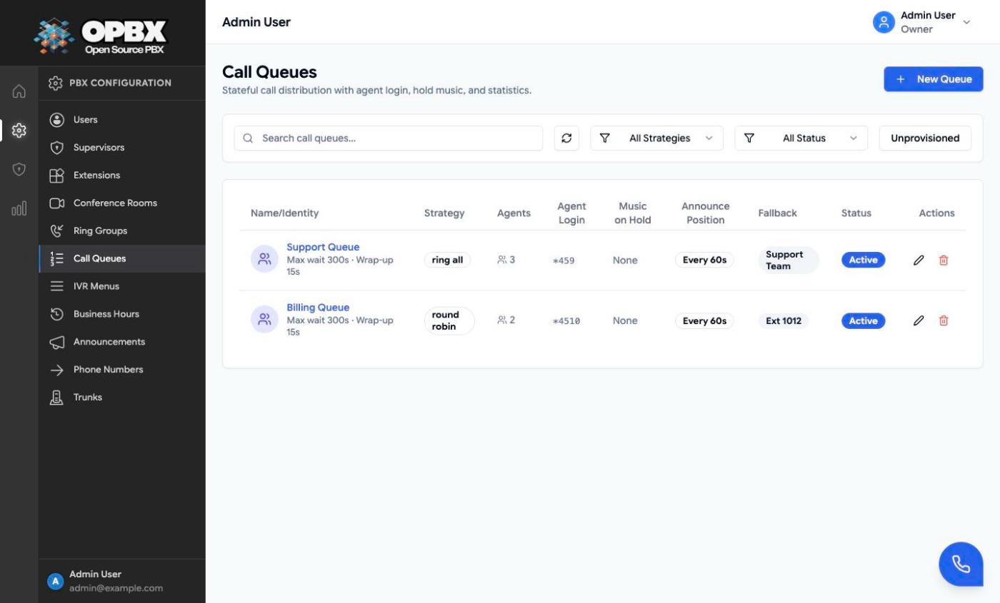
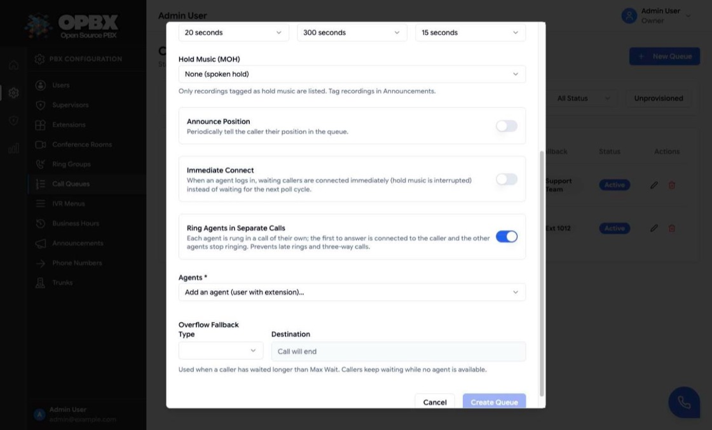
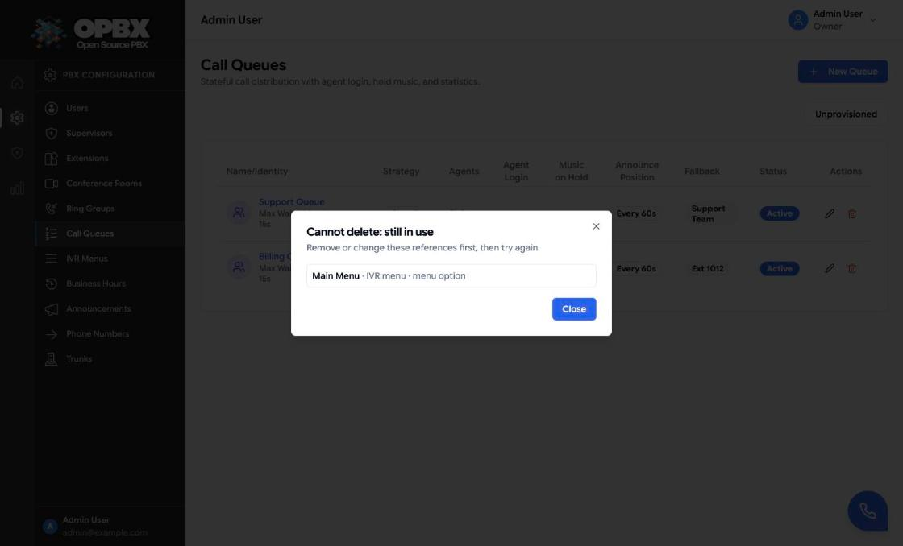

# Call Queues

A call queue holds incoming callers in first-in, first-out order with music on hold, and offers each caller to an agent when one is free. Unlike a [ring group](/opbx/modules/ring-groups), a queue is **stateful**: agents log in and out, finished calls leave a wrap-up pause, callers that wait too long overflow to a fallback, and every call is measured.

## When to use a queue instead of a ring group

| | Ring Group | Call Queue |
|---|---|---|
| Caller experience | Rings members at once; fallback if nobody answers | Waits on hold with music until an agent is free |
| Agents | Just destinations | Log in and out, have wrap-up time |
| Distribution | Simultaneous, round-robin or sequential | Ring all, round robin, least talk time, fewest calls |
| Statistics | Call logs only | Waiting and handling times, answered, abandoned and overflow counts, per-call reports |

## Purpose

Use a queue for a support or sales line where you need to know how long callers wait and how many were lost.

## Prerequisites

Before you create a queue, prepare these:

1. **Agents.** Each agent is an **active** user with an **extension assigned**. A user without an extension is not offered in the agent list. See [User Management](/opbx/modules/user-management) and [Extensions](/opbx/modules/extensions).
2. **Hold music (optional).** An audio recording with the **Hold music** tag (set on the **Announcements** page). Only tagged recordings are offered. See [Recordings](/opbx/modules/recordings). Without hold music, waiting callers hear "Please hold the line." between pauses.
3. **An overflow fallback (optional).** Where callers go when they wait too long. It must exist and be active. The default is **Hang Up**.

## Permissions

| Action | Owner | PBX Admin | PBX User | Reporter | Supervisor |
|--------|:-----:|:---------:|:--------:|:--------:|:----------:|
| See **Call Queues** in the sidebar | Yes | Yes | No | Yes | Yes |
| View queues, the detail page and statistics | Yes | Yes | Yes (API) | Yes | Only queues where their assigned users are agents |
| Create, edit, delete, activate or deactivate a queue | Yes | Yes | No | No | No |
| Log any agent in or out (detail page **Agents** tab) | Yes | Yes | No | No | No |
| Change your own agent state (header **Queues** menu or `*45`) | If an agent | If an agent | If an agent | If an agent | If an agent |
| See **Queues Dashboard** and **Queue Reports** in the sidebar | Yes | Yes | No | Yes | No |
| Read queue call reports (API) | Yes | Yes | Yes | Yes | No |
| See and regenerate the public wallboard link | Yes | Yes | No | No | No |

PBX Users can read queues and reports through the API, but the sidebar does not show the pages to them.

## Agent states

| State (label) | Meaning |
|---------------|---------|
| Logged Out | Not offered calls. The default |
| Available | Offered calls |
| On Call | On a queue call. Not offered further calls |
| Wrap-up | Just finished a call, and returns to Available after the queue's wrap-up time. An agent who chooses **Wrap-up** themselves stays in Wrap-up until they change it |

An available agent who is already on another call is skipped automatically. Presence comes from live call updates.

## Queue behaviour in practice

1. A call reaches the queue (from a phone number, an IVR option, a ring group or AI load balancer fallback, business hours, a call-tracking campaign or a Call Queue extension).
2. The caller hears the hold music and, if enabled, their position.
3. The strategy picks an agent, whose extension rings for the agent ring timeout.
4. If the agent answers, the call connects and is recorded as answered.
5. If nobody answers, the offer moves on to the next agent.
6. A caller who waits longer than the max wait is sent to the fallback and the call is recorded as overflow.
7. A caller who hangs up is recorded as abandoned.

When a call is requeued (for example after an offer is not answered), it keeps its **original position and its original enqueue time**. A requeued call that is already past the max wait overflows on its next check.

If the agent hangs up after the caller has joined, the call ends.

## Workflows

### Create a call queue

**Who can do this:** Owner, PBX Admin.

1. Open **Call Queues** in the sidebar (under **PBX Configuration**).
2. Click **New Queue**. The **New Call Queue** dialog opens.
3. Enter the **Name** and choose the **Agent Selection Strategy**.
4. Set **Agent Ring Timeout**, **Max Wait** and **Wrap-up**.
5. Optionally choose **Hold Music (MOH)**, switch on **Announce Position** (then pick the interval and language), **Immediate Connect** and, for Ring All, **Ring Agents in Separate Calls**.
6. Under **Agents**, pick each agent from **Add an agent (user with extension)…**. Each one appears as a chip; click **×** on a chip to remove it.
7. Under **Overflow Fallback**, choose the type and the destination, or keep **Hang Up**.
8. Click **Create Queue**. The button stays disabled until the queue has a name and at least one agent.

The toast "Call queue created" appears and the queue is listed as **Active**. It becomes available as a destination everywhere else in OPBX. Agents are not logged in automatically; each agent logs in (see [Join a queue as an agent](#join-a-queue-as-an-agent)).

### Edit a call queue

**Who can do this:** Owner, PBX Admin.

1. On **Call Queues**, click the edit (pencil) icon on the queue's row. Clicking the row itself opens the detail page.
2. Change the settings, agents or fallback in the **Edit Call Queue** dialog.
3. Click **Save Changes**.

The toast "Call queue updated" appears.

### Activate or deactivate a queue

**Who can do this:** Owner, PBX Admin.

1. On **Call Queues**, click the **Active** or **Inactive** badge in the **Status** column.

The badge switches at once. An inactive queue keeps its settings but does not accept calls.

### Disconnect the overflow fallback

**Who can do this:** Owner, PBX Admin.

1. Open the queue with the edit (pencil) icon.
2. Under **Overflow Fallback**, choose **Disconnect**.
3. Click **Save Changes**.

The fallback now stores **Destination unavailable**, and the queue shows the **Unprovisioned** badge in the list and the dialog title. Create screens never offer Disconnect. A fallback also becomes Destination unavailable when a user is deleted and the fallback pointed at that user's extension.

### Find unprovisioned queues

**Who can do this:** Owner, PBX Admin, Reporter.

1. On **Call Queues**, click the **Unprovisioned** button above the list.

Only queues whose fallback is Destination unavailable are listed. Click **Unprovisioned** again to show all queues.

### Delete a call queue

**Who can do this:** Owner, PBX Admin.

1. On **Call Queues**, click the delete (trash) icon on the queue's row, or click **Delete** in the **Edit Call Queue** dialog.
2. Confirm with **Delete** in the **Delete call queue** dialog.

The toast "Call queue deleted" appears and the row disappears. If other configuration still points at the queue, the delete is refused and the **Cannot delete: still in use** dialog lists every place: phone numbers, IVR options and failovers, ring-group and AI load-balancer fallbacks, business-hours actions, call-tracking campaigns and extensions of type **Call Queue**. Change those first, then delete again. Past call records never block a delete.

### Join a queue as an agent

**Who can do this:** any user who is an agent of the queue.

1. Click **Queues** in the page header. The button shows only when you are an agent of at least one queue; its badge counts the queues you are logged in to.
2. Under **My Queue Status**, find the queue. Its badge shows your state (**Logged out**, **Available**, **Wrap-up** or **On call**).
3. Click **Go Available** to start taking calls.

To pause, click **Wrap-up**: you stay in Wrap-up, without new offers, until you change it. To stop, click **Log out**. The menu refreshes every 15 seconds.

{/* SCREENSHOT: call-queues-agent-widget — page header with the Queues menu open: My Queue Status listing Support Queue (Available) and Billing Queue (Logged out) with the Go Available, Wrap-up and Log out actions */}

### Log in or out by phone

**Who can do this:** any user who is an agent of the queue, calling from their own extension.

1. Find the queue's login code in the **Agent Login** column of the **Call Queues** list, for example `*457` for queue 7.
2. From your own extension, dial that code.

The code toggles your state: Logged Out becomes Available, any other state becomes Logged Out. A voice confirms "You are now logged in to queue *name*." or "You have logged out of queue *name*." A call from a phone that is not your extension, or for an inactive queue, only plays a short message.

### Log an agent in or out

**Who can do this:** Owner, PBX Admin.

1. On **Call Queues**, click the queue's row to open its detail page.
2. Open the **Agents** tab. It lists each agent with **Agent**, **Extension** and **Current State**.
3. Click an agent's state badge. **Logged Out** switches to **Available**; any other state switches to **Logged Out**. An agent who is **On Call** cannot be switched.

To add or remove agents, edit the queue.

{/* SCREENSHOT: call-queues-agents-tab — queue detail Agents tab of Support Queue with three agents in Available, Wrap-up and Logged Out states */}

### Watch a queue live

**Who can do this:** Owner, PBX Admin, Reporter; Supervisors for queues of their assigned users.

1. On **Call Queues**, click the queue's row.
2. The **Live** tab shows **Waiting Callers**, **Available Agents**, **Handled (60m)** and **Abandoned (60m)**, and a table of waiting callers with position, wait time, average wait (24h), caller ID, destination and call start. It refreshes every 5 seconds.

{/* SCREENSHOT: call-queues-live-tab — queue detail Live tab with two waiting callers, the four counters and the waiting-callers table */}

### View queue statistics

**Who can do this:** Owner, PBX Admin, Reporter; Supervisors for queues of their assigned users.

1. Open the queue's detail page and the **Statistics** tab.
2. Read **Waiting Time (answered calls)** and **Handling Time (answered calls)** (Min, Max, Average, Std Dev) and **Totals (last 24 hours)**: Handled, Abandoned and Overflowed.

The tab covers the last 24 hours and refreshes every 30 seconds. The API (`GET /v1/call-queues/{id}/stats`) also accepts `from` and `to`. The **Queue Reports** link opens the per-call report.

### Use the Queues Dashboard

**Who can do this:** Owner, PBX Admin, Reporter.

1. Open **Queues Dashboard** in the sidebar (under **Analytics**).
2. Under **Queue**, keep **All Queues (cycle)** to rotate through the queues every 30 seconds (the arrow button skips to the next), or pick one queue.
3. Under **Timespan**, choose **Last 15 Minutes**, **Last Hour**, **Last 6 Hours**, **Last 12 Hours** or **Last 24 Hours**.

The dashboard shows the queue's waiting callers, available agents, handled and abandoned counts, and an agent card per agent coloured by state.

{/* SCREENSHOT: queues-dashboard — Queues Dashboard showing Support Queue with Last Hour selected, the counters and agent cards in Available, On Call and Logged Out colours */}

### Share the public wallboard

**Who can do this:** Owner, PBX Admin.

1. On **Queues Dashboard**, click **Public wallboard link** to expand it.
2. Click the copy icon ("Link copied") or the open-in-new-tab icon.
3. To revoke the link, click the regenerate icon. The toast "Public link regenerated - the old link no longer works" appears and the old link stops working at once.

The link has the form `/public/queues-dashboard/{token}`. Anyone with it can view the queues, agents and statistics without logging in.

### Report on queue calls

**Who can do this:** Owner, PBX Admin, Reporter.

1. Open **Queue Reports** in the sidebar (under **Analytics**).
2. Filter by **Queue**, **Disposition** (**Answered**, **Abandoned**, **Overflow**) and the **From** and **To** dates. **Reset** clears the filters.
3. Optionally set **Auto refresh:** (**No Refresh**, **5 Seconds** to **60 Seconds**) or click **Refresh**.
4. Click a row to open the call's CDR details.
5. Click **Export CSV** to download the filtered rows.

The table shows the call ID, queue, from number, entered time, waiting time, handling time and disposition. The CSV also has the to number, answered, abandoned and ended times and the answering agent's user ID.

{/* SCREENSHOT: queue-reports — Queue Reports with Support Queue selected, a mix of Answered, Abandoned and Overflow rows, and the Export CSV button */}

## Live monitoring

Each queue's detail page has three tabs: **Live** (waiting callers and counters, see [Watch a queue live](#watch-a-queue-live)), **Agents** (agent states, see [Log an agent in or out](#log-an-agent-in-or-out)) and **Statistics** (see [View queue statistics](#view-queue-statistics)). The **Queues Dashboard** shows all queues, and the public wallboard shows it without a login (see [Share the public wallboard](#share-the-public-wallboard)).

## Reporting

- **Queue Reports**: one row per call with waiting time, handling time and disposition (answered, abandoned or overflow), with CSV export. See [Report on queue calls](#report-on-queue-calls).
- **Statistics tab**: minimum, maximum, average and standard deviation of waiting and handling times, and totals for the last 24 hours.
- **Live tab**: handled and abandoned counts over the last 60 minutes (the API also returns 15-minute, 30-minute and 24-hour windows).

## Queue settings

| Field (dialog label) | Limits and default | Meaning |
|----------------------|--------------------|---------|
| Name | 2 to 100 characters; unique within the organization | Shown in lists and the agent menu |
| Agent Selection Strategy | Ring All, Round Robin, Least Talk Time, Fewest Calls. Default: Ring All | How the next agent is chosen (table below) |
| Agent Ring Timeout | 15 to 60 seconds, in steps of 5. Default: 20 | How long one agent's extension rings before the offer moves on |
| Max Wait | 30 to 300 seconds, in steps of 30. Default: 300 | How long a caller may wait before overflowing |
| Wrap-up | 15 to 120 seconds, in steps of 15. Default: 15 | Pause after each answered call before the agent is available again. Zero is not accepted |
| Hold Music (MOH) | An MOH-tagged recording, or **None (spoken hold)**. Default: none | Played to waiting callers |
| Announce Position | Off by default | Tells waiting callers their position at a set interval |
| Announce Position Timeout | Every 15, 30, 60 or 120 seconds in the dialog (the API accepts 10 to 600). Default: 60 | The announcement interval |
| Announce Position Language | **Default (English)** or a text-to-speech language (API: a code up to 20 characters) | The language of the announcements and of the `*45` confirmations |
| Immediate Connect | Off by default | When an agent becomes available while callers wait, connect the next caller straight away (the hold music is interrupted) instead of waiting for the next hold loop |
| Ring Agents in Separate Calls | Off by default. Shown only for Ring All | Each agent is rung in a call of their own; the first to answer is connected and the others stop ringing. Prevents late rings and three-way calls |
| Agents | At least 1, at most 100 active users with extensions | Who takes calls |
| Overflow Fallback | Default: **Hang Up**. See [Fallback](#fallback-destination) | Where overflow calls go |
| Status | Active or Inactive. Set from the list. New queues are Active | Inactive queues do not accept calls: callers hear a short "not available" message |
| Description | API only. Up to 1000 characters | Free text. The dialog does not show it |

### Strategies

| Strategy | How the next agent is chosen |
|----------|------------------------------|
| Ring All | Every available agent is offered the call at once |
| Round Robin | Available agents in turn |
| Least Talk Time | The available agent with the least talk time |
| Fewest Calls | The available agent who has handled the fewest calls |

Agents are always dialed **at their extension**. Call-forwarding and follow-me settings are not applied to queue offers.

### Fallback destination

Overflow (max wait reached) goes to one of: **PBX User Extension**, **Ring Group**, **IVR Menu**, **AI Assistant**, **AI Load Balancer**, or **Hang Up**. Queue-to-queue fallback is not supported. A caller only overflows when the max wait is reached; while no agent is available, callers keep waiting until then.

The fallback must be active when you save. A fallback that is deleted later is protected by the in-use check.

## API and automation

- **REST API**: create, read, update and delete queues and agent membership. Statistics, live state and per-call reports are read-only endpoints.
- **Scoped API keys**: the `call-queues` and `queue-calls` resources, with read access meaning GET only. See [API Keys](/opbx/modules/api-keys).
- **MCP server**: read-only tools `list_call_queues`, `get_call_queue`, `get_call_queue_stats`, `get_call_queue_live` and `list_queue_calls`. See [MCP Server](/opbx/modules/mcp-server).

## Common errors

| Message (summary) | What it means | What to do |
|-------------------|---------------|-----------|
| The hold music recording must belong to your organization. / The selected recording is not tagged as hold music. | The chosen recording is from another organization or lacks the Hold music tag | Choose an MOH-tagged recording of your own |
| Only active users can be queue agents. *name* is not active | The user is inactive | Activate the user or remove them from the agents |
| Queue agents must have an extension assigned. *name* has no extension | The user has no extension | Assign an extension to the user first |
| The selected fallback target must be active | The fallback is inactive | Activate it or pick another fallback |
| Choose a destination | You tried to create a route as "unavailable" | Pick a destination. "Destination unavailable" is only available when editing |
| This call queue is still used by: … | Other configuration points at the queue | Change the listed references, then delete |

## Troubleshooting

With the [centralized logging stack](/opbx/administration/centralized-logs) enabled, every queue event (enqueue, offer, answer, overflow) is searchable by the call's Cloudonix session token. That is the quickest way to follow one caller through a queue.

Common causes of "nobody gets the call":

- No agent is logged in (state Logged Out). The **Agents** tab of the queue's detail page shows the states.
- The agent is already on a call, so presence skips them.
- The agent's extension is not active. Check its status on [Extensions](/opbx/modules/extensions).

## Related modules

- [Ring Groups](/opbx/modules/ring-groups) — a simpler alternative, and a common queue fallback
- [IVR Menus](/opbx/modules/ivr-menus) — route callers into a queue from a menu option
- [Phone Numbers](/opbx/modules/phone-numbers) — route a number directly to a queue
- [Recordings](/opbx/modules/recordings) — hold music
- [Supervisors](/opbx/modules/supervisors) — supervisors can read the queues where their assigned users are agents
