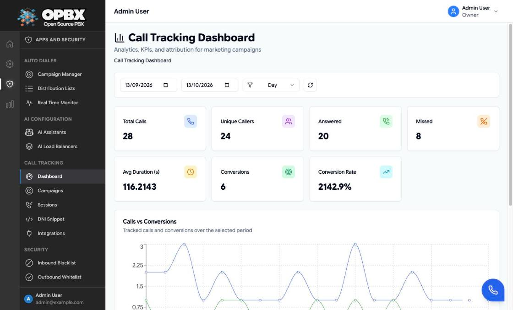
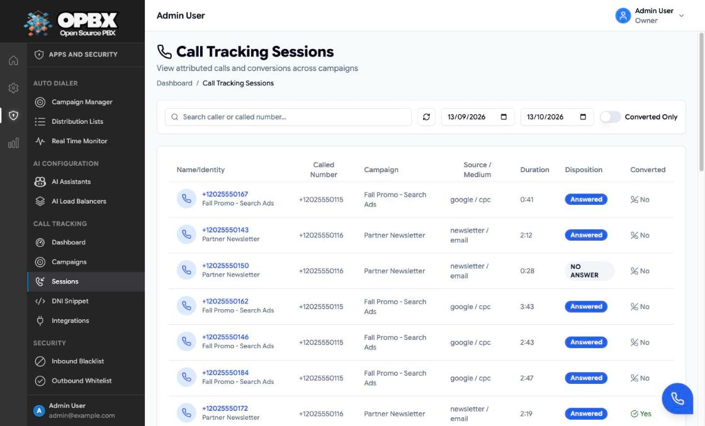

# Call Tracking Analytics

Every finished call to an active tracking number becomes a **session**: the caller, the campaign with its source and medium, the duration, the disposition, and whether it converted. The **Dashboard** sums the sessions; the **Sessions** page lists them one by one.

## Prerequisites

- At least one [call-tracking campaign](/opbx/modules/call-tracking-campaigns) with an active tracking number.
- Calls to those numbers. A session is created when the call's CDR arrives, so a call appears only after it has ended.

## Permissions

| Action | Owner | PBX Admin | PBX User | Reporter | Supervisor |
|--------|:-----:|:---------:|:--------:|:--------:|:----------:|
| See **Call Tracking → Dashboard** and **Sessions** in the sidebar | Yes | Yes | No | Yes | No |
| Read analytics, sessions and the CSV export (API) | Yes | Yes | Yes | Yes | Yes |

Every signed-in user of the organization can read the analytics through the API; the pages are in the **Apps and Security** sidebar section, which only Owners, PBX Admins and Reporters see. The pages are read-only for every role.

## Workflows

### View the dashboard

**Who can do this:** Owner, PBX Admin, Reporter.

1. Open **Call Tracking → Dashboard**. It shows the period from 30 days ago to today, grouped by day.
2. To change the period, set the start date and the end date in the two date fields. Whole days are included.
3. To change the chart buckets, choose **Day**, **Week** or **Month** in the group-by list.
4. Click the refresh button to load the figures again.
5. **Reset** appears when a date or the grouping differs from the defaults; click it to go back to them.

The KPI cards, the **Calls vs Conversions** chart and the **Top Campaigns** and **Top Sources** tables follow the period. If the start date is after the end date, the page shows "Failed to load analytics: …" with a **Try Again** button; fix the dates.



#### KPI cards

| Card | Calculation |
|------|-------------|
| Total Calls | Sessions in the period |
| Unique Callers | Distinct caller numbers |
| Answered | Sessions with more than 0 billable seconds |
| Missed | Total minus answered |
| Avg Duration (s) | Average total duration in seconds, ringing included |
| Conversions | Sessions marked converted |
| Conversion Rate | Conversions divided by total calls, in percent |

#### Calls vs Conversions chart

Calls and conversions per bucket. The bucket comes from the session's start time:

| Group by | Bucket label |
|----------|--------------|
| Day | `2026-10-13` |
| Week | ISO year and week, for example `2026-42` |
| Month | `2026-10` |

#### Top Campaigns and Top Sources

The ten campaigns and the ten sources with the most calls in the period, each with its call and conversion counts.

### Find a session

**Who can do this:** Owner, PBX Admin, Reporter.

1. Open **Call Tracking → Sessions**. The list shows the sessions of the last 30 days, 25 per page, newest first.
2. To find a number, type at least 3 characters of the caller or called number in **Search caller or called number...**. Shorter input is ignored and the list stays unfiltered.
3. To change the period, set the start date and the end date. If the start is after the end, the page shows "Start date must be before or equal to end date." and loads nothing.
4. Turn on **Converted Only** to show converted sessions only.
5. Click the refresh button to load the list again. **Clear Filters** appears when a filter is set and returns to the defaults.



| Column | Content |
|--------|---------|
| Caller (first column) | The caller's number, with the campaign name below it (or the called number when the session has no campaign name) |
| Called Number | The tracking number dialled |
| Campaign | Campaign name at the time of the call |
| Source / Medium | Copied from the campaign when the session was created |
| Duration | Total duration as minutes and seconds, for example `1:27` |
| Disposition | **Answered** for a call with billable seconds, otherwise the disposition, for example `NO ANSWER` or `BUSY` |
| Converted | Yes or No |

The page cannot open, change or delete a session. Source, medium and campaign name are copied into the session when it is created. Renaming a campaign later does not change past sessions. Deleting a campaign deletes its sessions.

## CSV export

The export is an API call; the dashboard has no export button.

```http
GET /v1/call-tracking-analytics/export?start_date=2026-09-13&end_date=2026-10-13&group_by=day
```

The file `call-tracking-analytics-YYYY-MM-DD-HHMMSS.csv` has one row per bucket, campaign, source and medium:

| Column | Content |
|--------|---------|
| `date` | Bucket label (day, week or month, as above) |
| `campaign_name` | Campaign |
| `source`, `medium` | Attribution |
| `calls` | Sessions |
| `answered`, `missed` | Answered and missed sessions |
| `conversions` | Converted sessions |
| `avg_duration` | Average duration in seconds |

## Filters in the API

`GET /v1/call-tracking-analytics` and the export take:

| Parameter | Required | Meaning |
|-----------|----------|---------|
| `start_date`, `end_date` | Yes | Dates; the start must not be after the end |
| `group_by` | No | `day` (default), `week` or `month` |
| `campaign_ids[]` | No | Only these campaigns |
| `sources[]`, `mediums[]` | No | Only these sources or mediums |

`GET /v1/call-tracking-sessions` takes `start_date`, `end_date`, `campaign_ids[]`, `sources[]`, `mediums[]`, `is_converted`, `search` (at least 3 characters) and `per_page` (1 to 100, default 25).

The [MCP server](/opbx/modules/mcp-server) has the read-only tools `get_call_tracking_analytics` and `list_call_tracking_sessions`. Scoped API keys use the `call-tracking-analytics` and `call-tracking-sessions` resources (see [API Keys](/opbx/modules/api-keys)).

## Common errors

| Message (summary) | What it means | What to do |
|-------------------|---------------|-----------|
| Start date must be before or equal to end date. (Sessions page); "Failed to load analytics: …" (Dashboard) | The range is reversed | Fix the dates |
| The search field must be at least 3 characters | One or two characters sent as `search` through the API (the Sessions page ignores such input instead) | Send at least 3 characters, or leave it out |

## Best practices

- Compare the top campaigns and sources with your ad spend each week.
- Set the conversion rule before a campaign goes live: sessions are evaluated once, when they are created.
- Export before you delete a campaign, because its sessions are deleted with it.

## Related modules

- [Call Tracking Campaigns](/opbx/modules/call-tracking-campaigns) — campaigns, tracking numbers and conversion rules
- [Call Tracking DNI](/opbx/modules/call-tracking-dni) — website number swapping
- [Call Logs](/opbx/modules/call-logs) — every call, tracked or not
