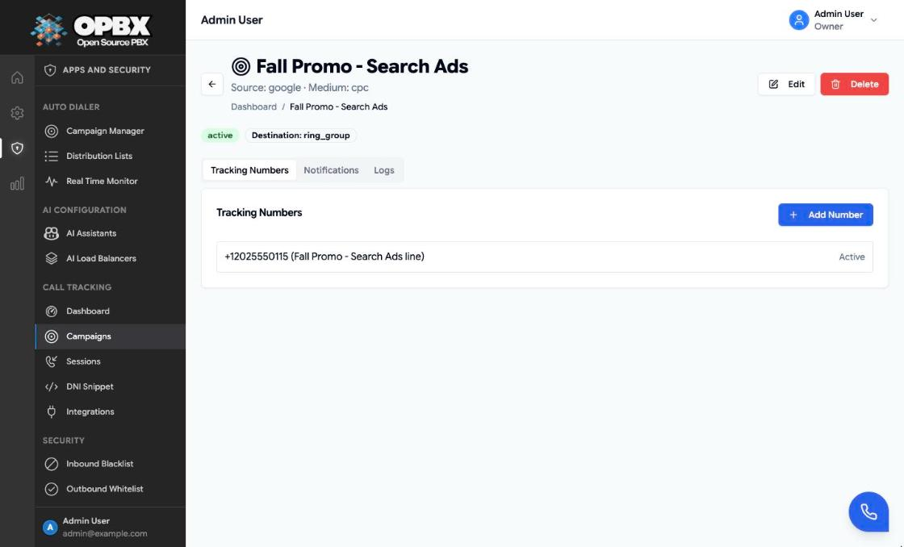
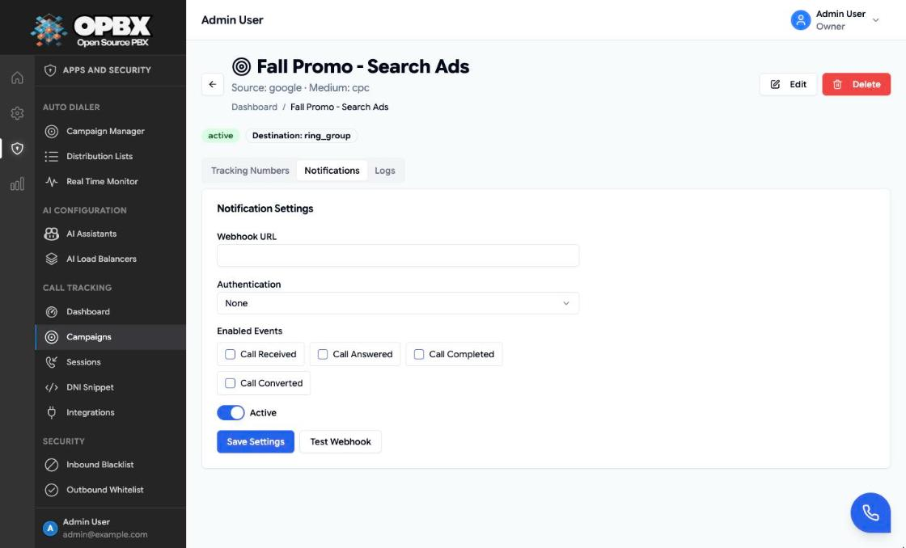

# Call Tracking Campaigns

Call tracking ties inbound calls to the marketing that produced them. A **campaign** stands for one marketing source and medium (for example `google` / `cpc`). It owns one or more **tracking numbers** (phone numbers that you publish only in that campaign) and a **destination** where the calls go. Every finished call to a tracking number becomes a **session**, which is checked against the campaign's **conversion rule** and can be sent to a webhook, Google Ads and Meta.

## Purpose

Use this module to:

- create a campaign per marketing channel;
- attach tracking numbers to it;
- route the campaign's calls to a forward number, an extension or a ring group;
- define what counts as a converted call;
- notify your own systems by webhook, and upload conversions to Google Ads and Meta.

Results are on the [Call Tracking Analytics](/opbx/modules/call-tracking-analytics) pages. To show the right number on your website, see [Call Tracking DNI](/opbx/modules/call-tracking-dni).

## Prerequisites

- One **active** phone number per tracking number, not yet used by another campaign. See [Phone Numbers](/opbx/modules/phone-numbers).
- The destination: an external number in E.164 form, or the ID of an active extension or ring group.
- You are the **Owner** or a **PBX Admin** to create, edit or delete.

## Permissions

| Action | Owner | PBX Admin | PBX User | Reporter | Supervisor |
|--------|:-----:|:---------:|:--------:|:--------:|:----------:|
| See **Call Tracking → Campaigns** in the sidebar | Yes | Yes | No | Yes (read-only) | No |
| List and view campaigns and their tracking numbers (API) | Yes | Yes | No | Yes | No |
| Create, edit, delete, activate or deactivate a campaign | Yes | Yes | No | No | No |
| Add tracking numbers (page), change or remove them (API) | Yes | Yes | No | No | No |
| View and change webhook notification settings, send a test | Yes | Yes | No | No | No |
| Read the delivery log (API) | Yes | Yes | No | Yes | No |
| Open **Integrations** in the sidebar | Yes | Yes | No | No | No |
| Read or change ad-platform integrations (API) | Yes | Yes | No | No | No |

The **Call Tracking** group is part of the **Apps and Security** sidebar section, which Owners, PBX Admins and Reporters can see. Other roles who open a call-tracking page's address directly are returned to the Dashboard with an **Access denied** toast; the campaign create and edit pages are for Owners and PBX Admins only. In the campaign list, only Owners and PBX Admins can open a campaign.

## How a tracked call works

1. A caller dials a tracking number.
2. The number's routing type is **Call tracking**, so OPBX looks up its campaign.
3. If the tracking number and the campaign are active, the call goes to the campaign's destination.
4. When the call ends and its CDR arrives, OPBX creates a **session** with the caller, the campaign's source and medium, the duration and the disposition.
5. The conversion rule decides whether the session is **converted**.
6. Webhook events are queued for the enabled event types, and a converted session is uploaded to Google Ads and Meta when both the campaign toggle and the organization integration are on.

Sessions are created only for calls to an **active** tracking number in an **active** campaign. A call that cannot be routed (inactive number or campaign, missing destination) hears a short spoken message and is ended.

## Workflows

### Find a campaign

**Who can do this:** Owner, PBX Admin, Reporter (Reporters see the list read-only).

1. Open **Call Tracking → Campaigns**. The list shows 25 campaigns per page with the **Source**, **Medium**, **Destination**, **Tracking Numbers** count and **Status** of each.
2. Type part of the name in **Search campaigns...**, choose **All Statuses**, **Active** or **Inactive**, or click **Unprovisioned** to see only disconnected campaigns.
3. Click the column headers to sort, or the refresh button to load the list again. **Clear Filters** appears when a filter is set and resets them all.


Owners and PBX Admins click a campaign's name or row to open its page. Reporters see the list only; the page shows a **Read-Only** badge.

### Create a campaign

**Who can do this:** Owner, PBX Admin.

1. Open **Call Tracking → Campaigns**.
2. Click **New Campaign**.
3. Under **Basic Information**, enter the **Name** and, for DNI and reports, the **Source** and **Medium** (use the same values as your `utm_source` and `utm_medium`).
4. Under **Destination**, choose the **Destination Type** and fill in its field.
5. Under **Ad-Platform Uploads**, turn on **Google Ads** or **Meta Conversions** if you want converted calls uploaded.
6. Under **Conversion Rules**, set **Min Answered Duration (seconds)**, **Conversion Value** and **Require answered disposition**.
7. Click **Create Campaign**.

The toast "Campaign created successfully" appears and you return to the list, where the new campaign is **Active**. Add tracking numbers next; a campaign without tracking numbers receives no calls.


### Add a tracking number

**Who can do this:** Owner, PBX Admin.

A tracking number links one phone number to one campaign. A phone number can belong to only one campaign.

1. Open the campaign from the list. The **Tracking Numbers** tab is selected.
2. Click **Add Number**. The **Add Tracking Number** dialog opens.
3. Choose the **Phone number**. The list offers your active phone numbers (the first 100).
4. Optionally enter a **Friendly name (optional)**.
5. Click **Add Number**.

The toast "Tracking number added" appears and the number is listed on the tab with its friendly name and status (**active**). A number that already belongs to a campaign is refused with "The did number id has already been taken."

When a number is added, OPBX changes the phone number's routing type to **Call tracking**, pointing at the campaign. Its previous routing is replaced.

{/* SCREENSHOT: call-tracking-numbers-add-dialog — Campaign page of Fall Promo - Search Ads with the Add Tracking Number dialog open, Phone number +12025550117 selected and Friendly name "Search ads line" */}



The page cannot change or remove a tracking number. Use the API:

```http
POST   /v1/call-tracking-campaigns/{campaign}/call-tracking-numbers
       { "did_number_id": 42, "friendly_name": "Search ads line", "status": "active" }
PUT    /v1/call-tracking-campaigns/{campaign}/call-tracking-numbers/{number}
       { "friendly_name": "Search ads line", "status": "inactive" }
DELETE /v1/call-tracking-campaigns/{campaign}/call-tracking-numbers/{number}
```

| Field | Required | Limits | Meaning |
|-------|----------|--------|---------|
| `did_number_id` | Yes (create only) | An **active** phone number of your organization, not used by any campaign | The number callers dial |
| `friendly_name` | No | Up to 255 characters | Label in lists |
| `status` | No | `active` or `inactive`. Default: `active` | Inactive numbers are not routed, not used by DNI and create no sessions |

When a tracking number is removed, the phone number keeps the **Call tracking** routing type. Calls to it then hear a short message and end. Give the phone number a new destination on the [Phone Numbers](/opbx/modules/phone-numbers) page.

### Edit a campaign

**Who can do this:** Owner, PBX Admin.

1. In the list, click the campaign to open it.
2. Click **Edit**. The **Edit Campaign** page opens with the current values.
3. Change the fields.
4. Click **Update Campaign**.

The toast "Campaign updated successfully" appears and you return to the list.

:::note Saving from the form
Editing keeps the campaign's current description and status. The form only knows Forward to Number, Extension and Ring Group; edit a campaign with another destination type through the API.
:::

### Disconnect a campaign

**Who can do this:** Owner, PBX Admin.

1. Open the campaign and click **Edit**.
2. In **Destination Type**, choose **Disconnect**. Only the edit page offers it.
3. Click **Update Campaign**.

The campaign is saved with "Destination unavailable": callers to its tracking numbers hear "Destination doesn't exist" and the call ends. The campaign shows the **Unprovisioned** badge in the list and on its page, and the **Unprovisioned** filter finds it. To reconnect it, edit it, choose a destination type again and save.

{/* SCREENSHOT: call-tracking-campaigns-disconnect — Edit Campaign page of Partner Newsletter with the Destination Type list open and Disconnect highlighted under Forward to Number, Extension and Ring Group */}

The same state appears after a [user is deleted](/opbx/modules/user-management#delete-a-user) whose extension was the campaign's destination.

### Activate or deactivate a campaign

**Who can do this:** Owner, PBX Admin.

1. Open **Call Tracking → Campaigns**.
2. Click the **Active** or **Inactive** badge in the **Status** column.

The badge spins while saving and then shows the new status. An inactive campaign:

- does not route its tracking numbers: callers hear a short message and the call ends;
- creates no sessions;
- is not matched by DNI.

### Set up webhook notifications

**Who can do this:** Owner, PBX Admin.

Each campaign can send its sessions to your own webhook.

1. Open the campaign and select the **Notifications** tab.
2. Enter the **Webhook URL**.
3. Choose the **Authentication**: **None**, **Bearer Token** or **Basic Auth**. For Basic Auth enter the **Username**; for both, enter the **Token** or **Password**.
4. Tick the **Enabled Events** to send. At least one is required.
5. Leave **Active** on.
6. Click **Save Settings**.

The page shows no message when the settings are saved or refused. Reload the page to check that they were stored.

| Field | Limits | Meaning |
|-------|--------|---------|
| Webhook URL | Required, a URL, up to 2048 characters | Where events are posted. Deliveries to private or local network addresses are blocked and logged as failed |
| Authentication | None, Bearer Token or Basic Auth | Header sent with each request |
| Username | Required for Basic Auth, up to 255 characters | |
| Token / Password | Required for Bearer Token and Basic Auth when none is stored, up to 2048 characters | Stored encrypted and never shown again |
| Enabled Events | At least one | Which events are sent |
| Active | On by default | Turns delivery on or off |

The token or password is not returned by the server. When you save the settings again with the same Bearer Token or Basic Auth, leave it empty to keep the stored one; type a new value only to replace it.



#### Events

| Event | Form label | Sent when |
|-------|------------|-----------|
| `call.received` | Call Received | Every session |
| `call.answered` | Call Answered | The call had billable seconds |
| `call.missed` | Call Missed | The call had no billable seconds and did not fail |
| `call.failed` | Call Failed | The disposition was `FAILED` or `BUSY` |
| `call.converted` | Call Converted | The session is converted |

Each event is delivered by a background job with a 30-second request timeout and up to three attempts (after 30 seconds, 2 minutes and 10 minutes). Authorization headers are shown as `***REDACTED***` in the logs.

#### Payload

```json
{
  "event": "call.converted",
  "event_id": "ct_event_6f1c…",
  "timestamp": "2026-10-13T12:34:56+00:00",
  "organization_id": 1,
  "campaign": { "id": 5, "name": "Fall Promo - Search Ads" },
  "tracking_number": "+12025550115",
  "caller_number": "+12025550142",
  "source": "google",
  "medium": "cpc",
  "duration": 87,
  "billsec": 72,
  "is_answered": true,
  "is_converted": true,
  "conversion_value": 45.0
}
```

### Test the webhook

**Who can do this:** Owner, PBX Admin.

1. Save active settings with a webhook URL first (see above).
2. On the **Notifications** tab, click **Test Webhook**.

OPBX posts a sample `call.received` event at once, with made-up numbers (`+15550000000` calling `+15551111111`). The page shows no message; reload the page and open the **Logs** tab to see the result. Without saved, active settings the test is refused with "Notification settings are missing, inactive, or have no webhook URL configured." The test is limited to 5 per minute.

### Check the delivery log

**Who can do this:** Owner, PBX Admin (Reporters can also read the log through the API).

1. Open the campaign and select the **Logs** tab.
2. Read the ten most recent deliveries: **Event**, **URL**, **Status** (the HTTP status code, or **Error** when no response came back) and **Time**.

Webhook events, test events and the Google Ads and Meta uploads (`ad_platform.google_ads`, `ad_platform.meta`) are all logged here. The tab does not refresh by itself; reload the page to see new entries. The full, filterable log is `GET /v1/call-tracking-campaigns/{campaign}/notification-logs`.

{/* SCREENSHOT: call-tracking-campaigns-logs — Logs tab of Fall Promo - Search Ads with a successful call.received test (200) to https://hooks.example.com/opbx and an ad_platform.google_ads row with Error */}

### Connect Google Ads and Meta

**Who can do this:** Owner, PBX Admin.

Converted sessions can be uploaded to Google Ads and Meta. Both switches must be on: the organization integration, and the **Google Ads** or **Meta Conversions** switch on the campaign.

1. Open **Call Tracking → Integrations**.
2. On the **Google Ads** or **Meta Conversions API** card, turn the switch to **Enabled**. The fields appear.
3. Fill in the fields (table below).
4. Click **Save Integrations**. The button is enabled once you have changed something.

The toast "Integration settings saved" appears. Each card shows **Configured** when all its values are stored, otherwise **Not configured**.

| Integration | Fields | What OPBX sends |
|-------------|--------|-----------------|
| Google Ads | **Developer Token**, **Refresh Token**, **Customer ID** (for example `123-456-7890`), **Conversion Action Resource Name** (for example `customers/123/conversionActions/456`) | A call conversion to the Google Ads `uploadCallConversions` endpoint |
| Meta Conversions API | **Pixel ID**, **Access Token** | A `Contact` event with the caller's number hashed (SHA-256) |

The stored values are never shown again; the fields are always empty when the page opens. Every time you save with an integration enabled, the form needs **Customer ID** and **Conversion Action Resource Name** (Google Ads), or **Pixel ID** and **Access Token** (Meta). **Developer Token** and **Refresh Token** are required the first time; after that, leave them empty to keep the stored values. To turn an integration off, switch it to **Disabled** and save; the stored values are kept.

:::caution Google Ads token
OPBX sends the **Refresh Token** value as the OAuth bearer token on the upload request. It does not exchange it for an access token. Check the campaign's **Logs** tab after the first conversion.
:::


### Delete a campaign

**Who can do this:** Owner, PBX Admin.

1. Click the delete icon on the campaign's row, or **Delete** on the campaign page.
2. Confirm with **Delete** in the **Delete Campaign** dialog.

The toast "Campaign deleted successfully" appears and the campaign leaves the list.

A campaign that still has tracking numbers cannot be deleted: the **Cannot delete: still in use** dialog lists each phone number as a tracking number. Changing the phone number's routing on the Phone Numbers page does not help; remove the tracking numbers through the API (see [Add a tracking number](#add-a-tracking-number)) and delete again. Sessions never block the delete, but deleting the campaign also deletes its **sessions, notification settings and notification logs**, so its history disappears from the analytics.


{/* SCREENSHOT: call-tracking-campaigns-in-use-dialog — Cannot delete: still in use dialog for Fall Promo - Search Ads listing the phone number +12025550115 as a tracking number */}

## Campaign fields

| Field | Required | Limits and default | Meaning |
|-------|----------|--------------------|---------|
| Name | Yes | Up to 255 characters; unique within the organization | Shown in lists and reports; matched by DNI `utm_campaign` |
| Source | No | Up to 100 characters | Attribution source, for example `google` |
| Medium | No | Up to 100 characters | Attribution medium, for example `cpc` |
| Destination Type | Yes | Forward to Number, Extension or Ring Group in the form (plus Disconnect when editing). Default: Forward to Number | Where calls go (table below) |
| Google Ads | No | Off by default | Upload converted calls to Google Ads |
| Meta Conversions | No | Off by default | Send converted calls to the Meta Conversions API |
| Min Answered Duration (seconds) | No | 0 or more. Form default: 30 | Billable seconds a call needs to convert |
| Conversion Value | No | 0 or more | Value stored on each converted session and sent in webhooks |
| Require answered disposition | No | Form default: on | Only answered calls can convert |
| Status | — | Active or Inactive. New campaigns are Active | Change it from the list |
| Description | No (API only) | Free text | Not shown in the form |

### Destination types

| Destination Type | Field in the form | Result |
|------------------|-------------------|--------|
| Forward to Number | **Forward To**: an external number, up to 50 characters, for example `+12025550180` | The call is dialled out to that number (recorded if inbound recording is on) |
| Extension | **Extension ID**: the numeric ID of the extension | The call rings the extension |
| Ring Group | **Ring Group ID**: the numeric ID of the ring group | The call goes to the ring group |

The form takes the internal **ID**, not the extension number or the group name. The ID is shown in the API and in the address bar when you open the item.

Through the API a campaign can also route to a **business-hours schedule**, **conference room**, **IVR menu**, **AI assistant** or **AI load balancer**. The destination must be active when the call arrives; otherwise the caller hears a short message and the call ends.

### Conversion rule

A session is **converted** when:

- **Require answered disposition** is off, or the call was answered (disposition `CONNECTED` or `ANSWERED`); and
- its billable seconds are at least **Min Answered Duration**.

The rule is applied once, when the session is created. Changing the rule later does not re-evaluate past sessions.

:::caution API defaults
The form starts with 30 seconds and **Require answered disposition** on. A campaign created through the API without a `conversion_rule` gets 0 seconds and the requirement off, so **every** call counts as converted.
:::

## Common errors

| Message (summary) | What it means | What to do |
|-------------------|---------------|-----------|
| Name is required | The form's **Name** is empty | Enter a name |
| The name has already been taken | Another campaign has the name | Choose another name |
| Forward to is required for destination type forward (and similar) | The destination field is empty | Fill in the number or ID |
| The selected extension id / ring group id is invalid | No such extension or ring group | Use the internal ID |
| Choose a destination | You tried to create with "Destination unavailable" (API) | Pick a destination. Disconnect is for edits only |
| The selected did number id is invalid | The phone number is inactive or not yours | Use an active number of your organization |
| The did number id has already been taken | The number already belongs to a campaign | Remove it from the other campaign first |
| The enabled events field is required | No event was ticked (the page shows no message; the settings are not saved) | Tick at least one event |
| The selected enabled_events.N is invalid | An event name the server does not know was sent through the API | Use one of the five event names |
| The auth secret field is required when auth method is … | No token or password is stored yet for this campaign | Enter it and save |
| Notification settings are missing, inactive, or have no webhook URL configured | **Test Webhook** before saving active settings | Save the settings first |
| Customer ID and Conversion Action are required when Google Ads is enabled | **Save Integrations** with Google Ads enabled and either field empty | Enter both values again |
| Pixel ID and Access Token are required when Meta is enabled | **Save Integrations** with Meta enabled and either field empty | Enter both values again |
| Cannot delete: still in use | The campaign still has tracking numbers | Remove them through the API, then delete |

## Key data fields

### `call_tracking_campaigns`

| Column | Notes |
|--------|-------|
| `name` | Unique within the organization |
| `source`, `medium` | Up to 100 characters each |
| `status` | `active` or `inactive` |
| `destination_type` | `forward`, `extension`, `ring_group`, `business_hours`, `conference_room`, `ivr_menu`, `ai_assistant`, `ai_load_balancer` or `unavailable` |
| `destination_config` | JSON, for example `{"forward_to": "+12025550180"}` or `{"ring_group_id": 3}` |
| `conversion_rule` | JSON: `min_answered_duration_seconds`, `requires_answered_disposition`, `conversion_value` |
| `google_ads_upload_enabled`, `meta_upload_enabled` | Booleans |

### `call_tracking_numbers`

| Column | Notes |
|--------|-------|
| `call_tracking_campaign_id` | The campaign. Deleted with the campaign (only possible once no tracking numbers remain) |
| `did_number_id` | The phone number. Unique: one campaign per number |
| `friendly_name` | Up to 255 characters |
| `status` | `active` or `inactive` |

## Related API endpoints

| Method | Endpoint | Purpose |
|--------|----------|---------|
| GET | `/v1/call-tracking-campaigns` | List. Filters: `status`, `source`, `medium`, `search`, `unprovisioned=1` |
| POST | `/v1/call-tracking-campaigns` | Create. Rejects "Destination unavailable" |
| GET, PUT, DELETE | `/v1/call-tracking-campaigns/{campaign}` | Read, update, delete (409 with a usage list while it has tracking numbers) |
| GET, POST | `/v1/call-tracking-campaigns/{campaign}/call-tracking-numbers` | List or add tracking numbers |
| PUT, DELETE | `/v1/call-tracking-campaigns/{campaign}/call-tracking-numbers/{number}` | Change the friendly name or status, or remove |
| GET, PUT | `/v1/call-tracking-campaigns/{campaign}/notification-settings` | Webhook settings |
| POST | `/v1/call-tracking-campaigns/{campaign}/notification-settings/test` | Send a test event (5 per minute) |
| GET | `/v1/call-tracking-campaigns/{campaign}/notification-logs` | Delivery log |
| GET, PUT | `/v1/call-tracking-ad-platform-integrations` | Google Ads and Meta settings |

Scoped API keys use the `call-tracking-campaigns`, `call-tracking-sessions`, `call-tracking-analytics` and `call-tracking-ad-platform-integrations` resources (see [API Keys](/opbx/modules/api-keys)). The [MCP server](/opbx/modules/mcp-server) has the read-only tools `list_call_tracking_campaigns`, `get_call_tracking_campaign` and `list_call_tracking_numbers`.

See the [OPBX REST API reference](https://developers.cloudonix.com/opbxRestOpenAPI) for full schemas.

## Best practices

- Use the same source and medium values as your UTM parameters, so DNI finds the campaign.
- Give each campaign its own tracking numbers; never print a tracking number outside its campaign.
- Set the conversion rule before the campaign goes live, because past sessions are not re-evaluated.
- Test the webhook before you rely on it, and check the **Logs** tab after the first real calls.

## Related modules

- [Call Tracking Analytics](/opbx/modules/call-tracking-analytics) — dashboard and sessions
- [Call Tracking DNI](/opbx/modules/call-tracking-dni) — show the campaign's number on your website
- [Phone Numbers](/opbx/modules/phone-numbers) — the numbers used as tracking numbers
- [Ring Groups](/opbx/modules/ring-groups) and [Extensions](/opbx/modules/extensions) — campaign destinations
