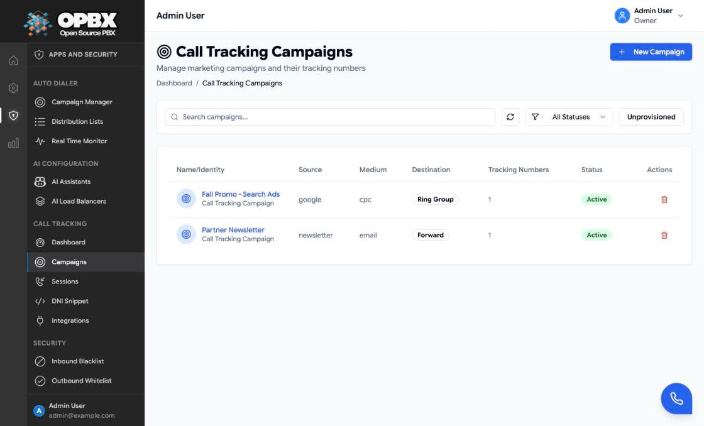
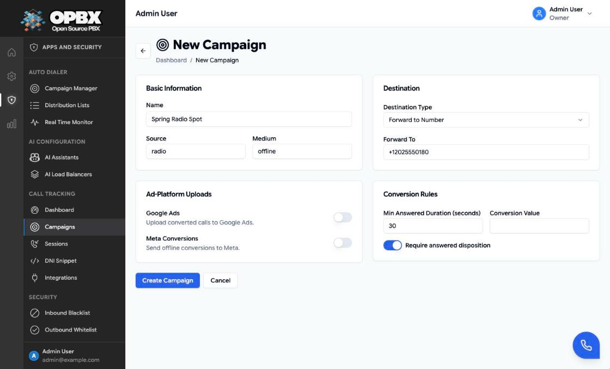
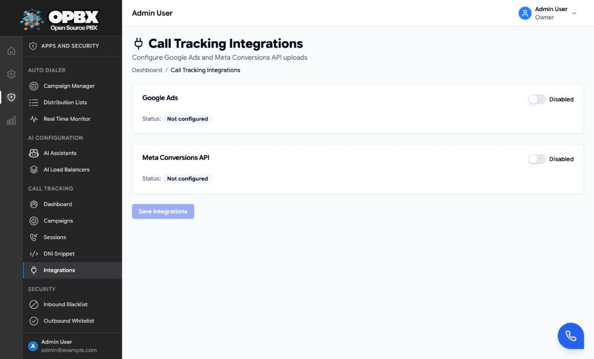
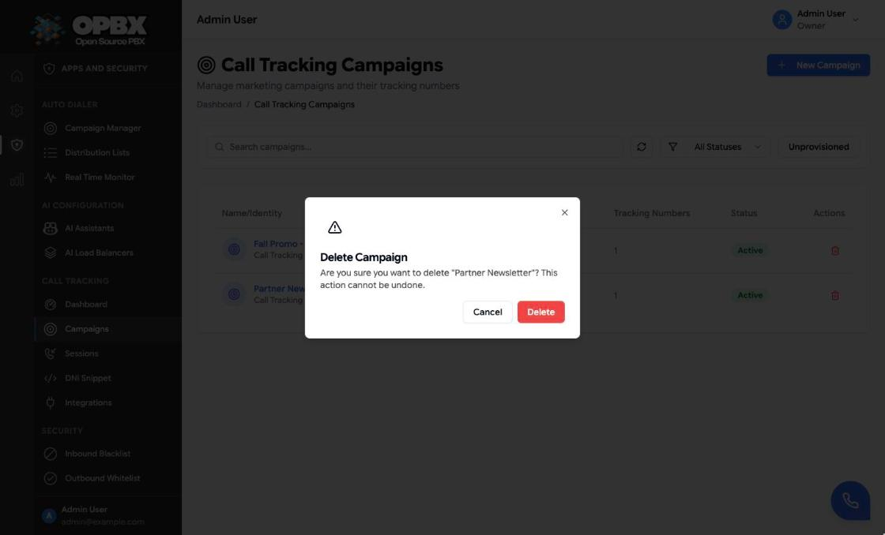

# Call Tracking Campaigns

Call tracking ties inbound calls to the marketing that produced them. A **campaign** stands for one marketing source and medium (for example `google` / `cpc`). It owns one or more **tracking numbers** (phone numbers that you publish only in that campaign) and a **destination** where the calls go. Every finished call to a tracking number becomes a **session**, which is checked against the campaign's **conversion rule** and can be sent to a webhook, Google Ads and Meta.

## Purpose

Use this module to:

- create a campaign per marketing channel;
- attach tracking numbers to it;
- route the campaign's calls to a forward number, an extension or a ring group;
- define what counts as a converted call;
- notify your own systems by webhook, and upload conversions to Google Ads and Meta.

Results are on the [Call Tracking Analytics](/modules/call-tracking-analytics) pages. To show the right number on your website, see [Call Tracking DNI](/modules/call-tracking-dni).

## Prerequisites

- One **active** phone number per tracking number, not yet used by another campaign. See [Phone Numbers](/modules/phone-numbers).
- The destination: an external number in E.164 form, or the ID of an active extension or ring group.
- You are the **Owner** or a **PBX Admin** to create, edit or delete.

## Permissions

| Action | Owner | PBX Admin | PBX User | Reporter | Supervisor |
|--------|:-----:|:---------:|:--------:|:--------:|:----------:|
| See **Call Tracking → Campaigns** in the sidebar | Yes | Yes | No | Yes (read-only) | No |
| List and view campaigns (API) | Yes | Yes | Yes | Yes | Yes |
| Create, edit, delete, activate or deactivate a campaign | Yes | Yes | No | No | No |
| Add, edit or remove tracking numbers | Yes | Yes | No | No | No |
| View and change webhook notification settings | Yes | Yes | No | No | No |
| Open **Integrations** in the sidebar | Yes | No | No | No | No |
| Read or change ad-platform integrations (API) | Yes | Yes | No | No | No |

The **Call Tracking** group is part of the **Apps and Security** sidebar section, which Owners, PBX Admins and Reporters can see. In the campaign list, only Owners and PBX Admins can open a campaign.

## How a tracked call works

1. A caller dials a tracking number.
2. The number's routing type is **Call tracking**, so OPBX looks up its campaign.
3. If the tracking number and the campaign are active, the call goes to the campaign's destination.
4. When the call ends and its CDR arrives, OPBX creates a **session** with the caller, the campaign's source and medium, the duration and the disposition.
5. The conversion rule decides whether the session is **converted**.
6. Webhook events are queued for the enabled event types, and a converted session is uploaded to Google Ads and Meta when both the campaign toggle and the organization integration are on.

Sessions are created only for calls to an **active** tracking number in an **active** campaign. A call that cannot be routed (inactive number or campaign, missing destination) hears a short spoken message and is ended.

## Create a campaign

1. Open **Call Tracking → Campaigns**.
2. Click **New Campaign**.
3. Under **Basic Information**, enter the **Name** and, for DNI and reports, the **Source** and **Medium** (use the same values as your `utm_source` and `utm_medium`).
4. Under **Destination**, choose the **Destination Type** and fill in its field.
5. Under **Ad-Platform Uploads**, turn on **Google Ads** or **Meta Conversions** if you want converted calls uploaded.
6. Under **Conversion Rules**, set the rule.
7. Click **Create Campaign**.

The campaign is saved as **Active**. Add tracking numbers next (see below); a campaign without tracking numbers receives no calls.





## Campaign fields

| Field | Required | Limits and default | Meaning |
|-------|----------|--------------------|---------|
| Name | Yes | Up to 255 characters; unique within the organization | Shown in lists and reports; matched by DNI `utm_campaign` |
| Source | No | Up to 100 characters | Attribution source, for example `google` |
| Medium | No | Up to 100 characters | Attribution medium, for example `cpc` |
| Destination Type | Yes | Forward to Number, Extension or Ring Group in the form. Default: Forward to Number | Where calls go (table below) |
| Google Ads | No | Off by default | Upload converted calls to Google Ads |
| Meta Conversions | No | Off by default | Send converted calls to the Meta Conversions API |
| Min Answered Duration (seconds) | No | 0 or more. Form default: 30 | Billable seconds a call needs to convert |
| Conversion Value | No | 0 or more | Value stored on each converted session and sent in webhooks |
| Require answered disposition | No | Form default: on | Only answered calls can convert |
| Status | — | Active or Inactive. New campaigns are Active | Change it from the list |
| Description | No (API only) | Free text | Not shown in the form |

### Destination types

| Destination Type | Field in the form | Result |
|------------------|-------------------|--------|
| Forward to Number | **Forward To**: an external number, up to 50 characters, for example `+12025550180` | The call is dialled out to that number (recorded if inbound recording is on) |
| Extension | **Extension ID**: the numeric ID of the extension | The call rings the extension |
| Ring Group | **Ring Group ID**: the numeric ID of the ring group | The call goes to the ring group |

The form takes the internal **ID**, not the extension number or the group name. The ID is shown in the API and in the address bar when you open the item.

Through the API a campaign can also route to a **business-hours schedule**, **conference room**, **IVR menu**, **AI assistant** or **AI load balancer**. The destination must be active when the call arrives; otherwise the caller hears a short message and the call ends.

### Conversion rule

A session is **converted** when:

- **Require answered disposition** is off, or the call was answered (disposition `CONNECTED` or `ANSWERED`); and
- its billable seconds are at least **Min Answered Duration**.

The rule is applied once, when the session is created. Changing the rule later does not re-evaluate past sessions.

:::caution API defaults
The form starts with 30 seconds and **Require answered disposition** on. A campaign created through the API without a `conversion_rule` gets 0 seconds and the requirement off, so **every** call counts as converted.
:::

## Tracking numbers

A tracking number links one phone number to one campaign. A phone number can belong to only one campaign.

On the campaign page, the **Tracking Numbers** tab lists the numbers with their friendly name and status.

To add a number, use the API (the **Add Number** button does not open a form in the current version):

```http
POST /v1/call-tracking-campaigns/{campaign}/call-tracking-numbers
{ "did_number_id": 42, "friendly_name": "Search ads line", "status": "active" }
```

| Field | Required | Limits | Meaning |
|-------|----------|--------|---------|
| `did_number_id` | Yes | An **active** phone number of your organization, not used by any campaign | The number callers dial |
| `friendly_name` | No | Up to 255 characters | Label in lists |
| `status` | No | `active` or `inactive`. Default: `active` | Inactive numbers are not routed, not used by DNI and create no sessions |

When a number is added, OPBX changes the phone number's routing type to **Call tracking**, pointing at the campaign. Its previous routing is replaced.

When a tracking number is removed (`DELETE …/call-tracking-numbers/{number}`), the phone number keeps the **Call tracking** routing type. Calls to it then hear a short message and end. Give the phone number a new destination on the [Phone Numbers](/modules/phone-numbers) page.

{/* SCREENSHOT: call-tracking-campaigns-detail — campaign page for "Fall Promo - Search Ads" with the status, destination and upload badges, and the Tracking Numbers tab listing +12025550115 */}

## Edit a campaign

1. In the list, click the campaign to open it.
2. Click **Edit**.
3. Change the fields and click **Update Campaign**.

:::caution Saving from the form
The form always saves the campaign as **Active** and clears the description. To keep a campaign inactive, set the status again from the list after you save. The form also only knows Forward, Extension and Ring Group; edit a campaign with another destination type through the API.
:::

### Disconnect

On the edit page only, the **Destination Type** list offers **Disconnect**. It saves the campaign with "Destination unavailable": callers to its tracking numbers hear "Destination doesn't exist" and the call ends. The campaign then shows the **Unprovisioned** badge in the list and on its page, and the **Unprovisioned** filter finds it. To reconnect it, choose a destination type again and save. The create page never offers Disconnect.

The same state appears after a [user is deleted](/modules/user-management#delete-a-user) whose extension was the campaign's destination.

## Activate or deactivate

Click the **Active** or **Inactive** badge in the **Status** column of the list. An inactive campaign:

- does not route its tracking numbers: callers hear a short message and the call ends;
- creates no sessions;
- is not matched by DNI.

## Webhook notifications

Each campaign can send its sessions to your own webhook. Open the campaign and select the **Notifications** tab.

| Field | Limits | Meaning |
|-------|--------|---------|
| Webhook URL | Required, a URL, up to 2048 characters | Where events are posted. Deliveries to private or local network addresses are blocked |
| Authentication | None, Bearer Token or Basic Auth | Header sent with each request |
| Username | Required for Basic Auth, up to 255 characters | |
| Token / Password | Required for Bearer Token and Basic Auth, up to 2048 characters | Stored encrypted and never shown again |
| Enabled Events | At least the events you want | Which events are sent |
| Active | On by default | Turns delivery on or off |

Click **Save Settings**, then **Test Webhook** to post a sample `call.received` event (with made-up numbers) right away. The result appears on the **Logs** tab. The test needs saved, active settings.

The token or password is not returned by the server. When you save the settings again with Bearer Token or Basic Auth, type it in again; the save is refused without it.

### Events

| Event | Sent when |
|-------|-----------|
| `call.received` | Every session |
| `call.answered` | The call was answered |
| `call.missed` | The call was not answered and did not fail |
| `call.failed` | The disposition was `FAILED` or `BUSY` |
| `call.converted` | The session is converted |

The server accepts these five event names. The form lists **Call Received**, **Call Answered**, **Call Completed** and **Call Converted**; **Call Completed** is not a valid event and makes the save fail, so leave it unchecked. Enable `call.missed` and `call.failed` through the API.

Each event is delivered by a background job with a 30-second request timeout and up to three attempts (after 30 seconds, 2 minutes and 10 minutes). Authorization headers are shown as `***REDACTED***` in the logs.

### Payload

```json
{
  "event": "call.converted",
  "event_id": "ct_event_6f1c…",
  "timestamp": "2026-10-13T12:34:56+00:00",
  "organization_id": 1,
  "campaign": { "id": 5, "name": "Fall Promo - Search Ads" },
  "tracking_number": "+12025550115",
  "caller_number": "+12025550142",
  "source": "google",
  "medium": "cpc",
  "duration": 87,
  "billsec": 72,
  "is_answered": true,
  "is_converted": true,
  "conversion_value": 45.0
}
```

{/* SCREENSHOT: call-tracking-campaigns-notifications — Notifications tab of a campaign with an empty Webhook URL, Authentication None, the Enabled Events checkboxes, the Active switch and the Save Settings and Test Webhook buttons */}

## Ad-platform uploads

Converted sessions can be uploaded to Google Ads and Meta. Both switches must be on:

1. the organization integration, on **Call Tracking → Integrations** (Owner);
2. the **Google Ads** or **Meta Conversions** switch on the campaign.

| Integration | Fields | What OPBX sends |
|-------------|--------|-----------------|
| Google Ads | Developer Token, Refresh Token, Customer ID, Conversion Action Resource Name (for example `customers/123/conversionActions/456`) | A call conversion to the Google Ads `uploadCallConversions` endpoint |
| Meta Conversions API | Pixel ID, Access Token | A `Contact` event with the caller's number hashed (SHA-256) |

Turn an integration on, fill in its fields and click **Save Integrations**. Secrets are stored encrypted and are never shown again; each card shows **Configured** or **Not configured**, and a field left empty keeps the stored value. Fields that were never set are required when you turn an integration on.

:::caution Google Ads token
OPBX sends the **Refresh Token** value as the OAuth bearer token on the upload request. It does not exchange it for an access token. Check the job logs after the first conversion.
:::



## Delete a campaign

1. Click the delete action on the campaign's row, or **Delete** on the campaign page.
2. Confirm in the **Delete Campaign** dialog.

A campaign delete is not blocked by its tracking numbers. Deleting a campaign also deletes its **tracking numbers, sessions, notification settings and notification logs**, so its history disappears from the analytics. The phone numbers keep the **Call tracking** routing type; give them a new destination afterwards.



## Common errors

| Message (summary) | What it means | What to do |
|-------------------|---------------|-----------|
| The name has already been taken | Another campaign has the name | Choose another name |
| Forward to is required for destination type forward (and similar) | The destination field is empty | Fill in the number or ID |
| The selected extension id / ring group id is invalid | No such extension or ring group | Use the internal ID |
| Choose a destination | You tried to create with "Destination unavailable" (API) | Pick a destination. Disconnect is for edits only |
| The selected did number id is invalid | The phone number is inactive or not yours | Use an active number of your organization |
| The did number id has already been taken | The number already belongs to a campaign | Remove it from the other campaign first |
| The selected enabled_events.N is invalid | **Call Completed** was checked | Uncheck it |
| The auth secret field is required when auth method is … | The token or password was not re-entered | Enter it and save again |
| Notification settings are missing, inactive, or have no webhook URL configured | **Test Webhook** before saving active settings | Save the settings first |

## Key data fields

### `call_tracking_campaigns`

| Column | Notes |
|--------|-------|
| `name` | Unique within the organization |
| `source`, `medium` | Up to 100 characters each |
| `status` | `active` or `inactive` |
| `destination_type` | `forward`, `extension`, `ring_group`, `business_hours`, `conference_room`, `ivr_menu`, `ai_assistant`, `ai_load_balancer` or `unavailable` |
| `destination_config` | JSON, for example `{"forward_to": "+12025550180"}` or `{"ring_group_id": 3}` |
| `conversion_rule` | JSON: `min_answered_duration_seconds`, `requires_answered_disposition`, `conversion_value` |
| `google_ads_upload_enabled`, `meta_upload_enabled` | Booleans |

### `call_tracking_numbers`

| Column | Notes |
|--------|-------|
| `call_tracking_campaign_id` | The campaign. Deleted with the campaign |
| `did_number_id` | The phone number. Unique: one campaign per number |
| `friendly_name` | Up to 255 characters |
| `status` | `active` or `inactive` |

## Related API endpoints

| Method | Endpoint | Purpose |
|--------|----------|---------|
| GET | `/v1/call-tracking-campaigns` | List. Filters: `status`, `source`, `medium`, `search`, `unprovisioned=1` |
| POST | `/v1/call-tracking-campaigns` | Create. Rejects "Destination unavailable" |
| GET, PUT, DELETE | `/v1/call-tracking-campaigns/{campaign}` | Read, update, delete |
| GET, POST | `/v1/call-tracking-campaigns/{campaign}/call-tracking-numbers` | List or add tracking numbers |
| PUT, DELETE | `/v1/call-tracking-campaigns/{campaign}/call-tracking-numbers/{number}` | Change the friendly name or status, or remove |
| GET, PUT | `/v1/call-tracking-campaigns/{campaign}/notification-settings` | Webhook settings |
| POST | `/v1/call-tracking-campaigns/{campaign}/notification-settings/test` | Send a test event (5 per minute) |
| GET | `/v1/call-tracking-campaigns/{campaign}/notification-logs` | Delivery log |
| GET, PUT | `/v1/call-tracking-ad-platform-integrations` | Google Ads and Meta settings |

Scoped API keys use the `call-tracking-campaigns`, `call-tracking-sessions`, `call-tracking-analytics` and `call-tracking-ad-platform-integrations` resources (see [API Keys](/modules/api-keys)). The [MCP server](/modules/mcp-server) has the read-only tools `list_call_tracking_campaigns`, `get_call_tracking_campaign` and `list_call_tracking_numbers`.

See the [OPBX REST API reference](https://developers.cloudonix.com/opbxRestOpenAPI) for full schemas.

## Best practices

- Use the same source and medium values as your UTM parameters, so DNI finds the campaign.
- Give each campaign its own tracking numbers; never print a tracking number outside its campaign.
- Set the conversion rule before the campaign goes live, because past sessions are not re-evaluated.
- Test the webhook before you rely on it, and check the **Logs** tab after the first real calls.

## Related modules

- [Call Tracking Analytics](/modules/call-tracking-analytics) — dashboard and sessions
- [Call Tracking DNI](/modules/call-tracking-dni) — show the campaign's number on your website
- [Phone Numbers](/modules/phone-numbers) — the numbers used as tracking numbers
- [Ring Groups](/modules/ring-groups) and [Extensions](/modules/extensions) — campaign destinations
