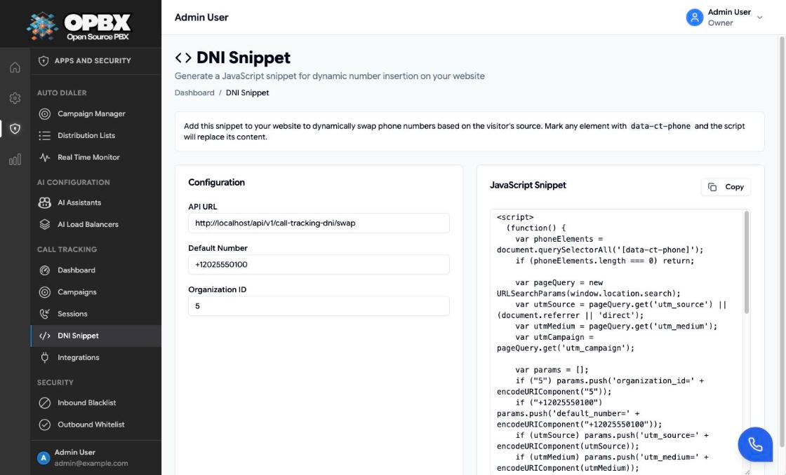

# Call Tracking DNI

Dynamic Number Insertion (DNI) replaces the phone number on your website with the tracking number of the campaign the visitor came from. A visitor who arrives from `?utm_source=google&utm_medium=cpc` sees the number of your `google` / `cpc` campaign, so the call is attributed to it.

DNI has two parts: a public OPBX endpoint that picks the number, and a small script on your website that asks it and swaps the number on the page.

## Prerequisites

- A [call-tracking campaign](/opbx/modules/call-tracking-campaigns) whose **Source** and **Medium** match your UTM values, with at least one **active** tracking number.
- Your organization's numeric ID. The API returns it as `organization_id`, for example in `GET /v1/call-tracking-campaigns`.
- Your website's origin must be allowed to call the OPBX API from the browser. The deployment's CORS configuration (`config/cors.php`) allows only the OPBX front-end and a few fixed origins by default; ask the platform operator to add your site, otherwise the browser blocks the request and the page keeps its default number.
- To find **Call Tracking → DNI Snippet** in the sidebar, you are the **Owner** or a **PBX Admin**.

## How the number is chosen

The endpoint is `GET /api/v1/call-tracking-dni/swap`. It needs no login and allows 60 requests per minute per organization and visitor IP.

| Parameter | Required | Limits | Meaning |
|-----------|----------|--------|---------|
| `organization_id` | Yes | An existing organization | Whose campaigns to search |
| `utm_source` | No | Up to 100 characters | Compared with the campaign **Source** (any letter case) |
| `utm_medium` | No | Up to 100 characters | Compared with the campaign **Medium** (any letter case) |
| `utm_campaign` | No | Up to 255 characters | Must appear somewhere in the campaign **Name** |
| `default_number` | No | E.164, for example `+12025550100` | Returned when no tracking number is found |

The endpoint picks a number in this order:

1. If **both** `utm_source` and `utm_medium` are given, the first **active** campaign with that source and medium (and, when `utm_campaign` is given, a name containing it). Then that campaign's first active tracking number.
2. Otherwise, or if that campaign has no active number: the organization's first active tracking number, from any campaign.
3. Otherwise: `default_number`.

The response has `tracking_number` and, when a campaign matched, `campaign_id`, `campaign_name`, `source` and `medium`.

:::caution
Step 2 can return a number whose campaign is inactive. Calls to it are not routed. Deactivate the tracking numbers of inactive campaigns, or always pass `utm_source` and `utm_medium`.
:::

## Workflows

### Mark the phone numbers on your website

**Who can do this:** whoever edits your website; no OPBX role is needed.

1. Find every element that shows your phone number.
2. Add the `data-ct-phone` attribute to it, and keep your normal number as its content so visitors without a match still see it:

```html
<a href="tel:+12025550100" data-ct-phone>+1 202 555 0100</a>
```

### Generate and install the DNI snippet

**Who can do this:** Owner, PBX Admin (the sidebar shows **DNI Snippet** to them only; other roles who open the page's address directly see it with a **Read-Only** badge but can still copy a snippet).

1. Open **Call Tracking → DNI Snippet**.
2. Check the **API URL**. It defaults to this OPBX server's `…/api/v1/call-tracking-dni/swap`.
3. Enter the **Default Number** in E.164 form, for example `+12025550100`. A value in another form shows "Default number must be in E.164 format (e.g. +14155551234)."
4. Enter the **Organization ID**. Anything but digits shows "Organization ID must be numeric."
5. Click **Copy**. The button shows **Copied** for two seconds; if the browser refuses, the toast "Failed to copy snippet to clipboard" appears. **Copy** is disabled while either field holds an invalid value. An empty field does not disable it, but a snippet without the organization ID never finds a number.
6. Paste the snippet into every page, before the closing `</body>` tag.

The **JavaScript Snippet** box updates as you type; you can also select its text by hand.



The generated snippet:

- finds every element with `data-ct-phone` (and does nothing if there is none);
- reads `utm_source`, `utm_medium` and `utm_campaign` from the page address. Without `utm_source` it sends the referring page address, or `direct`;
- replaces the element text with the returned number, and for links also sets `href` to `tel:` followed by the digits of the number;
- leaves the page unchanged if the request fails or returns no number.

It asks the endpoint on every page load.

### Test the number swap

**Who can do this:** anyone; the endpoint needs no login.

1. Open your page with the UTM parameters in the address, for example `https://www.example.com/?utm_source=google&utm_medium=cpc`.
2. Check the number shown in every marked element.
3. To test the endpoint directly, open:

```text
https://opbx.example.com/api/v1/call-tracking-dni/swap?organization_id=1&utm_source=google&utm_medium=cpc&default_number=%2B12025550100
```

The response shows the `tracking_number` and, when a campaign matched, its `campaign_name`.

## The hosted script

OPBX also serves a script at `/js/call-tracking-dni.js`:

```html
<script async
  src="https://opbx.example.com/js/call-tracking-dni.js"
  data-organization-id="1"
  data-default="+12025550100"
  data-selector="[data-ct-phone]"></script>
```

| Attribute | Required | Meaning |
|-----------|----------|---------|
| `data-organization-id` | Yes | Your organization ID. Without it the script does nothing |
| `data-default` | No | Number used when the endpoint returns none |
| `data-selector` | No | CSS selector of the elements to swap. Default: `.call-tracking-number` |

Differences from the generated snippet:

- it hides the marked elements until the number is known;
- it changes only the text, not the `href` of links;
- it keeps the number for the rest of the browser session (`sessionStorage`), so later pages do not ask again;
- it calls `/api/v1/call-tracking-dni/swap` on the **same host as the page**. It therefore works only on pages served from the OPBX host itself. For any other website, use the snippet from the **DNI Snippet** page.

## Example

The demo organization's campaign **Fall Promo - Search Ads** has source `google`, medium `cpc` and the tracking number +1 202 555 0115. A visitor opening `https://www.example.com/?utm_source=google&utm_medium=cpc` sees +1 202 555 0115 in every marked element. A visitor arriving with `utm_source=newsletter&utm_medium=email` sees the **Partner Newsletter** number, +1 202 555 0116.

To check it, follow [Test the number swap](#test-the-number-swap).

## Troubleshooting

| Symptom | Likely cause |
|---------|--------------|
| The default number always shows | The browser blocked the request (CORS; see the console), or no campaign has an active tracking number |
| A number from the wrong campaign shows | `utm_source` or `utm_medium` was missing or did not match, so the organization's first active number was used |
| Requests fail with 429 | More than 60 requests a minute from one visitor IP |
| Requests fail with 422 | The organization ID does not exist, or the default number is not E.164 |
| The default number shows for visitors without `utm_source` | The snippet then sends the referring page address as `utm_source`; an address longer than 100 characters is refused with 422 |

## Related modules

- [Call Tracking Campaigns](/opbx/modules/call-tracking-campaigns) — source, medium and tracking numbers
- [Call Tracking Analytics](/opbx/modules/call-tracking-analytics) — the calls that DNI brings in
- [Phone Numbers](/opbx/modules/phone-numbers) — the numbers behind the tracking numbers
