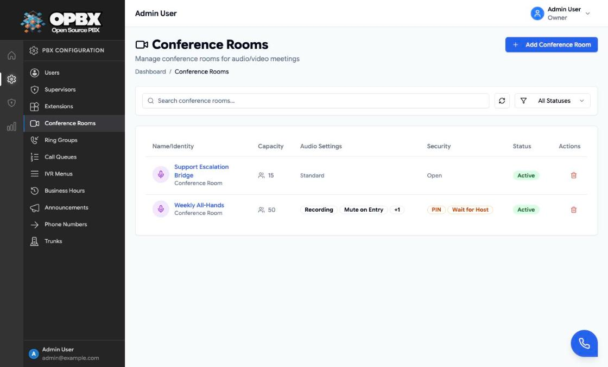
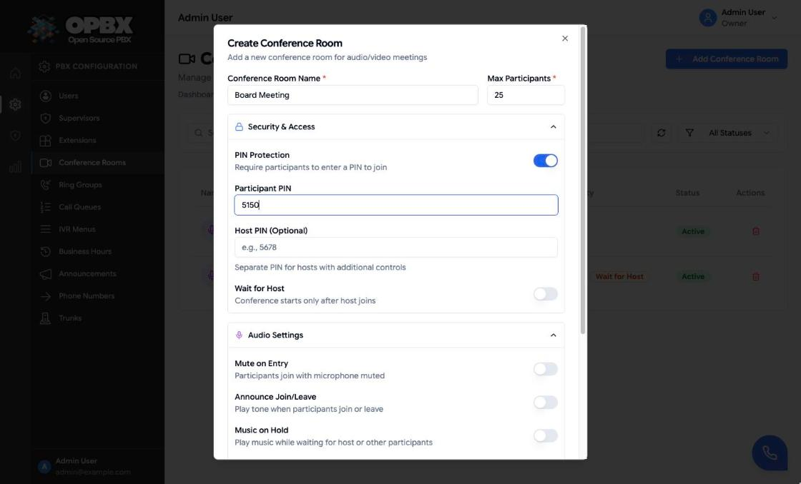
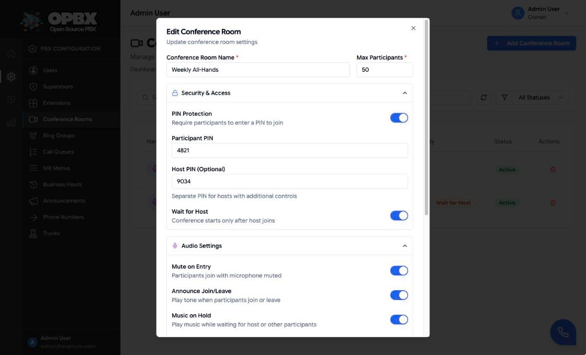
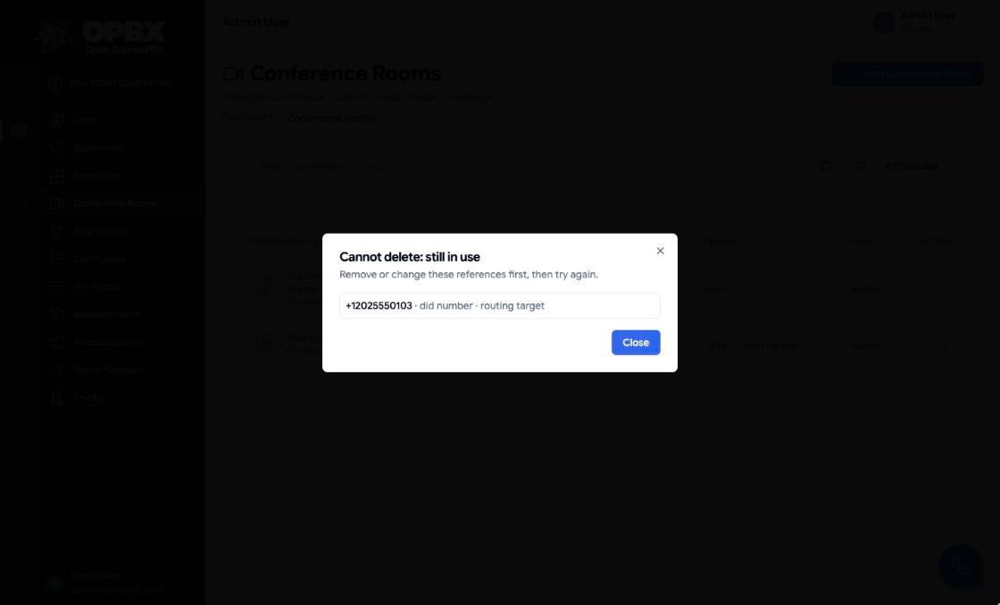

# Conference Rooms

A conference room is an audio bridge. Every caller who reaches the room joins the same conversation. Route a phone number, an extension, an IVR option or a business-hours action to the room.

## Purpose

Use this module to:

- create a bridge for a recurring meeting or an open escalation line;
- limit how many people can join;
- mute people as they join, or announce who joins and leaves;
- store PIN, host, recording and talk-detection settings for the room.

## Prerequisites

- To reach the room from outside, a **phone number** routed to it, or an extension of type **Conference** reached through an IVR menu or a transfer. See [Phone Numbers](/opbx/modules/phone-numbers) and [Extensions](/opbx/modules/extensions).

## Permissions

| Action | Owner | PBX Admin | PBX User | Reporter |
|--------|:-----:|:---------:|:--------:|:--------:|
| See Conference Rooms in the sidebar | Yes | Yes | Yes (read-only page) | Yes (read-only page) |
| View rooms | Yes | Yes | Yes | Yes |
| See the PIN and host PIN | Yes | Yes | No | No |
| Create, edit, delete, toggle status | Yes | Yes | No | No |

The API leaves `pin` and `host_pin` out of the response for anyone who cannot edit the room. The **Security** column still shows whether a PIN is set.

## Workflows

### Create a conference room

**Who can do this:** Owner, PBX Admin.

1. Open **Conference Rooms** in the sidebar (under **PBX Configuration**).
2. Click **Add Conference Room**. The **Create Conference Room** dialog opens.
3. Enter the **Conference Room Name** and **Max Participants** (default 25).
4. Optionally expand **Security & Access** to protect the room (see [Protect a room with a PIN](#protect-a-room-with-a-pin) and [Set up a host](#set-up-a-host)).
5. Optionally expand **Audio Settings** and switch on **Mute on Entry**, **Announce Join/Leave**, **Music on Hold**, **Enable Recording** or **Enable Talk Detection**.
6. Click **Create Conference Room**.

The toast "Conference room created successfully" appears and the room is listed as **Active**. It becomes available as a destination.

### Protect a room with a PIN

**Who can do this:** Owner, PBX Admin.

1. Open the room (click its row) or start a new one.
2. Expand **Security & Access** and switch on **PIN Protection**.
3. Enter the **Participant PIN** (digits only).
4. Click **Save Changes** (or **Create Conference Room**).

Callers are now asked "Please enter the conference PIN followed by the pound key." The list shows **PIN** in the **Security** column.

### Set up a host

**Who can do this:** Owner, PBX Admin.

1. Open the room and expand **Security & Access**.
2. Enter the **Host PIN** (digits only). The label reads **Host PIN (Optional)**, or **Host PIN (Required)** once Wait for Host is on.
3. To hold participants until the host joins, switch on **Wait for Host**. The switch stays disabled until a Host PIN is entered.
4. Click **Save Changes**.

A caller who enters the host PIN joins as the host: never muted on entry, and the room ends for everyone when the host leaves. With Wait for Host on, the list shows **Wait for Host** in the **Security** column.

### Edit a conference room

**Who can do this:** Owner, PBX Admin.

1. Click the room's row or name in the list. The **Edit Conference Room** dialog opens with both sections collapsed.
2. Change the settings.
3. Click **Save Changes**.

The toast "Conference room updated successfully" appears.

### Activate or deactivate a room

**Who can do this:** Owner, PBX Admin.

1. Click the **Active** or **Inactive** badge in the **Status** column.

The toast "Conference room updated successfully" appears and the badge switches. Callers who reach an inactive room hear "Conference room is closed" and the call ends. The status filter calls inactive rooms **Disabled**.

### Find a room

**Who can do this:** Owner, PBX Admin, PBX User, Reporter.

1. Type in **Search conference rooms...**, or pick **All Statuses**, **Active** or **Disabled** in the status filter.
2. Click a column header such as **Capacity** to sort, and **Refresh** to reload.

PBX Users and Reporters see the page with a **Read-Only** badge: they cannot open, toggle or delete rooms.

### Delete a conference room

**Who can do this:** Owner, PBX Admin.

1. Click the delete (trash) icon on the row.
2. Confirm with **Delete** in the **Delete Conference Room** dialog.

The toast "Conference room deleted successfully" appears and the row disappears. The delete is refused while something still routes to the room: a phone number, an IVR menu option or failover, a business-hours action or an extension of type Conference. The **Cannot delete: still in use** dialog lists each one. Change those first, then delete again.

## Fields

| Field | Limits and default | Meaning |
|-------|--------------------|---------|
| Conference Room Name | Required. Up to 255 characters, unique within the organization | Shown in lists and destination pickers |
| Max Participants | Required. 2 to 1000 (the dialog's number field stops at 500). Default: 25 | Callers beyond the limit cannot join |
| PIN Protection | Off by default | When on, a participant PIN is required |
| Participant PIN | Digits only, up to 20. Required when PIN Protection is on | |
| Host PIN | Digits only, up to 20. Optional, but required when Wait for Host is on | |
| Wait for Host | Off by default. Needs a Host PIN: saving without one is refused | |
| Mute on Entry | Off by default | Participants join muted |
| Announce Join/Leave | Off by default | Plays voice prompts when someone joins or leaves |
| Music on Hold | Off by default | |
| Enable Recording | Off by default. With an optional **Recording Webhook URL** | The room is recorded from its start |
| Enable Talk Detection | Off by default. Needs a **Webhook URL** | |
| Status | Active or Inactive (the status filter says **Disabled**). Default: Active | Changed from the list |

The API also accepts a **description** (up to 1000 characters). The dialog does not show it.

Webhook URLs must be valid URLs up to 500 characters that are publicly reachable: internal network addresses are refused.

### How the settings apply to a call

- **PIN Protection.** The caller is asked for the participant PIN followed by `#` and has 8 seconds to start. Three wrong entries end the call ("Too many incorrect attempts. Goodbye."). No PIN entered ends the call. A room with PIN Protection on but no PIN stored is not joinable: callers hear a short "not available" message.
- **Host PIN.** A caller who enters the host PIN joins as the host. The host is never muted on entry, and **the room ends for everyone when the host leaves**.
- **Wait for Host.** Participants wait (with hold music if enabled) until the host joins. Saving the room with Wait for Host on and no Host PIN is refused (HTTP 422, error on `host_pin`). Rooms saved earlier with Wait for Host on and no Host PIN keep working: the setting is ignored for them so the room cannot get stuck, and the next save that touches Wait for Host or the Host PIN asks you to set a PIN. If PIN Protection is off, callers hear "If you are the host, enter your PIN followed by the pound key. Otherwise, please hold." and, without the host PIN, join as waiting participants.
- **Music on Hold.** Hold music plays while a caller is alone or waiting. When off, they wait in silence.
- **Mute on Entry.** Participants join muted. **Announce Join/Leave** plays voice prompts when people join or leave. **Max Participants** is capped at 250.
- **Recording.** The room is recorded from its start whenever **Enable Recording** is on (the old Auto-Start Recording setting is no longer needed or shown). The recording is delivered to OPBX's recording handler, not to the Recording Webhook URL.

:::caution Settings that are still stored but not applied
**Talk detection** and the **Recording Webhook URL** are saved with the room but not used when a call joins.
:::

## Common errors

| Message | What it means | What to do |
|---------|---------------|-----------|
| A conference room with this name already exists in your organization. | Duplicate name | Choose another name |
| Maximum participants must be at least 2. / cannot exceed 1000. | Capacity out of range | Use 2 to 1000 |
| PIN is required when PIN protection is enabled. | PIN Protection on, no PIN | Enter a PIN or turn the protection off |
| PIN must contain only numbers. | Letters or symbols in the PIN | Use digits only |
| A host PIN is required when waiting for the host is enabled. | Wait for Host on, no Host PIN (the dialog shows "A host PIN is required when Wait for Host is enabled") | Enter a Host PIN or turn Wait for Host off |
| Host PIN must contain only numbers. | Letters or symbols in the Host PIN | Use digits only |
| Webhook URL is required when talk detection is enabled. | Talk detection on, no URL | Enter the URL |
| This conference room is still used by: … | The delete was refused | Change the listed references, then delete |

## Key data fields

### `conference_rooms`

| Column | Notes |
|--------|-------|
| `id` | Primary key |
| `organization_id` | Tenant scope |
| `name` | Unique within the organization |
| `description` | Optional |
| `max_participants` | 2 to 1000 |
| `status` | `active` or `inactive` |
| `pin`, `host_pin` | Digits. Returned only to Owners and PBX Admins |
| `pin_required`, `wait_for_host`, `mute_on_entry`, `announce_join_leave`, `music_on_hold` | Booleans |
| `recording_enabled`, `recording_webhook_url` | Recording settings. `recording_auto_start` is still stored but no longer affects recording |
| `talk_detection_enabled`, `talk_detection_webhook_url` | Talk-detection settings |

## Related API endpoints

| Method | Endpoint | Purpose |
|--------|----------|---------|
| GET | `/v1/conference-rooms` | List. Filters: `status`, `search` |
| POST | `/v1/conference-rooms` | Create |
| GET | `/v1/conference-rooms/{conferenceRoom}` | One room |
| PUT | `/v1/conference-rooms/{conferenceRoom}` | Update |
| DELETE | `/v1/conference-rooms/{conferenceRoom}` | Delete. Returns 409 with `references` when in use |

Scoped API keys use the `conference-rooms` resource. The MCP server has `list_conference_rooms`, `get_conference_room`, `create_conference_room`, `update_conference_room` and `delete_conference_room`.

See the [OPBX REST API reference](https://developers.cloudonix.com/opbxRestOpenAPI) for full schemas.

## Related modules

- [Phone Numbers](/opbx/modules/phone-numbers) — a dedicated number for a bridge
- [Extensions](/opbx/modules/extensions) — a Conference extension for internal dialing
- [IVR Menus](/opbx/modules/ivr-menus) — "press 3 to join the meeting"
- [Business Hours](/opbx/modules/business-hours) — route open or closed hours to a room
