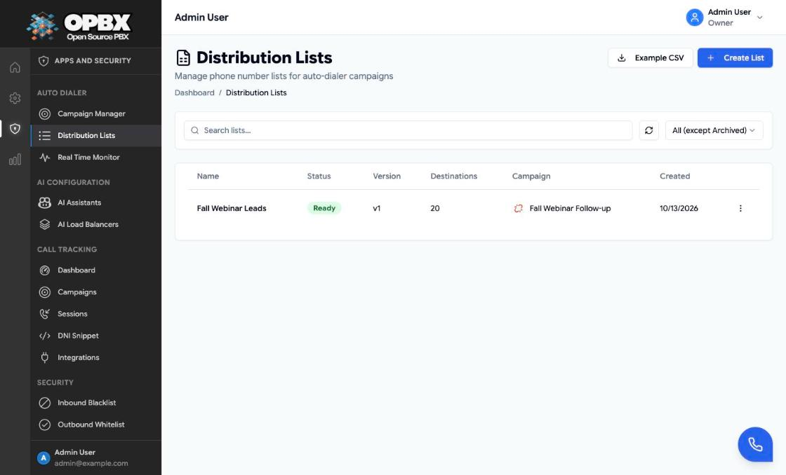

# Distribution Lists

A distribution list holds the phone numbers an [auto-dialer campaign](/modules/auto-dialer-campaigns) dials, with an optional name, batch identifier and metadata per number. This page is the reference. The step-by-step walk-through is [Distribution Lists](/applications/auto-dialer/distribution-lists) in the Auto Dialer guide.

## Purpose

Use this module to:

- create lists and upload numbers from CSV;
- assign a list to a campaign and take it back;
- reset numbers so they are dialed again;
- copy, download, archive and delete lists.

## Prerequisites

- **Owner** or **PBX Admin** role.
- A CSV file with a header row and a phone-number column.

## Limits

| Item | Limit |
|------|-------|
| List name | Required, up to 255 characters |
| Description | Up to 1000 characters |
| CSV file | `.csv` or `.txt`, up to 50 MB, first row is the header |
| Numbers per list | 100,000. Larger files are split into "*name* (Part 2)", "(Part 3)" and so on |
| Numbers per API batch add | 1000 |
| Phone numbers | Validated with international numbering rules, stored as E.164. Numbers without `+` are read as US numbers. Duplicates in a file or list are skipped |
| Copy name | Unique among your lists that are not archived |

## Statuses

| Status | Meaning |
|--------|---------|
| `draft` | Created, no numbers yet |
| `pending` | Numbers removed for a re-upload, waiting to be processed |
| `processing` | An upload is being processed |
| `ready` | Has valid numbers; can be assigned |
| `failed` | No valid number, or processing failed. Errors can be viewed |
| `in_use` | Assigned to a campaign |
| `used` | A campaign has finished with it |
| `archived` | Kept for history |

Assigning a list to a **Draft** campaign also makes that campaign **Active**. See [Assign a list](/applications/auto-dialer/distribution-lists#assign-a-list-to-a-campaign).

## Number statuses

| Status | Meaning |
|--------|---------|
| `pending` | Waiting to be dialed (or waiting for its retry time) |
| `dialing` | A call is being placed |
| `connected` | The call is in progress |
| `completed` | The call was answered |
| `failed` | Not reached after its attempts, or refused 3 times in a row |
| `invalid` | Not a dialable number |

## Permissions

| Action | Owner | PBX Admin | PBX User | Reporter | Supervisor |
|--------|:-----:|:---------:|:--------:|:--------:|:----------:|
| See the page and list lists | Yes | Yes | No | No | No |
| Create, upload, copy, download | Yes | Yes | No | No | No |
| Assign and unassign | Yes | Yes | No | No | No |
| Reset dial attempts | Yes | Yes | No | No | No |
| Archive (Ready or Used) | Yes | Yes | No | No | No |
| Delete a Failed list | Yes | Yes | No | No | No |
| Delete any other list | Yes | No | No | No | No |

Deleting removes the list and all its numbers and asks for confirmation first.

## Key data fields

### `auto_dialer_lists`

| Column | Notes |
|--------|-------|
| `id`, `organization_id` | Key and tenant scope |
| `campaign_id` | The campaign the list is assigned to, or empty |
| `name`, `description` | |
| `version_number`, `parent_list_id`, `is_latest_version` | Versioning. Only latest versions appear on the page |
| `status` | See [Statuses](#statuses) |
| `used_by_campaign_id`, `used_at` | Last assignment |
| `original_filename`, `total_rows`, `valid_rows`, `invalid_rows`, `validation_errors` | Upload results |
| `processed_at`, `archived_at` | Timestamps |

### `auto_dialer_destinations`

| Column | Notes |
|--------|-------|
| `id`, `organization_id`, `list_id` | Keys |
| `phone_number` | E.164 |
| `name`, `batch_identifier`, `metadata` | From the CSV mapping. `metadata` is passed to the AI assistant on the call |
| `status` | See [Number statuses](#number-statuses) |
| `dial_attempts`, `consecutive_initiate_failures`, `next_retry_at` | Attempts and retry timing |
| `last_dialed_at`, `last_disposition`, `last_error`, `duration`, `billsec`, `total_duration` | Last result |
| `last_session_token`, `last_call_id`, `last_cdr_id` | Links to the call |

## Related API endpoints

| Method | Endpoint | Purpose |
|--------|----------|---------|
| GET | `/v1/auto-dialer-campaigns/lists` | List lists (filters: `status`, `campaign_id`, `search`) |
| POST | `/v1/auto-dialer-campaigns/lists` | Create |
| GET | `/v1/auto-dialer-campaigns/lists/example-csv` | Example CSV |
| GET | `/v1/auto-dialer-campaigns/lists/{list}` | One list |
| POST | `/v1/auto-dialer-campaigns/lists/{list}/preview-csv` | Headers and first 5 rows of a file |
| POST | `/v1/auto-dialer-campaigns/lists/{list}/upload` | Upload a CSV with a column `mapping` |
| GET | `/v1/auto-dialer-campaigns/lists/upload-progress/{jobId}` | Upload progress |
| POST | `/v1/auto-dialer-campaigns/lists/{list}/destinations` | Add one number |
| POST | `/v1/auto-dialer-campaigns/lists/{list}/destinations/batch` | Add up to 1000 numbers |
| GET | `/v1/auto-dialer-campaigns/lists/{list}/destinations` | Numbers (filters: `status`, `search`) |
| POST | `/v1/auto-dialer-campaigns/lists/{list}/destinations/{destinationId}/reset-dial-attempts` | Reset one number |
| POST | `/v1/auto-dialer-campaigns/lists/{list}/destinations/bulk-reset-dial-attempts` | Reset selected numbers |
| POST | `/v1/auto-dialer-campaigns/lists/{list}/reset-pending-destinations` | Reset every pending number |
| GET | `/v1/auto-dialer-campaigns/lists/{list}/versions` | Version history |
| GET | `/v1/auto-dialer-campaigns/lists/{list}/validation-errors` | Errors of a Failed list |
| POST | `/v1/auto-dialer-campaigns/lists/{list}/copy` | Copy |
| GET | `/v1/auto-dialer-campaigns/lists/{list}/download` | CSV export |
| PATCH | `/v1/auto-dialer-campaigns/lists/{list}/archive` | Archive |
| DELETE | `/v1/auto-dialer-campaigns/lists/{list}` | Delete |
| POST | `/v1/auto-dialer-campaigns/lists/{list}/assign` | Assign to a campaign (`campaign_id`) |
| POST | `/v1/auto-dialer-campaigns/lists/{list}/unassign` | Take back from the campaign |

**Scoped API keys** use the `distribution-lists` resource. The **MCP server** offers tools such as `list_distribution_lists`, `create_distribution_list`, `add_distribution_list_destinations`, `assign_distribution_list` and `unassign_distribution_list`. See [API Keys](/modules/api-keys) and [MCP Server](/modules/mcp-server).

See the [OPBX REST API reference](https://developers.cloudonix.com/opbxRestOpenAPI) for full schemas.

## Related modules

- [Auto Dialer Campaigns](/modules/auto-dialer-campaigns) — lists are assigned to campaigns
- [Campaign Routing](/applications/auto-dialer/routing-destinations) — how list metadata reaches the assistant
