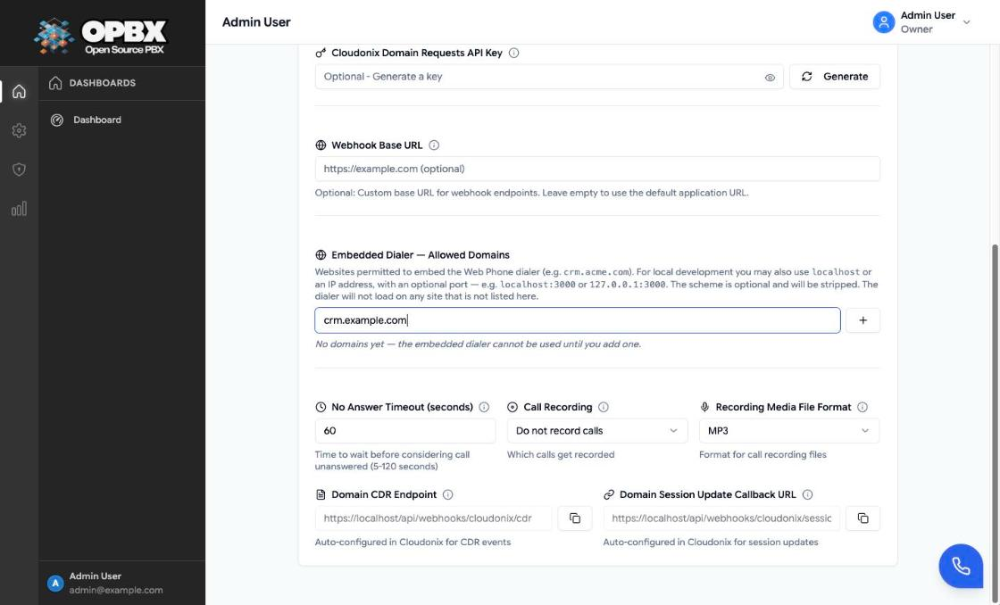
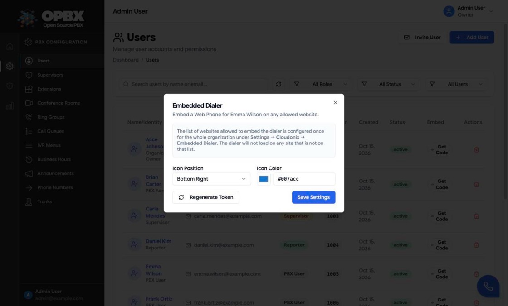
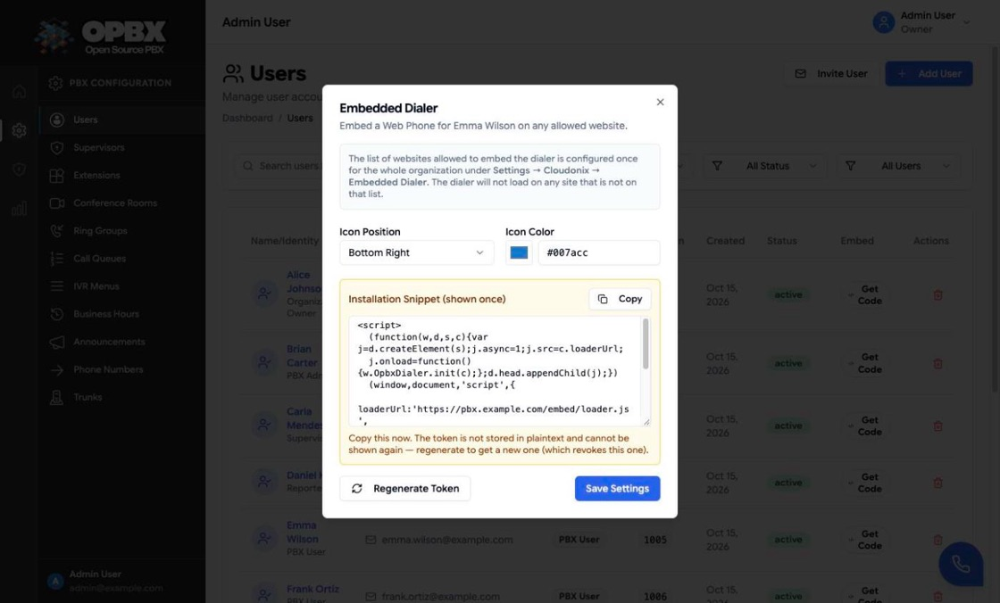

# Embedded Dialer

The Embedded Dialer puts one user's [Web Phone](/opbx/modules/web-phone) on a website you control, most often a CRM. You paste a short script into the page. It loads an OPBX iframe that registers the user's extension and offers click-to-dial. The host page can drive the dialer and listen to call events through `window.OpbxDialer`.

## Purpose

Use the Embedded Dialer to:

- let a user call from inside a CRM or internal web app;
- start calls from the host page, for example a "Call this lead" button;
- react in the host page when a call starts, ends or fails.

## Prerequisites

- The user has a **user extension** and the organization has Cloudonix settings with a domain. Without them the widget shows "Web Phone Unavailable".
- The user and the organization are **active**. Otherwise the widget's API answers "Embed token is not active."
- At least one **allowed domain** is set for the organization (below). With none, no site can show the dialer.
- The host page is served over **HTTPS**.
- OPBX's public address (the organization's webhook base URL, or `APP_URL`) is reachable from the browsers that load the host page. The snippet points at it.

## Permissions

| Action | Owner | PBX Admin | PBX User | Reporter | Supervisor |
|--------|:-----:|:---------:|:--------:|:--------:|:----------:|
| Set the organization's allowed domains (Settings) | Yes | No | No | No | No |
| Open a user's Embedded Dialer dialog, set icon position and colour | Yes | Yes, except for an Owner's account | No | No | No |
| Regenerate a user's token and get the snippet | Yes | Yes, except for an Owner's account | No | No | No |

The **Embed** column on **Users** is shown to Owners and PBX Admins only, and a PBX Admin sees no **Get Code** badge on an Owner's row. The server applies the same rule (403 otherwise). Token management is only for signed-in users. Scoped API keys cannot call the embed-token endpoints.

## Workflows

### Allow a website to embed the dialer

**Who can do this:** Owner.

The list of websites that may embed the dialer is set once for the whole organization and applies to every embedded user.

1. Open **Settings**.
2. Find **Embedded Dialer — Allowed Domains**.
3. Type a host name in the field, for example `crm.example.com`, and click the **+** button (or press Enter). A scheme and any path are stripped, so `https://crm.example.com/leads` is added as `crm.example.com`. For local testing, `localhost` or an IP address with an optional port is accepted, for example `localhost:3000` or `127.0.0.1:3000`.
4. Repeat for each website. Each entry appears as a badge.
5. Click **Validate and Save Settings**. The list is saved together with the rest of the Cloudonix settings, so the **Domain UUID** and **API Key** must be filled in. A toast confirms "Settings validated and saved successfully".

Each entry must be a host name, `localhost` or an IPv4 address, optionally followed by `:port`. The page refuses anything else with "Enter a valid hostname, localhost, or IP address (a port is allowed)." and a repeated entry with "Domain already added". The server applies the same rule: "Each embed allowed domain must be a valid hostname, localhost, or IP address, optionally with a port".

While the list is empty, Settings shows "No domains yet — the embedded dialer cannot be used until you add one."



### Remove a website from the allowed list

**Who can do this:** Owner.

1. Open **Settings** and find **Embedded Dialer — Allowed Domains**.
2. Click the **×** on the domain's badge.
3. Click **Validate and Save Settings**.

From then on the dialer no longer loads on that website, for every user.

### Set the dialer icon for a user

**Who can do this:** Owner; PBX Admin for any user except an Owner.

1. Open **Users**.
2. On the user's row, in the **Embed** column, click **Get Code** (tooltip "Embedded dialer settings"). The **Embedded Dialer** dialog opens. The first time, OPBX creates the user's token record.
3. Choose the **Icon Position**: Bottom Right (default), Bottom Left, Top Right or Top Left.
4. Choose the **Icon Color** with the colour picker, or type it in `#RRGGBB` form (default `#007acc`).
5. Click **Save Settings**. A toast confirms "Embedded dialer settings saved".

The icon inside the dialer follows the saved settings the next time the host page loads. The corner where the dialer frame sits on the host page comes from the `iconPosition` in the installed snippet, so after changing the position, also change `iconPosition` in the installed snippet (or install a new one).



### Get the installation snippet for a user

**Who can do this:** Owner; PBX Admin for any user except an Owner.

1. Open **Users** and click **Get Code** on the user's row.
2. If you changed the icon settings, click **Save Settings** first. The snippet is built from the saved settings, not from unsaved changes in the dialog.
3. Click **Regenerate Token**.
4. Confirm in the **Regenerate embed token** dialog by clicking **Regenerate**. A toast confirms "New embed token generated. Old token is now revoked."
5. The **Installation Snippet (shown once)** appears. Click **Copy** ("Snippet copied to clipboard") and keep it for the next workflow.



:::warning The token is shown once, and regenerating revokes the old one
The token is stored only as a hash and cannot be shown again. If you lose the snippet, regenerate for a new one. Regenerating **immediately revokes** the previous token: every site that still uses the old snippet stops working until you install the new snippet.
:::

### Revoke a user's embedded dialer

**Who can do this:** Owner; PBX Admin for any user except an Owner.

There is no separate revoke button. To cut off every site that uses a user's snippet, follow [Get the installation snippet for a user](#get-the-installation-snippet-for-a-user) and do not install the new snippet anywhere. Deactivating the user also stops the dialer ("Embed token is not active.").

### Install the snippet on a website

**Who can do this:** whoever maintains the host website. No OPBX role is needed.

Paste the snippet anywhere in the host page's HTML:

```html
<script>
  (function(w,d,s,c){var j=d.createElement(s);j.async=1;j.src=c.loaderUrl;
  j.onload=function(){w.OpbxDialer.init(c);};d.head.appendChild(j);})
  (window,document,'script',{
    loaderUrl:'https://pbx.example.com/embed/loader.js',
    token:'opbxd_XXXXXXXXXXXXXXXXXXXXXXXXXXXXXXXXXXXXXXXX',
    iconPosition:'bottom-right',
    iconBackgroundColor:'#007acc'
  });
</script>
```

| Setting | Meaning |
|---------|---------|
| `loaderUrl` | The OPBX loader script. Built from the organization's webhook base URL, falling back to `APP_URL` |
| `token` | The user's embed token: `opbxd_` followed by 40 characters |
| `iconPosition` | `bottom-right`, `bottom-left`, `top-right` or `top-left` |
| `iconBackgroundColor` | The launcher colour |

The loader adds a 360 × 600 pixel iframe (`/embed/dialer`) in the corner given by the snippet's `iconPosition`, with microphone access allowed. Inside it the Web Phone opens and registers straight away. The icon position and colour shown inside the iframe come from the settings saved in the dialog.

## Drive the dialer from the host page

| Method | What it does |
|--------|--------------|
| `OpbxDialer.dial(number)` | Opens the dialer and calls `number`. If the phone is not registered yet, the call is placed as soon as it is |
| `OpbxDialer.hangup()` | Ends the current call |
| `OpbxDialer.open()` | Opens the dialer panel |
| `OpbxDialer.close()` | Closes the dialer panel. Ignored while a call is in progress (see `close.rejected`) |
| `OpbxDialer.on(event, callback)` | Adds a handler for an event |
| `OpbxDialer.init(config)` | Called by the snippet. You do not call it yourself |

### Events

| Event | When | Payload |
|-------|------|---------|
| `ready` | The phone has registered and can take commands | None |
| `call.started` | A call connected | None |
| `call.ended` | A connected call ended | None |
| `call.failed` | A call failed to connect | `{ cause }` |
| `close.rejected` | `OpbxDialer.close()` was ignored because a call is in progress | `{ reason: 'call_in_progress' }` |

:::caution Events start after the first command
The widget sends events only to the page that has spoken to it, so it waits for the host page's first command before delivering any event (earlier events are queued, not lost). Send a command, for example `OpbxDialer.open()`, once the loader has run if you rely on `ready`.
:::

```js
OpbxDialer.on('ready', () => console.log('dialer ready'));
OpbxDialer.on('call.started', () => console.log('call started'));
OpbxDialer.on('call.ended', () => console.log('call ended'));
OpbxDialer.on('call.failed', (p) => console.log('call failed', p.cause));
OpbxDialer.on('close.rejected', (p) => console.log('close ignored:', p.reason));
OpbxDialer.open();

document.querySelector('#call-lead').addEventListener('click', () => {
  OpbxDialer.dial('+12025550123');
});
```

The embedded phone stays registered while the page is open, even when the panel is closed, and an incoming call opens the panel. Several tabs showing the dialer for the same user share one registration: the first tab holds it, the others show "Web Phone is active in another tab" with a **Use here** button, and the next tab takes over when the first one closes. This is independent of the OPBX app's own Web Phone. A host `close` during a call is ignored and answered with the `close.rejected` event; outside a call it closes the panel.

## Security model

| Protection | How it works |
|------------|--------------|
| Allowed domains | The iframe page sends a `frame-ancestors` Content-Security-Policy listing only the allowed domains, with `https://`. With no allowed domains it is `'none'`. The embed API refuses an `Origin` that is not on the list ("Origin not allowed.") |
| Origin required for the SIP config | `/v1/embed/config` returns the extension's SIP password. It is answered only to an allowed `Origin`, or to the iframe's own same-origin request (marked by the browser with `Sec-Fetch-Site: same-origin`). Anything else gets "Origin required." |
| Per-user token | One token per user, stored hashed, shown once. An invalid token gets "Invalid embed token." |
| Active user and organization | An inactive user or organization gets "Embed token is not active." (403), on the API and on the dialer page |
| Regenerate = revoke | A new token replaces the old one immediately |
| Rate limit | 60 requests per minute per token and IP address on the embed API |
| No third-party scripts | The widget bundles its JsSIP library; it loads nothing from a CDN |

For local development only, `EMBED_ALLOW_INSECURE_FRAMING=true` also allows `http://` ancestors so an `http://localhost` page can frame the dialer. It defaults to `false` and must stay `false` in production.

:::danger The extension's SIP password reaches the host page's browser
The embedded phone registers with the extension's SIP user name and password, exactly like the in-app Web Phone. Because the widget runs inside a page you embed it in, treat any extension used this way as **lower-trust**:

- allow only domains you control;
- use a dedicated extension for embedding where possible;
- if you suspect a leak, **Regenerate** the token at once and reset the extension password on [Extensions](/opbx/modules/extensions).
:::

### Host-page Content Security Policy

If the host site sends its own CSP, it must allow:

- `script-src` and `frame-src` for your OPBX address (loader and iframe);
- the browser to reach `wss://webrtc.cloudonix.io` from the iframe (the iframe is served by OPBX, so this is governed by OPBX's headers, not the host page's).

## Common errors

| Message or symptom | What it means | What to do |
|--------------------|---------------|-----------|
| The dialer area stays blank; the browser console reports a `frame-ancestors` violation | The host domain is not on the allowed list, or the page is HTTP | Add the domain in Settings; serve the page over HTTPS |
| Invalid embed token. | The token was regenerated or mistyped | Regenerate and install the new snippet |
| Embed token is not active. | The user or the organization is inactive | Activate them |
| Origin not allowed. | The request came from a domain not on the list | Add the domain |
| Web Phone Unavailable | No user extension, or no Cloudonix domain | Assign an extension; check Settings |
| Too many requests (429) | More than 60 embed API calls a minute from one token and IP | Reduce reloads |

## Related API endpoints

Token management (signed-in Owner or PBX Admin):

| Method | Endpoint | Purpose |
|--------|----------|---------|
| GET | `/v1/users/{user}/embed-token` | Icon settings. Creates the user's token record if it does not exist yet |
| PATCH | `/v1/users/{user}/embed-token` | Update `icon_position` and `icon_background_color` |
| POST | `/v1/users/{user}/embed-token/regenerate` | New token; returns the token and the snippet once |
| PUT | `/v1/settings/cloudonix` | Update `embed_allowed_domains` (Owner) |

Widget runtime (embed token):

| Method | Endpoint | Purpose |
|--------|----------|---------|
| GET | `/embed/loader.js` | The host-side loader (`window.OpbxDialer`) |
| GET | `/embed/dialer?token=…` | The iframe page |
| GET | `/v1/embed/config` | SIP settings for the embedded user |
| GET | `/v1/embed/calls-log` | The user's last 50 outbound calls |

See the [OPBX REST API reference](https://developers.cloudonix.com/opbxRestOpenAPI) for full schemas.

## Related modules

- [Web Phone](/opbx/modules/web-phone) — the softphone that is embedded
- [User Management](/opbx/modules/user-management) — the Embed column and Get Code button
- [Extensions](/opbx/modules/extensions) — the extension the dialer registers as
- [Settings](/opbx/modules/settings) — allowed domains and Cloudonix settings
