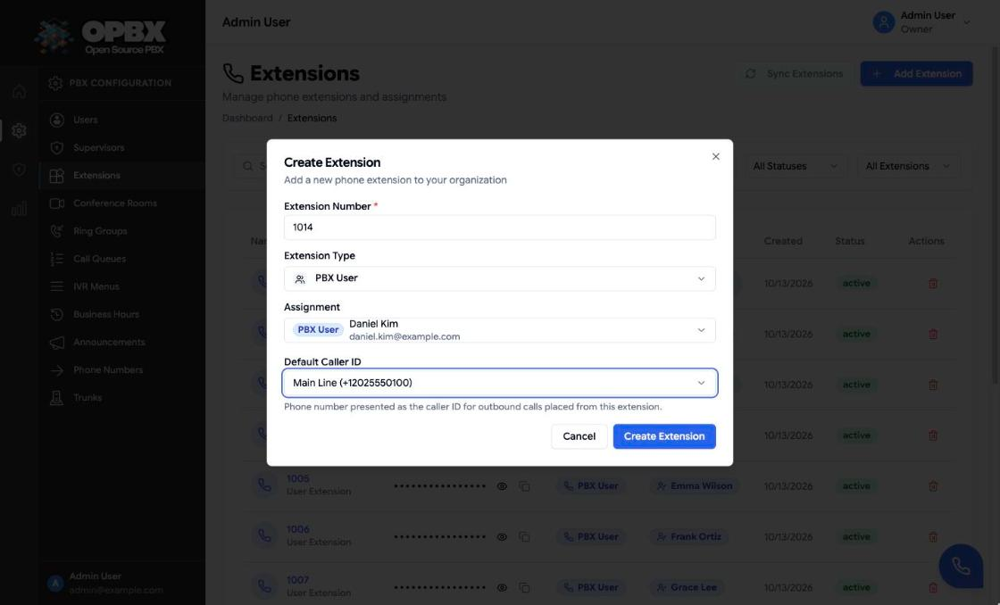
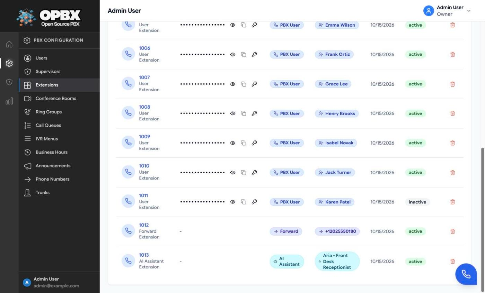
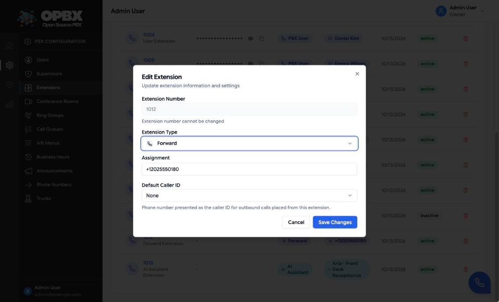
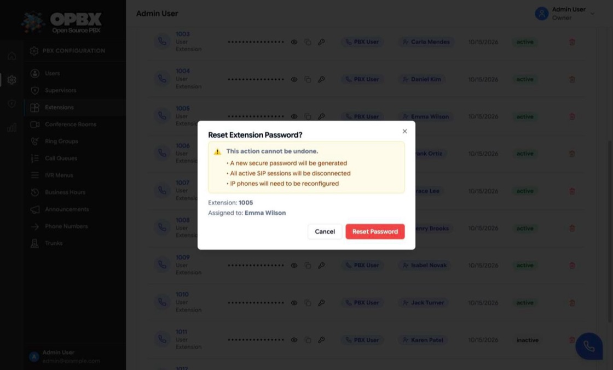
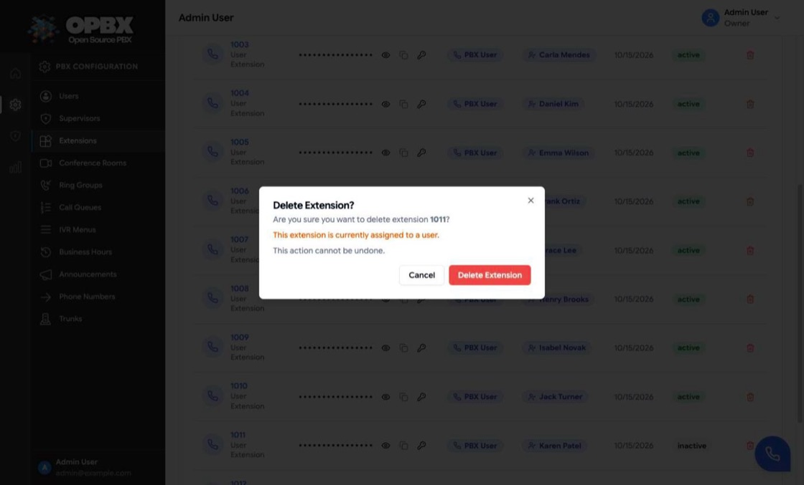
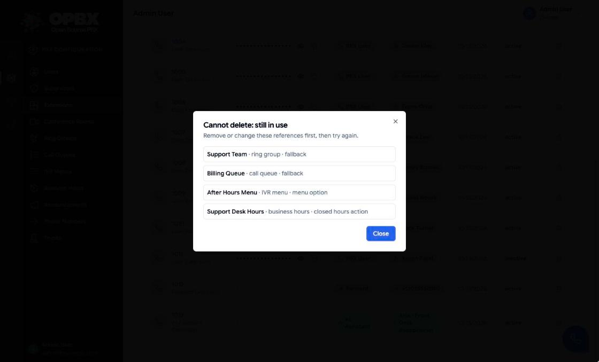

# Extensions

An extension is a short internal number, for example `1005`. Dialing it reaches whatever the extension is linked to: a person's phone, a ring group, a queue, a conference room, an IVR menu, an AI assistant, an AI load balancer, or an outside number.

Extensions of type **PBX User** are SIP accounts. OPBX creates a matching subscriber in Cloudonix so a desk phone, softphone or the [web phone](/opbx/modules/web-phone) can register with it.

## Purpose

Use this module to:

- give each person an internal number and a SIP account;
- create short numbers for groups, queues, conference rooms, menus and AI;
- forward an internal number to an outside number;
- set the caller ID used for outbound calls from an extension;
- see SIP passwords and keep the extensions aligned with Cloudonix.

## Prerequisites

- **Cloudonix settings** for the organization (domain and API key). Without them, PBX User extensions are saved but no SIP subscriber is created. See [Settings](/opbx/modules/settings).
- **The target exists.** For any type other than PBX User and Forward, create the ring group, queue, room, menu, assistant or load balancer first.
- **A phone number (optional)** for the default caller ID. See [Phone Numbers](/opbx/modules/phone-numbers).

## Permissions

| Action | Owner | PBX Admin | PBX User | Reporter | Supervisor |
|--------|:-----:|:---------:|:--------:|:--------:|:----------:|
| See Extensions in the sidebar | Yes | Yes | Yes | Yes | No |
| List extensions | Yes | Yes | Yes (read-only page) | Yes (read-only page) | All extensions (API) |
| Open a single extension (API) | Yes | Yes | Yes | Yes | Only extensions of their assigned users |
| Create, sync | Yes | Yes | No | No | No |
| Edit, toggle status, delete | Yes | Yes, except an Owner's extension | Edit own extension, through the API only | No | No |
| See SIP passwords on the page | Yes | Yes, except an Owner's extension | Own extension only | Own extension only | Own extension only |
| Reset a SIP password | Yes | Yes, except an Owner's extension | Own extension, through the API only | No | No |

An Owner's extension is the PBX User extension assigned to an Owner account. A PBX Admin cannot open, toggle, delete or reset it, and does not see its password.

A PBX User may change their own extension through the API but cannot change its type, its assigned user or its status.

## Extension types

| Type (page label) | API value | Links to |
|-------------------|-----------|----------|
| PBX User | `user` | A user in the organization (optional). Gets a SIP account |
| Forward | `forward` | An outside number or SIP address, up to 50 characters |
| Ring Group | `ring_group` | A ring group |
| Call Queue | `queue` | A call queue. The queue must be active |
| Conference | `conference` | A conference room |
| IVR Menu | `ivr` | An IVR menu |
| AI Assistant | `ai_assistant` | An AI assistant |
| AI Load Balancer | `ai_load_balancer` | An AI load balancer |

The API also has a `custom_logic` type (a Cloudonix container application and block name, up to 255 characters each). The page does not offer it.

A **Call Queue** extension lets agents transfer callers into a queue by number. See [Call Queues](/opbx/modules/call-queues).

## Fields

| Field | Required | Limits | Meaning |
|-------|----------|--------|---------|
| Extension Number | Yes | 3 to 5 digits, unique within the organization. Cannot be changed later | The number people dial |
| Extension Type | Yes | See the table above | What the extension reaches |
| Assignment | Yes, except for PBX User | One item of the chosen type, from your organization. Forward: a typed number or address, up to 50 characters. PBX User: leave it empty for an unassigned extension | The target |
| Default Caller ID | No | **None** or a phone number of your organization; the list shows active numbers | Caller ID for outbound calls from this extension |
| Status | Set in the list | Active or Inactive. Default: Active | Inactive extensions are not routed to |

The API also accepts `voicemail_enabled` (PBX User only; any other type is refused with "Voicemail can only be enabled for user extensions."). The page always sends it as off.

:::warning Extension numbers cannot be changed
The number is fixed after creation. To use another number, create a new extension and delete the old one. The delete is refused while the old extension is still used in routing.
:::

### Default caller ID

The default caller ID is the number presented when someone calls out from this extension. It takes precedence over the caller ID of an [outbound whitelist](/opbx/modules/outbound-whitelist) rule and over the organization's Default Outbound Caller ID set on the [Phone Numbers](/opbx/modules/phone-numbers) page. When the chosen number is not active, the call falls through to the next caller ID in the order described in the [Outbound Calling Overview](/opbx/installation/outbound-calling-overview).

A phone number used as a default caller ID cannot be deleted until you clear it here.

## Workflows

### Create an extension

Who can do this: Owner and PBX Admin. Other roles do not see **Add Extension**.

1. Open **Extensions** in the sidebar.
2. Click **Add Extension**. The **Create Extension** dialog opens with the next number after the highest existing one (1001 when there are none).
3. Check or change the **Extension Number** (3 to 5 digits).
4. Choose the **Extension Type**.
5. Under **Assignment**, pick the target: the user, ring group, queue, conference room, IVR menu, AI assistant or load balancer. For **Forward**, type the outside number or SIP address. For **PBX User** you may leave it empty to create an unassigned extension.
6. Optionally choose a **Default Caller ID**, or leave **None**.
7. Click **Create Extension**.

Result: the toast "Extension created successfully" appears and the extension is added to the list. When a field is wrong, the field shows the problem (for example "Extension must be 3-5 digits") and the toast "Please fix form errors" appears.

What happens on save:

- The extension is stored as **Active**.
- For **PBX User** extensions, OPBX generates a 32-character hexadecimal SIP password and creates the subscriber in Cloudonix. If the Cloudonix call fails, the extension is still saved; run [Sync Extensions](#sync-extensions-with-cloudonix) later.
- The extension becomes available as a routing destination.

### Edit an extension

Who can do this: Owner and PBX Admin (a PBX Admin not an Owner's extension). A PBX User can change their own extension through the API only.

1. In the **Extensions** list, click the extension number or its row. The **Edit Extension** dialog opens. The number is shown but cannot be edited ("Extension number cannot be changed").
2. Change the **Extension Type**, the **Assignment** or the **Default Caller ID**.
3. Click **Save Changes**.

Result: the toast "Extension updated successfully" appears and the list shows the new values.

Changing the type **to** PBX User generates a SIP password and creates the Cloudonix subscriber; changing it **from** PBX User removes the password and the subscriber, so its SIP credentials stop working. Other edits of a PBX User extension do not call Cloudonix.

### Activate or deactivate an extension

Who can do this: Owner and PBX Admin (a PBX Admin not an Owner's extension).

1. In the **Extensions** list, find the extension.
2. Click its **Status** badge (**active** or **inactive**).

Result: the badge switches and the toast "Extension updated successfully" appears. Calls to an inactive extension are not connected, and an inactive extension is skipped as a ring-group member.

### Show and copy a SIP password

Who can do this: Owner (any PBX User extension), PBX Admin (any except an Owner's), and every other role for the extension linked to their own user.

The **Password** column appears when the list contains an extension whose password you may read. Only PBX User extensions have a password; the others show "-".

1. In the **Extensions** list, click the eye icon (**Show password**) in the **Password** column. OPBX loads the password and shows it. "Not set" means the extension has no password.
2. Click the copy icon (**Copy password**).
3. Click the eye icon again (**Hide password**) to hide it.

Result: the toast "Password for extension *number* copied to clipboard" appears.

{/* SCREENSHOT: extensions-password-shown — Extensions list with the password of extension 1005 revealed and the copy icon next to it */}

### Reset an extension's SIP password

Who can do this: Owner and PBX Admin on the page (a PBX Admin not an Owner's extension). A PBX User can reset their own extension's password through the API.

1. In the **Extensions** list, click the key icon (**Reset password**) next to the extension's password in the **Password** column.
2. Read the **Reset Extension Password?** dialog. It shows the extension number and the user it is assigned to.
3. Click **Reset Password**.

Result: OPBX generates a new password (a 16 to 32 character passphrase of words, digits and a symbol) and pushes it to Cloudonix. The toast "Password reset successfully! New password: …" shows it for 10 seconds with a **Copy** button. Every phone registered with this extension must be configured with the new password.

If Cloudonix cannot be updated, the toast reads "The password was reset locally but could not be synced to the voice provider. The extension may fail to register until this is resolved."

### Sync extensions with Cloudonix

Who can do this: Owner and PBX Admin.

When the page opens, OPBX compares its PBX User extensions with the Cloudonix subscribers. **Sync Extensions** is enabled only when a PBX User extension has no subscriber, or a subscriber has no extension with its number. A status difference alone does not enable it.

1. Open **Extensions** in the sidebar.
2. Click **Sync Extensions**. The toast "Synchronizing extensions with Cloudonix..." appears.

{/* SCREENSHOT: extensions-sync-enabled — Extensions page header with the Sync Extensions button enabled next to Add Extension */}

Result: the toast "Extensions synchronized! Created *N* in Cloudonix, imported *M* from Cloudonix" appears and the button is disabled again. A sync:

1. creates a Cloudonix subscriber for each PBX User extension that has none;
2. creates an unassigned, active PBX User extension for each Cloudonix subscriber whose number OPBX does not have. Subscriber numbers longer than 5 characters are treated as phone numbers and skipped;
3. sets the local status of extensions that exist on both sides to the Cloudonix status.

:::note The button can stay enabled
The comparison counts every Cloudonix subscriber that has no matching extension, including subscribers whose number is longer than 5 characters (phone numbers registered as subscribers). The sync deliberately never imports those, because they are not PBX extensions. So when your Cloudonix domain has such a subscriber, **Sync Extensions** is enabled again after every page load even though a sync has nothing to import for it. This is expected: run the sync when you have added extensions or subscribers, and ignore the button otherwise.
:::

When the sync fails (for example Cloudonix is not configured), the toast reads "An error occurred while syncing extensions."

### Find an extension

Who can do this: every role that sees the page.

1. Type in **Search by extension number, user name...**.
2. Narrow the list with the filters: type (**All Types**, PBX User, Conference, Ring Group, IVR Menu, AI Assistant, AI Load Balancer, Forward), status (**All Statuses**, Active, Inactive) and assignment (**All Extensions**, Assigned, Unassigned).
3. Click a column header (Type, Created, Status) to sort. Click **Clear Filters** to reset, or the refresh icon to reload.

### Delete an extension

Who can do this: Owner and PBX Admin (a PBX Admin not an Owner's extension).

1. In the **Extensions** list, click the trash icon in the extension's **Actions** column.
2. In the **Delete Extension?** dialog, check the number. It warns "This extension is currently assigned to a user." when it has a user.
3. Click **Delete Extension**.

Result: the toast "Extension deleted successfully" appears and the extension leaves the list. A PBX User extension's Cloudonix subscriber is removed with it. Call history never blocks a delete.

The delete is refused while routing still points at the extension. The **Cannot delete: still in use** dialog lists each place, for example:

- a ring group that has it as a member or a fallback;
- a call queue or AI load balancer fallback;
- an IVR menu option or failover;
- a phone number routed to it;
- a business-hours open or closed action;
- an auto-dialer campaign routing destination.

Change those first, then delete again.

### When a user is deleted

Deleting a user does **not** delete their extension. It is kept, unassigned, and can be given to someone else. Routes that pointed at it are changed to "Destination unavailable". See [User Management](/opbx/modules/user-management#delete-a-user).

## Common errors

| Message | What it means | What to do |
|---------|---------------|-----------|
| Extension must be 3-5 digits (under the field), or Extension number must be 3-5 digits. (from the server) | Wrong format | Use 3 to 5 digits |
| This extension number is already in use within your organization. | Duplicate | Choose another number |
| Extension number cannot be changed after creation. | The API request tried to change it | Create a new extension instead |
| *Ring group / call queue / IVR / conference room …* ID is required for … extensions. | No assignment for that type | Pick the target |
| The selected call queue must be active. | Queue extension pointing at an inactive queue | Activate the queue first |
| User ID should only be set for user extensions. | A user was sent with another type | Remove the user or change the type |
| The selected caller ID does not belong to your organization. | Wrong default caller ID | Pick one of your numbers |
| This extension is still used by: … (API), the **Cannot delete: still in use** dialog (page) | The delete was refused | Change the listed references, then delete |
| The password was reset locally but could not be synced to the voice provider. … | Cloudonix refused or did not answer the password update | Try the reset again; phones fail to register until Cloudonix has the new password |

## Key data fields

### `extensions`

| Column | Notes |
|--------|-------|
| `id` | Primary key |
| `organization_id` | Tenant scope |
| `user_id` | The assigned user. PBX User type only, may be empty |
| `extension_number` | 3 to 5 digits, unique within the organization, fixed |
| `password` | SIP password, PBX User only. 32 hexadecimal characters when created; a word passphrase after a reset. Never in list responses |
| `type` | `user`, `forward`, `ring_group`, `queue`, `conference`, `ivr`, `ai_assistant`, `ai_load_balancer` or `custom_logic` |
| `status` | `active` or `inactive` |
| `voicemail_enabled` | PBX User only |
| `configuration` | The target id, for example `{"ring_group_id": 4}` or `{"forward_to": "+12025550180"}` |
| `ai_assistant_id` | Set for AI Assistant extensions |
| `default_caller_id_did_id` | The phone number used as outbound caller ID |
| `cloudonix_subscriber_id` | The Cloudonix subscriber, when synced |

## Related API endpoints

| Method | Endpoint | Purpose |
|--------|----------|---------|
| GET | `/v1/extensions` | List. Filters: `type`, `status`, `user_id`, `search` |
| POST | `/v1/extensions` | Create |
| GET | `/v1/extensions/{extension}` | One extension |
| PUT | `/v1/extensions/{extension}` | Update |
| DELETE | `/v1/extensions/{extension}` | Delete. Returns 409 with `references` when in use |
| GET | `/v1/extensions/{extension}/password` | SIP password (PBX User type only; 204 for other types). Owner and PBX Admin: any extension (a PBX Admin not an Owner's); every other role: only its own |
| PUT | `/v1/extensions/{extension}/reset-password` | New SIP password, pushed to Cloudonix. Same rights as Update. 400 for other types; 502 when Cloudonix is not updated |
| GET | `/v1/extensions/sync/compare` | Differences between OPBX and Cloudonix |
| POST | `/v1/extensions/sync` | Run the sync (Owner and PBX Admin) |

Scoped API keys use the `extensions` resource. The MCP server has `list_extensions`, `get_extension`, `create_extension`, `update_extension` and `delete_extension`.

See the [OPBX REST API reference](https://developers.cloudonix.com/opbxRestOpenAPI) for full schemas.

## Best practices

- Keep a numbering plan, for example 1000–1999 for people and 2000–2999 for groups and queues.
- Set an extension to inactive instead of deleting it when someone is away.
- Treat SIP passwords as secrets; reset one if it may have leaked.

## Related modules

- [User Management](/opbx/modules/user-management) — the people PBX User extensions belong to
- [Ring Groups](/opbx/modules/ring-groups) — extensions are ring-group members
- [Phone Numbers](/opbx/modules/phone-numbers) — route a number to an extension, and use a number as caller ID
- [Web Phone](/opbx/modules/web-phone) — a browser phone that registers with a PBX User extension
- [Outbound Calling Overview](/opbx/installation/outbound-calling-overview) — how the caller ID is chosen
