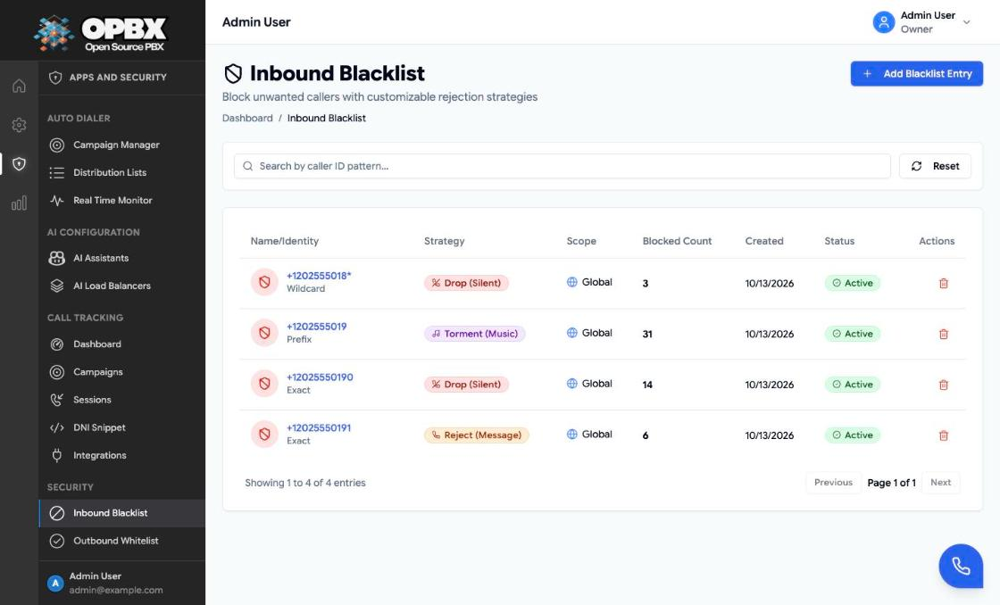
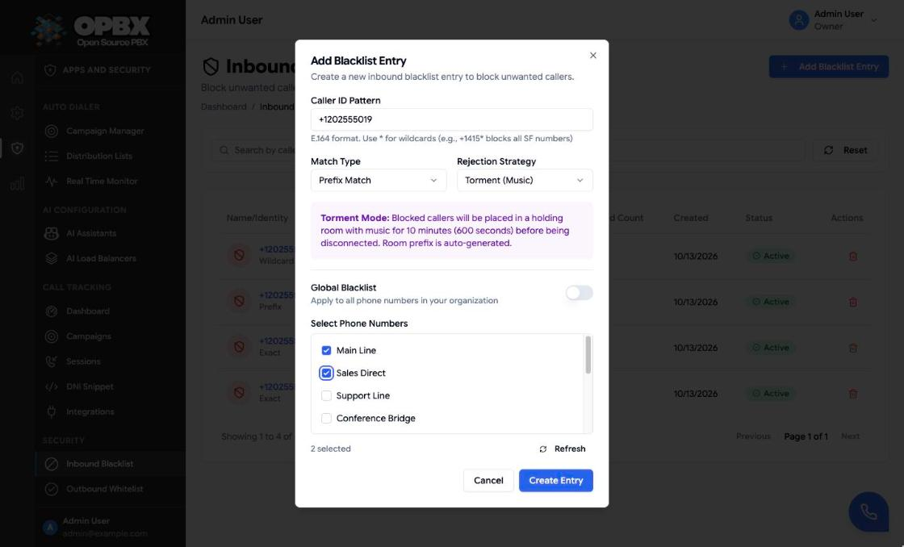
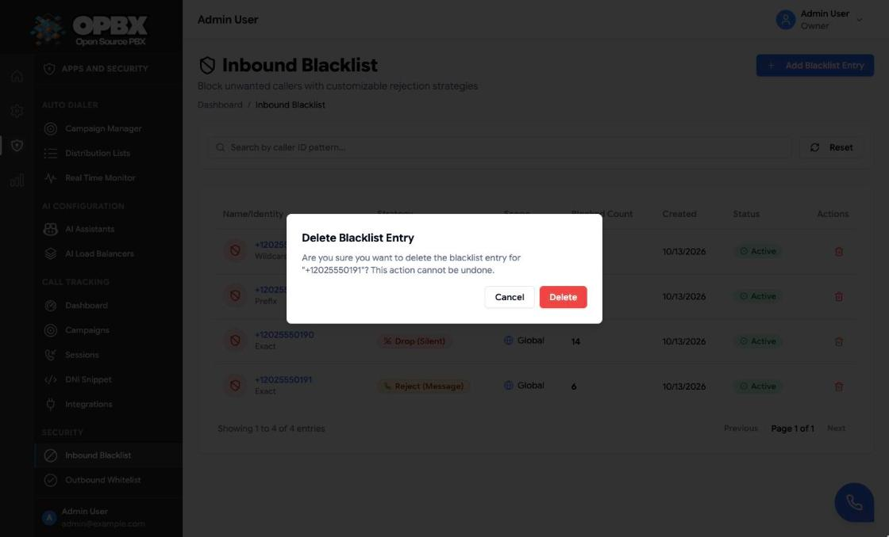

# Inbound Blacklist

The Inbound Blacklist stops unwanted callers before a call is routed. Each rule matches the caller ID against a pattern and decides what the blocked caller experiences: silence, a short message, or a long wait on hold music. A rule applies to all your phone numbers or only to the numbers you pick.

## Purpose

Use this module to:

- block spam, robocalls and abusive callers;
- block one number, a range that starts with a prefix, or a wildcard pattern;
- choose how a blocked call is handled;
- apply a rule to every phone number or only to some;
- see how many calls each rule has blocked.

## Prerequisites

- At least one **phone number** if you want a rule for specific numbers. See [Phone Numbers](/opbx/modules/phone-numbers).
- You are the **Owner** or a **PBX Admin**.

## Permissions

| Action | Owner | PBX Admin | PBX User | Reporter |
|--------|:-----:|:---------:|:--------:|:--------:|
| See Inbound Blacklist in the sidebar | Yes | Yes | No | No |
| Read rules, blocked-call logs and statistics (API) | Yes | Yes | Yes | Yes |
| Create, edit, toggle or delete a rule | Yes | Yes | No | No |

## How a call is checked

When a call arrives on one of your **active** phone numbers, OPBX looks at every **active** rule that is either global or assigned to that number. If the caller ID matches a rule, the call is handled by that rule's strategy and never reaches its normal destination. The check runs before any routing (IVR, queue, ring group and so on).

### Match types

| Match type | Matches when | Example pattern | Blocks |
|------------|--------------|-----------------|--------|
| Exact Match | The caller ID equals the pattern | `+12025550190` | Only that number |
| Prefix Match | The caller ID starts with the pattern | `+1202555019` | `+12025550190` to `+12025550199` |
| Wildcard Pattern | The caller ID matches a shell-style pattern: `*` is any characters, `?` is one character | `+1202555018*` | Every number starting `+1202555018` |

The caller ID is compared exactly as the carrier delivers it, usually in E.164 format with a leading `+`. Write patterns the same way.

### Rejection strategies

| Strategy | What the caller experiences |
|----------|-----------------------------|
| Drop (Silent) | The call is hung up at once |
| Reject (Message) | The caller hears "Your call has been rejected", then the call ends |
| Torment (Music) | The caller is placed alone in a holding room with hold music for 600 seconds (10 minutes), then disconnected. The room prefix is generated automatically |

Every blocked call is logged and adds 1 to the rule's **Blocked Count**.

## Workflows

### Find a rule

**Who can do this:** Owner and PBX Admin (the only roles with **Inbound Blacklist** in the sidebar).

1. Open **Inbound Blacklist** (under **Apps and Security** › **Security**).
2. Type in **Search by caller ID pattern...**.
3. Click **Reset** to clear the search.

The list shows each rule's pattern and match type, **Strategy**, **Scope**, **Blocked Count**, **Created** and **Status** (see [List columns](#list-columns)). The page loads up to 100 rules and pages through them 20 at a time.

### Block a caller

**Who can do this:** Owner and PBX Admin (`InboundBlacklistPolicy::create`; the **Add Blacklist Entry** button is shown to these roles only).

1. Open **Inbound Blacklist**.
2. Click **Add Blacklist Entry**.
3. Enter the **Caller ID Pattern**, for example `+12025550190` or `+1202555018*`.
4. Choose the **Match Type** (default **Exact Match**) and the **Rejection Strategy** (default **Drop (Silent)**). For **Torment (Music)** the dialog notes that callers are held with music for 10 minutes (600 seconds) and that the room prefix is generated.
5. Leave **Global Blacklist** on to protect every phone number, or turn it off and tick the numbers under **Select Phone Numbers**. The counter shows how many are selected; **Refresh** reloads the number list.
6. Click **Create Entry**.

The dialog closes, the toast "Blacklist entry created successfully" appears and the rule is listed as **Active**. If the server refuses the entry, its message appears under the field or as a toast (see [Common errors](#common-errors)).

| Field | Required | Limit | Meaning |
|-------|----------|-------|---------|
| Caller ID Pattern | Yes | Up to 50 characters: digits, `+`, `*` and `?` only | The number or pattern to block |
| Match Type | Yes | Exact Match, Prefix Match or Wildcard Pattern | How the pattern is compared (see [Match types](#match-types)) |
| Rejection Strategy | Yes | Drop (Silent), Reject (Message) or Torment (Music) | What the blocked caller experiences |
| Global Blacklist | No | On or off. Default: on | On: the rule applies to every phone number. Off: pick the numbers under **Select Phone Numbers** |
| Select Phone Numbers | When Global is off | At least one. Saving with none shows "Please select at least one phone number when not using global scope." under the list | The phone numbers the rule protects, shown by friendly name or number |

### Edit a rule

**Who can do this:** Owner and PBX Admin (`InboundBlacklistPolicy::update`). For other roles the rows do not open.

1. Click the rule's pattern or row.
2. Change the fields in **Edit Blacklist Entry**.
3. Click **Update Entry**.

The toast "Blacklist entry updated successfully" appears. Saving a rule with the Torment strategy generates a new room prefix and sets the timeout to 600 seconds again.

{/* SCREENSHOT: inbound-blacklist-edit-dialog — Edit Blacklist Entry dialog for the +12025550191 rule, Exact Match, Reject (Message), Global Blacklist on */}

### Turn a rule on or off

**Who can do this:** Owner and PBX Admin (`InboundBlacklistPolicy::update`). For other roles the status pill is not clickable.

1. In the list, click the rule's **Active** or **Disabled** pill in the **Status** column.

The toast "Status updated successfully" appears and the pill changes. The change applies to the next call.

### Delete a rule

**Who can do this:** Owner and PBX Admin (`InboundBlacklistPolicy::delete`; the **Delete** action is shown to these roles only).

1. Click the **Delete** (trash) action on the row.
2. In **Delete Blacklist Entry**, click **Delete**.

The toast "Blacklist entry deleted successfully" appears. A rule is never referenced by other configuration, so the delete always goes through. The rule's blocked-call log entries are kept, without a link to the deleted rule.

:::note Phone numbers used in a rule
A phone number selected in a rule cannot be deleted from the Phone Numbers page. The delete is refused and the dialog lists the blacklist rule. Remove the number from the rule first (or make the rule global).
:::

## List columns

| Column | Shows |
|--------|-------|
| Pattern | The caller ID pattern, with the match type under it |
| Strategy | Drop (Silent), Reject (Message) or Torment (Music) |
| Scope | **Global**, the one selected number, or "*n* DIDs" |
| Blocked Count | Calls this rule has blocked |
| Created | Creation date |
| Status | Active or Disabled; click to switch |

## Blocked-call logs and statistics

The blocked-call log and the statistics are available through the API only; the page does not show them.

- **Blocked-call log** (`GET /v1/inbound-blacklist/blocked-logs`): one row per blocked call with caller ID, called number, rule, phone number, strategy and time. Filters: `caller_id`, `blacklist_id`, `did_number_id`, `from_date`, `to_date`, `rejection_strategy`. Rows are kept for 90 days.
- **Statistics** (`GET /v1/inbound-blacklist/statistics`): totals of rules (all, active, global), counts by strategy and match type, and calls blocked today and this week. The figures are cached for up to 5 minutes and refreshed after every change to a rule.

## Common errors

| Message | What it means | What to do |
|---------|---------------|-----------|
| The caller ID pattern must be a valid phone number or pattern (digits, +, *, ? only). | The pattern has letters, spaces or other characters | Remove them |
| Please select at least one phone number when not using global scope. | Global is off and no number is ticked | Tick at least one number or switch Global on |

## Key data fields

### `inbound_blacklists`

| Column | Notes |
|--------|-------|
| `id` | Primary key |
| `organization_id` | Tenant scope |
| `match_type` | `exact`, `prefix` or `wildcard` |
| `caller_id_pattern` | Up to 50 characters |
| `is_global` | `true`: all numbers. `false`: only the numbers in the `inbound_blacklist_did_number` table |
| `rejection_strategy` | `drop`, `reject` or `torment` |
| `torment_room_prefix`, `torment_music_timeout` | Set automatically for Torment (random prefix, 600 seconds) |
| `status` | `active` or `inactive` |
| `blocked_count` | Calls blocked by this rule |

### `blocked_call_logs`

| Column | Notes |
|--------|-------|
| `inbound_blacklist_id` | The rule that matched |
| `did_number_id` | The number called (set for number-specific rules) |
| `caller_id`, `called_number` | From and To of the blocked call |
| `rejection_strategy` | The strategy applied |
| `blocked_at` | Time of the block |

## Related API endpoints

| Method | Endpoint | Purpose |
|--------|----------|---------|
| GET | `/v1/inbound-blacklist` | List (`search`, `match_type`, `rejection_strategy`, `scope` = `global` or `did_specific`, `status`, `per_page` up to 100) |
| POST | `/v1/inbound-blacklist` | Create. `is_global` defaults to `false`, so a rule without `"is_global": true` needs at least one `did_number_ids` entry (422 otherwise) |
| GET | `/v1/inbound-blacklist/{id}` | One rule |
| PUT | `/v1/inbound-blacklist/{id}` | Update. A rule that ends up non-global must keep at least one phone number (422 otherwise) |
| PATCH | `/v1/inbound-blacklist/{id}/toggle-status` | Switch between active and inactive |
| DELETE | `/v1/inbound-blacklist/{id}` | Delete |
| GET | `/v1/inbound-blacklist/blocked-logs` | Blocked-call log |
| GET | `/v1/inbound-blacklist/statistics` | Aggregate statistics |

See the [OPBX REST API reference](https://developers.cloudonix.com/opbxRestOpenAPI) for full schemas.

## Related modules

- [Phone Numbers](/opbx/modules/phone-numbers) — the numbers a rule protects
- [Outbound Whitelist](/opbx/modules/outbound-whitelist) — the outbound counterpart
- [Call Logs](/opbx/modules/call-logs) — calls that were not blocked
