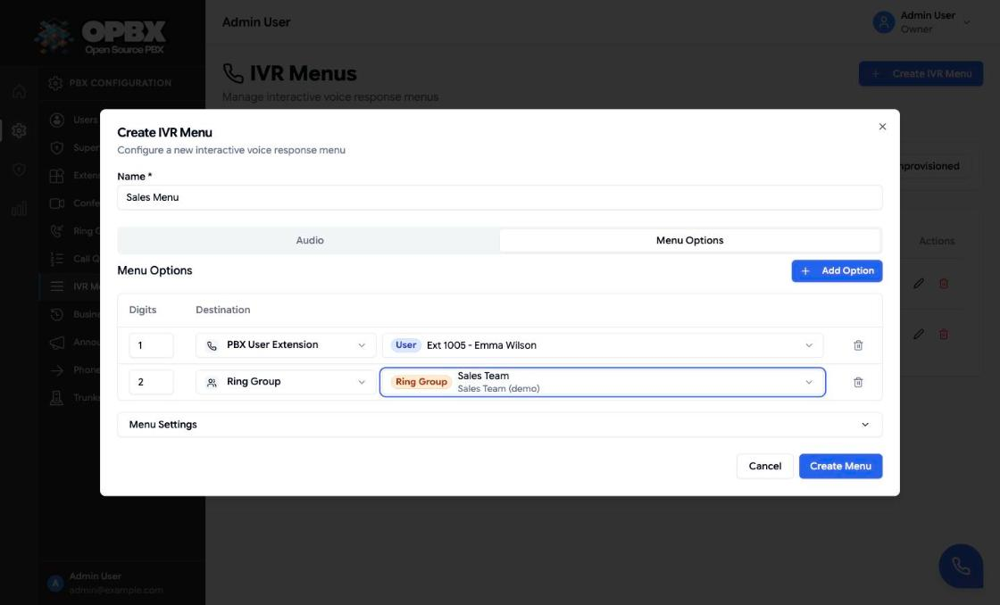
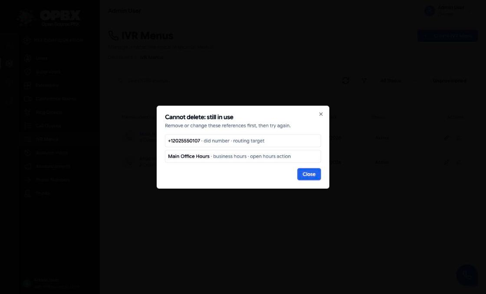

# IVR Menus

An IVR (interactive voice response) menu plays a prompt and waits for the caller to press a digit. Each digit leads to a destination: an extension, a ring group, a queue, another menu, an AI assistant and so on. If the caller presses something unknown, or nothing, the menu repeats up to a limit and then uses its failover destination.

## Purpose

Use an IVR menu for a main company line ("press 1 for sales, 2 for support"), for sub-menus, or for an after-hours front door.

## Prerequisites

Create the destinations first, so you can pick them in the menu:

- the extensions, ring groups, call queues, AI assistants or business-hours schedules the options will reach;
- an audio source for the prompt: an uploaded recording, a URL, or text to speak. See [Recordings](/modules/recordings).

## Permissions

| Action | Owner | PBX Admin | PBX User | Reporter |
|--------|:-----:|:---------:|:--------:|:--------:|
| See IVR Menus in the sidebar | Yes | Yes | No | No |
| Create | Yes | Yes | No | No |
| Edit or change status | Yes | Yes | No | No |
| Delete | Yes | Yes | No | No |

## Audio source

A menu needs **exactly one** prompt source. The form does not accept two at once.

| Source | Field | Limit |
|--------|-------|-------|
| Recording | Choose an uploaded recording from your organization | Must belong to your organization |
| Remote URL | Audio file URL | Up to 500 characters |
| Text-to-speech | Text to read | Up to 1000 characters |

For text-to-speech, choose a voice. The list comes from the Cloudonix voice catalogue and shows the language provider, price and gender of each voice. Voice names are up to 50 characters.

If you choose none of the three, saving is refused with "An IVR menu must have either a recording, direct audio URL, or Text-to-Speech text configured."

## Menu settings

| Setting | Required | Range | Meaning |
|---------|----------|-------|---------|
| Max timeout | Yes | 1 to 30 seconds | How long to wait for the first digit |
| Inter-digit timeout | Yes | 1 to 30 seconds | How long to wait between digits of a multi-digit option |
| Max turns | Yes | 1 to 9 | How many times the prompt plays before the failover is used |
| Status | Yes | Active or Inactive | Inactive menus are not used for routing |
| Failover destination | Yes | See below | Where the caller goes after the last turn |

## Options

Each option maps digits to one destination. A menu has **1 to 20 options**.

| Field | Required | Limit | Meaning |
|-------|----------|-------|---------|
| Input digits | Yes | 1 to 10 characters | The digits the caller presses |
| Description | No | Up to 255 characters | Your note, for example "Sales" |
| Destination type | Yes | See the list below | What kind of target |
| Destination | Yes | Pick one existing item | The target itself |
| Priority | Yes | 1 to 20 | Display order in the menu |

Destination types for an option: **Extension**, **Ring group**, **Conference room**, **IVR menu** (a sub-menu), **AI assistant**, **AI load balancer**, **Business hours**, **Call queue**.

A menu may point at itself, for example to repeat. Such loops are bounded by the max turns setting.

## Failover

The failover is used after the last turn with no valid input. Its choices are the same destination types as the options, plus:

- **Hangup**: the call ends. This is the default for a new menu.
- **Destination unavailable**: only available when editing (see below).

## Create an IVR menu

1. Open **IVR Menus** in the sidebar.
2. Click **Create IVR Menu**.
3. On the **Menu** tab, enter a name and an optional description, and choose the prompt source.
4. Open **Menu Settings** and set the timeouts, max turns and status. Set the failover destination.
5. On the **Menu Options** tab, add options. Set digits, destination and priority for each.
6. Save.

When you save, the menu is validated and stored. Any phone number, option or queue that points at the menu sends callers to it.

### Error display

Each problem is shown next to the field it belongs to. If the problem is in the timeouts, max turns or the failover, the **Menu Settings** panel opens by itself so you can see it.

{/* SCREENSHOT: ivr-menus-field-errors — Edit IVR Menu dialog with the Menu Settings panel auto-opened and an inline error under Max turns */}

## Edit an IVR menu

1. Click the menu's row, or its **Edit** action.
2. Change what you need and save.

**Disconnect** (edit only): an option or the failover can be set to **Destination unavailable**. The menu is then marked **Unprovisioned** (see the badge below). A caller who presses that option hears "Destination doesn't exist" and the call ends. A new menu must have a destination for every option and for the failover.

{/* SCREENSHOT: ivr-menus-unprovisioned — IVR Menus list filtered to Unprovisioned, one row with the badge and an option set to Destination unavailable */}

## Change status

Use the status switch on the list, or set **Status** in the editor. Disabled menus are not used for routing.

## Delete an IVR menu

Deletion asks for confirmation. If other configuration still points at the menu, the delete is refused with a dialog that lists every place the menu is used: a phone number, a ring group or queue fallback, an option of another menu, or the failover of another menu. Change those, then delete again.

Recording and call-log history never blocks a delete.

## Key data fields

### `ivr_menus`

| Column | Notes |
|--------|-------|
| `name` | Required, up to 255 characters |
| `description` | Up to 1000 characters |
| `audio_file_path` | URL, or the recording it refers to |
| `recording_id` | Uploaded recording of your organization |
| `tts_text` / `tts_voice` | Text to speak (up to 1000 characters) and its voice |
| `max_timeout`, `inter_digit_timeout` | Seconds, 1 to 30 |
| `max_turns` | 1 to 9 |
| `failover_destination_type`, `failover_destination_id` | Where the caller goes after the last turn |
| `status` | `active` or `inactive` |

### `ivr_menu_options`

| Column | Notes |
|--------|-------|
| `ivr_menu_id` | Parent menu |
| `input_digits` | 1 to 10 characters |
| `description` | Up to 255 characters |
| `destination_type`, `destination_id` | The target. An option set to Destination unavailable has `destination_id` 0 |
| `priority` | 1 to 20 |

## Related API endpoints

| Method | Endpoint | Purpose |
|--------|----------|---------|
| GET | `/v1/ivr-menus/voices` | Voices for text-to-speech |
| GET | `/v1/ivr-menus` | List |
| POST | `/v1/ivr-menus` | Create (rejects "Destination unavailable" on any route) |
| GET | `/v1/ivr-menus/{ivrMenu}` | One menu |
| PUT | `/v1/ivr-menus/{ivrMenu}` | Update |
| DELETE | `/v1/ivr-menus/{ivrMenu}` | Delete (409 when in use) |
| PATCH | `/v1/ivr-menus/{ivrMenu}/toggle-status` | Toggle active or inactive |

See the [OPBX REST API reference](https://developers.cloudonix.com/opbxRestOpenAPI) for full schemas.

## Related modules

- [Recordings](/modules/recordings) — prompt audio
- [Phone Numbers](/modules/phone-numbers) — a number can answer with a menu
- [Ring Groups](/modules/ring-groups) and [Call Queues](/modules/call-queues) — common option targets
- [Business Hours](/modules/business-hours) — an option can route to a schedule
- [Extensions](/modules/extensions) — an option can route to an extension
