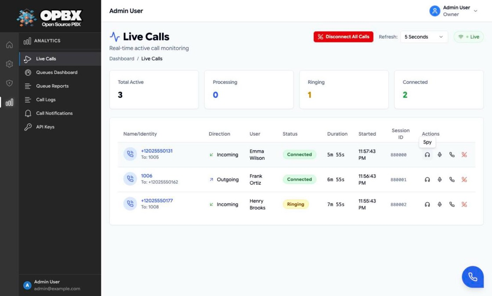
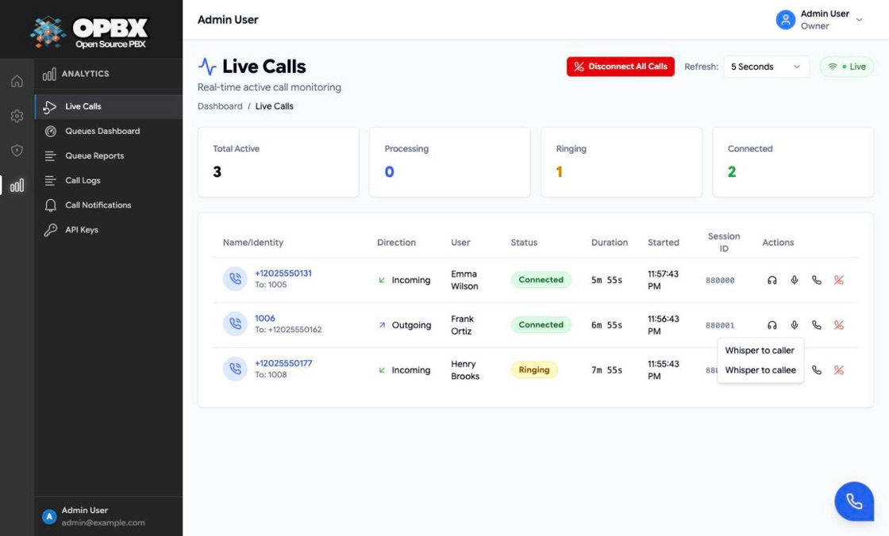
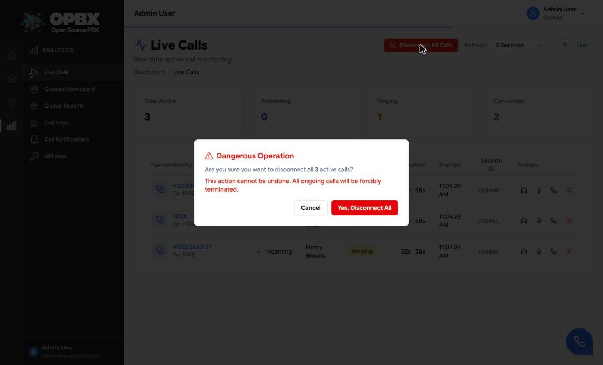

# Live Calls

The Live Calls page lists the calls that are in progress right now: who is calling whom, which user's extension is on the call, its state and how long it has been running. Owners and Supervisors can also listen in on a call, whisper to one side or join it, using the [Web Phone](/opbx/modules/web-phone).

## Purpose

Use this page to:

- see how many calls are active and in which state (processing, ringing, connected);
- see which user's extension each call belongs to;
- coach a call: **Spy** (listen only), **Whisper** (talk to one side) or **Barge** (join the call);
- disconnect a single call, or every active call at once (Owner only, see [Permissions](#permissions)).

For finished calls, use [Call Logs](/opbx/modules/call-logs).

## Prerequisites

- Cloudonix sends session-update webhooks to OPBX. Live Calls is built from those events. If the page stays empty during a test call, check the webhook settings on [Settings](/opbx/modules/settings) and [Cloudonix Setup](/opbx/installation/cloudonix-setup).
- To coach a call you need a **user extension** assigned to you, because coaching dials out from your Web Phone. See [Extensions](/opbx/modules/extensions).
- To disconnect calls, the organization's Cloudonix settings must be configured. Without them the server answers "Cloudonix settings not configured for this organization".

## Permissions

| Action | Owner | PBX Admin | PBX User | Reporter | Supervisor |
|--------|:-----:|:---------:|:--------:|:--------:|:----------:|
| See Live Calls in the sidebar | Yes | Yes | No | Yes | Yes |
| See the calls | All in the organization | All in the organization | All, read-only, by opening the page's address (see below) | All, read-only | Only calls to or from their assigned users and ring groups |
| Spy, Whisper, Barge | Yes | No | No | No | Yes, calls in their scope |
| Disconnect one call | Yes | No (the button is hidden) | No | No | No (the button is hidden) |
| Disconnect All Calls | Yes | No (the button is hidden) | No | No | No |
| Clear Stale (display only) | Yes | Yes | No | No | No |

The server allows only the **Owner** to disconnect a call. The **Disconnect** icon and **Disconnect All Calls** are shown to the Owner only; any other role that calls the API directly is refused with "This action is unauthorized." The **Actions** column (Spy, Whisper, Barge) is shown to Owners and Supervisors only, so PBX Admins and Reporters see no actions on the rows. Reporters, PBX Users and Supervisors see a **Read-Only** badge next to the page title.

:::note Wall display for PBX Users
Live Calls is not in a PBX User's sidebar, but the page (`/ui/live-calls`) and its API are open to that role on purpose, so a PBX User account can drive a wall-mounted dashboard. A PBX User who opens the page sees every active call of the organization, read-only, with no actions.
:::

The Supervisor scope is applied by the server on role alone: a Supervisor always gets only the calls of their assigned users and ring groups plus their own, whether or not the request carries `supervisor=true` (still accepted, no longer needed). The same holds for the active-call statistics and the call detail view. Owners, PBX Admins and Reporters see all of the organization's calls.

:::note Supervisor scope
A Supervisor's list contains only calls whose caller or destination is one of their assigned users, one of those users' extension numbers, their own user or extension, or the extension number of an assigned ring group. See [Supervisors](/opbx/modules/supervisors).
:::

## Workflows

### View the active calls

Who can do this: Owner, PBX Admin, Reporter and Supervisor (Supervisors see only the calls in their scope).

1. Open **Live Calls** in the sidebar (section **Analytics**; for Supervisors, section **Supervisor**).
2. Read the four counters at the top: **Total Active**, **Processing**, **Ringing** and **Connected**.
3. The table below lists one row per active call. When there are none, the page shows "No active calls at the moment" and the current refresh interval.

#### Table columns

| Column | What it shows |
|--------|---------------|
| Caller (first column) | The calling number, with "To: *destination*" underneath. Internal parties are shown as plain extension numbers, external ones in E.164 |
| Direction | Incoming or outgoing |
| User | The user whose extension is on the call, or *Unassigned* when the extension has no user (or the call has no extension) |
| Status | Processing, Ringing or Connected |
| Duration | Time since the session started, for example `4m 12s` |
| Started | Local time the session started |
| Session ID | The Cloudonix session ID, or N/A for a row that arrived over the WebSocket without one |
| Actions | Spy, Whisper and Barge are shown to Owners and Supervisors; Disconnect only to the Owner. Rows without a session ID show "-" |

#### Which calls count as active

A call is listed when its latest session update is **processing**, **ringing** or **connected** and arrived in the **last 30 minutes**. A call that Cloudonix has reported as finished (final CDR or deleted session) in the last 24 hours never comes back, even if a late "active" update arrives. At most 100 calls are returned.

A call that gets no update for 30 minutes drops off the list even if it is still up. Very long calls with no state change can therefore disappear from the page; they still appear in [Call Logs](/opbx/modules/call-logs) when they end.

### Change the refresh interval

Who can do this: everyone who can open the page.

The page combines two sources:

- **Polling**: the list is reloaded at the interval chosen in **Refresh**. Polling **stops while the browser tab is hidden** and resumes when you return to it.
- **WebSocket**: Owners and PBX Admins also receive live updates over the organization's WebSocket channel. The badge next to the Refresh selector reads **Live** when that connection is up, otherwise it shows the connection state.

Reporters and Supervisors are not admitted to the organization channel, so their page relies on polling only. For Supervisors this is deliberate: the channel carries every call in the organization.

1. Open the **Refresh** selector at the top right.
2. Choose **No Refresh**, **1 Second**, **5 Seconds** (default), **15 Seconds**, **30 Seconds** or **60 Seconds**.
3. The list now reloads at that interval. With **No Refresh**, the empty page reads "Auto-refresh disabled". The choice is not saved: the page starts at 5 Seconds again next time.

### Listen to a call (Spy)

Who can do this: Owner, and Supervisor for calls in their scope. You need a user extension and a registered [Web Phone](/opbx/modules/web-phone).

| Action | Icon | What happens |
|--------|------|--------------|
| **Spy** | Headphones | You hear both sides. Nobody hears you |
| **Whisper** | Microphone, with a menu | Choose **Whisper to caller** or **Whisper to callee**. Only that side hears you; you hear both |
| **Barge** | Phone | You join the call. Everyone hears you |

1. On the call's row, click the **Spy** icon (headphones).
2. OPBX checks that you may coach this call and returns a dial target. The Web Phone opens by itself, dials it and shows the label **Spy**.
3. While connected, the Web Phone header reads "On call - Coaching: Spy".
4. To stop, hang up in the Web Phone. When the coaching call ends, the Web Phone closes.

If OPBX refuses, a toast shows the reason (see [Common errors](#common-errors)), or "Unable to start monitoring this call." when there is none.

{/* SCREENSHOT: live-calls-coaching-webphone — Web Phone opened by a Spy action, showing the Spy label and the call timer */}

### Whisper to one side of a call

Who can do this: Owner, and Supervisor for calls in their scope. You need a user extension and a registered Web Phone.

1. On the call's row, click the **Whisper** icon (microphone).
2. Choose **Whisper to caller** or **Whisper to callee**.
3. The Web Phone opens, dials and shows the label **Whisper**. Only the side you chose hears you; you hear both.
4. Hang up in the Web Phone to stop.

### Join a call (Barge)

Who can do this: Owner, and Supervisor for calls in their scope. You need a user extension and a registered Web Phone.

1. On the call's row, click the **Barge** icon (phone).
2. The Web Phone opens, dials and shows the label **Barge**. Both sides hear you.
3. Hang up in the Web Phone to leave.

### How coaching is protected

Coaching is checked twice:

1. **When you click the action.** The server checks that you are an Owner or a Supervisor, that the call belongs to your organization, that it is in a Supervisor's scope, and that it is still active. The secret session token used to build the dial target is handed out only here, one call at a time; it is never part of the call list.
2. **When the Web Phone dials.** Before Cloudonix connects the coaching leg, OPBX checks again that the dialing extension is a user extension of an Owner or Supervisor in the same organization. A guessed or replayed dial target from any other extension is refused.

### Disconnect a call

Who can do this: Owner only (the icon is hidden for every other role).

:::warning
A disconnect ends the call for everyone on it at once. It cannot be undone.
:::

1. Click the **Disconnect** icon on the call's row.
2. Confirm "Are you sure you want to disconnect this call?".
3. The row disappears at once. OPBX asks Cloudonix to end the session; a toast confirms "Session disconnected successfully". If the request is refused, the error is shown in a toast and the row comes back.

### Disconnect all calls

Who can do this: Owner only.

1. Click **Disconnect All Calls** (shown when there is at least one call).
2. Read the **Dangerous Operation** dialog. It gives the number of calls, and how many rows have no session ID and are only cleared from the display.
3. Click **Yes, Disconnect All**.
4. A progress overlay shows "*n* of *total*". Calls are disconnected one after the other with a short pause between them. Do not close or refresh the page.
5. A toast reports the result: "All 3 calls disconnected successfully", "Disconnected 2 calls. 1 stale records cleared." when rows without a session ID were only cleared, or "Disconnected 2 calls, 1 failed". Calls whose disconnect failed stay on the list.

For ten seconds after Disconnect All, the disconnected calls are kept off the list even if Cloudonix still reports them, so they do not flash back while the hang-up is processed.

### Clear stale rows

Who can do this: Owner and PBX Admin.

**Clear Stale (*n*)** appears when the WebSocket has delivered calls that have no session ID yet. Clearing them affects your screen only; nothing is sent to the server.

1. Click **Clear Stale (*n*)**.
2. Confirm "Clear *n* stale record(s) without session ID from display?".
3. The rows disappear and a toast reads "Cleared *n* stale record(s)".

## Common errors

| Message (summary) | What it means | What to do |
|-------------------|---------------|-----------|
| This action is unauthorized | You are not the Owner and tried to disconnect a call | Ask the Owner to disconnect it |
| This call is outside your supervised scope | A Supervisor tried to coach a call that is not to or from their assigned users or ring groups | Ask an Owner or PBX Admin to change your assignments |
| You do not have permission to monitor calls | Only Owners and Supervisors can coach | Use an Owner or Supervisor account |
| This call is not active or has no session token | The call ended, or Cloudonix has not sent its session token yet | Wait a moment and try again |
| Unable to disconnect: session token not yet received from Cloudonix | The call is too new | Try again in a moment |
| Cloudonix settings not configured for this organization | No Cloudonix settings | Configure them on [Settings](/opbx/modules/settings) |
| Web Phone shows "Web Phone Unavailable" when you click Spy | You have no user extension, or the organization has no Cloudonix domain | Assign an extension to yourself |

## Key data fields

### `session_updates`

One row per status change Cloudonix reports, not one row per call. The page always uses the latest row of each session.

| Column | Notes |
|--------|-------|
| `organization_id` | Tenant scope |
| `session_id` | Cloudonix session ID; groups the rows of one call |
| `session_token` | Secret token used to disconnect or coach the call. Never sent in the call list |
| `event_id` | Idempotency key of the webhook |
| `caller_id`, `destination` | Stored in E.164 with a leading `+`, also for extension numbers |
| `direction` | `incoming` or `outgoing` |
| `status` | For example `processing`, `ringing`, `connected` |
| `subscriber_id` | Cloudonix subscriber of the extension on the call; used to find the user |
| `action` | `cdr_final_status` or `deleted` marks a finished session |
| `session_created_at`, `answer_time` | Start and answer times |
| `profile` | Raw session profile, including QoS data when present |

Session updates are kept for 30 days.

## Related API endpoints

| Method | Endpoint | Purpose |
|--------|----------|---------|
| GET | `/v1/session-updates/active` | Active calls (Supervisors are always scoped to their users, ring groups and own calls). Optional `status` and `direction` filters |
| GET | `/v1/session-updates/active/stats` | Counts by status and direction, average and longest duration |
| GET | `/v1/session-updates/{sessionId}` | Event history of one session |
| DELETE | `/v1/session-updates/{sessionId}/disconnect` | Disconnect a call (Owner only) |
| POST | `/v1/session-updates/{sessionId}/coach-target` | Get the dial target for `spy`, `whisper` (with `whisper_party` `caller`, `callee` or `both`) or `barge` |

Scoped API keys use the `session-updates` resource. The [MCP server](/opbx/modules/mcp-server) offers `list_active_calls`, `get_active_call`, `get_active_call_statistics`, `disconnect_call` and `start_call_coaching`.

See the [OPBX REST API reference](https://developers.cloudonix.com/opbxRestOpenAPI) for full schemas.

## Related modules

- [Supervisors](/opbx/modules/supervisors) — which calls a Supervisor sees and may coach
- [Web Phone](/opbx/modules/web-phone) — the softphone used for coaching
- [Call Logs](/opbx/modules/call-logs) — finished calls
- [Call Queues](/opbx/modules/call-queues) — the queue Live tab and Queues Dashboard for waiting callers
- [Call Notifications](/opbx/modules/call-notifications) — send call events to your own system
