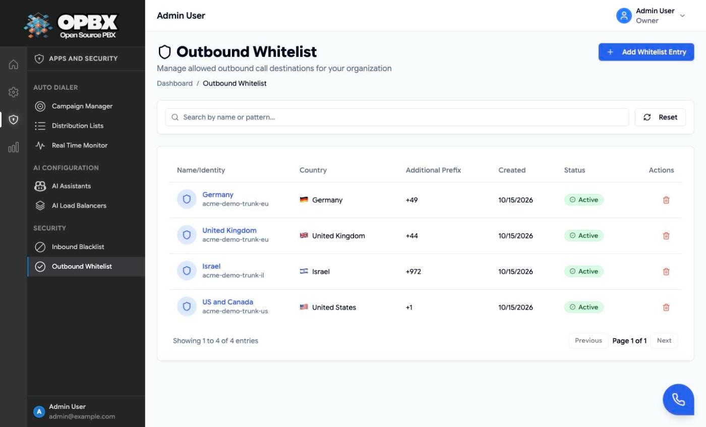
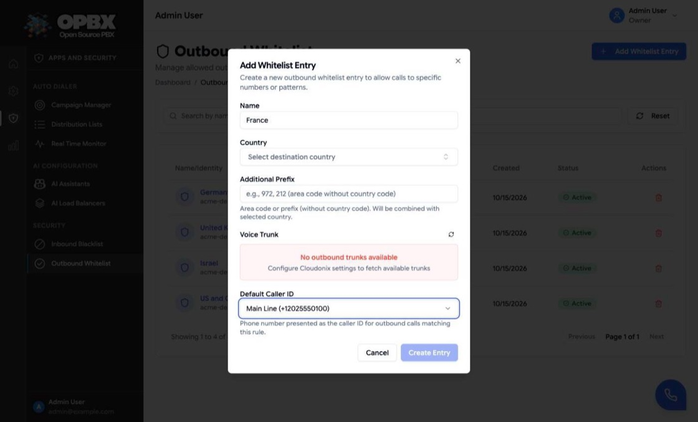
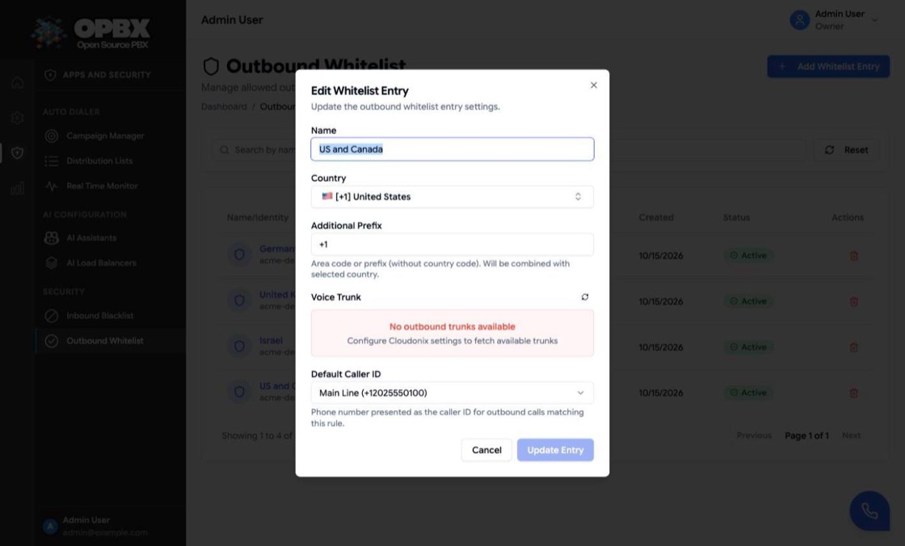
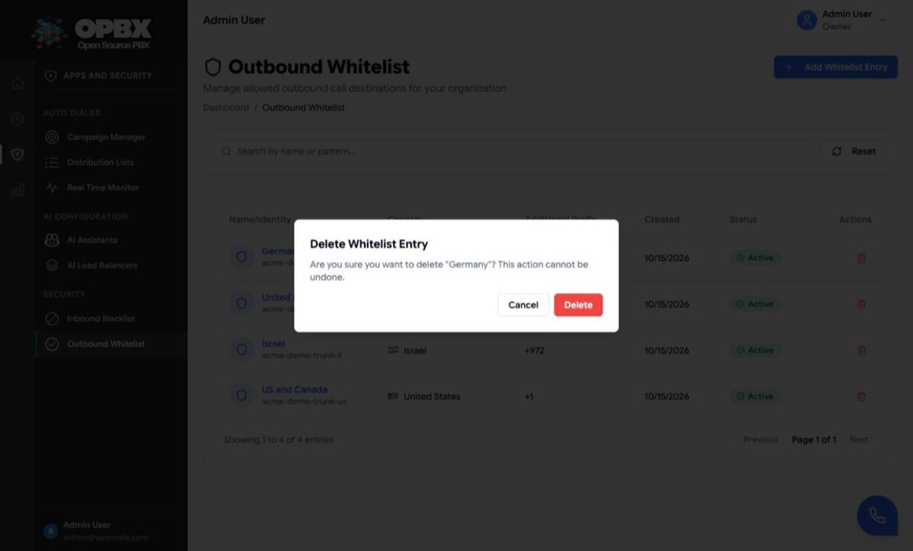

# Outbound Whitelist

The Outbound Whitelist decides which external numbers your extensions may dial. Each rule names a destination country (and optionally a prefix inside it), the voice trunk the call leaves through, and an optional caller ID. A call to a destination that no active rule matches is refused.

:::tip
For the full picture of how OPBX authorizes outbound calls and picks the caller ID, see the [Outbound Calling Overview](/opbx/installation/outbound-calling-overview).
:::

## Purpose

Use this module to:

- allow outbound calls to a country, or only to some area codes in it;
- send each destination out through a specific voice trunk;
- set the caller ID presented on calls that match a rule;
- turn a rule off without deleting it.

## Prerequisites

- **Voice trunks.** The trunk list comes from your Cloudonix domain. If the Cloudonix integration is not configured, the dialog shows "No outbound trunks available" and the save button stays disabled. See [Organization Settings](/opbx/modules/settings) and [Trunks](/opbx/modules/trunks).
- **A caller ID number (optional).** An **active** phone number of your organization. See [Phone Numbers](/opbx/modules/phone-numbers).

## Permissions

| Action | Owner | PBX Admin | PBX User | Reporter |
|--------|:-----:|:---------:|:--------:|:--------:|
| See Outbound Whitelist in the sidebar and open the page | Yes | Yes | No | No |
| Read rules through the API | Yes | Yes | Yes | Yes |
| Create, edit, toggle or delete a rule | Yes | Yes | No | No |

The page is available to the Owner and the PBX Admin only; other roles who open `/ui/outbound-whitelist` are sent to the Dashboard. Supervisors do not see it either.

## How a call is matched

When an extension dials a number, OPBX checks it in this order:

1. **Internal or external?** A destination with fewer than 7 digits is treated as an internal extension and the whitelist is not consulted.
2. **Who is calling?** Only an **active** extension of your organization may call out.
3. **Which rule?** Every **active** rule is scored:
   - the rule's country matches the number's country: **+10** (required; a rule for another country is skipped);
   - the rule has a prefix and the number matches it: **+ the prefix length**. A prefix that starts with `+` is compared with the full number; a prefix without `+` is compared with the digits after the country code. A rule with a prefix that does **not** match is skipped.
4. **The highest score wins.** A more specific rule (country plus area code) beats a country-only rule.

If no rule matches, the caller hears "Outbound calls to this destination are not allowed. Goodbye." and the call ends.

### Example

| Rule | Country | Prefix | Trunk |
|------|---------|--------|-------|
| US and Canada | United States | (none) | `trunk-us` |
| Washington DC | United States | `202` | `trunk-dc` |

A call to `+12025550123` matches both rules: the first scores 10, the second 13. It leaves through `trunk-dc`. A call to `+14155550123` matches only the first rule.

## Caller ID

The caller ID presented on the call is chosen in this order:

1. the calling extension's own **Default Caller ID**, if set and the number is active;
2. the matching rule's **Default Caller ID**, if set and the number is active;
3. the organization's **Default Outbound Caller ID** (set on the [Phone Numbers](/opbx/modules/phone-numbers) page), if set and the number is active;
4. otherwise the literal caller ID `Unknown`.

A number that has been set to Inactive is skipped and the next step is used.

## Workflows

### Find a rule

**Who can do this:** Owner and PBX Admin.

1. Open **Outbound Whitelist** (under **Apps and Security** › **Security**).
2. Type in **Search by name or pattern...**. The search matches the rule name, country, prefix and trunk name.
3. Click **Reset** to clear the search.

The list shows each rule's name with its voice trunk under it, **Country** (flag and name), **Additional Prefix**, **Created** and **Status**. The page loads up to 50 rules and pages through them 20 at a time.

### Allow an outbound destination

**Who can do this:** Owner and PBX Admin (`OutboundWhitelistPolicy::create`; `can(role, 'outboundWhitelist.manage')` shows the **Add Whitelist Entry** button).

1. Open **Outbound Whitelist**.
2. Click **Add Whitelist Entry**.
3. Enter a **Name**, for example "Local Calls".
4. Pick the **Country**.
5. Optionally enter an **Additional Prefix**: the area code without the country code, for example `202`.
6. Pick the **Voice Trunk**. Click the refresh button next to the label to reload the trunk list from Cloudonix.
7. Optionally pick a **Default Caller ID**, or leave **None**.
8. Click **Create Entry**.

The dialog closes, the toast "Outbound whitelist entry created successfully" appears and the rule is listed as **Active**. If the server refuses the rule, the page shows "Failed to create outbound whitelist entry"; the reasons are listed under [Common errors](#common-errors).

| Field | Required | Limit | Meaning |
|-------|----------|-------|---------|
| Name | Yes | Up to 255 characters | A label, for example "Local Calls" |
| Country | Yes | One country per rule; unique within the organization | The destination country. The list shows the flag, calling code and name |
| Additional Prefix | No | Up to 12 characters: digits, spaces, `+` and `-` | Area code or prefix **without** the country code, for example `202`. Extra spaces are removed |
| Voice Trunk | Yes | One of the trunks fetched from Cloudonix | The trunk the call leaves through. With no trunks the dialog shows "No outbound trunks available" and **Create Entry** stays disabled |
| Default Caller ID | No | **None**, or one of your **active** phone numbers (shown as friendly name and number) | Presented on matching calls when the extension has no caller ID of its own |

Because the country is unique, you cannot have two rules for the same country. To allow only some area codes, use one rule with the narrowest prefix you need.

### Edit a rule

**Who can do this:** Owner and PBX Admin (`OutboundWhitelistPolicy::update`).

1. Click the rule's name or row.
2. Change the fields in **Edit Whitelist Entry**. The prefix is shown without the country code.
3. Click **Update Entry**.

The toast "Outbound whitelist entry updated successfully" appears. If the server refuses the change, the page shows "Failed to update outbound whitelist entry".

### Turn a rule on or off

**Who can do this:** Owner and PBX Admin (`OutboundWhitelistPolicy::update`). For other roles the status pill is not clickable.

1. In the list, click the rule's **Active** or **Disabled** pill in the **Status** column.

The toast "Status updated successfully" appears and the change is saved at once. Disabled rules are ignored when calls are matched, so calls that only that rule allowed are refused.

### Delete a rule

**Who can do this:** Owner and PBX Admin (`OutboundWhitelistPolicy::delete`; the **Delete** action is shown to these roles only).

1. Click the **Delete** (trash) action on the row.
2. In **Delete Whitelist Entry**, click **Delete**.

The toast "Outbound whitelist entry deleted successfully" appears. Nothing else in OPBX points at a whitelist rule, so the delete is never refused. Calls that only this rule allowed are refused from then on.

:::note Phone numbers used as a rule's caller ID
A phone number that is the Default Caller ID of a whitelist rule cannot be deleted. The delete on the Phone Numbers page is refused and the dialog lists this rule. Change the rule's caller ID first.
:::

## Common errors

These messages come from the API. The page itself shows only "Failed to create outbound whitelist entry" or "Failed to update outbound whitelist entry".

| Message | What it means | What to do |
|---------|---------------|-----------|
| An outbound whitelist entry for this Country Code already exists in your organization. | Another rule already uses this country | Edit that rule instead |
| Additional Prefix must contain only numbers, spaces, plus signs, and hyphens. | The prefix has other characters | Use digits, spaces, plus signs and hyphens only. Spaces and hyphens are ignored when matching |
| Additional Prefix must not exceed 12 characters. | The prefix is too long | Shorten it |
| Voice Trunk is required. | No trunk was chosen | Pick a trunk; if none are listed, configure the Cloudonix integration |
| The selected caller ID does not belong to your organization. | The caller ID number is not yours | Pick one of your numbers |

## Key data fields

### `outbound_whitelists`

| Column | Notes |
|--------|-------|
| `id` | Primary key |
| `organization_id` | Tenant scope |
| `name` | Up to 255 characters |
| `destination_country` | ISO country code (for example `US`), unique per organization. A calling code (`1` or `+1`) also matches |
| `destination_prefix` | Optional, up to 12 characters |
| `outbound_trunk_name` | Cloudonix trunk name |
| `default_caller_id_did_id` | Optional phone number presented as caller ID. The API also returns a nested `default_caller_id` object |
| `status` | `active` or `inactive` |

## Related API endpoints

| Method | Endpoint | Purpose |
|--------|----------|---------|
| GET | `/v1/outbound-whitelist` | List (`search`, `sort_by`, `sort_order`, `per_page`) |
| POST | `/v1/outbound-whitelist` | Create |
| GET | `/v1/outbound-whitelist/{id}` | One rule |
| PUT | `/v1/outbound-whitelist/{id}` | Update |
| PATCH | `/v1/outbound-whitelist/{id}/toggle-status` | Switch between active and inactive |
| DELETE | `/v1/outbound-whitelist/{id}` | Delete |

See the [OPBX REST API reference](https://developers.cloudonix.com/opbxRestOpenAPI) for full schemas.

## Related modules

- [Outbound Calling Overview](/opbx/installation/outbound-calling-overview) — authorization and caller ID precedence
- [Phone Numbers](/opbx/modules/phone-numbers) — numbers used as caller ID
- [Extensions](/opbx/modules/extensions) — per-extension caller ID, which wins over the rule's
- [Trunks](/opbx/modules/trunks) — the voice trunks a rule can use
- [Inbound Blacklist](/opbx/modules/inbound-blacklist) — the inbound counterpart
