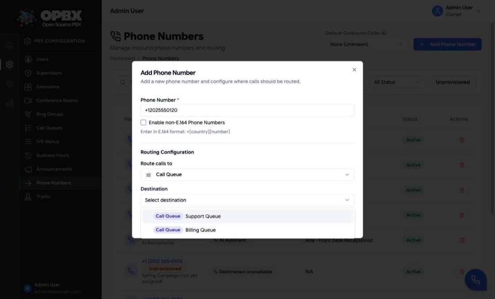
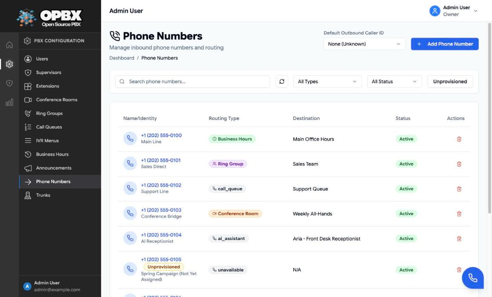
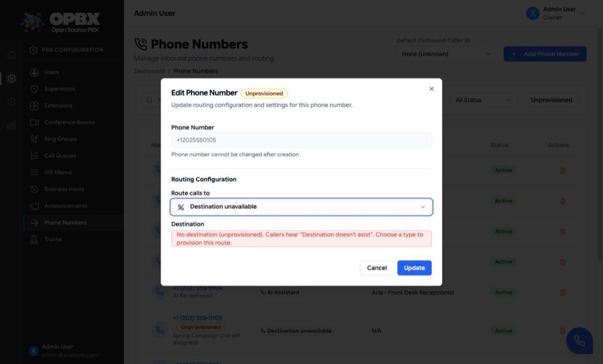
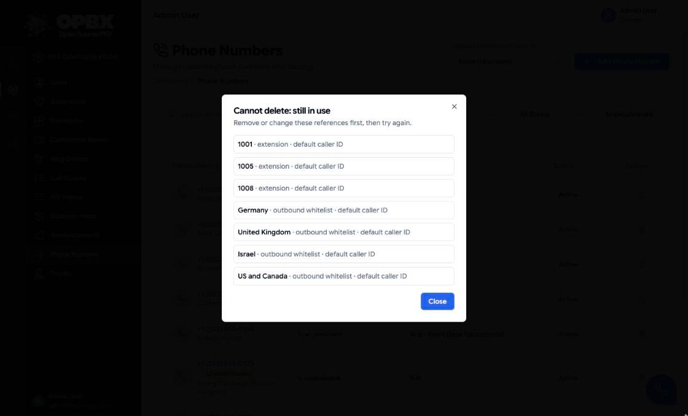

# Phone Numbers (DIDs)

A phone number (DID, direct inward dial) is a number that outside callers dial to reach your organization. Each DID has one routing destination: an extension, ring group, queue, IVR menu, business-hours schedule, conference room, AI assistant or AI load balancer.

## Purpose

Use this module to:

- add the numbers your organization owns;
- route each number to a destination;
- turn a number on or off;
- use a number as the caller ID for outbound calls (see below).

## Prerequisites

- The number is provisioned in Cloudonix and points at your OPBX instance. See [Cloudonix Setup](/opbx/installation/cloudonix-setup).
- The destination exists and is **active**. Creating a DID is refused if its destination is inactive, missing, or belongs to another organization.

## Permissions

| Action | Owner | PBX Admin | PBX User | Reporter |
|--------|:-----:|:---------:|:--------:|:--------:|
| See Phone Numbers in the sidebar | Yes | Yes | No | Yes (read-only page) |
| List and view numbers through the API | Yes | Yes | Yes | Yes |
| Create | Yes | Yes | No | No |
| Edit routing or status | Yes | Yes | No | No |
| Delete | Yes | Yes | No | No |

## Number format

The number must be in **E.164** format: a plus sign, a first digit from 1 to 9, then 1 to 14 more digits. For example `+14155551234`. Maximum 20 characters.

The **Enable non-E.164 Phone Numbers** option accepts digits, `+` and `#` only. Use it for internal or special-use numbers that are not valid E.164.

The number must be **unique across all organizations**. A number that another organization already has is refused with "This phone number is already registered."

:::warning Numbers cannot be changed
The number is fixed after creation. To change it, delete the DID and create a new one. The delete is refused while the number is used elsewhere (see [Delete](#delete)).
:::

## Fields

| Field (page label) | Required | Limit | Meaning |
|--------------------|----------|-------|---------|
| Phone Number | Yes | E.164 (or digits, `+`, `#` with **Enable non-E.164 Phone Numbers**), max 20 characters | The number callers dial |
| Route calls to | Yes | See the table below | What kind of destination the call goes to |
| Destination | Yes | Pick one existing, active item | The item itself |
| Status | Yes | Active or Inactive (the page shows **Active** or **Disabled**). Default: Active | Whether the number is used for routing. Changed from the list, not in the dialog |
| Friendly name | No | Up to 255 characters. API only: the dialog has no field for it | A label, for example "Main line". The list shows it under the number |

### Routing types

| Route calls to (page label) | API value | Routes to | Typical use |
|-----------------------------|-----------|-----------|-------------|
| PBX User Extension | `extension` | One extension | Direct line |
| Ring Group | `ring_group` | A ring group | Department coverage |
| Call Queue | `call_queue` | A call queue | Support or sales line that needs waiting and statistics |
| IVR Menu | `ivr_menu` | A menu | Main company number with "press 1 for…" |
| Business Hours | `business_hours` | A business-hours schedule | Open and closed handling |
| Conference | `conference_room` | A conference room | Dedicated conference line |
| AI Assistant | `ai_assistant` | An AI assistant | Automated answering |
| AI Load Balancer | `ai_load_balancer` | An AI load balancer | High-volume AI answering |

Each destination must be **active**. A destination that is inactive, deleted, or belongs to another organization is refused, for example "The selected extension must be active. Extension 1011 is currently inactive."

## Workflows

### Add a phone number and route it

Who can do this: Owner and PBX Admin. Other roles do not see **Add Phone Number**.

1. Open **Phone Numbers** in the sidebar.
2. Click **Add Phone Number**.
3. Enter the **Phone Number** in E.164 format, for example `+12025550123`. Tick **Enable non-E.164 Phone Numbers** only for a number that is not E.164.
4. Under **Routing Configuration**, choose **Route calls to**, then the **Destination**.
5. Click **Create**.

Result: the toast "Phone number added successfully" appears and the number is listed as **Active**. A wrong number shows "Phone number must be in E.164 format (+12125551234)" under the field; a missing destination shows "Please select a destination".

A new number must be fully routed. **Disconnect** ("Destination unavailable") is not offered when you add a number.

### Change a number's routing

Who can do this: Owner and PBX Admin.

1. In the **Phone Numbers** list, click the number or its row. The **Edit Phone Number** dialog opens; the number is read-only ("Phone number cannot be changed after creation").
2. Change **Route calls to** or the **Destination**.
3. Click **Update**.

{/* SCREENSHOT: phone-numbers-edit-dialog — Edit Phone Number dialog for +12025550100 (Main Line) with the read-only number, Route calls to IVR Menu and the menu selected as Destination */}

Result: the toast "Phone number updated successfully" appears and the list shows the new routing type and destination.

### Disconnect a number (mark it Unprovisioned)

Who can do this: Owner and PBX Admin.

Use it when a number is provisioned but not yet in service.

1. Open the number as in [Change a number's routing](#change-a-numbers-routing).
2. In **Route calls to**, choose **Disconnect**. The **Destination** box explains: "No destination (unprovisioned). Callers hear "Destination doesn't exist". Choose a type to provision this route."
3. Click **Update**.

Result: the route is stored as "Destination unavailable". The edit dialog title shows the **Unprovisioned** badge and the **Unprovisioned** filter lists the number. Callers hear "Destination doesn't exist" and the call ends. To bring the number back into service, choose a routing type and destination again.

### Enable or disable a number

Who can do this: Owner and PBX Admin. Other roles see the badge, but it is not clickable (its tooltip reads "Only Owners and PBX Admins can change the status"), and the server refuses the change through the API.

1. In the **Phone Numbers** list, find the number.
2. Click its **Status** badge (**Active** or **Disabled**, tooltip "Click to toggle status").

Result: the badge switches and the toast "Phone number updated successfully" appears.

| Status | Meaning |
|--------|---------|
| Active | Calls to the number are routed to its destination |
| Disabled (`inactive`) | The number is not used for routing |

Disable a number while it is being ported, to block calls temporarily, or while it is reserved.

### Find a phone number

Who can do this: every role that sees the page.

1. Type in **Search phone numbers...**.
2. Narrow the list with the routing-type filter (**All Types**, Extension, Ring Group, Business Hours, Conference Room), the status filter (**All Status**, Active, Disabled) or the **Unprovisioned** button.
3. Click **Clear** to reset the filters, or the refresh icon to reload.

### Set the Default Outbound Caller ID selector

Who can do this: Owner and PBX Admin. Other roles see the selector disabled.

The page header has a **Default Outbound Caller ID** selector with **None (Unknown)** and the active numbers.

1. Open **Phone Numbers** in the sidebar.
2. In **Default Outbound Caller ID**, choose a number or **None (Unknown)**.

Result: the toast "Default outbound caller ID updated" appears.

:::note
This selector stores the organization-wide default caller ID (`GET` and `PUT /v1/phone-numbers/default-caller-id`), which is deprecated. Call routing no longer reads it. Set the caller ID on each [extension](/opbx/modules/extensions#default-caller-id) or [outbound whitelist](/opbx/modules/outbound-whitelist) rule instead.
:::

{/* SCREENSHOT: phone-numbers-default-caller-id — Phone Numbers page header with the Default Outbound Caller ID selector open, showing None (Unknown) and the demo numbers */}

## Delete

### Delete a phone number

Who can do this: Owner and PBX Admin.

1. In the **Phone Numbers** list, click the trash icon in the number's **Actions** column.
2. In the **Delete Phone Number** dialog, click **Delete**.

{/* SCREENSHOT: phone-numbers-delete-dialog — Delete Phone Number dialog asking to delete the demo number +12025550105, with Cancel and Delete buttons */}

Result: the toast "Phone number deleted successfully" appears and the number leaves the list.

The delete is refused while the number is assigned as configuration somewhere else:

- the default caller ID of an extension;
- a call-tracking number;
- the caller ID of an outbound whitelist rule;
- a caller-ID pool of an auto-dialer campaign;
- a scope of an inbound blacklist.

The refusal opens the **Cannot delete: still in use** dialog, which lists each place. Remove those assignments, then delete the number. Call history (call logs, CDRs, call-tracking sessions, blocked-call logs) never blocks a delete.

## Using a number as an outbound caller ID

Besides receiving calls, an **active** number can be shown as the caller ID on outbound calls. Assign it as the default caller ID on an [extension](/opbx/modules/extensions#default-caller-id) or on an [outbound whitelist](/opbx/modules/outbound-whitelist) rule.

Only active numbers owned by your organization can be used this way. When the chosen number is not usable, outbound calls fall through to the next caller ID in the precedence order. See the [Outbound Calling Overview](/opbx/installation/outbound-calling-overview).

## Key data fields

### `did_numbers`

| Column | Notes |
|--------|-------|
| `id` | Primary key |
| `organization_id` | Tenant scope |
| `phone_number` | String up to 20 characters. Unique across all organizations. Cannot be changed |
| `friendly_name` | Optional label, up to 255 characters |
| `routing_type` | `extension`, `ring_group`, `call_queue`, `ivr_menu`, `business_hours`, `conference_room`, `ai_assistant`, `ai_load_balancer` or `unavailable` |
| `routing_config` | JSON with the target id, for example `{"extension_id": 12}` |
| `status` | `active` or `inactive` |

## Related API endpoints

| Method | Endpoint | Purpose |
|--------|----------|---------|
| GET | `/v1/phone-numbers` | List. Filters: `search`, `routing_type`, `status`, `unprovisioned=1` |
| POST | `/v1/phone-numbers` | Create. Rejects "Destination unavailable" |
| GET | `/v1/phone-numbers/{phoneNumber}` | One number |
| PUT | `/v1/phone-numbers/{phoneNumber}` | Update routing, status or friendly name. The number itself is refused if sent ("Phone number cannot be changed after creation.") |
| GET, PUT | `/v1/phone-numbers/default-caller-id` | Deprecated organization default caller ID. Not used by call routing |
| DELETE | `/v1/phone-numbers/{phoneNumber}` | Delete. Returns 409 with the list of uses when in use |

See the [OPBX REST API reference](https://developers.cloudonix.com/opbxRestOpenAPI) for full schemas.

## Best practices

- Label each number with its purpose (Sales, Support, Main).
- Keep the same routing pattern for similar numbers.
- Test each number after you change its routing.

## Related modules

- [Extensions](/opbx/modules/extensions) — extension routing target and per-extension caller ID
- [Ring Groups](/opbx/modules/ring-groups) — ring group routing target
- [Call Queues](/opbx/modules/call-queues) — queue routing target
- [IVR Menus](/opbx/modules/ivr-menus) — menu routing target
- [Business Hours](/opbx/modules/business-hours) — time-based routing target
- [Outbound Calling Overview](/opbx/installation/outbound-calling-overview) — using a number as an outbound caller ID
