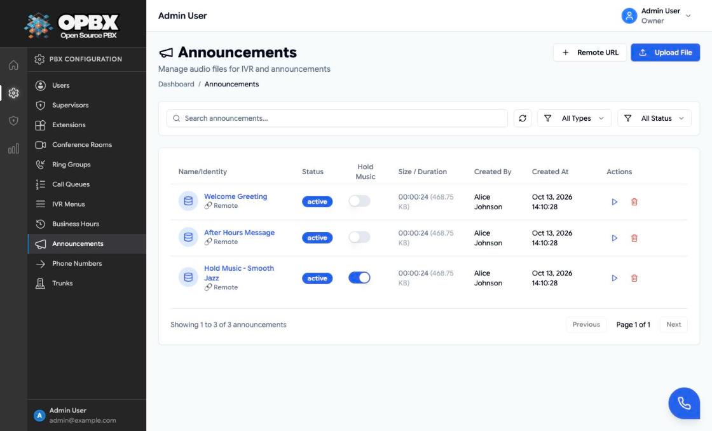
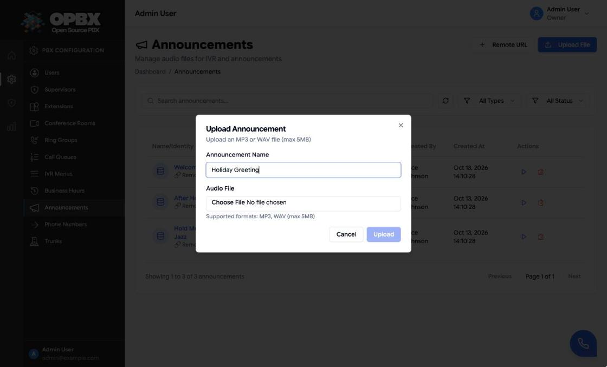
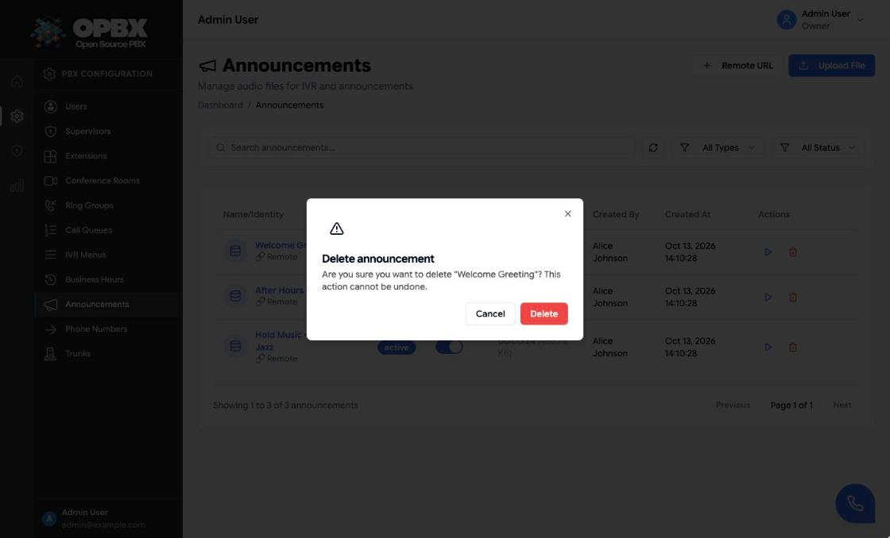

# Recordings (Announcements)

Recordings are the audio files OPBX plays to callers: IVR menu greetings, closed messages and call-queue hold music. In the application they are managed on the **Announcements** page. The old `/ui/recordings` address redirects there.

This page is about announcement audio. Recordings of **calls** are played from [Call Logs](/modules/call-logs).

## Purpose

Use this module to:

- upload an MP3 or WAV file;
- add a recording that lives at an outside URL;
- listen to a recording and download uploaded files;
- tag a recording as **hold music** so call queues can use it;
- delete recordings you no longer need.

## Permissions

| Action | Owner | PBX Admin | PBX User | Reporter |
|--------|:-----:|:---------:|:--------:|:--------:|
| See Announcements in the sidebar | Yes | Yes | No | No |
| List, play and download recordings | Yes | Yes | No | Yes |
| Upload, add remote, edit, tag as hold music, delete | Yes | Yes | No | No |

Reporters can list, play and download recordings through the API, and by opening `/ui/announcements` directly; the sidebar does not show them the link. The page shows the upload, tag and delete controls to everyone who opens it, but the server refuses those actions for Reporters.

Creating a recording needs a signed-in user. API keys cannot create recordings ("Creating recordings requires a user token; API keys cannot create recordings.").

## Add a recording

### Upload a file

1. Open **Announcements** in the sidebar.
2. Click **Upload File**.
3. Enter the **Announcement Name** and choose the **Audio File**.
4. Click **Upload**.

| Rule | Limit |
|------|-------|
| Name | Required, up to 255 characters |
| Format | MP3 or WAV only (`.mp3`, `.wav`) |
| Size | Up to 5 MB |
| Content check | The file header must look like MP3 or WAV audio. Files containing script or PHP markers are refused |

Uploaded files are stored in the deployment's S3-compatible storage (SeaweedFS in the standard Docker setup) under a folder for your organization.

### Add a remote URL

1. Click **Remote URL**.
2. Enter the **Announcement Name** and the **Remote URL**, for example `https://media.example.com/audio/welcome.mp3`.
3. Click **Add Announcement**.

The URL must start with `http://` or `https://`. If the deployment sets `RECORDINGS_ALLOWED_DOMAINS`, the host must be on that list, or the recording is refused with "Domain not allowed. Please contact administrator." OPBX does not copy the file; callers hear whatever the URL serves when the recording is played.

## The list

| Column | Meaning |
|--------|---------|
| Name and type | Uploaded or Remote |
| Status | Active or Inactive |
| Hold Music | Switch that adds or removes the hold-music tag |
| Size / Duration | For uploaded files |
| Created By, Created At | Who added it and when |
| Actions | Play or pause, download (uploaded files only), delete |

Filter by type (All Types, Uploaded, Remote) and status, or search by name. Click a row to see its details: type, status, creation date and the remote URL or original file name.

## Use a recording

| Where | How it is used |
|-------|----------------|
| [IVR Menus](/modules/ivr-menus) | The menu greeting, instead of text-to-speech |
| [Call Queues](/modules/call-queues) | Hold music. Only recordings with the **Hold Music** tag are offered |

Turn on the **Hold Music** switch in the list to tag a recording. A queue refuses a recording that is not tagged or belongs to another organization.

## Download

**Download** creates a short-lived access token (30 minutes by default) and fetches the file with it. Each download and delete is written to the access log.

## Edit

The API can change a recording's **name**, **status** and **hold-music tag**. The page changes the hold-music tag only. The file or URL cannot be replaced: add a new recording instead.

## Delete a recording

1. Click the delete icon on the row.
2. Confirm in the **Delete announcement** dialog.

The uploaded file is removed from storage and the recording is deleted.

:::caution Recordings in use are not protected
Unlike routing resources, a recording is deleted even while it is used. An IVR menu that played it loses its greeting, and a call queue that used it as hold music loses its hold music. Check your IVR menus and queues before you delete.
:::

## Common errors

| Message | What it means | What to do |
|---------|---------------|-----------|
| Only MP3 and WAV files are allowed. | Wrong file type | Convert the file to MP3 or WAV |
| File size must not exceed 5MB. | File too big | Compress or shorten it |
| URL must start with http:// or https://. | Remote URL in another form | Use a web address |
| Domain not allowed. Please contact administrator. | The host is not on the deployment allow-list | Use an allowed host, or ask the operator to add it |
| This action is unauthorized. | A Reporter or PBX User tried to change recordings | Ask an Owner or PBX Admin |

## Key data fields

### `recordings`

| Column | Notes |
|--------|-------|
| `id` | Primary key |
| `organization_id` | Tenant scope |
| `name` | Up to 255 characters |
| `type` | `upload` or `remote` |
| `file_path`, `original_filename`, `mime_type`, `file_size`, `duration_seconds` | Uploaded files |
| `remote_url` | Remote recordings |
| `status` | `active` or `inactive` |
| `is_moh` | Hold-music tag |
| `created_by`, `updated_by` | Users |

## Related API endpoints

| Method | Endpoint | Purpose |
|--------|----------|---------|
| GET | `/v1/recordings` | List. Filters: `status`, `search`, `moh=1` (hold music only) |
| POST | `/v1/recordings` | Create: `type` `upload` with `file`, or `remote` with `remote_url` |
| GET | `/v1/recordings/{recording}` | One recording |
| PUT | `/v1/recordings/{recording}` | Change `name`, `status` or `is_moh` |
| DELETE | `/v1/recordings/{recording}` | Delete |
| GET | `/v1/recordings/{recording}/download` | Get a download token |
| GET | `/v1/recordings/download` | Download with the token (Bearer header or `token` parameter) |

Scoped API keys use the `recordings` resource; an API key cannot create recordings.

See the [OPBX REST API reference](https://developers.cloudonix.com/opbxRestOpenAPI) for full schemas.

## Related modules

- [IVR Menus](/modules/ivr-menus) — menu greetings
- [Call Queues](/modules/call-queues) — hold music
- [Call Logs](/modules/call-logs) — recordings of calls
