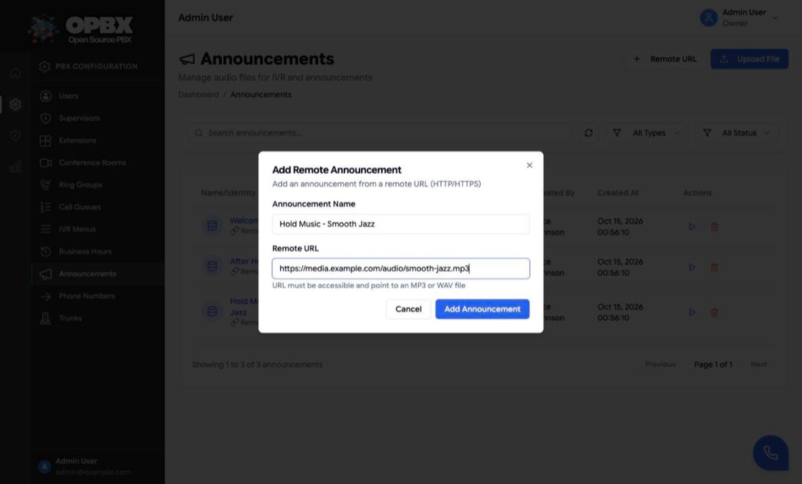
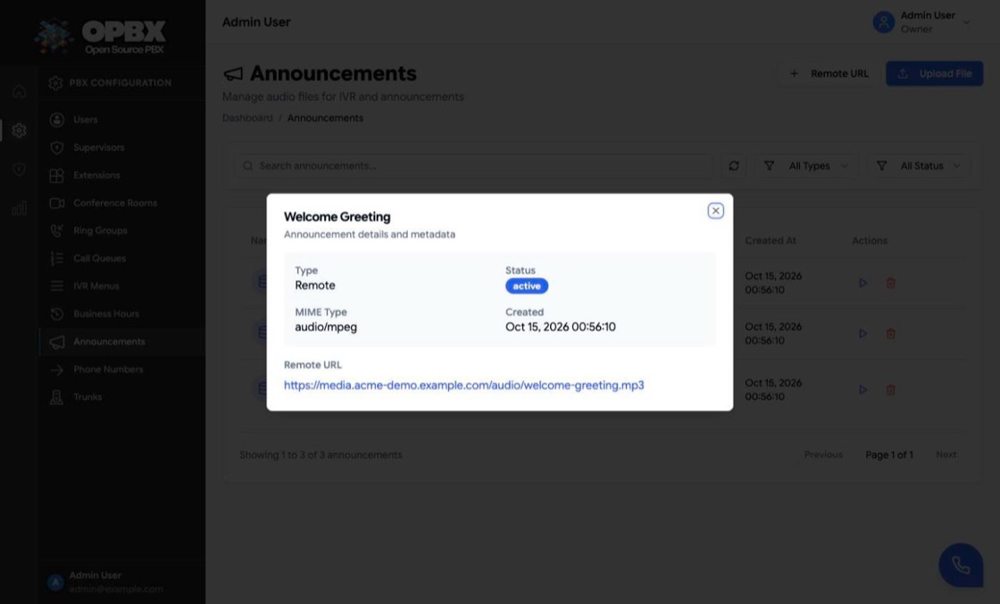

# Recordings (Announcements)

Recordings are the audio files OPBX plays to callers: IVR menu greetings, closed messages and call-queue hold music. In the application they are managed on the **Announcements** page. The old `/ui/recordings` address redirects there.

This page is about announcement audio. Recordings of **calls** are played from [Call Logs](/opbx/modules/call-logs).

## Purpose

Use this module to:

- upload an MP3 or WAV file;
- add a recording that lives at an outside URL;
- listen to a recording and download uploaded files;
- tag a recording as **hold music** so call queues can use it;
- delete recordings you no longer need.

## Permissions

| Action | Owner | PBX Admin | PBX User | Reporter |
|--------|:-----:|:---------:|:--------:|:--------:|
| See Announcements in the sidebar | Yes | Yes | No | No |
| List, play and download recordings | Yes | Yes | No | Yes |
| Upload, add remote, edit, tag as hold music, delete | Yes | Yes | No | No |

Reporters can list, play and download recordings through the API, and by opening `/ui/announcements` directly; the sidebar does not show them the link. For them the page hides **Upload File**, **Remote URL** and the delete action, and the **Hold Music** switch is disabled.

Creating or editing a recording needs a signed-in user. API keys cannot create recordings ("Creating recordings requires a user token; API keys cannot create recordings.") or update them ("Updating recordings requires a user token; API keys cannot update recordings.").

## Workflows

### Find a recording

**Who can do this:** Owner and PBX Admin from the sidebar; a Reporter by opening `/ui/announcements` (`RecordingPolicy::viewAny`).

1. Open **Announcements** in the sidebar.
2. Type in **Search announcements...** to filter by name.
3. Narrow the list with the type filter (**All Types**, **Uploaded**, **Remote**) and the status filter (**All Status**, **Active**, **Inactive**). **Clear Filters** resets all three.
4. Click the refresh button to reload the list.

### Upload a recording

**Who can do this:** Owner and PBX Admin (`RecordingPolicy::create`; the button is shown to these roles only).

1. Open **Announcements** in the sidebar.
2. Click **Upload File**.
3. In **Upload Announcement**, enter the **Announcement Name** and choose the **Audio File** (the picker offers `.mp3` and `.wav` files).
4. Click **Upload**. The button stays disabled until both fields are filled.

The dialog closes, the toast "Announcement created successfully" appears and the recording is listed as **Local**. If the server refuses the file, the toast shows its message (see [Common errors](#common-errors)).

| Rule | Limit |
|------|-------|
| Name | Required, up to 255 characters |
| Format | MP3 or WAV only (`.mp3`, `.wav`) |
| Size | Up to 5 MB |
| Content check | The file header must look like MP3 or WAV audio. Files containing script or PHP markers are refused |

Uploaded files are stored in the deployment's S3-compatible storage (SeaweedFS in the standard Docker setup) under a folder for your organization.

### Add a remote recording

**Who can do this:** Owner and PBX Admin (`RecordingPolicy::create`; the button is shown to these roles only).

1. Open **Announcements** in the sidebar.
2. Click **Remote URL**.
3. In **Add Remote Announcement**, enter the **Announcement Name** and the **Remote URL**, for example `https://media.example.com/audio/welcome.mp3`. The URL must be reachable and point to an MP3 or WAV file.
4. Click **Add Announcement**.

The dialog closes, the toast "Announcement created successfully" appears and the recording is listed as **Remote**.

The URL must start with `http://` or `https://`. If the deployment sets `RECORDINGS_ALLOWED_DOMAINS`, the host must be on that list, or the recording is refused with "Domain not allowed. Please contact administrator." OPBX does not copy the file; callers hear whatever the URL serves when the recording is played.

### Listen to a recording

**Who can do this:** Owner, PBX Admin and Reporter (`RecordingPolicy::view`).

1. Click the row's **Play** action. The recording plays in the browser and the action turns into **Pause**.
2. Click **Pause** to stop.

### View recording details

**Who can do this:** Owner, PBX Admin and Reporter.

1. Click the recording's row or name.

A dialog titled with the recording name shows its **Type**, **Status**, **MIME Type**, **Created** date and the **Remote URL** or **Original Filename**.

### Tag a recording as hold music

**Who can do this:** Owner and PBX Admin (`RecordingPolicy::update`). For other roles the switch is disabled.

1. In the Announcements list, turn on the recording's **Hold Music** switch.

The toast "Tagged as hold music" appears and call queues now offer the recording as hold music. Turn the switch off to remove the tag; the toast is "Removed hold music tag".

### Delete a recording

**Who can do this:** Owner and PBX Admin (`RecordingPolicy::delete`; the action is shown to these roles only).

1. Click the row's **Delete** action.
2. In **Delete announcement**, click **Delete**.

The toast "Announcement deleted successfully" appears. The uploaded file is removed from storage and the recording is deleted.

:::note Recordings in use cannot be deleted
If an IVR menu still plays the recording as its greeting, or a call queue uses it as hold music, the delete is refused and a dialog lists every place it is used. Change those first, then delete again. Call records never block a delete.
:::

## The list

| Column | Meaning |
|--------|---------|
| Name and type | **Local** (uploaded) or **Remote** |
| Status | Active or Inactive |
| Hold Music | Switch that adds or removes the hold-music tag |
| Size / Duration | For uploaded files |
| Created By, Created At | Who added it and when |
| Actions | **Play** or **Pause**, **Download** (uploaded files only), **Delete** (Owner and PBX Admin) |

## Use a recording

| Where | How it is used |
|-------|----------------|
| [IVR Menus](/opbx/modules/ivr-menus) | The menu greeting, instead of text-to-speech |
| [Call Queues](/opbx/modules/call-queues) | Hold music. Only recordings with the **Hold Music** tag are offered |

A queue refuses a recording that is not tagged or belongs to another organization.

## Download

**Download** creates a short-lived access token (30 minutes by default) and fetches the file with it. Each download and delete is written to the access log.

## Edit

The API can change a recording's **name**, **status** and **hold-music tag**. The page changes the hold-music tag only. The file or URL cannot be replaced: add a new recording instead.

## Common errors

| Message | What it means | What to do |
|---------|---------------|-----------|
| Only MP3 and WAV files are allowed. | Wrong file type | Convert the file to MP3 or WAV |
| File size must not exceed 5MB. | File too big | Compress or shorten it |
| URL must start with http:// or https://. | Remote URL in another form | Use a web address |
| Domain not allowed. Please contact administrator. | The host is not on the deployment allow-list | Use an allowed host, or ask the operator to add it |
| Please select a file to upload. / Please provide a remote URL. | The file or URL is missing | Fill it in |
| Please provide a valid URL. | The remote URL is not a valid address | Correct the URL |
| This action is unauthorized. | A Reporter or PBX User tried to change recordings through the API | Ask an Owner or PBX Admin |

## Key data fields

### `recordings`

| Column | Notes |
|--------|-------|
| `id` | Primary key |
| `organization_id` | Tenant scope |
| `name` | Up to 255 characters |
| `type` | `upload` or `remote` |
| `file_path`, `original_filename`, `mime_type`, `file_size`, `duration_seconds` | Uploaded files |
| `remote_url` | Remote recordings |
| `status` | `active` or `inactive` |
| `is_moh` | Hold-music tag |
| `created_by`, `updated_by` | Users |

## Related API endpoints

| Method | Endpoint | Purpose |
|--------|----------|---------|
| GET | `/v1/recordings` | List. Filters: `status`, `search`, `moh=1` (hold music only) |
| POST | `/v1/recordings` | Create: `type` `upload` with `file`, or `remote` with `remote_url` |
| GET | `/v1/recordings/{recording}` | One recording |
| PUT | `/v1/recordings/{recording}` | Change `name`, `status` or `is_moh` |
| DELETE | `/v1/recordings/{recording}` | Delete (409 with a usage list while an IVR menu or call queue uses it) |
| GET | `/v1/recordings/{recording}/download` | Get a download token |
| GET | `/v1/recordings/download` | Download with the token (Bearer header or `token` parameter) |

Scoped API keys use the `recordings` resource; an API key cannot create or update recordings.

See the [OPBX REST API reference](https://developers.cloudonix.com/opbxRestOpenAPI) for full schemas.

## Related modules

- [IVR Menus](/opbx/modules/ivr-menus) — menu greetings
- [Call Queues](/opbx/modules/call-queues) — hold music
- [Call Logs](/opbx/modules/call-logs) — recordings of calls
