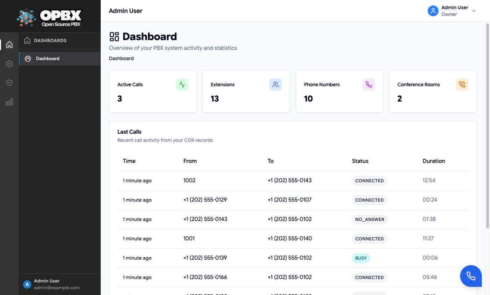

# Reporting and Analytics

OPBX has no single "Reports" page. Each kind of call data has its own page: the Dashboard, live views, call history, queue reports and campaign analytics. This page tells you which one to open for a given question, and who can see it.

## Purpose

Use this page to find:

- the report that answers your question;
- which roles can open it;
- which reports can be exported to CSV.

## Which report answers which question

| Question | Open | Sidebar section |
|----------|------|-----------------|
| What is happening right now, in numbers? | **Dashboard** | Dashboards |
| Which calls are up right now, and on which extension? | [Live Calls](/opbx/modules/live-calls) | Analytics |
| Who called whom, when, for how long, with what result? | [Call Logs](/opbx/modules/call-logs) | Analytics |
| How long are callers waiting in each queue, and which agents are free? | **Queues Dashboard** (see [Call Queues](/opbx/modules/call-queues#live-monitoring)) | Analytics |
| How did each queued call end (answered, abandoned, overflow)? | **Queue Reports** (see [Call Queues](/opbx/modules/call-queues#reporting)) | Analytics |
| How is an outbound campaign progressing? | Auto Dialer **Real Time Monitor** (see [Real-Time Monitor](/opbx/applications/auto-dialer/real-time-monitor)) | Apps and Security |
| Were our call events delivered to our webhook? | **Call Notifications**, delivery log (see [Call Notifications](/opbx/modules/call-notifications)) | Analytics |
| How often was a blocked caller turned away? | **Inbound Blacklist**, Blocked Count column (see [Inbound Blacklist](/opbx/modules/inbound-blacklist)) | Apps and Security |

## Who can see what

| Report | Owner | PBX Admin | PBX User | Reporter | Supervisor |
|--------|:-----:|:---------:|:--------:|:--------:|:----------:|
| Dashboard | Organization | Organization | Organization | Organization | Assigned scope |
| Live Calls | Yes | Yes | No | Yes, read-only | Assigned scope |
| Call Logs | Yes | Yes | Own calls only, read-only | Yes, read-only | Assigned scope, read-only |
| Call Logs CSV export (button) | Yes | Yes | No | No | No |
| Queues Dashboard, Queue Reports | Yes | Yes | No | Yes | No |
| Auto Dialer Real Time Monitor | Yes | Yes | No | Yes | No |
| Call Notifications delivery log | Yes | Yes | No | No | No |
| Inbound Blacklist counts | Yes | Yes | No | No | No |

"Assigned scope" means calls to or from the users and ring groups assigned to the Supervisor. See [Supervisors](/opbx/modules/supervisors).

"Own calls only" means calls of the PBX User's own extension(s) or to them, whatever Caller ID the call presented; the server enforces it on the list, single call, statistics and CSV export. See [Call Logs](/opbx/modules/call-logs).

The table shows what each role reaches through the sidebar. Several of these endpoints are readable by more roles through the API; the module pages describe the exact server rules.

## Workflows

### Read the Dashboard

Who can do this: every role. Every role lands on the Dashboard after signing in.

1. Open **Dashboard** in the sidebar (section **Dashboards**; for Supervisors, section **Supervisor**).
2. Read the counters: **Active Calls**, **Extensions**, **Phone Numbers** and **Conference Rooms**. Click a counter to open its page (Live Calls, Extensions, Phone Numbers or Conference Rooms).
3. Read **Last Calls**: the 10 most recent call records, with time, from, to, status and duration. When there are none, it reads "No recent calls".

The active-call counter refreshes every 15 seconds and the other cards every 30 seconds, only while the browser tab is visible.

Supervisors see their own variant with assigned users, assigned ring groups, active calls in scope and the last 5 calls in scope. See [Supervisors](/opbx/modules/supervisors#the-supervisors-dashboard).

### Export a report to CSV

Who can do this: Owner and PBX Admin for call records (the **Export** button is hidden for other roles); Owner, PBX Admin and Reporter for queue calls.

1. Open the report page and apply the filters you need.
2. Click **Export** (Call Logs) or **Export CSV** (Queue Reports). The browser downloads the CSV file.

The step-by-step workflows are on [Call Logs](/opbx/modules/call-logs#export-call-logs-to-csv) and [Call Queues](/opbx/modules/call-queues#reporting).

| Data | How to export | Format |
|------|---------------|--------|
| Call records | Call Logs → apply filters → **Export** | CSV, produced in chunks of 1000 rows |
| Queue calls | Queue Reports → apply filters → **Export CSV** | CSV |

Exports use the same filters as the list on screen. Call records older than 6 months are not in Call Logs; see [Call Logs → Retention and archive](/opbx/modules/call-logs#retention-and-archive).

## Call statistics

The call statistics are available through the API only (`GET /v1/call-detail-records/statistics`); the app has no screen for them. They cover the `from_date` to `to_date` range (default: the last 30 days) and the Supervisor scope for a Supervisor:

| Metric | Meaning |
|--------|---------|
| Total calls | Number of call records |
| Total duration | Sum of call durations, in seconds |
| Total billable seconds | Sum of answered (billed) seconds |
| Average duration | Average over calls with a duration above zero |
| Total cost | Sum of the sell cost reported by Cloudonix |
| By disposition | Count per final disposition, for example CONNECTED, NO_ANSWER, BUSY, FAILED |

Queue statistics (waiting and handling times, answered, abandoned and overflow counts) are on each queue's **Statistics** tab. See [Call Queues](/opbx/modules/call-queues#reporting).

## Data retention

| Data | Kept |
|------|------|
| Call records (Call Logs) | 6 months in the main database, then 6 more months in an archive reachable by API key, then 7 years in compressed files for the platform owner |
| Live-call events | 30 days |
| Queue calls, auto-dialer call sessions | 6 months |
| Call notification and blocked-call logs | 90 days |

Every period can be changed by environment variables. See the [Configuration Reference](/opbx/data-models/configuration/index#data-retention).

## Related API endpoints

| Method | Endpoint | Purpose |
|--------|----------|---------|
| GET | `/v1/call-detail-records` | Call records |
| GET | `/v1/call-detail-records/export` | CSV export |
| GET | `/v1/call-detail-records/statistics` | Totals and counts by disposition |
| GET | `/v1/session-updates/active` | Active calls |
| GET | `/v1/session-updates/active/stats` | Active-call counts and durations |
| GET | `/v1/queue-calls` | Queue call rows |
| GET | `/v1/queue-calls/export` | Queue call CSV export |
| GET | `/v1/dashboard/supervisor` | Supervisor dashboard data |

Scoped API keys can be limited to just these resources (for example `call-detail-records` and `dashboard` read-only). See [API Keys](/opbx/modules/api-keys).

See the [OPBX REST API reference](https://developers.cloudonix.com/opbxRestOpenAPI) for full schemas.

## Related modules

- [Call Logs](/opbx/modules/call-logs) — call history, filters, recordings and export
- [Live Calls](/opbx/modules/live-calls) — calls in progress
- [Call Queues](/opbx/modules/call-queues) — queue live views, statistics and reports
- [Supervisors](/opbx/modules/supervisors) — scoped reporting for team leads
