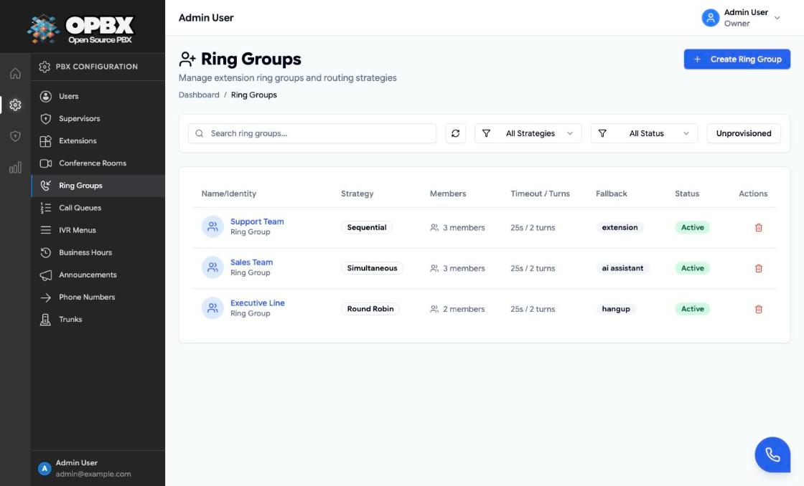
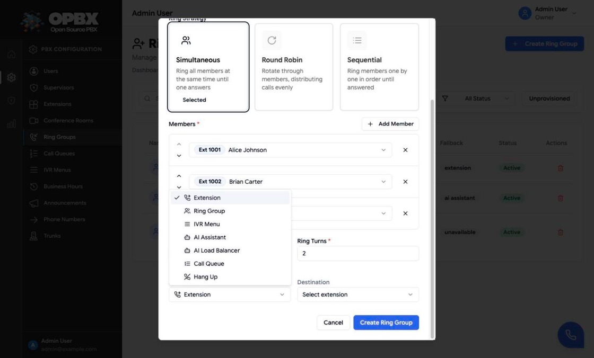
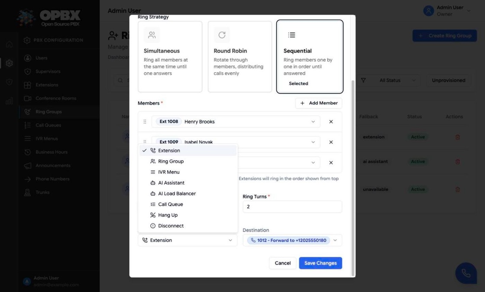
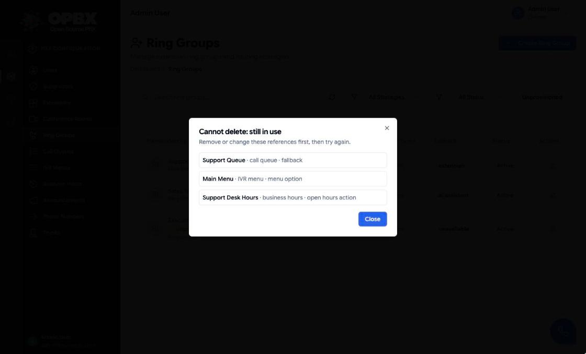

# Ring Groups

A ring group rings a set of extensions for one incoming call. The first member who answers takes the call. If nobody answers, the call goes to the group's **fallback** destination.

A ring group is **stateless**: members do not log in, and there are no waiting callers or statistics. For callers that should wait on hold until someone is free, use a [call queue](/opbx/modules/call-queues).

## Purpose

Use this module to:

- give a department one destination, for example "Sales Team";
- choose whether members ring together or one after another;
- set how long each member rings and how many rounds are tried;
- choose where unanswered calls go.

## Prerequisites

1. **Member extensions.** Members are extensions of type **User** or **Forward**, and they must be **active**. See [Extensions](/opbx/modules/extensions).
2. **A fallback destination (optional).** If you want unanswered calls to go somewhere other than a hangup, the target (extension, ring group, IVR menu, AI assistant, AI load balancer or call queue) must exist and be active.

## Permissions

| Action | Owner | PBX Admin | PBX User | Reporter | Supervisor |
|--------|:-----:|:---------:|:--------:|:--------:|:----------:|
| See Ring Groups in the sidebar | Yes | Yes | No | Yes | Yes |
| View ring groups | Yes | Yes | Yes (API) | Yes (read-only page) | Only the groups assigned to them |
| Create, edit, delete | Yes | Yes | No | No | No |
| Toggle status from the list | Yes | Yes | No | No | No |

Reporters and supervisors see the page with a **Read-Only** badge. Supervisor assignments are made on [Supervisors](/opbx/modules/supervisors).

## Workflows

### Find a ring group

**Who can do this:** Owner, PBX Admin and Reporter from the sidebar; a Supervisor sees only the groups assigned to them.

1. Open **Ring Groups** in the sidebar.
2. Type in **Search ring groups...** to filter by name.
3. Narrow the list with the strategy filter (**All Strategies**, **Simultaneous**, **Round Robin**, **Sequential**), the status filter (**All Status**, **Active**, **Disabled**) and the **Unprovisioned** button.
4. Click the refresh button to reload the list.

The list shows each group's name, **Strategy**, **Members** (count), **Timeout / Turns**, **Fallback** and **Status**. Click the **Strategy**, **Members** or **Status** column header to sort. An unprovisioned group carries the **Unprovisioned** badge next to its name.

### Create a ring group

**Who can do this:** Owner and PBX Admin (`RingGroupPolicy::create`; the **Create Ring Group** button is shown to these roles only).

1. Open **Ring Groups** in the sidebar.
2. Click **Create Ring Group**.
3. Enter the **Ring Group Name**.
4. Under **Ring Strategy**, click the **Simultaneous**, **Round Robin** or **Sequential** card (see [Strategies](#strategies)).
5. Click **Add Member** for each extension. Each click adds the next unused extension; change it with the row's list, which shows **Ext** *number* and the user's name (or **Forward to** *number* for a forward extension). Remove a row with its trash icon.
6. Set the ring order: for Sequential, drag rows by their handle; for the other strategies, use the up and down arrows.
7. Set **Extension Ring Timeout (seconds)** and **Ring Turns**.
8. Under **Fallback Action**, choose the **Action** and, unless it is **Hangup** ("No destination needed"), the **Destination**.
9. Click **Create Ring Group**.

The dialog closes, the toast "Ring group created successfully" appears and the group is listed as **Active**. It is now available as a destination everywhere in OPBX.

The form checks the name (2 to 100 characters), the member count (1 to 50), the timeout, the ring turns and that the fallback has a destination before it sends anything; errors appear under the field. Errors from the server appear as a toast (see [Common errors](#common-errors)). **Add Member** is disabled at 50 members or when every eligible extension is already in the group.

### Edit a ring group

**Who can do this:** Owner and PBX Admin (`RingGroupPolicy::update`). For other roles the rows do not open.

1. Click the group's name or row in the list.
2. Change the fields in **Edit Ring Group**.
3. Click **Save Changes**.

The toast "Ring group updated successfully" appears. Saving the dialog replaces the whole member list with the one shown.

### Enable or disable a ring group

**Who can do this:** Owner and PBX Admin (`RingGroupPolicy::update`). For Reporters and Supervisors the badge is not clickable.

1. In the Ring Groups list, click the group's **Active** or **Disabled** badge.

The status switches straight away and the toast "Ring group updated successfully" appears. A disabled group does not ring anybody: callers hear "Ring group is inactive" and the call ends.

### Disconnect the fallback

**Who can do this:** Owner and PBX Admin (`RingGroupPolicy::update`).

1. Open the group from the list.
2. Under **Fallback Action**, set **Action** to **Disconnect**.
3. Click **Save Changes**.

The fallback is stored as **Destination unavailable**: when nobody answers, callers hear "Destination doesn't exist" and the call ends. The group then shows the **Unprovisioned** badge next to its name in the list and in the dialog title, and the Action list shows the stored value as **Destination unavailable**.

The create dialog never offers Disconnect, and the API refuses it on create with "Choose a destination." A new group must have a real fallback.

Groups can also become unprovisioned when a user is deleted and the group's fallback pointed at that user's extension (see [User Management](/opbx/modules/user-management#delete-a-user)).

To find these groups, click the **Unprovisioned** filter in the toolbar. To fix one, open it and choose a new fallback.

### Delete a ring group

**Who can do this:** Owner and PBX Admin (`RingGroupPolicy::delete`; the **Delete** action is shown to these roles only).

1. Click the **Delete** (trash) action on the row.
2. In **Delete Ring Group**, click **Delete**.

The toast "Ring group deleted successfully" appears and the row disappears.

The delete is refused while other configuration still routes calls to the group. The dialog **Cannot delete: still in use** lists each place, for example:

- a phone number routed to the group;
- an IVR menu option or failover;
- another ring group's, call queue's or AI load balancer's fallback;
- a business-hours open or closed action;
- a call-tracking campaign destination;
- an extension of type Ring Group that points at it.

Change those first, then delete again. A group that falls back to itself does not block its own delete. Call history never blocks a delete.

## Fields

| Field | Limits and default | Meaning |
|-------|--------------------|---------|
| Ring Group Name | Required. 2 to 100 characters, unique within the organization | Shown in lists and destination pickers |
| Strategy | Simultaneous, Round Robin or Sequential. Default: Simultaneous | How members are rung |
| Members | Required. 1 to 50 extensions, each only once | Who is rung. Only active **User** and **Forward** extensions are offered and accepted |
| Extension Ring Timeout | 5 to 300 seconds. Default: 30 | How long the call rings (all members for Simultaneous, each member for the others) |
| Ring Turns | 1 to 9. Default: 2 | How many rounds through the member list (Sequential and Round Robin) |
| Fallback Action | Required. Default in the dialog: Extension | Where the call goes when nobody answers |
| Fallback destination | Required for every action except Hangup | The extension, group, menu, assistant, load balancer or queue |

The API also accepts a **description** (up to 1000 characters) and a **status**; the dialog does not show them. New groups are always Active.

### Strategies

| Strategy | What happens |
|----------|--------------|
| Simultaneous | All members ring at the same time for the ring timeout. The first to answer gets the call. If nobody answers, the fallback runs |
| Sequential | Members ring one at a time, in the order shown in the dialog, each for the ring timeout. The list is tried **Ring Turns** times, then the fallback runs |
| Round Robin | Rings members one at a time like Sequential, but each new call starts at the next member after the one the previous call started at. Retries for the same call continue from that member |

For Sequential, drag members by their handle to change the order; for Simultaneous and Round Robin the rows have up and down arrows instead. The top member rings first.

Only **active** member extensions are rung. An inactive member is skipped without an error. A **Forward** member rings its forward-to number or SIP address.

### Fallback actions

| Action | Where the call goes |
|--------|---------------------|
| Extension | One extension |
| Ring Group | Another ring group. The group being edited is not offered |
| IVR Menu | A menu |
| AI Assistant | An extension of type AI Assistant |
| AI Load Balancer | An AI load balancer |
| Call Queue | A call queue |
| Hangup | The caller hears "No agents available" and the call ends |
| Disconnect (edit only) | Stores **Destination unavailable**. See [Disconnect](#disconnect-the-fallback) |

The fallback target must belong to your organization and be **active** when you save. If it becomes inactive or is removed later, the call ends with the Hangup message instead.

## Routing calls to a ring group

A ring group appears as a destination in:

- **Phone numbers (DIDs)**: route a number to the group.
- **IVR menus**: as an option target or the failover.
- **Business hours**: as the open-hours or closed-hours action.
- **Other ring groups, call queues and AI load balancers**: as the fallback.
- **Call-tracking campaigns**: as the destination.

## Common errors

| Message | What it means | What to do |
|---------|---------------|-----------|
| A ring group with this name already exists in your organization. | Duplicate name | Choose another name |
| At least one member is required. / Maximum 50 members allowed per ring group. | Member count out of range | Add or remove members |
| Each extension can only be added once to a ring group. | The same extension twice | Remove the duplicate |
| Only user and forward extensions can be added to ring groups. Extension *n* is not allowed. | The extension is another type (AI assistant, conference and so on) | Pick a User or Forward extension |
| Only active extensions can be added to ring groups. Extension *n* is not active. | The extension is inactive | Activate it or pick another |
| Fallback … must be active. | The fallback target is inactive | Activate it or pick another |
| Choose a destination. | A create request used "Destination unavailable" | Pick a real fallback |
| Ring group is currently being modified. Please try again. | Someone else is saving the same group | Wait a moment and save again |
| This ring group is still used by: … | The delete was refused | Change the listed references, then delete |

## Key data fields

### `ring_groups`

| Column | Notes |
|--------|-------|
| `id` | Primary key |
| `organization_id` | Tenant scope |
| `name` | Unique within the organization |
| `description` | Optional, up to 1000 characters |
| `strategy` | `simultaneous`, `round_robin` or `sequential` |
| `timeout` | Ring timeout in seconds |
| `ring_turns` | Rounds through the member list |
| `fallback_action` | `extension`, `ring_group`, `ivr_menu`, `ai_assistant`, `ai_load_balancer`, `call_queue`, `hangup` or `unavailable` |
| `fallback_extension_id`, `fallback_ring_group_id`, `fallback_ivr_menu_id`, `fallback_ai_assistant_id`, `fallback_ai_load_balancer_id`, `fallback_call_queue_id` | Only the one matching the action is kept. `fallback_ai_assistant_id` points at an extension of type AI Assistant |
| `status` | `active` or `inactive` |

### `ring_group_members`

| Column | Notes |
|--------|-------|
| `ring_group_id` | The group |
| `extension_id` | The member extension |
| `priority` | 1 to 100. Ring order for Sequential and Round Robin |

## Related API endpoints

| Method | Endpoint | Purpose |
|--------|----------|---------|
| GET | `/v1/ring-groups` | List. Filters: `strategy`, `status`, `search`, `unprovisioned=1` |
| POST | `/v1/ring-groups` | Create. Rejects `unavailable` as the fallback |
| GET | `/v1/ring-groups/{ringGroup}` | One group with members |
| PUT | `/v1/ring-groups/{ringGroup}` | Update. Sending `members` replaces the list; omitting it keeps the list |
| DELETE | `/v1/ring-groups/{ringGroup}` | Delete. Returns 409 with `references` when in use |

Scoped API keys use the `ring-groups` resource. The MCP server has `list_ring_groups`, `get_ring_group`, `create_ring_group`, `update_ring_group` and `delete_ring_group`. See [API Keys](/opbx/modules/api-keys) and [MCP Server](/opbx/modules/mcp-server).

See the [OPBX REST API reference](https://developers.cloudonix.com/opbxRestOpenAPI) for full schemas.

## Related modules

- [Extensions](/opbx/modules/extensions) — members are extensions
- [Call Queues](/opbx/modules/call-queues) — a stateful alternative, and a possible fallback
- [Phone Numbers](/opbx/modules/phone-numbers) — route a number to a group
- [IVR Menus](/opbx/modules/ivr-menus) — route a menu option to a group
- [Business Hours](/opbx/modules/business-hours) — route open or closed hours to a group
- [Supervisors](/opbx/modules/supervisors) — assign groups to a supervisor
