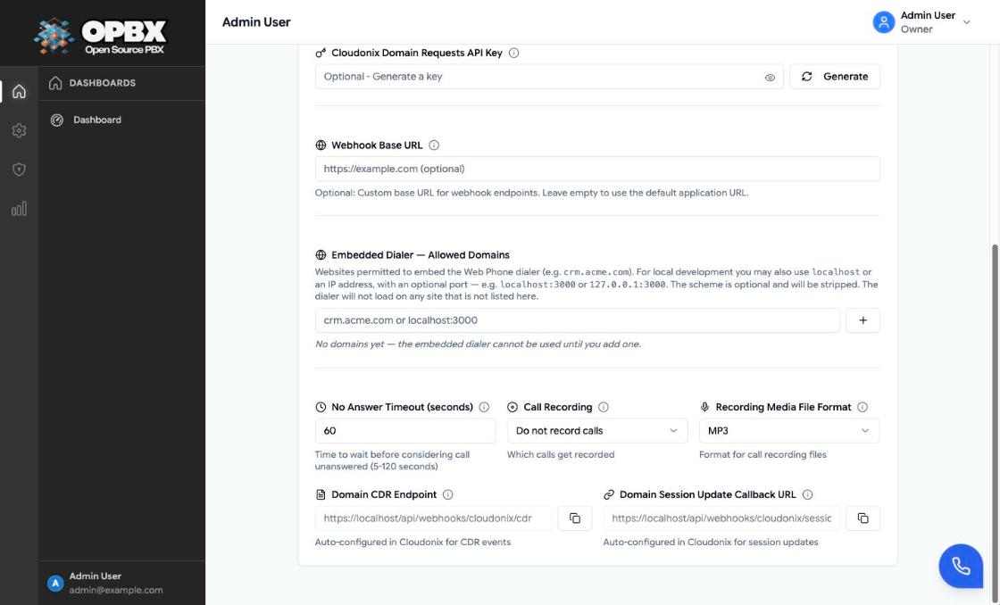

# Settings

The Settings page connects your organization to its Cloudonix domain. Until it is configured, OPBX cannot place or route calls, sync extensions, or list voice trunks. The same page holds organization-wide call options: the no-answer timeout, which calls are recorded, the recording file format, and the domains allowed to host the embedded dialer.

## Purpose

Use this page to:

- enter and validate your Cloudonix domain UUID and API key;
- create or rotate the key Cloudonix uses to authenticate its webhooks to OPBX;
- see (and, if allowed, override) the webhook URLs Cloudonix calls;
- set the no-answer timeout, call recording and recording format;
- list the domains allowed to embed the dialer.

## Prerequisites

- A Cloudonix domain and its **domain API key**. See [Cloudonix Setup](/opbx/installation/cloudonix-setup).
- You are the **Owner**.

## Permissions

| Action | Owner | PBX Admin | PBX User | Supervisor | Reporter |
|--------|:-----:|:---------:|:--------:|:----------:|:--------:|
| Open Settings (user menu at the top right) | Yes | No | No | No | No |
| Read, validate and save Cloudonix settings | Yes | No | No | No | No |
| Generate a webhook key | Yes | No | No | No | No |
| List voice trunks (`/settings/cloudonix/outbound-trunks`) | Yes | No | No | No | No |

Other roles do not see the **Settings** item in the user menu. If they open the address, they get an "Access denied" toast ("You do not have permission to access this page.") and are sent back to the dashboard; the API answers `403`. Settings endpoints are never available to [API keys](/opbx/modules/api-keys).

## How saving works

The page has a single save button, **Validate and Save Settings**, next to the credentials. Every change on the page, including the call options and the embedded dialer domains, is stored only when you click it. The button stays disabled until both **Cloudonix Domain UUID** and **Cloudonix Domain API Key** hold a value. After a save, the API key fields show a masked value (first and last characters, `***` in between); a masked value is never saved over the real key, and the stored key is used when you validate again.

What happens on **Validate and Save Settings**:

1. The UUID and key are checked against Cloudonix. If they are wrong, the badge next to the button shows **Invalid**, a "Validation failed" toast says "Invalid Cloudonix credentials. Please check your domain UUID and API key." and nothing is saved.
2. Values from your Cloudonix domain profile are copied into the form: the domain name, the call timeout (if it is between 5 and 120 seconds) and the recording format (if it is WAV or MP3). These replace what you typed in those two fields.
3. The settings are saved. The domain name always comes from Cloudonix; it cannot be typed in. It is shown under the UUID as "Cloudonix Domain: …".
4. If the organization has no webhook key yet, OPBX generates one.
5. OPBX pushes the call timeout, recording format, session-update URL, CDR URL and webhook key to the Cloudonix domain.
6. OPBX creates or updates the Cloudonix voice application that sends calls to OPBX (named `opbx-routing-application-…` when it is created) and makes it the domain's default.

A full-page "Saving Settings" overlay ("Validating and applying your configuration...") is shown while this runs. The badge then shows **Saved** and a "Settings validated and saved successfully" toast confirms the save. When the page loads for an organization that is already configured, the badge shows **Saved** straight away.

If saving locally works but the push to Cloudonix or the voice application setup fails, the API answers with a `warning` (for example "Settings saved locally, but failed to sync to Cloudonix: …" or "Failed to create voice application: …") and the page shows a warning toast, "Settings saved, but not synced to Cloudonix", with that text, instead of the success message. Check the logs if calls do not reach OPBX after a save.

## Workflows

### Open Settings

Who can do this: Owner.

1. Click your name at the top right.
2. Choose **Settings**.

The **Settings** page opens with the **Cloudonix Integration** card. If the installation has a configuration problem (for example production mode without `OPBX_APPLICATION_WEBHOOK_BASEURL`), a red **Configuration Warning** banner lists it above the card; click × to hide it for this visit.

### Connect your organization to Cloudonix

Who can do this: Owner.

1. [Open Settings](#open-settings).
2. Under **Cloudonix Integration**, enter the **Cloudonix Domain UUID** (format `xxxxxxxx-xxxx-xxxx-xxxx-xxxxxxxxxxxx`).
3. Enter the **Cloudonix Domain API Key**. Use the eye button to show or hide it.
4. Optionally set the other fields (see [Fields](#fields)).
5. Click **Validate and Save Settings**.

The badge shows **Saved**, the toast "Settings validated and saved successfully" appears, the Cloudonix domain name appears under the UUID, and the [webhook URLs](#webhook-urls) are filled in. See [How saving works](#how-saving-works) for what OPBX does in Cloudonix.

{/* SCREENSHOT: settings-cloudonix — Settings page, Cloudonix Integration card with Domain UUID, masked Domain API Key, the Validate and Save Settings button and a green Saved badge */}

### Replace the Cloudonix API key

Who can do this: Owner.

1. [Open Settings](#open-settings).
2. Clear the **Cloudonix Domain API Key** field (it shows the masked key) and type the new key.
3. Click **Validate and Save Settings**.

The new key is checked against Cloudonix before it is stored. The badge shows **Saved** and the field shows the new key masked.

### Generate a new webhook key

Who can do this: Owner.

1. [Open Settings](#open-settings).
2. Next to **Cloudonix Domain Requests API Key**, click **Generate**.
3. An amber **New API Key Generated** box shows the key. Click its copy button if you need the key elsewhere ("API Key copied to clipboard").
4. Click **Validate and Save Settings**.

The toast "API key generated successfully" appears when the key is created; the key takes effect, and is pushed to Cloudonix, only when you save. See [Webhook key](#webhook-key).

{/* SCREENSHOT: settings-webhook-key — Cloudonix Domain Requests API Key field with the amber "New API Key Generated" box and its copy button (key value blurred) */}

### Change the call options

Who can do this: Owner.

1. [Open Settings](#open-settings).
2. Set **No Answer Timeout (seconds)** (5 to 120).
3. Choose the **Call Recording** option (see [Fields](#fields)).
4. Choose the **Recording Media File Format**: **WAV** or **MP3**.
5. Click **Validate and Save Settings**.

The toast "Settings validated and saved successfully" appears and the values are pushed to the Cloudonix domain. If the Cloudonix domain profile already holds a call timeout or recording format, those values are read back on save and replace what you chose (step 2 of [How saving works](#how-saving-works)).

### Set a webhook base URL

Who can do this: Owner. Not available when the installation sets `OPBX_APPLICATION_WEBHOOK_BASEURL` (the field is then read-only).

1. [Open Settings](#open-settings).
2. In **Webhook Base URL**, enter the public base address of your OPBX, for example `https://pbx.example.com`. Leave it empty to use the application URL.
3. Click **Validate and Save Settings**.

The **Domain CDR Endpoint** and **Domain Session Update Callback URL** fields show the new addresses, and OPBX updates the Cloudonix domain and voice application to use them.

### Allow a website to embed the dialer

Who can do this: Owner.

1. [Open Settings](#open-settings).
2. Under **Embedded Dialer — Allowed Domains**, type a host name such as `crm.example.com` (or `localhost:3000` for local development).
3. Click the **+** button, or press Enter. The domain appears as a badge.
4. Click **Validate and Save Settings** to store the list.

The scheme (`https://`) and any path are removed and the entry is lowercased. An entry that is not a host name, `localhost` or an IPv4 address (optionally with `:port`) is refused with "Enter a valid hostname, localhost, or IP address (a port is allowed)."; a duplicate is refused with "Domain already added". See [Embedded Dialer](/opbx/modules/embedded-dialer).

### Remove an embedded dialer domain

Who can do this: Owner.

1. [Open Settings](#open-settings).
2. Click the × on the domain's badge.
3. Click **Validate and Save Settings**.

The dialer stops loading on that site. While the list is empty, the page shows "No domains yet — the embedded dialer cannot be used until you add one."

### Copy the webhook URLs

Who can do this: Owner.

1. [Open Settings](#open-settings).
2. At the bottom of the card, click the copy button next to **Domain CDR Endpoint** or **Domain Session Update Callback URL**.

A toast confirms "CDR Endpoint URL copied to clipboard" or "Callback URL copied to clipboard". OPBX already registers these URLs in Cloudonix on save; copy them only if you need to check or set them by hand.

## Fields

| Field | Required | Limits and default | Meaning |
|-------|----------|--------------------|---------|
| Cloudonix Domain UUID | Yes | A UUID. A UUID or Cloudonix domain used by another organization is refused | Identifies your Cloudonix domain |
| Cloudonix Domain API Key | Yes | Up to 255 characters | Authenticates OPBX to Cloudonix. Shown masked after saving; a masked value is never saved over the real key |
| Cloudonix Domain Requests API Key | No | Up to 255 characters. Generated automatically on the first save if empty | The key Cloudonix sends with every webhook so OPBX can check it. See [Webhook key](#webhook-key) |
| Webhook Base URL | No | A URL, up to 255 characters | Base for the URLs Cloudonix calls. Read-only when the installation sets the URL (see below) |
| Embedded Dialer — Allowed Domains | No | Hostnames, `localhost` or an IPv4 address, each with an optional port | Sites allowed to host the [embedded dialer](/opbx/modules/embedded-dialer). Empty list: the dialer cannot be embedded |
| No Answer Timeout (seconds) | Yes | 5 to 120. Default: 60 | How long a call rings before it counts as unanswered |
| Call Recording | Yes | See the next table. Default: Do not record calls | Which calls are recorded |
| Recording Media File Format | Yes | WAV or MP3. Default: MP3 | File format of call recordings |

| Call Recording option | Records |
|-----------------------|---------|
| Do not record calls | Nothing |
| Record all inbound calls | Calls from outside to your numbers |
| Record all outbound calls | Calls from extensions to outside numbers |
| Record all internal calls | Extension-to-extension calls |
| Record all inbound/outbound calls | Inbound and outbound, not internal |
| Record all calls (inbound/outbound/internal) | Everything |

Recordings appear in [Call Logs](/opbx/modules/call-logs) and can be played by the Owner, PBX Admins, Reporters and Supervisors (Supervisors only for the calls of their assigned users and ring groups).

## Webhook key

The **Cloudonix Domain Requests API Key** is a shared secret. Cloudonix sends it with every webhook, and OPBX can reject webhooks that do not carry it.

- **Generate** creates a new 32-character key and puts it in the field. An amber box shows it once with a copy button: "Save this key now - it will not be shown again after you save settings."
- The new key takes effect only after you click **Validate and Save Settings**, which also pushes it to Cloudonix.
- If you save with an empty field and no key exists, OPBX creates a 48-character key itself and pushes it. If that push fails, the key is removed again so Cloudonix is never left with a key OPBX would reject.

## Webhook URLs

At the bottom of the page, two read-only fields show the URLs OPBX registers in Cloudonix, each with a copy button. They show "(Not yet generated)" until a URL exists, and are hidden when the installation sets the webhook URL (see below).

| Field | URL |
|-------|-----|
| Domain CDR Endpoint | `{base}/api/webhooks/cloudonix/cdr` |
| Domain Session Update Callback URL | `{base}/api/webhooks/cloudonix/session-update` |

The base URL is chosen in this order:

1. `OPBX_APPLICATION_WEBHOOK_BASEURL`, if the installation sets it. The page then shows **Webhook Base URL (Application Level)** with the effective URL and "Managed by system administrator"; the per-organization field and the two URL fields are hidden.
2. The organization's **Webhook Base URL**.
3. The application URL (`APP_URL`).

Voice calls are sent to `{base}/api/voice/route` through the voice application created on save.

## Common errors

| Message | What it means | What to do |
|---------|---------------|-----------|
| The domain UUID must be a valid UUID format. | The UUID is malformed | Copy it again from Cloudonix |
| Invalid Cloudonix credentials. Please check your domain UUID and API key. | Cloudonix rejected them | Check the key and UUID in the Cloudonix console |
| This Cloudonix domain is already registered to another organization. | Another organization uses this domain | Use your own domain |
| The domain UUID has already been taken. | Another organization saved this UUID | Use your own domain |
| The no answer timeout must be at least 5 seconds. / must not exceed 120 seconds. | Out of range | Use 5 to 120 |
| Enter a valid hostname, localhost, or IP address (a port is allowed). | Wrong format when adding a domain | Enter a host name, `localhost` or an IPv4 address, optionally with `:port` |
| Each embed allowed domain must be a valid hostname, localhost, or IP address… | The API refused a saved domain | Same as above |
| Cannot validate with masked API key… | The key field holds the masked value and nothing is saved yet | Enter the full key |

## Key data fields

### `cloudonix_settings`

| Column | Notes |
|--------|-------|
| `organization_id` | One row per organization |
| `domain_uuid` | Unique across organizations |
| `domain_name` | From the Cloudonix domain profile |
| `domain_api_key` | Encrypted; returned masked |
| `domain_requests_api_key` | Webhook key; encrypted; returned masked |
| `webhook_base_url` | Optional override |
| `embed_allowed_domains` | List of allowed embed hosts |
| `no_answer_timeout` | 5 to 120 seconds |
| `call_recording_mode` | `disabled`, `inbound`, `outbound`, `internal`, `inbound_outbound` or `all` |
| `recording_format` | `wav` or `mp3` |
| `cloudonix_package` | Billing package name from Cloudonix |
| `voice_application_id`, `voice_application_uuid`, `voice_application_name` | The Cloudonix voice application OPBX manages |

## Related API endpoints

| Method | Endpoint | Purpose |
|--------|----------|---------|
| GET | `/v1/settings/cloudonix` | Settings (keys masked), callback and CDR URLs, webhook URL details |
| PUT | `/v1/settings/cloudonix` | Save, sync to Cloudonix and set up the voice application |
| POST | `/v1/settings/cloudonix/validate` | Check credentials and return profile values |
| POST | `/v1/settings/cloudonix/generate-requests-key` | Generate a webhook key (not saved until PUT) |
| GET | `/v1/settings/cloudonix/outbound-trunks` | Voice trunks of the domain |

See the [OPBX REST API reference](https://developers.cloudonix.com/opbxRestOpenAPI) for full schemas.

## Related modules

- [Cloudonix Setup](/opbx/installation/cloudonix-setup) — creating the domain and key
- [Trunks](/opbx/modules/trunks) and [Outbound Whitelist](/opbx/modules/outbound-whitelist) — use the domain's voice trunks
- [Extensions](/opbx/modules/extensions) — synced to Cloudonix subscribers
- [Embedded Dialer](/opbx/modules/embedded-dialer) — uses the allowed domains
- [Call Logs](/opbx/modules/call-logs) — recordings and call records
