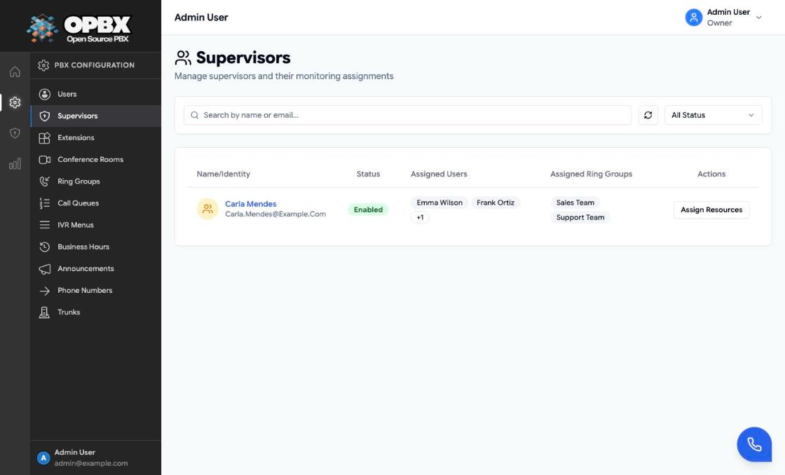
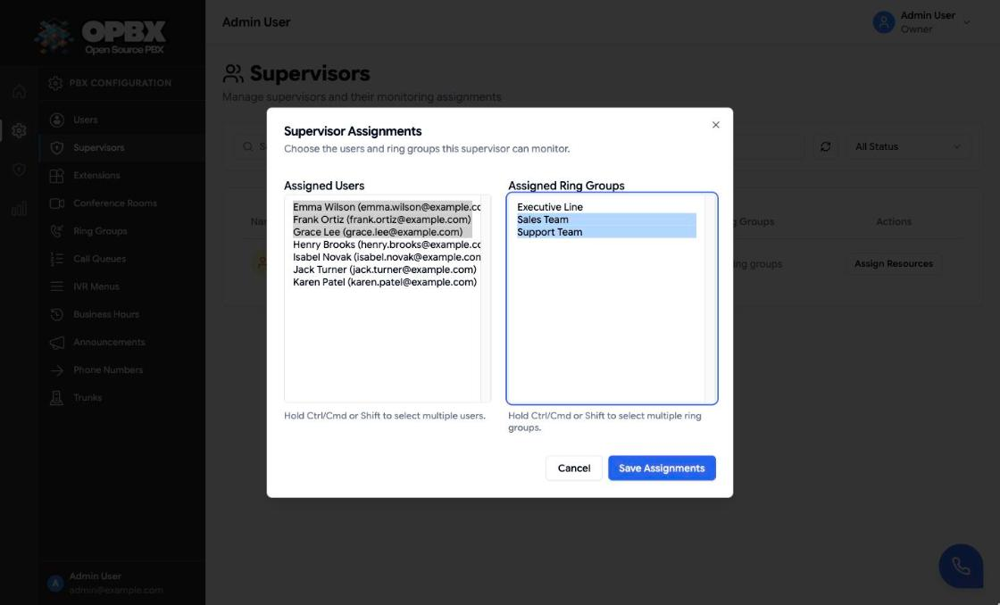

# Supervisors

A **Supervisor** is a team lead who watches and coaches calls but does not configure anything. Each Supervisor is assigned a set of **PBX users** and **ring groups**, and sees only calls that involve them: on the Dashboard, in Live Calls and in Call Logs.

## Purpose

Use the Supervisor role to:

- give a team lead a view of their team's live and recent calls;
- let them coach those calls (spy, whisper, barge) from the [Web Phone](/opbx/modules/web-phone);
- keep the rest of the organization's calls, configuration, exports and user management out of reach.

A [Reporter](/opbx/modules/user-management#roles) is the other read-only role. The difference: a Reporter sees all of the organization's data and cannot coach; a Supervisor sees only their assignment and can coach it.

## Prerequisites

- You are the **Owner** or a **PBX Admin**. Only they can open the Supervisors page and change assignments.
- The users to supervise have the **PBX User** role. Owners, PBX Admins, Reporters and other Supervisors cannot be assigned.
- To coach calls, the Supervisor needs a **user extension** of their own. Assign it on [Extensions](/opbx/modules/extensions); the user editor sets no extension for this role.

## What a Supervisor can do

| Page (Supervisor sidebar) | What the Supervisor gets |
|---------------------------|--------------------------|
| Dashboard | Counters for assigned users, assigned ring groups and active calls in scope; the 5 most recent calls in scope; lists of the assigned users and ring groups |
| Live Calls | Active calls in scope, read-only, with **Spy**, **Whisper** and **Barge** |
| Call Logs | Call records in scope, read-only. No Export button |
| Users | Themselves and their assigned users, view only |
| Ring Groups | Their assigned ring groups, view only |
| Call Queues | The queues where one of their assigned users, or the Supervisor, is an agent: list, detail, agents and live status, read only |

Every other page sends a Supervisor back to the Dashboard with "Access denied — Supervisors can only access their assigned dashboards and reports." A Supervisor cannot disconnect calls, export call logs, or change any configuration.

:::note Call Queues are read only
There is no queue assignment. A Supervisor sees a queue when at least one of their assigned users, or the Supervisor themselves, is one of its agents. Other queues are hidden from the list and refused with 403 when opened directly. A Supervisor cannot create, edit, delete or toggle a queue, cannot change another agent's state, and has no access to the queue reports or the Queues Dashboard.
:::

## How the scope is built

For each Supervisor, OPBX collects these identifiers:

- the IDs of the assigned users;
- the extension numbers of the assigned users' **user** extensions;
- the IDs of the assigned ring groups;
- the extension numbers of any **ring group** extensions that point at those ring groups.

Each identifier is also matched with a leading `+`, because live calls store extension numbers in E.164 form. A call is in scope when its caller or its destination matches one of them: `caller_id` or `destination` for live calls, `from` or `to` for call records.

A Supervisor with no assignments sees only their own calls. The scope always includes the Supervisor's own user and extension.

:::note
A ring group adds calls to the scope only if it has its own extension of type Ring group. Calls that reach a ring group straight from a phone number match only through the member who answers, when that member is an assigned user.
:::

## Permissions

| Action | Owner | PBX Admin | PBX User | Reporter | Supervisor |
|--------|:-----:|:---------:|:--------:|:--------:|:----------:|
| Open the Supervisors page | Yes | Yes | No | No | No |
| Create a Supervisor (on the Users page) | Yes | Yes | No | No | No |
| Change a Supervisor's assignments | Yes | Yes | No | No | No |
| Read a Supervisor's assignments | Yes | Yes | No | No | Their own |
| Enable or disable a Supervisor | Yes | Yes | No | No | No |

## Create a Supervisor

The Supervisors page has no create button. Create the account on the Users page:

1. Open **Users** and click **Add User**.
2. Enter name, email and password, and choose the role **Supervisor**.
3. Save. The **Supervisor Assignments** dialog opens straight away (next section).

To turn an existing user into a Supervisor, the **Owner** edits the user and changes the role to Supervisor. The assignment dialog opens after saving. Only the Owner can change roles; see [User Management](/opbx/modules/user-management).

## Assign users and ring groups

1. Open **Supervisors** in the sidebar (section **PBX Configuration**).
2. Click the Supervisor's name, or **Assign Resources** on their row.
3. In **Supervisor Assignments**, select entries in the two lists:
   - **Assigned Users**: the organization's PBX Users, shown as "name (email)";
   - **Assigned Ring Groups**: the organization's ring groups.

   Hold Ctrl (Cmd on a Mac) or Shift to select more than one.
4. Click **Save Assignments**.

Saving **replaces** the whole assignment with the current selection. A toast confirms "Supervisor assignments updated". The scope applies to the Supervisor's next page load or refresh.

### Assignment rules

| Rule | Message when broken |
|------|---------------------|
| The target user must have the Supervisor role | Target user is not a Supervisor. |
| A Supervisor cannot supervise themselves | A Supervisor cannot be assigned to themselves. |
| Only PBX Users can be supervised | Only PBX Users can be assigned as supervised users. |
| Users and ring groups must belong to the Supervisor's organization | All assigned users must belong to the same organization. / All assigned ring groups must belong to the same organization. |

Both lists may be empty: saving with nothing selected removes every assignment.

## The Supervisors list

| Column | Meaning |
|--------|---------|
| Name and email | Click to open the assignment dialog |
| Status | **Enabled** or **Disabled**. Click the badge to switch it; after you confirm, this sets the user Active or Inactive at once |
| Assigned Users | Up to two names, then "+*n*" |
| Assigned Ring Groups | Up to two names, then "+*n*" |
| Actions | **Assign Resources** |

Search by name or email and filter by status (All, Active, Inactive). When there are no Supervisors, the page shows "No supervisors yet".

A disabled Supervisor cannot sign in. Their assignments are kept.

## The Supervisor's Dashboard

When a Supervisor signs in, the Dashboard shows only their scope:

- **Assigned Users**, **Assigned Ring Groups** and **Active Calls** counters;
- **Recent Calls**: the last 5 call records in scope, with time, source number, source user, destination, status, duration and direction;
- the lists of assigned users (with extension numbers) and ring groups.

It refreshes every 30 seconds while the tab is visible.

{/* SCREENSHOT: supervisors-dashboard — Dashboard signed in as Carla Mendes, showing 3 assigned users, 2 assigned ring groups, active calls in scope and the Recent Calls table */}

## Coaching calls

A Supervisor coaches calls from **Live Calls** with **Spy**, **Whisper** or **Barge**. The server refuses a call outside the scope with "This call is outside your supervised scope". See [Live Calls](/opbx/modules/live-calls#coach-a-call-spy-whisper-barge).

## Real-time updates

Supervisors do not join the organization's WebSocket channel, because it carries every call in the organization. Their Live Calls page uses polling only.

:::note Scope is decided by role
On the call-list endpoints (`/v1/session-updates/active`, its statistics, `/v1/call-detail-records` and its export and statistics), the server always applies the Supervisor scope to a Supervisor. The `supervisor=true` flag is ignored. The scope includes the Supervisor's own user and extension, so their own calls are listed too.
:::

## Key data fields

### `supervisor_user_assignments`

| Column | Notes |
|--------|-------|
| `supervisor_id` | The Supervisor |
| `user_id` | A supervised PBX User |
| `organization_id` | Tenant scope |

### `supervisor_ring_group_assignments`

| Column | Notes |
|--------|-------|
| `supervisor_id` | The Supervisor |
| `ring_group_id` | A supervised ring group |
| `organization_id` | Tenant scope |

The role is stored as `supervisor` in `users.role`.

## Related API endpoints

| Method | Endpoint | Purpose |
|--------|----------|---------|
| GET | `/v1/supervisors/{user}/assignments` | A Supervisor's assigned users and ring groups |
| PUT | `/v1/supervisors/{user}/assignments` | Replace them. Body: `user_ids` and `ring_group_ids`, both required arrays (may be empty) |
| GET | `/v1/dashboard/supervisor` | Scoped dashboard data. Owners and PBX Admins get the whole organization |
| GET | `/v1/session-updates/active` | Live calls in scope |
| GET | `/v1/call-detail-records` | Call records in scope |
| POST | `/v1/session-updates/{sessionId}/coach-target` | Dial target for coaching |

Scoped API keys use the `supervisors` resource for the assignment endpoints.

See the [OPBX REST API reference](https://developers.cloudonix.com/opbxRestOpenAPI) for full schemas.

## Related modules

- [User Management](/opbx/modules/user-management) — create the Supervisor account and set roles
- [Live Calls](/opbx/modules/live-calls) — watch and coach calls
- [Call Logs](/opbx/modules/call-logs) — finished calls
- [Ring Groups](/opbx/modules/ring-groups) — the groups a Supervisor can be assigned
- [Web Phone](/opbx/modules/web-phone) — the softphone used for coaching
