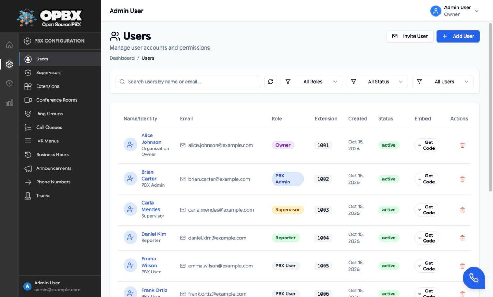
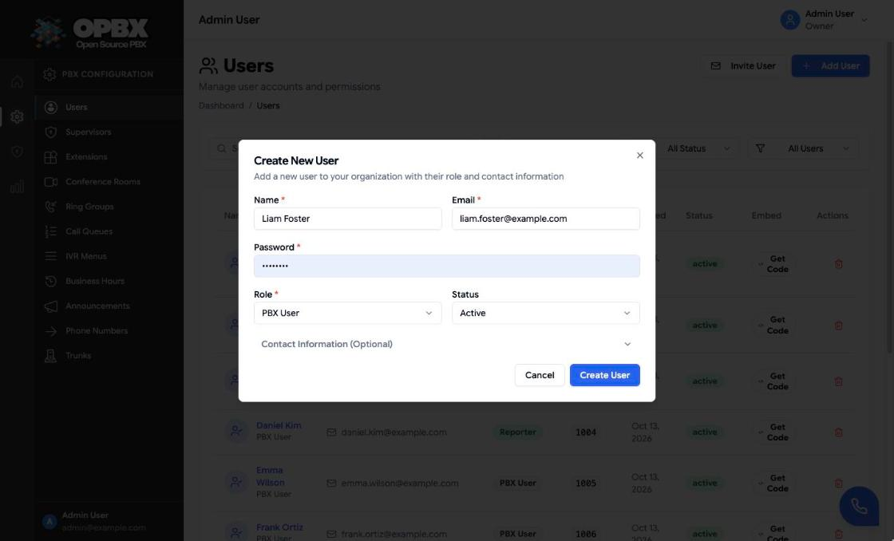

# User Management

The Users page controls who can sign in to your organization and what each person can do. Each user belongs to exactly one organization and has exactly one role.

## Purpose

Use this module to:

- add people to the organization;
- set each person's role;
- activate or deactivate accounts;
- set passwords;
- remove a person and see what that changes in routing.

## Prerequisites

- You are the **Owner** or a **PBX Admin**. A Supervisor sees a read-only Users page (see [Supervisors](/opbx/modules/supervisors)); PBX Users and Reporters do not have Users in the sidebar, and the server refuses them the list.
- For a PBX User to take queue calls or be called, give them an **extension**. See [Extensions](/opbx/modules/extensions).

## Roles

| Role | What it is for |
|------|----------------|
| **Owner** | Runs the organization. Full access, including role changes and Cloudonix settings |
| **PBX Admin** | Day-to-day administration of routing, numbers and users |
| **PBX User** | An employee with an extension. Manages their own profile and queue login |
| **Reporter** | Read-only access to reports, call logs and most configuration |
| **Supervisor** | Watches and coaches only the users and groups assigned to them. See [Supervisors](/opbx/modules/supervisors) |

:::info The Owner role
The **Owner** role cannot be assigned through the API or the Users page: the server refuses it with "Owner role cannot be assigned. Each organization has a single owner." An organization's Owner is set up when the organization is created. Only an Owner can change another user's role, and an Owner cannot change their own role.
:::

## Permissions

| Action | Owner | PBX Admin | PBX User | Reporter | Supervisor |
|--------|:-----:|:---------:|:--------:|:--------:|:----------:|
| See the user list | Yes | Yes | No | No | Yes (self and assigned users) |
| Open a user | Yes | Yes | Self only | Self only | Self and assigned users |
| Create a user | Yes | Yes, but not an Owner or PBX Admin account | No | No | No |
| Edit a user | Yes | Yes, with the limits below | Self only | No | No |
| Change a role | Yes, not their own | No | No | No | No |
| Activate or deactivate | Yes, not themselves, not an Owner account | Yes, same limits as Owner | No | No | No |
| Set a password | Yes, not their own (here) | PBX User and Reporter only | No | No | No |
| Delete | Yes, not themselves | Yes, not themselves and not an Owner | No | No | No |

PBX Admin limits when editing:

- an Admin cannot change anyone's role: role changes are refused for every role except the Owner;
- an Admin cannot edit an Owner account at all.

:::note Owner accounts
Only an Owner may edit, set the password of, deactivate, delete or get the embed code of an Owner account. For a PBX Admin, Owner rows cannot be opened and have no Delete or Get Code control. The last Owner of an organization can never be deleted ("Cannot delete the last owner in the organization.").
:::

## Workflows

### Find a user

Who can do this: Owner and PBX Admin (all users); Supervisor (themselves and their assigned users).

1. Open **Users** in the sidebar (section **PBX Configuration**; for Supervisors, section **Supervisor**).
2. Type in **Search users by name, email, or extension...**.
3. Narrow the list with the filters: **All Roles** (Owner, PBX Admin, PBX User, Reporter, Supervisor), **All Status** (Active, Inactive, Pending) and **All Users** (Has Extension, No Extension).
4. Click the **Email** or **Created** column header to sort. **Clear Filters** resets every filter.

The list shows 25 users per page; when there is more than one page, choose **Rows per page** (25, 50, 100) and use **Previous** and **Next**. The **Extension** column shows the user's extension number, or "-" when there is none.

### Create a user

Who can do this: Owner (any role except Owner) and PBX Admin (PBX User, Reporter or Supervisor).

1. Click **Add User**.
2. In **Create New User**, fill in **Name**, **Email** and **Password** (the requirements appear when you click the field).
3. Choose a **Role** and a **Status**.
4. Optionally open **Contact Information (Optional)** and fill in phone and address.
5. Click **Create User**.

A toast confirms "User created successfully" and the user appears in the list. When the role is **Supervisor**, the **Supervisor Assignments** dialog opens next; see [Supervisors](/opbx/modules/supervisors#assign-users-and-ring-groups-to-a-supervisor).

| Field | Required | Limit | Notes |
|-------|----------|-------|-------|
| Name | Yes | 2 to 255 characters | |
| Email | Yes | Valid email, up to 255 characters, unique within the organization | Used to sign in |
| Password | Yes | At least 8 characters, with letters (upper and lower case) and numbers | Set by the admin when you create the account |
| Role | Yes | PBX Admin, PBX User (default), Reporter, Supervisor | A PBX Admin who picks PBX Admin is refused with "PBX Admins can only create PBX Users or Reporters." The Owner role is not offered and the API refuses it |
| Status | No | Active (default), Inactive or Pending | Only Active users can sign in |
| Phone | No | Up to 50 characters | |
| Street address, city, state or province, postal code, country | No | 255, 100, 100, 20 and 100 characters | |

The new user has no extension. To give them one, see [Extensions](/opbx/modules/extensions).

### Invite a user

Who can do this: Owner and PBX Admin, when Auth0 sign-in is enabled for the deployment.

Without Auth0, **Invite User** is disabled and its tooltip reads "Invitations need Auth0, which is not configured on this server."

1. Click **Invite User**.
2. Enter the **Email** of the person to invite.
3. Click **Send Invitation**.

A toast confirms "Invitation sent successfully." The person is added to the list as a **PBX User** with status **Pending** and a name taken from the email address. The email link is valid for 24 hours; the person becomes Active when they accept it and sign in through Auth0. Change the role afterwards if needed.

Inviting the email of a user who is still Pending sends a new invitation. Inviting the email of any other existing user is refused with "A user with this email already exists in the organization." An organization can send at most 10 invitations per hour ("Invitation rate limit exceeded. Please try again later.").

{/* SCREENSHOT: users-invite-dialog — Invite User dialog with Email colleague@example.com filled in, Send Invitation button visible */}

### Edit a user

Who can do this: Owner (any user); PBX Admin (any user except an Owner). A Supervisor can open their own and their assigned users' details read-only (**User Details**, with **Close**).

1. Click the user's row or name. The **Edit User** dialog opens.
2. Change **Name**, **Email**, **Role** or the **Contact Information** fields.
3. Click **Save Changes**.

A toast confirms "User updated successfully". The status is not part of this dialog; see [Activate or deactivate a user](#activate-or-deactivate-a-user).

### Change a user's role

Who can do this: Owner only, and not on their own account.

1. Click the user's row to open **Edit User**.
2. Choose the new **Role**. For an Owner account the selector is disabled ("Cannot change role of organization owner").
3. Click **Save Changes**.

A PBX Admin who changes a role is refused. Choosing **Owner** is refused with "Owner role cannot be assigned. Each organization has a single owner." When the new role is **Supervisor**, the **Supervisor Assignments** dialog opens after the save.

### Set a user's password

Who can do this: Owner (any other user); PBX Admin (PBX Users and Reporters only). Nobody can set their own password here; use [your profile](/opbx/administration/profile) instead.

1. Click the user's row to open **Edit User**.
2. Click **Change Password**.
3. In **Change Password**, enter **New Password** and **Confirm Password** (at least 8 characters; both must match).
4. Click **Update Password**.

A toast confirms "Password updated successfully". When you are not allowed to change this user's password, the toast reads "Failed to update password" with "You are not authorized to change this user's password."

{/* SCREENSHOT: users-change-password-dialog — Change Password dialog for Frank Ortiz with New Password and Confirm Password filled (masked) */}

### Activate or deactivate a user

Who can do this: Owner and PBX Admin, not on their own account and never on an Owner account.

1. Click the status badge (**active**, **inactive** or **pending**) on the user's row. Owner rows have a plain badge that cannot be clicked.
2. Confirm **Deactivate User** (or **Activate User**) with **Deactivate** (or **Activate**).

A toast confirms "User status updated". A deactivated user cannot sign in; their extension, history and assignments are kept. Use this instead of deleting when someone leaves temporarily.

### Delete a user

Who can do this: Owner (any user except themselves; an Owner only while another Owner remains); PBX Admin (any user except themselves and Owners).

Deleting a user does not delete their extension. Before the delete is sent, the **Delete User** dialog lists exactly what will change, computed by the same code that performs the delete:

| What happens | Detail |
|--------------|--------|
| The user's extensions are kept | They are unassigned and can be given to a new user |
| Ring-group memberships | The user is removed. A ring group left with no members is allowed and is flagged "Will become EMPTY (no members left)" |
| Call-queue memberships | The user is removed. A queue left with no agents is allowed and is flagged the same way |
| Routes that pointed at those extensions | Changed to **Destination unavailable**. Callers hear "Destination doesn't exist" and the call ends |

The routes changed can be on IVR options and their failover, ring-group and queue fallbacks, AI load balancer fallbacks, phone numbers, business-hours actions and call-tracking campaigns.

1. Click the **Delete** icon (trash) on the user's row.
2. Read the list in **Delete User**. When nothing else changes it reads "No routing is affected."
3. Click **Delete User**.

A toast confirms "User deleted successfully" and the user leaves the list. Deleting the last Owner is refused with "Cannot delete the last owner in the organization."; deleting yourself is refused by the server.

After the delete, the routes that were changed show **Unprovisioned** in their own lists. Fix them by choosing a new destination on the edit screen. See [IVR Menus](/opbx/modules/ivr-menus) and [Phone Numbers](/opbx/modules/phone-numbers).

### Get a user's embedded dialer code

Who can do this: Owner and PBX Admin (not on Owner accounts, unless you are an Owner).

Click **Get Code** in the user's **Embed** column. The dialog and its settings are described in [Embedded Dialer](/opbx/modules/embedded-dialer#get-the-installation-snippet-for-a-user).

## Key data fields

### `users`

| Column | Notes |
|--------|-------|
| `id` | Primary key |
| `organization_id` | Tenant scope |
| `name` | Display name |
| `email` | Unique within the organization |
| `password` | Stored hashed |
| `role` | `owner`, `pbx_admin`, `pbx_user`, `reporter` or `supervisor` |
| `status` | `active` or `inactive` |
| `is_platform_manager` | Platform-level flag. Set by platform managers, not from this page |

## Related API endpoints

| Method | Endpoint | Purpose |
|--------|----------|---------|
| GET | `/v1/users` | List users |
| POST | `/v1/users` | Create a user |
| GET | `/v1/users/{user}` | One user |
| PUT | `/v1/users/{user}` | Update a user (role and status rules above apply) |
| PATCH | `/v1/users/{user}` | Same as PUT; the Supervisors page uses it to enable or disable a Supervisor |
| GET | `/v1/users/{user}/delete-impact` | The changes a delete would make, without deleting |
| DELETE | `/v1/users/{user}` | Delete (409 for the last Owner) |
| PATCH | `/v1/users/{user}/password` | Set a password |
| POST | `/v1/users/invite` | Invite by email (needs Auth0) |

See the [OPBX REST API reference](https://developers.cloudonix.com/opbxRestOpenAPI) for full schemas.

## Related modules

- [Extensions](/opbx/modules/extensions) — assign extensions to users
- [Supervisors](/opbx/modules/supervisors) — assign the users a supervisor can watch
- [Call Queues](/opbx/modules/call-queues) — queue agents
- [Organization Settings](/opbx/administration) — profile and Cloudonix integration
