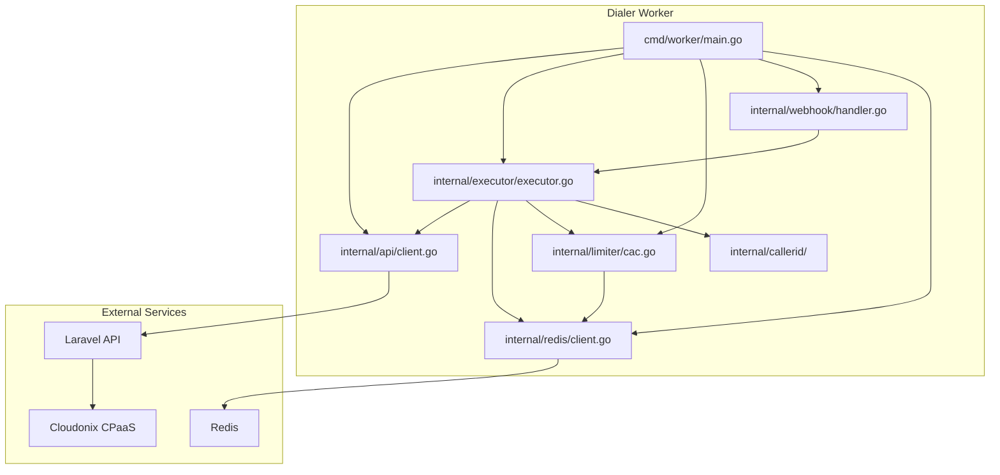

# Dialer Worker

The Dialer Worker is a Go-based service that executes outbound auto-dialer campaigns. It polls the Laravel API for active campaigns, rate-limits call initiation, and initiates calls through Cloudonix.

## Purpose

The worker handles:

- Polling for active campaigns every 10 seconds
- Fetching pending destinations from Laravel
- Enforcing CAC (Concurrent Active Calls) and CPS (Calls Per Second) limits
- Selecting Caller IDs from pools, and remembering which ones a destination already tried
- Initiating calls via the Laravel API
- Serving a health endpoint for the Real-Time Monitor's **Worker Health** card and the [Platform Status](/opbx/administration/platform-management#platform-status) page

## Architecture



## Build and Run

### Docker Compose (Recommended)

The worker starts automatically with the full OPBX stack:

```bash
docker compose up -d
```

### Local Development

```bash
cd dialer-worker

cp .env.example .env
# Edit .env with your configuration

make deps
make build
make run
```

The worker needs Go 1.25 (see `go.mod`). With an older local Go, build and test in Docker instead:

```bash
docker run --rm -v "$PWD/dialer-worker":/src -w /src golang:1.25-alpine sh -c 'go build ./... && go vet ./... && go test ./...'
```

### Makefile Targets

| Target | Description |
|--------|-------------|
| `make deps` | Download modules and run `go mod tidy` |
| `make build` | Build the `worker` binary |
| `make run` | Run with `go run` |
| `make test` | Run tests |
| `make test-coverage` | Run tests with coverage and write `coverage.html` |
| `make fmt` | Format Go code |
| `make lint` | Run `golangci-lint` |
| `make clean` | Remove the binary and coverage files |
| `make docker-build` | Build the `opbx-dialer-worker` Docker image |
| `make docker-run` | Run Docker container with `.env` |
| `make dev-setup` | Copy `.env.example` to `.env` |
| `make health` | Check worker health endpoint (`curl http://localhost:8081/webhooks/health`) |

## Environment Variables

These are the worker's own variables. In the compose stack they are filled from `.env` as shown in the last column.

| Variable | Default | Required | Description | Set in compose from |
|----------|---------|----------|-------------|---------------------|
| `LARAVEL_API_URL` | `http://localhost:8000` | Yes | Laravel API base URL | `DIALER_LARAVEL_API_URL` (default `http://nginx`) |
| `LARAVEL_API_TOKEN` | — | Yes | Bearer token for Laravel API. The worker refuses to start when it is empty or a shipped placeholder | `DIALER_WORKER_API_TOKEN` (required) |
| `REDIS_HOST` | `localhost` | Yes | Redis host | fixed `redis` |
| `REDIS_PORT` | `6379` | Yes | Redis port | fixed `6379` |
| `REDIS_PASSWORD` | — | No | Redis password | `REDIS_PASSWORD` |
| `REDIS_DB` | `0` | No | Redis database | fixed `0` |
| `WORKER_ID` | `worker-1` | Yes | Worker identifier, sent with each call | `DIALER_WORKER_ID` |
| `POLL_INTERVAL` | `10s` | No | Campaign polling interval (a Go duration such as `10s`) | `DIALER_POLL_INTERVAL` |
| `WEBHOOK_PORT` | `8081` | Yes | HTTP port of the worker's health endpoint (inside the container) | `DIALER_WEBHOOK_PORT` |

The compose stack publishes no host port for the worker. For local tools, `docker-compose.ports.yml` publishes the health port on `127.0.0.1:8181` (`DIALER_WEBHOOK_HOST_PORT`).

Laravel's side of the worker API is configured in `.env` too:

| Variable | Default | Description |
|----------|---------|-------------|
| `DIALER_WORKER_API_TOKEN` | — | The token Laravel accepts from the worker. Laravel refuses to boot in production when it is empty or a shipped placeholder |
| `DIALER_WORKER_API_TOKEN_SECONDARY` | — | A second accepted token, for rotating the token without downtime |
| `DIALER_WORKER_RATE_LIMIT` | `1000` | Worker API requests allowed per minute (per IP). Above it Laravel answers 429 |
| `DIALER_WORKER_HEALTH_URL` | `http://dialer-worker:8081/webhooks/health` | Address the Real-Time Monitor calls for the **Worker Health** card |
| `PLATFORM_STATUS_DIALER_URL` | `http://dialer-worker:8081/webhooks/health` | Address the Platform Status page probes |

:::note
The worker has no webhook endpoints. Call results come to Laravel from Cloudonix, and the worker only serves `GET /webhooks/health` on `WEBHOOK_PORT`. The old CDR webhook on the worker was removed, and `WEBHOOK_SECRET` is no longer read.
:::

:::note
Laravel uses a dedicated `dialer` Redis connection with **no key prefix** for all keys shared with the Go worker. This ensures both services read and write the same keys.
:::

## Campaign Lifecycle Overview

All calls go to `LARAVEL_API_URL` with `Authorization: Bearer <LARAVEL_API_TOKEN>`.

1. Every `POLL_INTERVAL` the worker calls `GET /api/v1/dialer/worker/campaigns/active`. Laravel returns only campaigns that are Active and inside their schedule (see [Campaign Scheduling](/opbx/applications/auto-dialer/scheduling)).
2. For each campaign it registers the CAC and CPS limits. A campaign still being processed from the previous poll is skipped, and at most 10 campaigns are processed at the same time.
3. It fetches pending destinations: `GET /api/v1/dialer/worker/campaigns/{id}/destinations/pending?limit=N`, where N is CPS × poll interval in seconds, capped at CAC.
4. For each destination, it waits for the CPS spacing (1000 ÷ CPS ms), reserves a CAC slot (an atomic Lua increment that refuses when the campaign is at its limit), selects a Caller ID, and calls `POST /api/v1/dialer/worker/calls/initiate` with an `Idempotency-Key` header (`{destination_id}-{dial_attempts}`), so a replayed request gets the original answer instead of a second call
5. If the initiate fails, the reserved slot is released. A `409` means another claim owns the destination and is skipped. A `429` makes the worker wait the `Retry-After` time (5 minutes when none is given) and stop that campaign's batch
6. Laravel receives the call result from Cloudonix and owns the active-call count; it decrements the count when the call ends
7. Retries are scheduled by Laravel from the result as well (see [Rate Limiting](/opbx/applications/auto-dialer/rate-limiting#attempts-and-retries))

The worker API also has routes the current worker does not call (`/campaigns/{id}/pause`, `/destinations/retry`, `/calls/generate-cxml`, `/calls/{session}/status`, `/calls/{session}/disposition`, `/state/persist`, `/state/{workerId}` and `/health`). `PATCH /calls/{session}/status` takes an optional `disposition`: an update without one only stores the session status and leaves the destination alone.

## Redis Key Patterns

| Key Pattern | Purpose |
|-------------|---------|
| `dialer:cac:{campaign_id}:active` | Active call counter per campaign (shared with Laravel, which decrements it) |
| `dialer:rr:{campaign_id}:position` | Round-robin position in the caller ID pool (24 hours) |
| `dialer:lru:{campaign_id}:timestamps` | Last-used times for the least-recently-used caller ID strategy (24 hours) |
| `dialer:retry:{campaign_id}:{destination_id}` | Caller IDs already tried for a destination (1 hour) |

## Replicas

Run **one** dialer-worker replica. The image runs as a non-root user (uid 10001), and the compose healthcheck calls `GET /webhooks/health` every 30 seconds. On `SIGTERM` the worker finishes in-flight initiates for up to 45 seconds (`stop_grace_period: 60s`). The compose file pins `replicas: 1`. The CPS (calls-per-second) limiter is held in the worker's memory and is not shared between replicas, so a second replica would double the rate. Do not scale this service with `--scale`.

## Troubleshooting

| Issue | Solution |
|-------|----------|
| Worker not dialing | Check `LARAVEL_API_URL` and `LARAVEL_API_TOKEN`; verify campaign status is `ACTIVE` |
| Health check unreachable | Check `WEBHOOK_PORT` and query `GET /webhooks/health` on that port (a `HEAD` request returns 404) |
| Worker exits at start with "LARAVEL_API_TOKEN is a shipped default" | Set `DIALER_WORKER_API_TOKEN` in `.env` to a real secret (`openssl rand -hex 32`) |
| Every request gets 401 | The worker's token does not match `DIALER_WORKER_API_TOKEN` (or the secondary token) in Laravel |
| CAC counter drift | Laravel reconciles the counter every minute (`dialer:reconcile-cac`, scheduled) |
| Dial rate doubled | More than one dialer-worker is running. Keep exactly one replica |

## Related Modules

- [Auto Dialer Campaigns](/opbx/modules/auto-dialer-campaigns) — Campaign configuration
- [Distribution Lists](/opbx/modules/distribution-lists) — Contact sources
- [Outbound Whitelist](/opbx/modules/outbound-whitelist) — Outbound trunk selection
